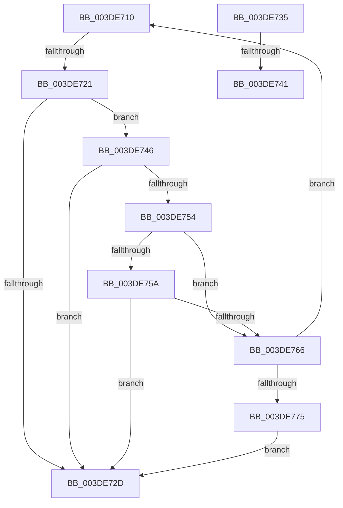

# sub_003DE710

- RVA: `0x003DE710`–`0x003DE777` (길이 `103` bytes)
- VA: `0x00000001403DE710`
- 실행 섹션: `.text`
- PDB 이름 있음: `아니요`; PDB Function 태그: `아니요`
- unwind 정보 RVA: `0x00094580`
- 디코드: `28`개 명령, `103/103` bytes 표시
- 미해석 바이트: `0` (있으면 어셈블리에 `.byte`로 보존)

> 이 문서는 커널 이미지의 기계어와 PDB 기호를 분석해 생성했습니다. 4번과 5번은 함수 원형과 자료형을 바이너리 사용 방식에서 추정한 C 해석이며 원본 소스 복구 결과는 아닙니다.

## 1. Dependencies

- 직접 호출 지점: **0**; 고유 호출 대상: **0**
- 직접 호출자로 확인된 함수: **0**
- RIP 상대 이미지 참조: **0**

### Outgoing calls
- 직접 디코드된 call 명령이 없습니다.

### Direct callers
- 이 함수 시작 RVA로 연결되는 직접 call은 확인되지 않았습니다. 간접 호출은 완전히 역산할 수 없습니다.

### Static image references
- 디코드된 RIP-relative 메모리 참조가 없습니다.

## 2. Other-region calls and transfers

- 다른 실행 섹션으로 향하는 call: **0**
- call이 아닌 외부 분기/꼬리 이동: **4**
  - `0x003DE71B` → [sub_003DE542 + 0x8C](Unknown_function_003DE542.md) (`tail-transfer`)
  - `0x003DE730` → [sub_003DE657 + 0x11](Unknown_function_003DE657.md) (`tail-transfer`)
  - `0x003DE73B` → [sub_003DE542 + 0x89](Unknown_function_003DE542.md) (`tail-transfer`)
  - `0x003DE741` → [sub_003DE657 + 0x8](Unknown_function_003DE657.md) (`tail-transfer`)

## 3. Assembly (complete function range)

```asm
003DE710  49 8B 4E 08                     mov rcx, qword ptr [r14 + 8]
003DE714  4D 8D 7E 08                     lea r15, [r14 + 8]
003DE718  48 3B CA                        cmp rcx, rdx
003DE71B  0F 87 AD FE FF FF               ja 0x1403de5ce
003DE721  4D 8B 36                        mov r14, qword ptr [r14]
003DE724  49 8D 46 01                     lea rax, [r14 + 1]
003DE728  48 3B C1                        cmp rax, rcx
003DE72B  74 19                           je 0x1403de746
003DE72D  45 3B C3                        cmp r8d, r11d
003DE730  E9 33 FF FF FF                  jmp 0x1403de668
003DE735  8D 4F FF                        lea ecx, [rdi - 1]
003DE738  49 85 C9                        test r9, rcx
003DE73B  0F 85 8A FE FF FF               jne 0x1403de5cb
003DE741  E9 19 FF FF FF                  jmp 0x1403de65f
003DE746  48 8B C1                        mov rax, rcx
003DE749  49 33 C6                        xor rax, r14
003DE74C  48 A9 00 00 F0 FF               test rax, -0x100000
003DE752  75 D9                           jne 0x1403de72d
003DE754  41 80 FC 01                     cmp r12b, 1
003DE758  74 0C                           je 0x1403de766
003DE75A  49 33 CE                        xor rcx, r14
003DE75D  48 F7 C1 F0 FF FF FF            test rcx, -0x10
003DE764  75 C7                           jne 0x1403de72d
003DE766  41 81 C0 00 10 00 00            add r8d, 0x1000
003DE76D  4D 8B F7                        mov r14, r15
003DE770  45 3B C3                        cmp r8d, r11d
003DE773  72 9B                           jb 0x1403de710
003DE775  EB B6                           jmp 0x1403de72d
```

## 4. C-style interpretation (structured pseudocode)

```c
__int64 __fastcall sub_003DE710(__int64 a1, __int64 a2, int a3, __int64 a4)
{
    __int64 result;

    if ((*(unsigned __int64 *)(v_r14) + 1) == (*(unsigned __int64 *)(v_r14 + 8))) goto loc_003DE746;
loc_003DE72D:
loc_003DE746:
    result = (*(unsigned __int64 *)(v_r14 + 8)) ^ (*(unsigned __int64 *)(v_r14));
    if (((result) & (0xFFFFFFFFFFF00000ULL)) != 0) goto loc_003DE72D;
    if (((unsigned __int8)(v_r12)) == 1) goto loc_003DE766;
    a1 = (*(unsigned __int64 *)(v_r14 + 8)) ^ (*(unsigned __int64 *)(v_r14));
    if (((a1) & (-16)) != 0) goto loc_003DE72D;
loc_003DE766:
    a3 = (unsigned int)((a3) + (0x1000ULL));
    if (a3 < ((unsigned int)(v_r11))) goto loc_003DE710;
    goto loc_003DE72D;
}
```

## 5. (Beta) C Style

```c
int64_t sub_003DE710(int64_t Arg1, int64_t Arg2, int32_t Arg3, int64_t Arg4)
{
    int64_t result;

    if ((*(uint64_t *)(local_r14) + 1) == (*(uint64_t *)(local_r14 + 0x8))) goto loc_003DE746;
loc_003DE72D:
loc_003DE746:
    result = (*(uint64_t *)(local_r14 + 0x8)) ^ (*(uint64_t *)(local_r14));
    if (((result) & (0xFFFFFFFFFFF00000ULL)) != 0) goto loc_003DE72D;
    if (((uint8_t)(local_r12)) == 1) goto loc_003DE766;
    Arg1 = (*(uint64_t *)(local_r14 + 0x8)) ^ (*(uint64_t *)(local_r14));
    if (((Arg1) & (-16)) != 0) goto loc_003DE72D;
loc_003DE766:
    Arg3 = (uint32_t)((Arg3) + (0x1000ULL));
    if (Arg3 < ((uint32_t)(local_r11))) goto loc_003DE710;
    goto loc_003DE72D;
}
```

## 6. Execution-region graph

[열기: 2D/3D 그래프와 함수 탐색 컨트롤 패널](../../../control-panel.html?section=text&rva=0x003DE710&view=graph)

- 2D 그래프는 위에서 아래로 흐르고, 3D 그래프는 빈 공간을 드래그해 회전합니다. Shift+드래그는 이동, 휠은 확대·축소, 함수 노드 선택은 대상 보고서 이동입니다.

### Static fallback


