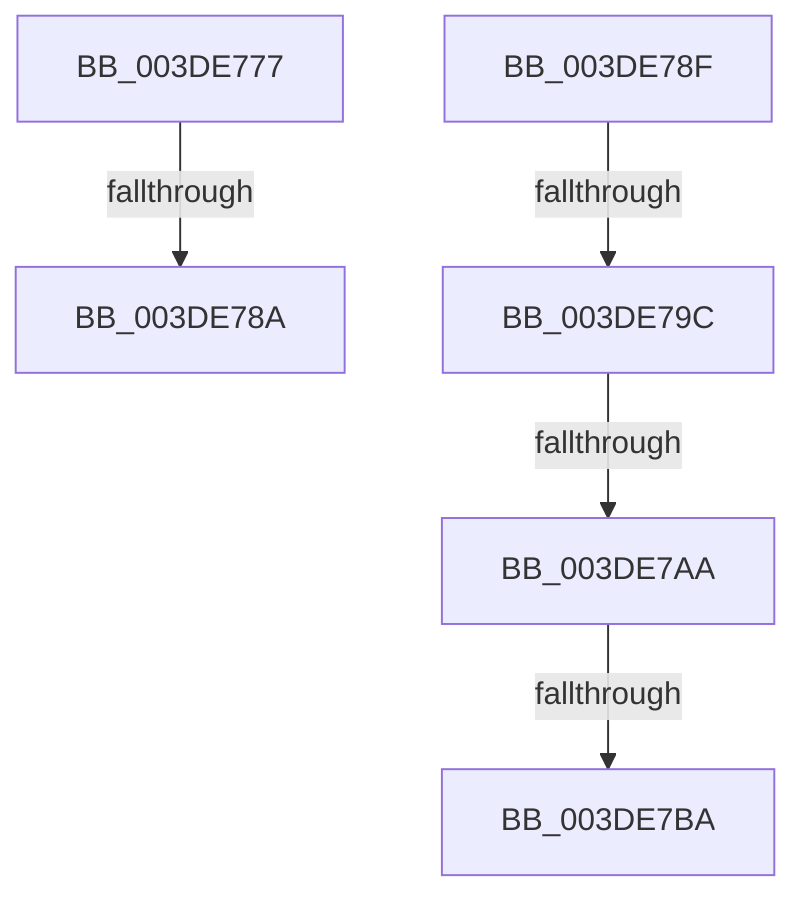

# sub_003DE777

- RVA: `0x003DE777`–`0x003DE7BF` (길이 `72` bytes)
- VA: `0x00000001403DE777`
- 실행 섹션: `.text`
- PDB 이름 있음: `아니요`; PDB Function 태그: `아니요`
- unwind 정보 RVA: `0x0009459C`
- 디코드: `17`개 명령, `72/72` bytes 표시
- 미해석 바이트: `0` (있으면 어셈블리에 `.byte`로 보존)

> 이 문서는 커널 이미지의 기계어와 PDB 기호를 분석해 생성했습니다. 4번과 5번은 함수 원형과 자료형을 바이너리 사용 방식에서 추정한 C 해석이며 원본 소스 복구 결과는 아닙니다.

## 1. Dependencies

- 직접 호출 지점: **0**; 고유 호출 대상: **0**
- 직접 호출자로 확인된 함수: **0**
- RIP 상대 이미지 참조: **0**

### Outgoing calls
- 직접 디코드된 call 명령이 없습니다.

### Direct callers
- 이 함수 시작 RVA로 연결되는 직접 call은 확인되지 않았습니다. 간접 호출은 완전히 역산할 수 없습니다.

### Static image references
- 디코드된 RIP-relative 메모리 참조가 없습니다.

## 2. Other-region calls and transfers

- 다른 실행 섹션으로 향하는 call: **0**
- call이 아닌 외부 분기/꼬리 이동: **6**
  - `0x003DE784` → [sub_003DE6C1 + 0x31](Unknown_function_003DE6C1.md) (`tail-transfer`)
  - `0x003DE78A` → [sub_003DE5E2 + 0x53](Unknown_function_003DE5E2.md) (`tail-transfer`)
  - `0x003DE796` → [sub_003DE5E2 + 0x5B](Unknown_function_003DE5E2.md) (`tail-transfer`)
  - `0x003DE7A4` → [sub_003DE5E2 + 0x5B](Unknown_function_003DE5E2.md) (`tail-transfer`)
  - `0x003DE7B4` → [sub_003DE5E2 + 0x65](Unknown_function_003DE5E2.md) (`tail-transfer`)
  - `0x003DE7BA` → [sub_003DE5E2 + 0x5B](Unknown_function_003DE5E2.md) (`tail-transfer`)

## 3. Assembly (complete function range)

```asm
003DE777  49 8B CA                        mov rcx, r10
003DE77A  48 33 CA                        xor rcx, rdx
003DE77D  48 F7 C1 F0 FF FF FF            test rcx, -0x10
003DE784  0F 84 68 FF FF FF               je 0x1403de6f2
003DE78A  E9 A6 FE FF FF                  jmp 0x1403de635
003DE78F  41 81 F8 00 10 00 00            cmp r8d, 0x1000
003DE796  0F 83 A1 FE FF FF               jae 0x1403de63d
003DE79C  41 8B C8                        mov ecx, r8d
003DE79F  C1 E1 0C                        shl ecx, 0xc
003DE7A2  3B C1                           cmp eax, ecx
003DE7A4  0F 83 93 FE FF FF               jae 0x1403de63d
003DE7AA  8B D0                           mov edx, eax
003DE7AC  8D 4F FF                        lea ecx, [rdi - 1]
003DE7AF  41 2B D0                        sub edx, r8d
003DE7B2  85 D1                           test ecx, edx
003DE7B4  0F 85 8D FE FF FF               jne 0x1403de647
003DE7BA  E9 7E FE FF FF                  jmp 0x1403de63d
```

## 4. C-style interpretation (structured pseudocode)

```c
void __fastcall sub_003DE777(__int64 a1, __int64 a2, int a3)
{
    a1 = (v_r10) ^ (a2);
}
```

## 5. (Beta) C Style

```c
void sub_003DE777(int64_t Arg1, int64_t Arg2, int32_t Arg3)
{
    Arg1 = (local_r10) ^ (Arg2);
}
```

## 6. Execution-region graph

[열기: 2D/3D 그래프와 함수 탐색 컨트롤 패널](../../../control-panel.html?section=text&rva=0x003DE777&view=graph)

- 2D 그래프는 위에서 아래로 흐르고, 3D 그래프는 빈 공간을 드래그해 회전합니다. Shift+드래그는 이동, 휠은 확대·축소, 함수 노드 선택은 대상 보고서 이동입니다.

### Static fallback


