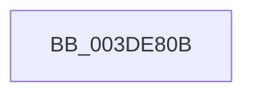

# sub_003DE80B

- RVA: `0x003DE80B`–`0x003DE84B` (길이 `64` bytes)
- VA: `0x00000001403DE80B`
- 실행 섹션: `.text`
- PDB 이름 있음: `아니요`; PDB Function 태그: `아니요`
- unwind 정보 RVA: `0x000945C0`
- 디코드: `15`개 명령, `64/64` bytes 표시
- 미해석 바이트: `0` (있으면 어셈블리에 `.byte`로 보존)

> 이 문서는 커널 이미지의 기계어와 PDB 기호를 분석해 생성했습니다. 4번과 5번은 함수 원형과 자료형을 바이너리 사용 방식에서 추정한 C 해석이며 원본 소스 복구 결과는 아닙니다.

## 1. Dependencies

- 직접 호출 지점: **0**; 고유 호출 대상: **0**
- 직접 호출자로 확인된 함수: **0**
- RIP 상대 이미지 참조: **0**

### Outgoing calls
- 직접 디코드된 call 명령이 없습니다.

### Direct callers
- 이 함수 시작 RVA로 연결되는 직접 call은 확인되지 않았습니다. 간접 호출은 완전히 역산할 수 없습니다.

### Static image references
- 디코드된 RIP-relative 메모리 참조가 없습니다.

## 2. Other-region calls and transfers

- 다른 실행 섹션으로 향하는 call: **0**
- call이 아닌 외부 분기/꼬리 이동: **1**
  - `0x003DE845` → [sub_003DE9F7](Unknown_function_003DE9F7.md) (`tail-transfer`)

## 3. Assembly (complete function range)

```asm
003DE80B  48 89 AC 24 A0 00 00 00         mov qword ptr [rsp + 0xa0], rbp
003DE813  48 8B 6B 20                     mov rbp, qword ptr [rbx + 0x20]
003DE817  48 89 74 24 78                  mov qword ptr [rsp + 0x78], rsi
003DE81C  48 8B 73 08                     mov rsi, qword ptr [rbx + 8]
003DE820  4C 89 64 24 70                  mov qword ptr [rsp + 0x70], r12
003DE825  44 8B 63 28                     mov r12d, dword ptr [rbx + 0x28]
003DE829  4C 89 7C 24 60                  mov qword ptr [rsp + 0x60], r15
003DE82E  8B 46 2C                        mov eax, dword ptr [rsi + 0x2c]
003DE831  03 46 28                        add eax, dword ptr [rsi + 0x28]
003DE834  4C 8B 7B 18                     mov r15, qword ptr [rbx + 0x18]
003DE838  2B C5                           sub eax, ebp
003DE83A  03 46 20                        add eax, dword ptr [rsi + 0x20]
003DE83D  4C 89 7C 24 40                  mov qword ptr [rsp + 0x40], r15
003DE842  45 85 E4                        test r12d, r12d
003DE845  0F 84 AC 01 00 00               je 0x1403de9f7
```

## 4. C-style interpretation (structured pseudocode)

```c
__int64 __fastcall sub_003DE80B(void)
{
    __int64 result;
    unsigned __int64 v_stack_p40;
    unsigned __int64 v_stack_p60;
    unsigned __int64 v_stack_p70;
    unsigned __int64 v_stack_p78;
    unsigned __int64 v_stack_pA0;

    v_stack_pA0 = v_rbp;
    v_stack_p78 = v_rsi;
    v_stack_p70 = v_r12;
    v_stack_p60 = v_r15;
    result = (unsigned int)(((unsigned int)(*(unsigned int *)(*(unsigned __int64 *)(v_rbx + 8) + 44))) + (*(unsigned int *)(*(unsigned __int64 *)(v_rbx + 8) + 40)));
    result = (unsigned int)((result) - ((unsigned int)(*(unsigned __int64 *)(v_rbx + 32))));
    result = (unsigned int)((result) + (*(unsigned int *)(*(unsigned __int64 *)(v_rbx + 8) + 32)));
    v_stack_p40 = *(unsigned __int64 *)(v_rbx + 24);
}
```

## 5. (Beta) C Style

```c
void sub_003DE80B(void)
{
    int64_t result;
    uint64_t v_stack_p40;
    uint64_t v_stack_p60;
    uint64_t v_stack_p70;
    uint64_t v_stack_p78;
    uint64_t v_stack_pA0;

    v_stack_pA0 = local_rbp;
    v_stack_p78 = local_rsi;
    v_stack_p70 = local_r12;
    v_stack_p60 = local_r15;
    result = (uint32_t)(((uint32_t)(*(uint32_t *)(*(uint64_t *)(local_rbx + 0x8) + 0x2C))) + (*(uint32_t *)(*(uint64_t *)(local_rbx + 0x8) + 0x28)));
    result = (uint32_t)((result) - ((uint32_t)(*(uint64_t *)(local_rbx + 0x20))));
    result = (uint32_t)((result) + (*(uint32_t *)(*(uint64_t *)(local_rbx + 0x8) + 0x20)));
    v_stack_p40 = *(uint64_t *)(local_rbx + 0x18);
}
```

## 6. Execution-region graph

[열기: 2D/3D 그래프와 함수 탐색 컨트롤 패널](../../../control-panel.html?section=text&rva=0x003DE80B&view=graph)

- 2D 그래프는 위에서 아래로 흐르고, 3D 그래프는 빈 공간을 드래그해 회전합니다. Shift+드래그는 이동, 휠은 확대·축소, 함수 노드 선택은 대상 보고서 이동입니다.

### Static fallback


