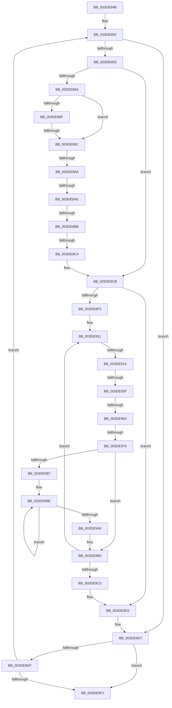

# sub_003DE84B

- RVA: `0x003DE84B`–`0x003DE9F7` (길이 `428` bytes)
- VA: `0x00000001403DE84B`
- 실행 섹션: `.text`
- PDB 이름 있음: `아니요`; PDB Function 태그: `아니요`
- unwind 정보 RVA: `0x000945E0`
- 디코드: `105`개 명령, `428/428` bytes 표시
- 미해석 바이트: `0` (있으면 어셈블리에 `.byte`로 보존)

> 이 문서는 커널 이미지의 기계어와 PDB 기호를 분석해 생성했습니다. 4번과 5번은 함수 원형과 자료형을 바이너리 사용 방식에서 추정한 C 해석이며 원본 소스 복구 결과는 아닙니다.

## 1. Dependencies

- 직접 호출 지점: **2**; 고유 호출 대상: **2**
- 직접 호출자로 확인된 함수: **0**
- RIP 상대 이미지 참조: **0**

### Outgoing calls
- `0x003DE93F` → [HalpDmaNextContiguousPieceV3](HalpDmaNextContiguousPieceV3_function_003DECFC.md) (function, `0x003DECFC`)
- `0x003DE955` → [HalpDmaGetAdapterVersion](HalpDmaGetAdapterVersion_function_003DEC8C.md) (function, `0x003DEC8C`)

### Direct callers
- 이 함수 시작 RVA로 연결되는 직접 call은 확인되지 않았습니다. 간접 호출은 완전히 역산할 수 없습니다.

### Static image references
- 디코드된 RIP-relative 메모리 참조가 없습니다.

## 2. Other-region calls and transfers

- 다른 실행 섹션으로 향하는 call: **0**
- call이 아닌 외부 분기/꼬리 이동: **9**
  - `0x003DE896` → [sub_003DEC6A](Unknown_function_003DEC6A.md) (`tail-transfer`)
  - `0x003DE89F` → [sub_003DEA82 + 0x3D](Unknown_function_003DEA82.md) (`tail-transfer`)
  - `0x003DE8A8` → [sub_003DEA82](Unknown_function_003DEA82.md) (`tail-transfer`)
  - `0x003DE8B5` → [sub_003DEA82](Unknown_function_003DEA82.md) (`tail-transfer`)
  - `0x003DE8BE` → [sub_003DEA82 + 0x8D](Unknown_function_003DEA82.md) (`tail-transfer`)
  - `0x003DE914` → [sub_003DEA82 + 0x85](Unknown_function_003DEA82.md) (`tail-transfer`)
  - `0x003DE939` → [sub_003DEA82 + 0x70](Unknown_function_003DEA82.md) (`tail-transfer`)
  - `0x003DE95D` → [sub_003DEA82 + 0x20](Unknown_function_003DEA82.md) (`tail-transfer`)
  - `0x003DE973` → [sub_003DEA44](Unknown_function_003DEA44.md) (`tail-transfer`)

## 3. Assembly (complete function range)

```asm
003DE84B  4C 89 6C 24 68                  mov qword ptr [rsp + 0x68], r13
003DE850  85 C0                           test eax, eax
003DE852  0F 84 7F 01 00 00               je 0x1403de9d7
003DE858  48 8B 0E                        mov rcx, qword ptr [rsi]
003DE85B  41 3B C4                        cmp eax, r12d
003DE85E  41 8B D4                        mov edx, r12d
003DE861  45 8B EC                        mov r13d, r12d
003DE864  0F 46 D0                        cmovbe edx, eax
003DE867  48 85 C9                        test rcx, rcx
003DE86A  41 8B C4                        mov eax, r12d
003DE86D  44 0F 45 EA                     cmovne r13d, edx
003DE871  2B C2                           sub eax, edx
003DE873  45 33 E4                        xor r12d, r12d
003DE876  48 85 C9                        test rcx, rcx
003DE879  44 0F 45 E0                     cmovne r12d, eax
003DE87D  44 89 A4 24 B8 00 00 00         mov dword ptr [rsp + 0xb8], r12d
003DE885  45 85 ED                        test r13d, r13d
003DE888  74 41                           je 0x1403de8cb
003DE88A  48 85 FF                        test rdi, rdi
003DE88D  74 0D                           je 0x1403de89c
003DE88F  80 BF B9 01 00 00 00            cmp byte ptr [rdi + 0x1b9], 0
003DE896  0F 84 CE 03 00 00               je 0x1403dec6a
003DE89C  4D 85 FF                        test r15, r15
003DE89F  0F 84 1A 02 00 00               je 0x1403deabf
003DE8A5  48 85 FF                        test rdi, rdi
003DE8A8  0F 84 D4 01 00 00               je 0x1403dea82
003DE8AE  80 BF BA 01 00 00 00            cmp byte ptr [rdi + 0x1ba], 0
003DE8B5  0F 84 C7 01 00 00               je 0x1403dea82
003DE8BB  45 84 F6                        test r14b, r14b
003DE8BE  0F 84 4B 02 00 00               je 0x1403deb0f
003DE8C4  49 8B C7                        mov rax, r15
003DE8C7  49 89 47 38                     mov qword ptr [r15 + 0x38], rax
003DE8CB  48 8B C5                        mov rax, rbp
003DE8CE  48 2B 46 20                     sub rax, qword ptr [rsi + 0x20]
003DE8D2  48 C1 E8 0C                     shr rax, 0xc
003DE8D6  8B C0                           mov eax, eax
003DE8D8  4C 8B 7C C6 30                  mov r15, qword ptr [rsi + rax*8 + 0x30]
003DE8DD  48 8B C5                        mov rax, rbp
003DE8E0  25 FF 0F 00 00                  and eax, 0xfff
003DE8E5  49 C1 E7 0C                     shl r15, 0xc
003DE8E9  4C 03 F8                        add r15, rax
003DE8EC  45 85 ED                        test r13d, r13d
003DE8EF  0F 84 DD 00 00 00               je 0x1403de9d2
003DE8F5  4C 8B 8F 90 00 00 00            mov r9, qword ptr [rdi + 0x90]
003DE8FC  44 0F B6 A7 BA 01 00 00         movzx r12d, byte ptr [rdi + 0x1ba]
003DE904  48 8B 5C 24 40                  mov rbx, qword ptr [rsp + 0x40]
003DE909  4C 89 8C 24 A8 00 00 00         mov qword ptr [rsp + 0xa8], r9
003DE911  45 84 E4                        test r12b, r12b
003DE914  0F 84 ED 01 00 00               je 0x1403deb07
003DE91A  8B 87 9C 00 00 00               mov eax, dword ptr [rdi + 0x9c]
003DE920  4C 8B CD                        mov r9, rbp
003DE923  44 89 6C 24 28                  mov dword ptr [rsp + 0x28], r13d
003DE928  4C 8B C3                        mov r8, rbx
003DE92B  44 88 74 24 20                  mov byte ptr [rsp + 0x20], r14b
003DE930  48 8B D6                        mov rdx, rsi
003DE933  48 8B CF                        mov rcx, rdi
003DE936  83 F8 02                        cmp eax, 2
003DE939  0F 84 B3 01 00 00               je 0x1403deaf2
003DE93F  E8 B8 03 00 00                  call 0x1403decfc
003DE944  4C 8B 8C 24 A8 00 00 00         mov r9, qword ptr [rsp + 0xa8]
003DE94C  44 8B C0                        mov r8d, eax
003DE94F  48 8B CF                        mov rcx, rdi
003DE952  45 2B E8                        sub r13d, r8d
003DE955  E8 32 03 00 00                  call 0x1403dec8c
003DE95A  83 E8 02                        sub eax, 2
003DE95D  0F 85 3F 01 00 00               jne 0x1403deaa2
003DE963  8D 50 01                        lea edx, [rax + 1]
003DE966  41 8B C8                        mov ecx, r8d
003DE969  49 03 CF                        add rcx, r15
003DE96C  48 8D 41 FF                     lea rax, [rcx - 1]
003DE970  4C 3B C8                        cmp r9, rax
003DE973  0F 83 CB 00 00 00               jae 0x1403dea44
003DE979  48 8B CD                        mov rcx, rbp
003DE97C  41 8B D0                        mov edx, r8d
003DE97F  48 81 C2 FF 0F 00 00            add rdx, 0xfff
003DE986  81 E1 FF 0F 00 00               and ecx, 0xfff
003DE98C  48 03 D1                        add rdx, rcx
003DE98F  48 C1 EA 0C                     shr rdx, 0xc
003DE993  85 D2                           test edx, edx
003DE995  74 19                           je 0x1403de9b0
003DE997  48 8B 44 24 40                  mov rax, qword ptr [rsp + 0x40]
003DE99C  8B CA                           mov ecx, edx
003DE99E  48 8B 40 08                     mov rax, qword ptr [rax + 8]
003DE9A2  48 83 E9 01                     sub rcx, 1
003DE9A6  75 F6                           jne 0x1403de99e
003DE9A8  48 89 44 24 40                  mov qword ptr [rsp + 0x40], rax
003DE9AD  48 8B D8                        mov rbx, rax
003DE9B0  41 8B C0                        mov eax, r8d
003DE9B3  48 03 E8                        add rbp, rax
003DE9B6  41 8B C0                        mov eax, r8d
003DE9B9  4C 03 F8                        add r15, rax
003DE9BC  45 85 ED                        test r13d, r13d
003DE9BF  0F 85 4C FF FF FF               jne 0x1403de911
003DE9C5  48 8B 5C 24 48                  mov rbx, qword ptr [rsp + 0x48]
003DE9CA  44 8B A4 24 B8 00 00 00         mov r12d, dword ptr [rsp + 0xb8]
003DE9D2  4C 8B 7C 24 40                  mov r15, qword ptr [rsp + 0x40]
003DE9D7  48 8B 36                        mov rsi, qword ptr [rsi]
003DE9DA  48 85 F6                        test rsi, rsi
003DE9DD  74 13                           je 0x1403de9f2
003DE9DF  8B 6E 2C                        mov ebp, dword ptr [rsi + 0x2c]
003DE9E2  48 03 6E 20                     add rbp, qword ptr [rsi + 0x20]
003DE9E6  8B 46 28                        mov eax, dword ptr [rsi + 0x28]
003DE9E9  45 85 E4                        test r12d, r12d
003DE9EC  0F 85 5E FE FF FF               jne 0x1403de850
003DE9F2  4C 8B 6C 24 68                  mov r13, qword ptr [rsp + 0x68]
```

## 4. C-style interpretation (structured pseudocode)

```c
__int64 __fastcall sub_003DE84B(__int64 a1, __int64 a2, __int64 a3, __int64 a4, __int64 a5, __int64 a6, __int64 a7, __int64 a8, __int64 a9, __int64 a10, __int64 a11, __int64 a12, __int64 a13, __int64 a14, __int64 a15, __int64 a16, __int64 a17, __int64 a18, __int64 a19, __int64 a20, __int64 a21, __int64 a22, unsigned int a23)
{
    __int64 result;
    __int64 v_r12;
    __int64 v_r13;
    __int64 v_r15;
    __int64 v_rbp;
    unsigned __int8 v_stack_p20;
    unsigned int v_stack_p28;
    unsigned __int64 v_stack_p40;
    unsigned __int64 v_stack_p68;
    unsigned __int64 v_stack_pA8;
    unsigned int v_stack_pB8;

    v_stack_p68 = v_r13;
loc_003DE850:
    if ((unsigned int)(result) == 0) goto loc_003DE9D7;
    a2 = (unsigned int)((unsigned int)(v_r12));
    if (((unsigned int)(result)) <= ((unsigned int)(v_r12))) { a2 = (unsigned int)(result); }
    v_r13 = (unsigned int)((unsigned int)(v_r12));
    if (*(unsigned __int64 *)(v_rsi) != 0) { v_r13 = (unsigned int)(a2); }
    result = (unsigned int)(((unsigned int)((unsigned int)(v_r12))) - ((unsigned int)(a2)));
    v_r12 = 0;
    if (*(unsigned __int64 *)(v_rsi) != 0) { v_r12 = (unsigned int)(result); }
    v_stack_pB8 = (unsigned int)(v_r12);
    if ((unsigned int)(v_r13) == 0) goto loc_003DE8CB;
    if (v_rdi == 0) goto loc_003DE89C;
loc_003DE89C:
    *(unsigned __int64 *)(v_r15 + 56) = v_r15;
loc_003DE8CB:
    result = (v_rbp) - (*(unsigned __int64 *)(v_rsi + 32));
    result = (result) >> (12);
    result = (unsigned int)((v_rbp) & (0xFFFULL));
    v_r15 = (*(unsigned __int64 *)(v_rsi + (unsigned int)((unsigned int)(result)) * 8 + 48)) << (12);
    v_r15 = (v_r15) + (result);
    if ((unsigned int)(v_r13) == 0) goto loc_003DE9D2;
    v_stack_pA8 = *(unsigned __int64 *)(v_rdi + 144);
loc_003DE911:
    v_stack_p28 = (unsigned int)(v_r13);
    v_stack_p20 = (unsigned __int8)(v_r14);
    result = HalpDmaNextContiguousPieceV3(v_rdi, v_rsi, a8, v_rbp);
    v_r13 = (unsigned int)((v_r13) - ((unsigned int)((unsigned int)((unsigned int)(result)))));
    result = HalpDmaGetAdapterVersion(v_rdi, v_rsi, (unsigned int)((unsigned int)(result)), a21);
    result = (unsigned int)((result) - (2));
    a1 = ((unsigned int)((unsigned int)((unsigned int)((unsigned int)(result))))) + (v_r15);
    a2 = ((unsigned int)((unsigned int)((unsigned int)((unsigned int)(result))))) + (0xFFFULL);
    a1 = (unsigned int)((v_rbp) & (0xFFFULL));
    a2 = (a2) + (a1);
    a2 = (a2) >> (12);
    if ((unsigned int)(a2) == 0) goto loc_003DE9B0;
loc_003DE99E:
    a1 = ((unsigned int)((unsigned int)(a2))) - (1);
    if (condition_is_not_equal) goto loc_003DE99E;
    v_stack_p40 = *(unsigned __int64 *)(a8 + 8);
loc_003DE9B0:
    v_rbp = (v_rbp) + ((unsigned int)((unsigned int)((unsigned int)((unsigned int)(result)))));
    v_r15 = (v_r15) + ((unsigned int)((unsigned int)((unsigned int)((unsigned int)(result)))));
    if ((unsigned int)(v_r13) != 0) goto loc_003DE911;
loc_003DE9D2:
loc_003DE9D7:
    if (*(unsigned __int64 *)(v_rsi) == 0) goto loc_003DE9F2;
    v_rbp = ((unsigned int)(*(unsigned int *)(*(unsigned __int64 *)(v_rsi) + 44))) + (*(unsigned __int64 *)(*(unsigned __int64 *)(v_rsi) + 32));
    if ((unsigned int)((unsigned int)(a23)) != 0) goto loc_003DE850;
loc_003DE9F2:
    return (unsigned int)(*(unsigned int *)(*(unsigned __int64 *)(v_rsi) + 40));
}
```

## 5. (Beta) C Style

```c
int64_t sub_003DE84B(int64_t Arg1, int64_t Arg2, int64_t Arg3, int64_t Arg4, uint64_t Arg5, uint64_t Arg6, uint64_t Arg7, int64_t Arg8, int64_t Arg9, uint64_t Arg10, uint64_t Arg11, uint64_t Arg12, int64_t Arg13, uint64_t Arg14, uint64_t Arg15, uint64_t Arg16, uint64_t Arg17, uint64_t Arg18, uint64_t Arg19, uint64_t Arg20, int64_t Arg21, uint64_t Arg22, uint32_t Arg23)
{
    int64_t result;
    int64_t local_r12;
    int64_t local_r13;
    int64_t local_r15;
    int64_t local_rbp;
    uint8_t v_stack_p20;
    uint32_t v_stack_p28;
    uint64_t v_stack_p40;
    uint64_t v_stack_p68;
    uint64_t v_stack_pA8;
    uint32_t v_stack_pB8;

    v_stack_p68 = local_r13;
loc_003DE850:
    if ((uint32_t)(result) == 0) goto loc_003DE9D7;
    Arg2 = (uint32_t)((uint32_t)(local_r12));
    if (((uint32_t)(result)) <= ((uint32_t)(local_r12))) { Arg2 = (uint32_t)(result); }
    local_r13 = (uint32_t)((uint32_t)(local_r12));
    if (*(uint64_t *)(local_rsi) != 0) { local_r13 = (uint32_t)(Arg2); }
    result = (uint32_t)(((uint32_t)((uint32_t)(local_r12))) - ((uint32_t)(Arg2)));
    local_r12 = 0;
    if (*(uint64_t *)(local_rsi) != 0) { local_r12 = (uint32_t)(result); }
    v_stack_pB8 = (uint32_t)(local_r12);
    if ((uint32_t)(local_r13) == 0) goto loc_003DE8CB;
    if (local_rdi == 0) goto loc_003DE89C;
loc_003DE89C:
    *(uint64_t *)(local_r15 + 0x38) = local_r15;
loc_003DE8CB:
    result = (local_rbp) - (*(uint64_t *)(local_rsi + 0x20));
    result = (result) >> (12);
    result = (uint32_t)((local_rbp) & (0xFFFULL));
    local_r15 = (*(uint64_t *)(local_rsi + (uint32_t)((uint32_t)(result)) * 8 + 0x30)) << (12);
    local_r15 = (local_r15) + (result);
    if ((uint32_t)(local_r13) == 0) goto loc_003DE9D2;
    v_stack_pA8 = *(uint64_t *)(local_rdi + 0x90);
loc_003DE911:
    v_stack_p28 = (uint32_t)(local_r13);
    v_stack_p20 = (uint8_t)(local_r14);
    result = HalpDmaNextContiguousPieceV3(local_rdi, local_rsi, Arg8, local_rbp);
    local_r13 = (uint32_t)((local_r13) - ((uint32_t)((uint32_t)((uint32_t)(result)))));
    result = HalpDmaGetAdapterVersion(local_rdi, local_rsi, (uint32_t)((uint32_t)(result)), Arg21);
    result = (uint32_t)((result) - (2));
    Arg1 = ((uint32_t)((uint32_t)((uint32_t)((uint32_t)(result))))) + (local_r15);
    Arg2 = ((uint32_t)((uint32_t)((uint32_t)((uint32_t)(result))))) + (0xFFFULL);
    Arg1 = (uint32_t)((local_rbp) & (0xFFFULL));
    Arg2 = (Arg2) + (Arg1);
    Arg2 = (Arg2) >> (12);
    if ((uint32_t)(Arg2) == 0) goto loc_003DE9B0;
loc_003DE99E:
    Arg1 = ((uint32_t)((uint32_t)(Arg2))) - (1);
    if (condition_is_not_equal) goto loc_003DE99E;
    v_stack_p40 = *(uint64_t *)(Arg8 + 0x8);
loc_003DE9B0:
    local_rbp = (local_rbp) + ((uint32_t)((uint32_t)((uint32_t)((uint32_t)(result)))));
    local_r15 = (local_r15) + ((uint32_t)((uint32_t)((uint32_t)((uint32_t)(result)))));
    if ((uint32_t)(local_r13) != 0) goto loc_003DE911;
loc_003DE9D2:
loc_003DE9D7:
    if (*(uint64_t *)(local_rsi) == 0) goto loc_003DE9F2;
    local_rbp = ((uint32_t)(*(uint32_t *)(*(uint64_t *)(local_rsi) + 0x2C))) + (*(uint64_t *)(*(uint64_t *)(local_rsi) + 0x20));
    if ((uint32_t)((uint32_t)(Arg23)) != 0) goto loc_003DE850;
loc_003DE9F2:
    return (uint32_t)(*(uint32_t *)(*(uint64_t *)(local_rsi) + 0x28));
}
```

## 6. Execution-region graph

[열기: 2D/3D 그래프와 함수 탐색 컨트롤 패널](../../../control-panel.html?section=text&rva=0x003DE84B&view=graph)

- 2D 그래프는 위에서 아래로 흐르고, 3D 그래프는 빈 공간을 드래그해 회전합니다. Shift+드래그는 이동, 휠은 확대·축소, 함수 노드 선택은 대상 보고서 이동입니다.

### Static fallback


