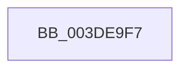

# sub_003DE9F7

- RVA: `0x003DE9F7`–`0x003DEA26` (길이 `47` bytes)
- VA: `0x00000001403DE9F7`
- 실행 섹션: `.text`
- PDB 이름 있음: `아니요`; PDB Function 태그: `아니요`
- unwind 정보 RVA: `0x000945F4`
- 디코드: `10`개 명령, `47/47` bytes 표시
- 미해석 바이트: `0` (있으면 어셈블리에 `.byte`로 보존)

> 이 문서는 커널 이미지의 기계어와 PDB 기호를 분석해 생성했습니다. 4번과 5번은 함수 원형과 자료형을 바이너리 사용 방식에서 추정한 C 해석이며 원본 소스 복구 결과는 아닙니다.

## 1. Dependencies

- 직접 호출 지점: **1**; 고유 호출 대상: **1**
- 직접 호출자로 확인된 함수: **0**
- RIP 상대 이미지 참조: **0**

### Outgoing calls
- `0x003DEA02` → [IoFreeMapRegistersV2](IoFreeMapRegistersV2_function_003DF440.md) (function, `0x003DF440`)

### Direct callers
- 이 함수 시작 RVA로 연결되는 직접 call은 확인되지 않았습니다. 간접 호출은 완전히 역산할 수 없습니다.

### Static image references
- 디코드된 RIP-relative 메모리 참조가 없습니다.

## 2. Other-region calls and transfers

- 다른 실행 섹션으로 향하는 call: **0**
- call이 아닌 외부 분기/꼬리 이동: **1**
  - `0x003DEA20` → [sub_003DEC40](Unknown_function_003DEC40.md) (`tail-transfer`)

## 3. Assembly (complete function range)

```asm
003DE9F7  44 8B 43 2C                     mov r8d, dword ptr [rbx + 0x2c]
003DE9FB  48 8B CF                        mov rcx, rdi
003DE9FE  48 8B 53 18                     mov rdx, qword ptr [rbx + 0x18]
003DEA02  E8 39 0A 00 00                  call 0x1403df440
003DEA07  48 8B 7B 10                     mov rdi, qword ptr [rbx + 0x10]
003DEA0B  4C 8B 7C 24 60                  mov r15, qword ptr [rsp + 0x60]
003DEA10  4C 8B 64 24 70                  mov r12, qword ptr [rsp + 0x70]
003DEA15  48 8B AC 24 A0 00 00 00         mov rbp, qword ptr [rsp + 0xa0]
003DEA1D  48 85 FF                        test rdi, rdi
003DEA20  0F 85 1A 02 00 00               jne 0x1403dec40
```

## 4. C-style interpretation (structured pseudocode)

```c
__int64 __fastcall sub_003DE9F7(__int64 a1, __int64 a2, __int64 a3, __int64 a4, __int64 a5, __int64 a6, __int64 a7, __int64 a8, __int64 a9, __int64 a10, __int64 a11, __int64 a12, __int64 a13, __int64 a14, __int64 a15, __int64 a16, __int64 a17, __int64 a18, __int64 a19, __int64 a20)
{
    __int64 result;

    result = IoFreeMapRegistersV2(v_rdi, *(unsigned __int64 *)(v_rbx + 24), (unsigned int)(*(unsigned int *)(v_rbx + 44)), a4);
}
```

## 5. (Beta) C Style

```c
int64_t sub_003DE9F7(int64_t Arg1, int64_t Arg2, int64_t Arg3, int64_t Arg4, uint64_t Arg5, uint64_t Arg6, uint64_t Arg7, uint64_t Arg8, uint64_t Arg9, uint64_t Arg10, uint64_t Arg11, int64_t Arg12, uint64_t Arg13, int64_t Arg14, uint64_t Arg15, uint64_t Arg16, uint64_t Arg17, uint64_t Arg18, uint64_t Arg19, int64_t Arg20)
{
    int64_t result;

    result = IoFreeMapRegistersV2(local_rdi, *(uint64_t *)(local_rbx + 0x18), (uint32_t)(*(uint32_t *)(local_rbx + 0x2C)), Arg4);
}
```

## 6. Execution-region graph

[열기: 2D/3D 그래프와 함수 탐색 컨트롤 패널](../../../control-panel.html?section=text&rva=0x003DE9F7&view=graph)

- 2D 그래프는 위에서 아래로 흐르고, 3D 그래프는 빈 공간을 드래그해 회전합니다. Shift+드래그는 이동, 휠은 확대·축소, 함수 노드 선택은 대상 보고서 이동입니다.

### Static fallback


