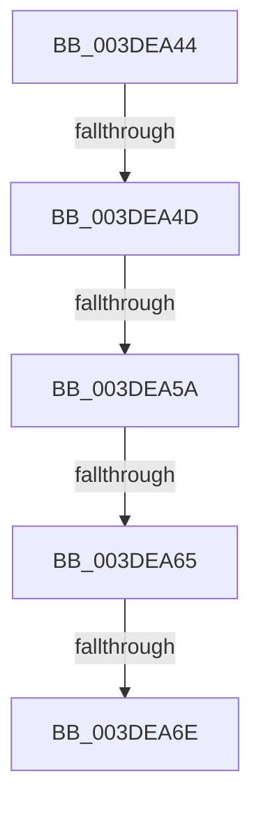

# sub_003DEA44

- RVA: `0x003DEA44`–`0x003DEA73` (길이 `47` bytes)
- VA: `0x00000001403DEA44`
- 실행 섹션: `.text`
- PDB 이름 있음: `아니요`; PDB Function 태그: `아니요`
- unwind 정보 RVA: `0x00094628`
- 디코드: `10`개 명령, `47/47` bytes 표시
- 미해석 바이트: `0` (있으면 어셈블리에 `.byte`로 보존)

> 이 문서는 커널 이미지의 기계어와 PDB 기호를 분석해 생성했습니다. 4번과 5번은 함수 원형과 자료형을 바이너리 사용 방식에서 추정한 C 해석이며 원본 소스 복구 결과는 아닙니다.

## 1. Dependencies

- 직접 호출 지점: **0**; 고유 호출 대상: **0**
- 직접 호출자로 확인된 함수: **0**
- RIP 상대 이미지 참조: **0**

### Outgoing calls
- 직접 디코드된 call 명령이 없습니다.

### Direct callers
- 이 함수 시작 RVA로 연결되는 직접 call은 확인되지 않았습니다. 간접 호출은 완전히 역산할 수 없습니다.

### Static image references
- 디코드된 RIP-relative 메모리 참조가 없습니다.

## 2. Other-region calls and transfers

- 다른 실행 섹션으로 향하는 call: **0**
- call이 아닌 외부 분기/꼬리 이동: **5**
  - `0x003DEA47` → [sub_003DE84B + 0x165](Unknown_function_003DE84B.md) (`tail-transfer`)
  - `0x003DEA54` → [sub_003DE84B + 0x165](Unknown_function_003DE84B.md) (`tail-transfer`)
  - `0x003DEA5F` → [sub_003DE84B + 0x12E](Unknown_function_003DE84B.md) (`tail-transfer`)
  - `0x003DEA68` → [sub_003DE84B + 0x165](Unknown_function_003DE84B.md) (`tail-transfer`)
  - `0x003DEA6E` → [sub_003DE84B + 0x12E](Unknown_function_003DE84B.md) (`tail-transfer`)

## 3. Assembly (complete function range)

```asm
003DEA44  45 84 F6                        test r14b, r14b
003DEA47  0F 85 63 FF FF FF               jne 0x1403de9b0
003DEA4D  44 38 B7 BD 01 00 00            cmp byte ptr [rdi + 0x1bd], r14b
003DEA54  0F 85 56 FF FF FF               jne 0x1403de9b0
003DEA5A  FF CA                           dec edx
003DEA5C  49 85 D7                        test r15, rdx
003DEA5F  0F 85 14 FF FF FF               jne 0x1403de979
003DEA65  48 85 D1                        test rcx, rdx
003DEA68  0F 84 42 FF FF FF               je 0x1403de9b0
003DEA6E  E9 06 FF FF FF                  jmp 0x1403de979
```

## 4. C-style interpretation (structured pseudocode)

```c
void __fastcall sub_003DEA44(__int64 a1, int a2)
{
    a2 = (unsigned int)((a2) - 1);
}
```

## 5. (Beta) C Style

```c
void sub_003DEA44(int64_t Arg1, int32_t Arg2)
{
    Arg2 = (uint32_t)((Arg2) - 1);
}
```

## 6. Execution-region graph

[열기: 2D/3D 그래프와 함수 탐색 컨트롤 패널](../../../control-panel.html?section=text&rva=0x003DEA44&view=graph)

- 2D 그래프는 위에서 아래로 흐르고, 3D 그래프는 빈 공간을 드래그해 회전합니다. Shift+드래그는 이동, 휠은 확대·축소, 함수 노드 선택은 대상 보고서 이동입니다.

### Static fallback


