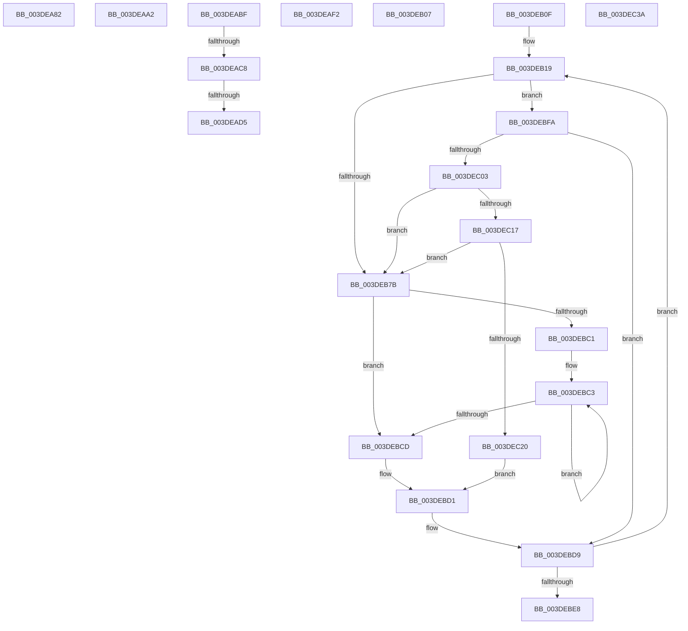

# sub_003DEA82

- RVA: `0x003DEA82`–`0x003DEC40` (길이 `446` bytes)
- VA: `0x00000001403DEA82`
- 실행 섹션: `.text`
- PDB 이름 있음: `아니요`; PDB Function 태그: `아니요`
- unwind 정보 RVA: `0x0009465C`
- 디코드: `105`개 명령, `446/446` bytes 표시
- 미해석 바이트: `0` (있으면 어셈블리에 `.byte`로 보존)

> 이 문서는 커널 이미지의 기계어와 PDB 기호를 분석해 생성했습니다. 4번과 5번은 함수 원형과 자료형을 바이너리 사용 방식에서 추정한 C 해석이며 원본 소스 복구 결과는 아닙니다.

## 1. Dependencies

- 직접 호출 지점: **7**; 고유 호출 대상: **6**
- 직접 호출자로 확인된 함수: **0**
- RIP 상대 이미지 참조: **1**

### Outgoing calls
- `0x003DEA98` → [HalpDmaFlushContiguousTransferV2](HalpDmaFlushContiguousTransferV2_function_003DFF3C.md) (function, `0x003DFF3C`)
- `0x003DEAE8` → [HalpDmaFlushBuffer](HalpDmaFlushBuffer_function_003DC1DC.md) (function, `0x003DC1DC`)
- `0x003DEAF2` → [HalpDmaNextContiguousPieceV2](HalpDmaNextContiguousPieceV2_function_003DE530.md) (function, `0x003DE530`)
- `0x003DEB2F` → [HalpDmaNextContiguousPiece](HalpDmaNextContiguousPiece_function_003DECB0.md) (function, `0x003DECB0`)
- `0x003DEB9C` → [HalpDmaSyncMapBuffers](HalpDmaSyncMapBuffers_function_003DEFD0.md) (function, `0x003DEFD0`)
- `0x003DEC06` → [HalpDmaGetAdapterCacheAlignment](HalpDmaGetAdapterCacheAlignment_function_003DC150.md) (function, `0x003DC150`)
- `0x003DEC33` → [HalpDmaFlushBuffer](HalpDmaFlushBuffer_function_003DC1DC.md) (function, `0x003DC1DC`)

### Direct callers
- 이 함수 시작 RVA로 연결되는 직접 call은 확인되지 않았습니다. 간접 호출은 완전히 역산할 수 없습니다.

### Static image references
- `0x003DEAA2` → RVA `0x00E0A778` (`.data`; read)

## 2. Other-region calls and transfers

- 다른 실행 섹션으로 향하는 call: **0**
- call이 아닌 외부 분기/꼬리 이동: **8**
  - `0x003DEA9D` → [sub_003DE84B + 0x80](Unknown_function_003DE84B.md) (`tail-transfer`)
  - `0x003DEABA` → [sub_003DE84B + 0x11B](Unknown_function_003DE84B.md) (`tail-transfer`)
  - `0x003DEAC2` → [sub_003DE84B + 0x80](Unknown_function_003DE84B.md) (`tail-transfer`)
  - `0x003DEACF` → [sub_003DE84B + 0x80](Unknown_function_003DE84B.md) (`tail-transfer`)
  - `0x003DEAED` → [sub_003DE84B + 0x80](Unknown_function_003DE84B.md) (`tail-transfer`)
  - `0x003DEB02` → [sub_003DE84B + 0x104](Unknown_function_003DE84B.md) (`tail-transfer`)
  - `0x003DEB0A` → [sub_003DE84B + 0x104](Unknown_function_003DE84B.md) (`tail-transfer`)
  - `0x003DEBF5` → [sub_003DE84B + 0x79](Unknown_function_003DE84B.md) (`tail-transfer`)

## 3. Assembly (complete function range)

```asm
003DEA82  44 88 74 24 28                  mov byte ptr [rsp + 0x28], r14b
003DEA87  4C 8B CD                        mov r9, rbp
003DEA8A  4D 8B C7                        mov r8, r15
003DEA8D  44 89 6C 24 20                  mov dword ptr [rsp + 0x20], r13d
003DEA92  48 8B D6                        mov rdx, rsi
003DEA95  48 8B CF                        mov rcx, rdi
003DEA98  E8 9F 14 00 00                  call 0x1403dff3c
003DEA9D  E9 29 FE FF FF                  jmp 0x1403de8cb
003DEAA2  8B 15 D0 BC A2 00               mov edx, dword ptr [rip + 0xa2bcd0]
003DEAA8  83 F8 01                        cmp eax, 1
003DEAAB  80 BF BD 01 00 00 00            cmp byte ptr [rdi + 0x1bd], 0
003DEAB2  B8 01 00 00 00                  mov eax, 1
003DEAB7  0F 45 D0                        cmovne edx, eax
003DEABA  E9 A7 FE FF FF                  jmp 0x1403de966
003DEABF  45 84 F6                        test r14b, r14b
003DEAC2  0F 85 03 FE FF FF               jne 0x1403de8cb
003DEAC8  44 38 B7 BD 01 00 00            cmp byte ptr [rdi + 0x1bd], r14b
003DEACF  0F 85 F6 FD FF FF               jne 0x1403de8cb
003DEAD5  44 88 74 24 28                  mov byte ptr [rsp + 0x28], r14b
003DEADA  45 8B CD                        mov r9d, r13d
003DEADD  4C 8B C5                        mov r8, rbp
003DEAE0  44 88 74 24 20                  mov byte ptr [rsp + 0x20], r14b
003DEAE5  48 8B D6                        mov rdx, rsi
003DEAE8  E8 EF D6 FF FF                  call 0x1403dc1dc
003DEAED  E9 D9 FD FF FF                  jmp 0x1403de8cb
003DEAF2  E8 39 FA FF FF                  call 0x1403de530
003DEAF7  4C 8B 8C 24 A8 00 00 00         mov r9, qword ptr [rsp + 0xa8]
003DEAFF  44 8B C0                        mov r8d, eax
003DEB02  E9 48 FE FF FF                  jmp 0x1403de94f
003DEB07  45 8B C5                        mov r8d, r13d
003DEB0A  E9 40 FE FF FF                  jmp 0x1403de94f
003DEB0F  45 8B E5                        mov r12d, r13d
003DEB12  4D 89 7F 38                     mov qword ptr [r15 + 0x38], r15
003DEB16  48 8B DD                        mov rbx, rbp
003DEB19  44 89 64 24 28                  mov dword ptr [rsp + 0x28], r12d
003DEB1E  4C 8B CB                        mov r9, rbx
003DEB21  4D 8B C7                        mov r8, r15
003DEB24  C6 44 24 20 00                  mov byte ptr [rsp + 0x20], 0
003DEB29  48 8B D6                        mov rdx, rsi
003DEB2C  48 8B CF                        mov rcx, rdi
003DEB2F  E8 7C 01 00 00                  call 0x1403decb0
003DEB34  44 8B C0                        mov r8d, eax
003DEB37  48 8B CB                        mov rcx, rbx
003DEB3A  48 2B 4E 20                     sub rcx, qword ptr [rsi + 0x20]
003DEB3E  48 8B C3                        mov rax, rbx
003DEB41  25 FF 0F 00 00                  and eax, 0xfff
003DEB46  48 C1 E9 0C                     shr rcx, 0xc
003DEB4A  8B C9                           mov ecx, ecx
003DEB4C  48 89 44 24 50                  mov qword ptr [rsp + 0x50], rax
003DEB51  44 89 84 24 A8 00 00 00         mov dword ptr [rsp + 0xa8], r8d
003DEB59  4C 89 44 24 58                  mov qword ptr [rsp + 0x58], r8
003DEB5E  4C 8B 4C CE 30                  mov r9, qword ptr [rsi + rcx*8 + 0x30]
003DEB63  49 C1 E1 0C                     shl r9, 0xc
003DEB67  4C 03 C8                        add r9, rax
003DEB6A  4F 8D 14 08                     lea r10, [r8 + r9]
003DEB6E  49 8D 42 FF                     lea rax, [r10 - 1]
003DEB72  48 39 87 90 00 00 00            cmp qword ptr [rdi + 0x90], rax
003DEB79  73 7F                           jae 0x1403debfa
003DEB7B  4D 8B 4F 38                     mov r9, qword ptr [r15 + 0x38]
003DEB7F  48 8B D6                        mov rdx, rsi
003DEB82  C6 44 24 38 00                  mov byte ptr [rsp + 0x38], 0
003DEB87  48 8B CF                        mov rcx, rdi
003DEB8A  C6 44 24 30 00                  mov byte ptr [rsp + 0x30], 0
003DEB8F  C6 44 24 28 00                  mov byte ptr [rsp + 0x28], 0
003DEB94  44 89 44 24 20                  mov dword ptr [rsp + 0x20], r8d
003DEB99  4C 8B C3                        mov r8, rbx
003DEB9C  E8 2F 04 00 00                  call 0x1403defd0
003DEBA1  48 8B 4C 24 50                  mov rcx, qword ptr [rsp + 0x50]
003DEBA6  48 8B 44 24 58                  mov rax, qword ptr [rsp + 0x58]
003DEBAB  48 81 C1 FF 0F 00 00            add rcx, 0xfff
003DEBB2  48 03 C1                        add rax, rcx
003DEBB5  49 8B 4F 38                     mov rcx, qword ptr [r15 + 0x38]
003DEBB9  48 C1 E8 0C                     shr rax, 0xc
003DEBBD  85 C0                           test eax, eax
003DEBBF  74 0C                           je 0x1403debcd
003DEBC1  8B D0                           mov edx, eax
003DEBC3  48 8B 49 08                     mov rcx, qword ptr [rcx + 8]
003DEBC7  48 83 EA 01                     sub rdx, 1
003DEBCB  75 F6                           jne 0x1403debc3
003DEBCD  49 89 4F 38                     mov qword ptr [r15 + 0x38], rcx
003DEBD1  44 8B 84 24 A8 00 00 00         mov r8d, dword ptr [rsp + 0xa8]
003DEBD9  41 8B C0                        mov eax, r8d
003DEBDC  48 03 D8                        add rbx, rax
003DEBDF  45 2B E0                        sub r12d, r8d
003DEBE2  0F 85 31 FF FF FF               jne 0x1403deb19
003DEBE8  48 8B 5C 24 48                  mov rbx, qword ptr [rsp + 0x48]
003DEBED  44 8B A4 24 B8 00 00 00         mov r12d, dword ptr [rsp + 0xb8]
003DEBF5  E9 CA FC FF FF                  jmp 0x1403de8c4
003DEBFA  80 BF BD 01 00 00 00            cmp byte ptr [rdi + 0x1bd], 0
003DEC01  75 D6                           jne 0x1403debd9
003DEC03  48 8B CF                        mov rcx, rdi
003DEC06  E8 45 D5 FF FF                  call 0x1403dc150
003DEC0B  8D 48 FF                        lea ecx, [rax - 1]
003DEC0E  49 85 C9                        test r9, rcx
003DEC11  0F 85 64 FF FF FF               jne 0x1403deb7b
003DEC17  4C 85 D1                        test rcx, r10
003DEC1A  0F 85 5B FF FF FF               jne 0x1403deb7b
003DEC20  45 8B C8                        mov r9d, r8d
003DEC23  C6 44 24 28 00                  mov byte ptr [rsp + 0x28], 0
003DEC28  4C 8B C3                        mov r8, rbx
003DEC2B  C6 44 24 20 00                  mov byte ptr [rsp + 0x20], 0
003DEC30  48 8B D6                        mov rdx, rsi
003DEC33  E8 A4 D5 FF FF                  call 0x1403dc1dc
003DEC38  EB 97                           jmp 0x1403debd1
003DEC3A  66 0F 1F 44 00 00               nop word ptr [rax + rax]
```

## 4. C-style interpretation (structured pseudocode)

```c
__int64 __fastcall sub_003DEA82(void)
{
    __int64 result;
    unsigned int v_stack_p20;
    unsigned __int8 v_stack_p28;
    unsigned __int8 v_stack_p30;
    unsigned __int8 v_stack_p38;
    unsigned __int64 v_stack_p48;
    unsigned __int64 v_stack_p50;
    unsigned __int64 v_stack_p58;
    unsigned __int64 v_stack_pA8;
    unsigned int v_stack_pB8;

    v_stack_p28 = (unsigned __int8)(v_r14);
    v_stack_p20 = (unsigned int)(v_r13);
    result = HalpDmaFlushContiguousTransferV2(v_rdi, v_rsi, v_r15, v_rbp);
}
```

## 5. (Beta) C Style

```c
void sub_003DEA82(void)
{
    int64_t result;
    uint32_t v_stack_p20;
    uint8_t v_stack_p28;
    uint8_t v_stack_p30;
    uint8_t v_stack_p38;
    uint64_t v_stack_p48;
    uint64_t v_stack_p50;
    uint64_t v_stack_p58;
    uint64_t v_stack_pA8;
    uint32_t v_stack_pB8;

    v_stack_p28 = (uint8_t)(local_r14);
    v_stack_p20 = (uint32_t)(local_r13);
    result = HalpDmaFlushContiguousTransferV2(local_rdi, local_rsi, local_r15, local_rbp);
}
```

## 6. Execution-region graph

[열기: 2D/3D 그래프와 함수 탐색 컨트롤 패널](../../../control-panel.html?section=text&rva=0x003DEA82&view=graph)

- 2D 그래프는 위에서 아래로 흐르고, 3D 그래프는 빈 공간을 드래그해 회전합니다. Shift+드래그는 이동, 휠은 확대·축소, 함수 노드 선택은 대상 보고서 이동입니다.

### Static fallback


