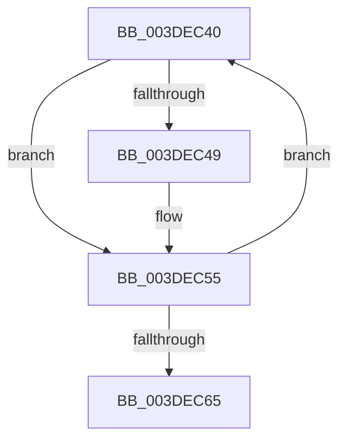

# sub_003DEC40

- RVA: `0x003DEC40`–`0x003DEC6A` (길이 `42` bytes)
- VA: `0x00000001403DEC40`
- 실행 섹션: `.text`
- PDB 이름 있음: `아니요`; PDB Function 태그: `아니요`
- unwind 정보 RVA: `0x00094680`
- 디코드: `12`개 명령, `42/42` bytes 표시
- 미해석 바이트: `0` (있으면 어셈블리에 `.byte`로 보존)

> 이 문서는 커널 이미지의 기계어와 PDB 기호를 분석해 생성했습니다. 4번과 5번은 함수 원형과 자료형을 바이너리 사용 방식에서 추정한 C 해석이며 원본 소스 복구 결과는 아닙니다.

## 1. Dependencies

- 직접 호출 지점: **2**; 고유 호출 대상: **2**
- 직접 호출자로 확인된 함수: **0**
- RIP 상대 이미지 참조: **0**

### Outgoing calls
- `0x003DEC50` → [MmUnmapLockedPages](../24/MmUnmapLockedPages_function_00246E60.md) (function, `0x00246E60`)
- `0x003DEC58` → [IoFreeMdl](../29/IoFreeMdl_function_0029EA80.md) (function, `0x0029EA80`)

### Direct callers
- 이 함수 시작 RVA로 연결되는 직접 call은 확인되지 않았습니다. 간접 호출은 완전히 역산할 수 없습니다.

### Static image references
- 디코드된 RIP-relative 메모리 참조가 없습니다.

## 2. Other-region calls and transfers

- 다른 실행 섹션으로 향하는 call: **0**
- call이 아닌 외부 분기/꼬리 이동: **1**
  - `0x003DEC65` → [sub_003DEA26](Unknown_function_003DEA26.md) (`tail-transfer`)

## 3. Assembly (complete function range)

```asm
003DEC40  F6 47 0A 01                     test byte ptr [rdi + 0xa], 1
003DEC44  48 8B 37                        mov rsi, qword ptr [rdi]
003DEC47  74 0C                           je 0x1403dec55
003DEC49  48 8B 4F 18                     mov rcx, qword ptr [rdi + 0x18]
003DEC4D  48 8B D7                        mov rdx, rdi
003DEC50  E8 0B 82 E6 FF                  call 0x140246e60
003DEC55  48 8B CF                        mov rcx, rdi
003DEC58  E8 23 FE EB FF                  call 0x14029ea80
003DEC5D  48 8B FE                        mov rdi, rsi
003DEC60  48 85 F6                        test rsi, rsi
003DEC63  75 DB                           jne 0x1403dec40
003DEC65  E9 BC FD FF FF                  jmp 0x1403dea26
```

## 4. C-style interpretation (structured pseudocode)

```c
__int64 __fastcall sub_003DEC40(void)
{
    __int64 result;

    if (((*(unsigned __int8 *)(v_rdi + 10)) & (1)) != 0) {
        a1 = *(unsigned __int64 *)(v_rdi + 24);
        a2 = v_rdi;
        result = MmUnmapLockedPages(a1, a2, a3, a4);
    }
    result = IoFreeMdl(v_rdi, a2, a3, a4);
    if (*(unsigned __int64 *)(v_rdi) != 0) goto loc_003DEC40;
}
```

## 5. (Beta) C Style

```c
void sub_003DEC40(void)
{
    int64_t result;

    if (((*(uint8_t *)(local_rdi + 0xA)) & (1)) != 0) {
        a1 = *(uint64_t *)(local_rdi + 0x18);
        a2 = local_rdi;
        result = MmUnmapLockedPages(a1, a2, a3, a4);
    }
    result = IoFreeMdl(local_rdi, a2, a3, a4);
    if (*(uint64_t *)(local_rdi) != 0) goto loc_003DEC40;
}
```

## 6. Execution-region graph

[열기: 2D/3D 그래프와 함수 탐색 컨트롤 패널](../../../control-panel.html?section=text&rva=0x003DEC40&view=graph)

- 2D 그래프는 위에서 아래로 흐르고, 3D 그래프는 빈 공간을 드래그해 회전합니다. Shift+드래그는 이동, 휠은 확대·축소, 함수 노드 선택은 대상 보고서 이동입니다.

### Static fallback


