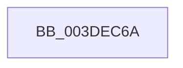

# sub_003DEC6A

- RVA: `0x003DEC6A`–`0x003DEC86` (길이 `28` bytes)
- VA: `0x00000001403DEC6A`
- 실행 섹션: `.text`
- PDB 이름 있음: `아니요`; PDB Function 태그: `아니요`
- unwind 정보 RVA: `0x00094694`
- 디코드: `5`개 명령, `28/28` bytes 표시
- 미해석 바이트: `0` (있으면 어셈블리에 `.byte`로 보존)

> 이 문서는 커널 이미지의 기계어와 PDB 기호를 분석해 생성했습니다. 4번과 5번은 함수 원형과 자료형을 바이너리 사용 방식에서 추정한 C 해석이며 원본 소스 복구 결과는 아닙니다.

## 1. Dependencies

- 직접 호출 지점: **1**; 고유 호출 대상: **1**
- 직접 호출자로 확인된 함수: **0**
- RIP 상대 이미지 참조: **1**

### Outgoing calls
- `0x003DEC7C` → [guard_dispatch_icall](../6B/guard_dispatch_icall_function_006BAAD0.md) (function, `0x006BAAD0`)

### Direct callers
- 이 함수 시작 RVA로 연결되는 직접 call은 확인되지 않았습니다. 간접 호출은 완전히 역산할 수 없습니다.

### Static image references
- `0x003DEC6A` → RVA `0x00FC3E58` (`.data`; read)

## 2. Other-region calls and transfers

- 다른 실행 섹션으로 향하는 call: **0**
- call이 아닌 외부 분기/꼬리 이동: **1**
  - `0x003DEC81` → [sub_003DE84B + 0x51](Unknown_function_003DE84B.md) (`tail-transfer`)

## 3. Assembly (complete function range)

```asm
003DEC6A  48 8B 05 E7 51 BE 00            mov rax, qword ptr [rip + 0xbe51e7]
003DEC71  48 8B 8F B0 01 00 00            mov rcx, qword ptr [rdi + 0x1b0]
003DEC78  48 8B 40 30                     mov rax, qword ptr [rax + 0x30]
003DEC7C  E8 4F BE 2D 00                  call 0x1406baad0
003DEC81  E9 16 FC FF FF                  jmp 0x1403de89c
```

## 4. C-style interpretation (structured pseudocode)

```c
__int64 __fastcall sub_003DEC6A(void)
{
    __int64 result;

    result = guard_dispatch_icall(*(unsigned __int64 *)(v_rdi + 432), a2, a3, a4);
}
```

## 5. (Beta) C Style

```c
void sub_003DEC6A(void)
{
    int64_t result;

    result = guard_dispatch_icall(*(uint64_t *)(local_rdi + 0x1B0), a2, a3, a4);
}
```

## 6. Execution-region graph

[열기: 2D/3D 그래프와 함수 탐색 컨트롤 패널](../../../control-panel.html?section=text&rva=0x003DEC6A&view=graph)

- 2D 그래프는 위에서 아래로 흐르고, 3D 그래프는 빈 공간을 드래그해 회전합니다. Shift+드래그는 이동, 휠은 확대·축소, 함수 노드 선택은 대상 보고서 이동입니다.

### Static fallback


