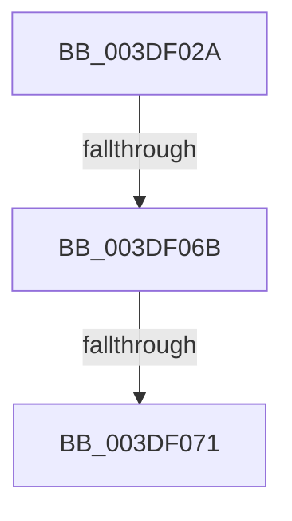

# sub_003DF02A

- RVA: `0x003DF02A`–`0x003DF08F` (길이 `101` bytes)
- VA: `0x00000001403DF02A`
- 실행 섹션: `.text`
- PDB 이름 있음: `아니요`; PDB Function 태그: `아니요`
- unwind 정보 RVA: `0x000946F4`
- 디코드: `19`개 명령, `101/101` bytes 표시
- 미해석 바이트: `0` (있으면 어셈블리에 `.byte`로 보존)

> 이 문서는 커널 이미지의 기계어와 PDB 기호를 분석해 생성했습니다. 4번과 5번은 함수 원형과 자료형을 바이너리 사용 방식에서 추정한 C 해석이며 원본 소스 복구 결과는 아닙니다.

## 1. Dependencies

- 직접 호출 지점: **1**; 고유 호출 대상: **1**
- 직접 호출자로 확인된 함수: **0**
- RIP 상대 이미지 참조: **0**

### Outgoing calls
- `0x003DF07C` → [HalpDmaAcquireBufferMappings](HalpDmaAcquireBufferMappings_function_003DF38C.md) (function, `0x003DF38C`)

### Direct callers
- 이 함수 시작 RVA로 연결되는 직접 call은 확인되지 않았습니다. 간접 호출은 완전히 역산할 수 없습니다.

### Static image references
- 디코드된 RIP-relative 메모리 참조가 없습니다.

## 2. Other-region calls and transfers

- 다른 실행 섹션으로 향하는 call: **0**
- call이 아닌 외부 분기/꼬리 이동: **2**
  - `0x003DF065` → [sub_003DF1DC + 0x20](Unknown_function_003DF1DC.md) (`tail-transfer`)
  - `0x003DF06B` → [sub_003DF2A7 + 0x22](Unknown_function_003DF2A7.md) (`tail-transfer`)

## 3. Assembly (complete function range)

```asm
003DF02A  4C 89 B4 24 88 00 00 00         mov qword ptr [rsp + 0x88], r14
003DF032  48 8B CF                        mov rcx, rdi
003DF035  81 E1 FF 0F 00 00               and ecx, 0xfff
003DF03B  4C 89 BC 24 80 00 00 00         mov qword ptr [rsp + 0x80], r15
003DF043  44 8B BC 24 E0 00 00 00         mov r15d, dword ptr [rsp + 0xe0]
003DF04B  C6 84 24 C8 00 00 00 00         mov byte ptr [rsp + 0xc8], 0
003DF053  4D 8D B7 FF 0F 00 00            lea r14, [r15 + 0xfff]
003DF05A  4C 03 F1                        add r14, rcx
003DF05D  49 C1 EE 0C                     shr r14, 0xc
003DF061  40 80 FE 02                     cmp sil, 2
003DF065  0F 87 91 01 00 00               ja 0x1403df1fc
003DF06B  0F 82 58 02 00 00               jb 0x1403df2c9
003DF071  4C 8D 4C 24 48                  lea r9, [rsp + 0x48]
003DF076  45 8B C6                        mov r8d, r14d
003DF079  49 8B D5                        mov rdx, r13
003DF07C  E8 0B 03 00 00                  call 0x1403df38c
003DF081  4C 8B 94 24 C0 00 00 00         mov r10, qword ptr [rsp + 0xc0]
003DF089  8B 45 2C                        mov eax, dword ptr [rbp + 0x2c]
003DF08C  48 2B F8                        sub rdi, rax
```

## 4. C-style interpretation (structured pseudocode)

```c
__int64 __fastcall sub_003DF02A(__int64 a1, __int64 a2, __int64 a3, __int64 a4, __int64 a5, __int64 a6, __int64 a7, __int64 a8, __int64 a9, __int64 a10, __int64 a11, __int64 a12, __int64 a13, __int64 a14, __int64 a15, __int64 a16, __int64 a17, __int64 a18, __int64 a19, __int64 a20, __int64 a21, __int64 a22, __int64 a23, __int64 a24, __int64 a25, __int64 a26, __int64 a27, unsigned int a28)
{
    __int64 result;
    __int64 v_r14;
    __int64 v_rdi;
    unsigned __int64 v_stack_p80;
    unsigned __int64 v_stack_p88;
    unsigned __int8 v_stack_pC8;

    v_stack_p88 = v_r14;
    a1 = (unsigned int)((v_rdi) & (0xFFFULL));
    v_stack_p80 = v_r15;
    v_stack_pC8 = 0;
    v_r14 = ((unsigned int)(a28) + 4095) + (a1);
    v_r14 = (v_r14) >> (12);
    result = HalpDmaAcquireBufferMappings(a1, v_r13, (unsigned int)((unsigned int)(v_r14)), a9);
    v_rdi = (v_rdi) - ((unsigned int)(*(unsigned int *)(v_rbp + 44)));
    return (unsigned int)(*(unsigned int *)(v_rbp + 44));
}
```

## 5. (Beta) C Style

```c
int64_t sub_003DF02A(int64_t Arg1, int64_t Arg2, int64_t Arg3, int64_t Arg4, uint64_t Arg5, uint64_t Arg6, uint64_t Arg7, uint64_t Arg8, int64_t Arg9, uint64_t Arg10, uint64_t Arg11, uint64_t Arg12, uint64_t Arg13, uint64_t Arg14, uint64_t Arg15, uint64_t Arg16, uint64_t Arg17, uint64_t Arg18, uint64_t Arg19, uint64_t Arg20, uint64_t Arg21, uint64_t Arg22, uint64_t Arg23, int64_t Arg24, uint64_t Arg25, uint64_t Arg26, uint64_t Arg27, void *Arg28)
{
    uint8_t *arg28 = (uint8_t *)Arg28;

    int64_t result;
    int64_t local_r14;
    int64_t local_rdi;
    uint64_t v_stack_p80;
    uint64_t v_stack_p88;
    uint8_t v_stack_pC8;

    v_stack_p88 = local_r14;
    Arg1 = (uint32_t)((local_rdi) & (0xFFFULL));
    v_stack_p80 = local_r15;
    v_stack_pC8 = 0;
    local_r14 = ((uint32_t)(Arg28) + 4095) + (Arg1);
    local_r14 = (local_r14) >> (12);
    result = HalpDmaAcquireBufferMappings(Arg1, local_r13, (uint32_t)((uint32_t)(local_r14)), Arg9);
    local_rdi = (local_rdi) - ((uint32_t)(*(uint32_t *)(local_rbp + 0x2C)));
    return (uint32_t)(*(uint32_t *)(local_rbp + 0x2C));
}
```

### 관측된 메모리 오프셋

구조체 형식이 확인되지 않은 접근은 인자 기준의 오프셋으로만 기록했습니다.

| 기준 인자 | 오프셋 표현 | 폭 (bit) | 접근 |
|---|---:|---:|---|
| `Arg28` | `+ 0xFFF` | `64` | `R` |

## 6. Execution-region graph

[열기: 2D/3D 그래프와 함수 탐색 컨트롤 패널](../../../control-panel.html?section=text&rva=0x003DF02A&view=graph)

- 2D 그래프는 위에서 아래로 흐르고, 3D 그래프는 빈 공간을 드래그해 회전합니다. Shift+드래그는 이동, 휠은 확대·축소, 함수 노드 선택은 대상 보고서 이동입니다.

### Static fallback


