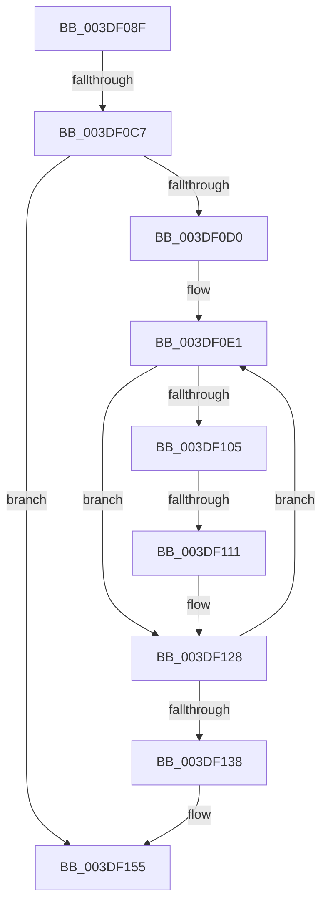

# sub_003DF08F

- RVA: `0x003DF08F`–`0x003DF173` (길이 `228` bytes)
- VA: `0x00000001403DF08F`
- 실행 섹션: `.text`
- PDB 이름 있음: `아니요`; PDB Function 태그: `아니요`
- unwind 정보 RVA: `0x0009470C`
- 디코드: `47`개 명령, `228/228` bytes 표시
- 미해석 바이트: `0` (있으면 어셈블리에 `.byte`로 보존)

> 이 문서는 커널 이미지의 기계어와 PDB 기호를 분석해 생성했습니다. 4번과 5번은 함수 원형과 자료형을 바이너리 사용 방식에서 추정한 C 해석이며 원본 소스 복구 결과는 아닙니다.

## 1. Dependencies

- 직접 호출 지점: **1**; 고유 호출 대상: **1**
- 직접 호출자로 확인된 함수: **0**
- RIP 상대 이미지 참조: **1**

### Outgoing calls
- `0x003DF11B` → [guard_dispatch_icall](../6B/guard_dispatch_icall_function_006BAAD0.md) (function, `0x006BAAD0`)

### Direct callers
- 이 함수 시작 RVA로 연결되는 직접 call은 확인되지 않았습니다. 간접 호출은 완전히 역산할 수 없습니다.

### Static image references
- `0x003DF111` → RVA `0x00E002C8` (`.data`; read)

## 2. Other-region calls and transfers

- 다른 실행 섹션으로 향하는 call: **0**
- call이 아닌 외부 분기/꼬리 이동: **3**
  - `0x003DF0C1` → [sub_003DF2F5](Unknown_function_003DF2F5.md) (`tail-transfer`)
  - `0x003DF10B` → [sub_003DF220](Unknown_function_003DF220.md) (`tail-transfer`)
  - `0x003DF16D` → [sub_003DF335](Unknown_function_003DF335.md) (`tail-transfer`)

## 3. Assembly (complete function range)

```asm
003DF08F  4C 89 A4 24 D0 00 00 00         mov qword ptr [rsp + 0xd0], r12
003DF097  48 2B 7D 20                     sub rdi, qword ptr [rbp + 0x20]
003DF09B  45 8B E7                        mov r12d, r15d
003DF09E  0F B6 AC 24 E8 00 00 00         movzx ebp, byte ptr [rsp + 0xe8]
003DF0A6  48 03 DF                        add rbx, rdi
003DF0A9  8B FB                           mov edi, ebx
003DF0AB  48 89 5C 24 40                  mov qword ptr [rsp + 0x40], rbx
003DF0B0  81 E7 FF 0F 00 00               and edi, 0xfff
003DF0B6  48 8B CB                        mov rcx, rbx
003DF0B9  41 80 BA BD 01 00 00 00         cmp byte ptr [r10 + 0x1bd], 0
003DF0C1  0F 84 2E 02 00 00               je 0x1403df2f5
003DF0C7  45 85 FF                        test r15d, r15d
003DF0CA  0F 84 85 00 00 00               je 0x1403df155
003DF0D0  0F B6 94 24 F0 00 00 00         movzx edx, byte ptr [rsp + 0xf0]
003DF0D8  44 0F B6 BC 24 E8 00 00 00      movzx r15d, byte ptr [rsp + 0xe8]
003DF0E1  49 8B 4D 30                     mov rcx, qword ptr [r13 + 0x30]
003DF0E5  B8 00 10 00 00                  mov eax, 0x1000
003DF0EA  2B C7                           sub eax, edi
003DF0EC  41 8B EC                        mov ebp, r12d
003DF0EF  44 3B E0                        cmp r12d, eax
003DF0F2  0F 43 E8                        cmovae ebp, eax
003DF0F5  48 81 E1 00 F0 FF FF            and rcx, 0xfffffffffffff000
003DF0FC  8B C7                           mov eax, edi
003DF0FE  48 03 C8                        add rcx, rax
003DF101  84 D2                           test dl, dl
003DF103  75 23                           jne 0x1403df128
003DF105  44 8B C5                        mov r8d, ebp
003DF108  45 84 FF                        test r15b, r15b
003DF10B  0F 84 0F 01 00 00               je 0x1403df220
003DF111  48 8B 05 B0 11 A2 00            mov rax, qword ptr [rip + 0xa211b0]
003DF118  48 8B D3                        mov rdx, rbx
003DF11B  E8 B0 B9 2D 00                  call 0x1406baad0
003DF120  0F B6 94 24 F0 00 00 00         movzx edx, byte ptr [rsp + 0xf0]
003DF128  4D 8B 6D 08                     mov r13, qword ptr [r13 + 8]
003DF12C  33 FF                           xor edi, edi
003DF12E  8B C5                           mov eax, ebp
003DF130  48 03 D8                        add rbx, rax
003DF133  44 2B E5                        sub r12d, ebp
003DF136  75 A9                           jne 0x1403df0e1
003DF138  44 8B BC 24 E0 00 00 00         mov r15d, dword ptr [rsp + 0xe0]
003DF140  4C 8B 94 24 C0 00 00 00         mov r10, qword ptr [rsp + 0xc0]
003DF148  0F B6 AC 24 E8 00 00 00         movzx ebp, byte ptr [rsp + 0xe8]
003DF150  48 8B 4C 24 40                  mov rcx, qword ptr [rsp + 0x40]
003DF155  41 80 BA BD 01 00 00 00         cmp byte ptr [r10 + 0x1bd], 0
003DF15D  4C 8B A4 24 D0 00 00 00         mov r12, qword ptr [rsp + 0xd0]
003DF165  48 8B 9C 24 D8 00 00 00         mov rbx, qword ptr [rsp + 0xd8]
003DF16D  0F 84 C2 01 00 00               je 0x1403df335
```

## 4. C-style interpretation (structured pseudocode)

```c
__int64 __fastcall sub_003DF08F(__int64 a1, __int64 a2, __int64 a3, __int64 a4, __int64 a5, __int64 a6, __int64 a7, __int64 a8, __int64 a9, __int64 a10, __int64 a11, __int64 a12, __int64 a13, __int64 a14, __int64 a15, __int64 a16, __int64 a17, __int64 a18, __int64 a19, __int64 a20, __int64 a21, __int64 a22, __int64 a23, __int64 a24, __int64 a25, __int64 a26, __int64 a27, unsigned int a28, unsigned __int8 a29, unsigned __int8 a30)
{
    __int64 result;
    __int64 v_r12;
    __int64 v_rbp;
    __int64 v_rbx;
    __int64 v_rdi;
    unsigned __int64 v_stack_p40;
    unsigned __int64 v_stack_pD0;

    v_stack_pD0 = v_r12;
    v_rdi = (v_rdi) - (*(unsigned __int64 *)(v_rbp + 32));
    v_rbx = (v_rbx) + (v_rdi);
    v_stack_p40 = v_rbx;
    v_rdi = (unsigned int)(((unsigned int)((unsigned int)(v_rbx))) & (0xFFFULL));
    if ((unsigned int)(v_r15) == 0) goto loc_003DF155;
loc_003DF0E1:
    result = (unsigned int)(((unsigned int)(0x1000ULL)) - ((unsigned int)(v_rdi)));
    v_rbp = (unsigned int)((unsigned int)((unsigned int)((unsigned int)(v_r15))));
    if (((unsigned int)((unsigned int)((unsigned int)(v_r15)))) >= ((unsigned int)(result))) { v_rbp = (unsigned int)(result); }
    a1 = (*(unsigned __int64 *)(v_r13 + 48)) & (0xFFFFFFFFFFFFF000ULL);
    a1 = (a1) + ((unsigned int)((unsigned int)(v_rdi)));
    if (a30 != 0) goto loc_003DF128;
    result = guard_dispatch_icall(a1, v_rbx, (unsigned int)((unsigned int)(v_rbp)), a4);
loc_003DF128:
    v_rdi = 0;
    v_rbx = (v_rbx) + ((unsigned int)((unsigned int)(v_rbp)));
    v_r12 = (unsigned int)(((unsigned int)((unsigned int)(v_r15))) - ((unsigned int)(v_rbp)));
    if (condition_is_not_equal) goto loc_003DF0E1;
loc_003DF155:
}
```

## 5. (Beta) C Style

```c
int64_t sub_003DF08F(int64_t Arg1, int64_t Arg2, int64_t Arg3, int64_t Arg4, uint64_t Arg5, uint64_t Arg6, uint64_t Arg7, int64_t Arg8, uint64_t Arg9, uint64_t Arg10, uint64_t Arg11, uint64_t Arg12, uint64_t Arg13, uint64_t Arg14, uint64_t Arg15, uint64_t Arg16, uint64_t Arg17, uint64_t Arg18, uint64_t Arg19, uint64_t Arg20, uint64_t Arg21, uint64_t Arg22, uint64_t Arg23, int64_t Arg24, uint64_t Arg25, int64_t Arg26, int64_t Arg27, uint32_t Arg28, uint8_t Arg29, uint8_t Arg30)
{
    int64_t result;
    int64_t local_r12;
    int64_t local_rbp;
    int64_t local_rbx;
    int64_t local_rdi;
    uint64_t v_stack_p40;
    uint64_t v_stack_pD0;

    v_stack_pD0 = local_r12;
    local_rdi = (local_rdi) - (*(uint64_t *)(local_rbp + 0x20));
    local_rbx = (local_rbx) + (local_rdi);
    v_stack_p40 = local_rbx;
    local_rdi = (uint32_t)(((uint32_t)((uint32_t)(local_rbx))) & (0xFFFULL));
    if ((uint32_t)(local_r15) == 0) goto loc_003DF155;
loc_003DF0E1:
    result = (uint32_t)(((uint32_t)(0x1000ULL)) - ((uint32_t)(local_rdi)));
    local_rbp = (uint32_t)((uint32_t)((uint32_t)((uint32_t)(local_r15))));
    if (((uint32_t)((uint32_t)((uint32_t)(local_r15)))) >= ((uint32_t)(result))) { local_rbp = (uint32_t)(result); }
    Arg1 = (*(uint64_t *)(local_r13 + 0x30)) & (0xFFFFFFFFFFFFF000ULL);
    Arg1 = (Arg1) + ((uint32_t)((uint32_t)(local_rdi)));
    if (Arg30 != 0) goto loc_003DF128;
    result = guard_dispatch_icall(Arg1, local_rbx, (uint32_t)((uint32_t)(local_rbp)), Arg4);
loc_003DF128:
    local_rdi = 0;
    local_rbx = (local_rbx) + ((uint32_t)((uint32_t)(local_rbp)));
    local_r12 = (uint32_t)(((uint32_t)((uint32_t)(local_r15))) - ((uint32_t)(local_rbp)));
    if (condition_is_not_equal) goto loc_003DF0E1;
loc_003DF155:
}
```

## 6. Execution-region graph

[열기: 2D/3D 그래프와 함수 탐색 컨트롤 패널](../../../control-panel.html?section=text&rva=0x003DF08F&view=graph)

- 2D 그래프는 위에서 아래로 흐르고, 3D 그래프는 빈 공간을 드래그해 회전합니다. Shift+드래그는 이동, 휠은 확대·축소, 함수 노드 선택은 대상 보고서 이동입니다.

### Static fallback


