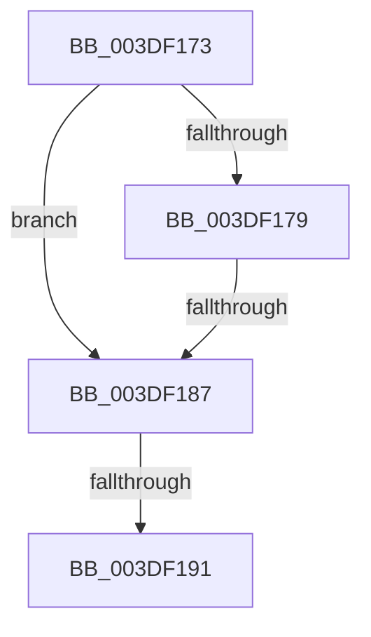

# sub_003DF173

- RVA: `0x003DF173`–`0x003DF1AF` (길이 `60` bytes)
- VA: `0x00000001403DF173`
- 실행 섹션: `.text`
- PDB 이름 있음: `아니요`; PDB Function 태그: `아니요`
- unwind 정보 RVA: `0x00094720`
- 디코드: `16`개 명령, `60/60` bytes 표시
- 미해석 바이트: `0` (있으면 어셈블리에 `.byte`로 보존)

> 이 문서는 커널 이미지의 기계어와 PDB 기호를 분석해 생성했습니다. 4번과 5번은 함수 원형과 자료형을 바이너리 사용 방식에서 추정한 C 해석이며 원본 소스 복구 결과는 아닙니다.

## 1. Dependencies

- 직접 호출 지점: **0**; 고유 호출 대상: **0**
- 직접 호출자로 확인된 함수: **0**
- RIP 상대 이미지 참조: **0**

### Outgoing calls
- 직접 디코드된 call 명령이 없습니다.

### Direct callers
- 이 함수 시작 RVA로 연결되는 직접 call은 확인되지 않았습니다. 간접 호출은 완전히 역산할 수 없습니다.

### Static image references
- 디코드된 RIP-relative 메모리 참조가 없습니다.

## 2. Other-region calls and transfers

- 다른 실행 섹션으로 향하는 call: **0**
- call이 아닌 외부 분기/꼬리 이동: **2**
  - `0x003DF181` → [sub_003DF335 + 0x30](Unknown_function_003DF335.md) (`tail-transfer`)
  - `0x003DF18F` → [sub_003DF1DC](Unknown_function_003DF1DC.md) (`tail-transfer`)

## 3. Assembly (complete function range)

```asm
003DF173  40 80 FE 02                     cmp sil, 2
003DF177  77 0E                           ja 0x1403df187
003DF179  4C 8B 44 24 48                  mov r8, qword ptr [rsp + 0x48]
003DF17E  4D 85 C0                        test r8, r8
003DF181  0F 85 DE 01 00 00               jne 0x1403df365
003DF187  80 BC 24 C8 00 00 00 00         cmp byte ptr [rsp + 0xc8], 0
003DF18F  75 4B                           jne 0x1403df1dc
003DF191  4C 8B B4 24 88 00 00 00         mov r14, qword ptr [rsp + 0x88]
003DF199  4C 8B BC 24 80 00 00 00         mov r15, qword ptr [rsp + 0x80]
003DF1A1  48 81 C4 90 00 00 00            add rsp, 0x90
003DF1A8  41 5D                           pop r13
003DF1AA  5F                              pop rdi
003DF1AB  5E                              pop rsi
003DF1AC  5D                              pop rbp
003DF1AD  5B                              pop rbx
003DF1AE  C3                              ret
```

## 4. C-style interpretation (structured pseudocode)

```c
void __fastcall sub_003DF173(__int64 a1, __int64 a2, __int64 a3, __int64 a4, __int64 a5, __int64 a6, __int64 a7, __int64 a8, __int64 a9, __int64 a10, __int64 a11, __int64 a12, __int64 a13, __int64 a14, __int64 a15, __int64 a16, __int64 a17, __int64 a18, __int64 a19, __int64 a20, __int64 a21, __int64 a22, __int64 a23, __int64 a24, unsigned __int8 a25)
{
    __int64 v_rsp;

    if (((unsigned __int8)(v_rsi)) > 2) goto loc_003DF187;
loc_003DF187:
    v_rsp = (v_rsp) + (144);
    return;
}
```

## 5. (Beta) C Style

```c
void sub_003DF173(int64_t Arg1, int64_t Arg2, int64_t Arg3, int64_t Arg4, uint64_t Arg5, uint64_t Arg6, uint64_t Arg7, uint64_t Arg8, int64_t Arg9, uint64_t Arg10, uint64_t Arg11, uint64_t Arg12, uint64_t Arg13, uint64_t Arg14, uint64_t Arg15, int64_t Arg16, int64_t Arg17, uint64_t Arg18, uint64_t Arg19, uint64_t Arg20, uint64_t Arg21, uint64_t Arg22, uint64_t Arg23, uint64_t Arg24, uint8_t Arg25)
{
    int64_t local_rsp;

    if (((uint8_t)(local_rsi)) > 2) goto loc_003DF187;
loc_003DF187:
    local_rsp = (local_rsp) + (144);
    return;
}
```

## 6. Execution-region graph

[열기: 2D/3D 그래프와 함수 탐색 컨트롤 패널](../../../control-panel.html?section=text&rva=0x003DF173&view=graph)

- 2D 그래프는 위에서 아래로 흐르고, 3D 그래프는 빈 공간을 드래그해 회전합니다. Shift+드래그는 이동, 휠은 확대·축소, 함수 노드 선택은 대상 보고서 이동입니다.

### Static fallback


