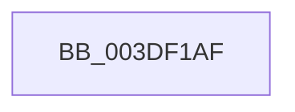

# sub_003DF1AF

- RVA: `0x003DF1AF`–`0x003DF1DC` (길이 `45` bytes)
- VA: `0x00000001403DF1AF`
- 실행 섹션: `.text`
- PDB 이름 있음: `아니요`; PDB Function 태그: `아니요`
- unwind 정보 RVA: `0x00094734`
- 디코드: `11`개 명령, `45/45` bytes 표시
- 미해석 바이트: `0` (있으면 어셈블리에 `.byte`로 보존)

> 이 문서는 커널 이미지의 기계어와 PDB 기호를 분석해 생성했습니다. 4번과 5번은 함수 원형과 자료형을 바이너리 사용 방식에서 추정한 C 해석이며 원본 소스 복구 결과는 아닙니다.

## 1. Dependencies

- 직접 호출 지점: **1**; 고유 호출 대상: **1**
- 직접 호출자로 확인된 함수: **0**
- RIP 상대 이미지 참조: **0**

### Outgoing calls
- `0x003DF1C7` → [MmMapLockedPagesSpecifyCache](../31/MmMapLockedPagesSpecifyCache_function_00318800.md) (function, `0x00318800`)

### Direct callers
- 이 함수 시작 RVA로 연결되는 직접 call은 확인되지 않았습니다. 간접 호출은 완전히 역산할 수 없습니다.

### Static image references
- 디코드된 RIP-relative 메모리 참조가 없습니다.

## 2. Other-region calls and transfers

- 다른 실행 섹션으로 향하는 call: **0**
- call이 아닌 외부 분기/꼬리 이동: **1**
  - `0x003DF1D7` → [HalpDmaSyncMapBuffers + 0x51](HalpDmaSyncMapBuffers_function_003DEFD0.md) (`tail-transfer`)

## 3. Assembly (complete function range)

```asm
003DF1AF  CC                              int3
003DF1B0  44 8B C1                        mov r8d, ecx
003DF1B3  C7 44 24 28 20 00 00 40         mov dword ptr [rsp + 0x28], 0x40000020
003DF1BB  48 8B CD                        mov rcx, rbp
003DF1BE  89 44 24 20                     mov dword ptr [rsp + 0x20], eax
003DF1C2  45 33 C9                        xor r9d, r9d
003DF1C5  33 D2                           xor edx, edx
003DF1C7  E8 34 96 F3 FF                  call 0x140318800
003DF1CC  4C 8B 94 24 C0 00 00 00         mov r10, qword ptr [rsp + 0xc0]
003DF1D4  48 8B D8                        mov rbx, rax
003DF1D7  E9 45 FE FF FF                  jmp 0x1403df021
```

## 4. C-style interpretation (structured pseudocode)

```c
__int64 __fastcall sub_003DF1AF(int a1, int a2, __int64 a3, int a4, __int64 a5, __int64 a6, __int64 a7, __int64 a8, __int64 a9, __int64 a10, __int64 a11, __int64 a12, __int64 a13, __int64 a14, __int64 a15, __int64 a16, __int64 a17, __int64 a18, __int64 a19, __int64 a20, __int64 a21, __int64 a22, __int64 a23, __int64 a24)
{
    __int64 result;
    unsigned int v_stack_p20;
    unsigned int v_stack_p28;

    v_stack_p28 = 0x40000020ULL;
    v_stack_p20 = (unsigned int)(result);
    a4 = 0;
    a2 = 0;
    result = MmMapLockedPagesSpecifyCache(v_rbp, a2, (unsigned int)(a1), a4);
}
```

## 5. (Beta) C Style

```c
int64_t sub_003DF1AF(int32_t Arg1, int32_t Arg2, int64_t Arg3, int32_t Arg4, uint64_t Arg5, uint64_t Arg6, uint64_t Arg7, uint64_t Arg8, uint64_t Arg9, uint64_t Arg10, uint64_t Arg11, uint64_t Arg12, uint64_t Arg13, uint64_t Arg14, uint64_t Arg15, uint64_t Arg16, uint64_t Arg17, uint64_t Arg18, uint64_t Arg19, uint64_t Arg20, uint64_t Arg21, uint64_t Arg22, uint64_t Arg23, int64_t Arg24)
{
    int64_t result;
    uint32_t v_stack_p20;
    uint32_t v_stack_p28;

    v_stack_p28 = 0x40000020ULL;
    v_stack_p20 = (uint32_t)(result);
    Arg4 = 0;
    Arg2 = 0;
    result = MmMapLockedPagesSpecifyCache(local_rbp, Arg2, (uint32_t)(Arg1), Arg4);
}
```

## 6. Execution-region graph

[열기: 2D/3D 그래프와 함수 탐색 컨트롤 패널](../../../control-panel.html?section=text&rva=0x003DF1AF&view=graph)

- 2D 그래프는 위에서 아래로 흐르고, 3D 그래프는 빈 공간을 드래그해 회전합니다. Shift+드래그는 이동, 휠은 확대·축소, 함수 노드 선택은 대상 보고서 이동입니다.

### Static fallback


