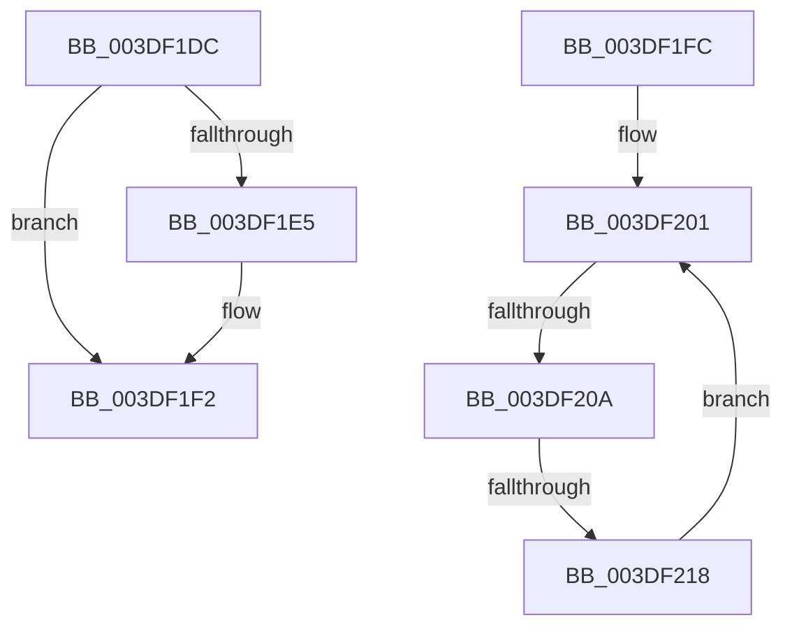

# sub_003DF1DC

- RVA: `0x003DF1DC`–`0x003DF220` (길이 `68` bytes)
- VA: `0x00000001403DF1DC`
- 실행 섹션: `.text`
- PDB 이름 있음: `아니요`; PDB Function 태그: `아니요`
- unwind 정보 RVA: `0x00094744`
- 디코드: `17`개 명령, `68/68` bytes 표시
- 미해석 바이트: `0` (있으면 어셈블리에 `.byte`로 보존)

> 이 문서는 커널 이미지의 기계어와 PDB 기호를 분석해 생성했습니다. 4번과 5번은 함수 원형과 자료형을 바이너리 사용 방식에서 추정한 C 해석이며 원본 소스 복구 결과는 아닙니다.

## 1. Dependencies

- 직접 호출 지점: **1**; 고유 호출 대상: **1**
- 직접 호출자로 확인된 함수: **0**
- RIP 상대 이미지 참조: **1**

### Outgoing calls
- `0x003DF1ED` → [KiLowerIrqlProcessIrqlFlags](../4F/KiLowerIrqlProcessIrqlFlags_function_004F5698.md) (function, `0x004F5698`)

### Direct callers
- 이 함수 시작 RVA로 연결되는 직접 call은 확인되지 않았습니다. 간접 호출은 완전히 역산할 수 없습니다.

### Static image references
- `0x003DF1DC` → RVA `0x00FC6D20` (`ALMOSTRO`; read)

## 2. Other-region calls and transfers

- 다른 실행 섹션으로 향하는 call: **0**
- call이 아닌 외부 분기/꼬리 이동: **3**
  - `0x003DF1FA` → [sub_003DF173 + 0x1E](Unknown_function_003DF173.md) (`tail-transfer`)
  - `0x003DF204` → [sub_003DF02A + 0x5F](Unknown_function_003DF02A.md) (`tail-transfer`)
  - `0x003DF212` → [sub_003DF2A7](Unknown_function_003DF2A7.md) (`tail-transfer`)

## 3. Assembly (complete function range)

```asm
003DF1DC  83 3D 3D 7B BE 00 00            cmp dword ptr [rip + 0xbe7b3d], 0
003DF1E3  74 0D                           je 0x1403df1f2
003DF1E5  44 0F 20 C1                     mov rcx, cr8
003DF1E9  40 0F B6 D6                     movzx edx, sil
003DF1ED  E8 A6 64 11 00                  call 0x1404f5698
003DF1F2  40 0F B6 C6                     movzx eax, sil
003DF1F6  44 0F 22 C0                     mov cr8, rax
003DF1FA  EB 95                           jmp 0x1403df191
003DF1FC  49 8B D5                        mov rdx, r13
003DF1FF  33 C9                           xor ecx, ecx
003DF201  41 3B CE                        cmp ecx, r14d
003DF204  0F 83 7F FE FF FF               jae 0x1403df089
003DF20A  48 F7 42 30 00 F0 FF FF         test qword ptr [rdx + 0x30], -0x1000
003DF212  0F 84 8F 00 00 00               je 0x1403df2a7
003DF218  48 8B 52 08                     mov rdx, qword ptr [rdx + 8]
003DF21C  FF C1                           inc ecx
003DF21E  EB E1                           jmp 0x1403df201
```

## 4. C-style interpretation (structured pseudocode)

```c
__int64 __fastcall sub_003DF1DC(void)
{
    __int64 result;

    if ((*(unsigned int *)(v_rip + 12483389)) != 0) {
        a1 = v_cr8;
        a2 = (unsigned __int8)(v_rsi);
        result = KiLowerIrqlProcessIrqlFlags(a1, a2, a3, a4);
    }
}
```

## 5. (Beta) C Style

```c
void sub_003DF1DC(void)
{
    int64_t result;

    if ((*(uint32_t *)(v_rip + 0xBE7B3D)) != 0) {
        a1 = v_cr8;
        a2 = (uint8_t)(local_rsi);
        result = KiLowerIrqlProcessIrqlFlags(a1, a2, a3, a4);
    }
}
```

## 6. Execution-region graph

[열기: 2D/3D 그래프와 함수 탐색 컨트롤 패널](../../../control-panel.html?section=text&rva=0x003DF1DC&view=graph)

- 2D 그래프는 위에서 아래로 흐르고, 3D 그래프는 빈 공간을 드래그해 회전합니다. Shift+드래그는 이동, 휠은 확대·축소, 함수 노드 선택은 대상 보고서 이동입니다.

### Static fallback


