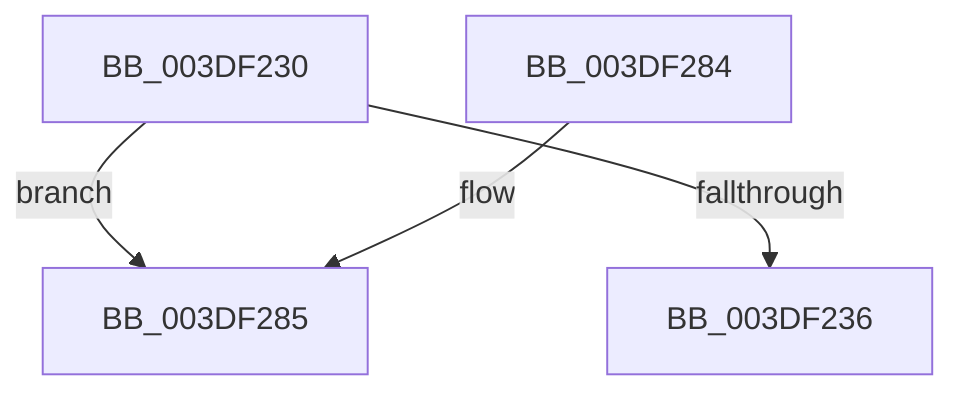

# sub_003DF230

- RVA: `0x003DF230`–`0x003DF2A7` (길이 `119` bytes)
- VA: `0x00000001403DF230`
- 실행 섹션: `.text`
- PDB 이름 있음: `아니요`; PDB Function 태그: `아니요`
- unwind 정보 RVA: `0x00094778`
- 디코드: `30`개 명령, `119/119` bytes 표시
- 미해석 바이트: `0` (있으면 어셈블리에 `.byte`로 보존)

> 이 문서는 커널 이미지의 기계어와 PDB 기호를 분석해 생성했습니다. 4번과 5번은 함수 원형과 자료형을 바이너리 사용 방식에서 추정한 C 해석이며 원본 소스 복구 결과는 아닙니다.

## 1. Dependencies

- 직접 호출 지점: **2**; 고유 호출 대상: **2**
- 직접 호출자로 확인된 함수: **0**
- RIP 상대 이미지 참조: **0**

### Outgoing calls
- `0x003DF271` → [HalpDmaSyncMapBuffersWithEmergencyResources](../4D/HalpDmaSyncMapBuffersWithEmergencyResources_function_004DE714.md) (function, `0x004DE714`)
- `0x003DF2A1` → [KeBugCheckEx](../4F/KeBugCheckEx_function_004FD660.md) (function, `0x004FD660`)

### Direct callers
- 이 함수 시작 RVA로 연결되는 직접 call은 확인되지 않았습니다. 간접 호출은 완전히 역산할 수 없습니다.

### Static image references
- 디코드된 RIP-relative 메모리 참조가 없습니다.

## 2. Other-region calls and transfers

- 다른 실행 섹션으로 향하는 call: **0**
- 별도 외부 분기/꼬리 이동을 확인하지 못했습니다.

## 3. Assembly (complete function range)

```asm
003DF230  40 80 FE 02                     cmp sil, 2
003DF234  77 4F                           ja 0x1403df285
003DF236  0F B6 84 24 F8 00 00 00         movzx eax, byte ptr [rsp + 0xf8]
003DF23E  4D 8B CD                        mov r9, r13
003DF241  88 44 24 38                     mov byte ptr [rsp + 0x38], al
003DF245  4C 8B C7                        mov r8, rdi
003DF248  0F B6 84 24 F0 00 00 00         movzx eax, byte ptr [rsp + 0xf0]
003DF250  48 8B D5                        mov rdx, rbp
003DF253  88 44 24 30                     mov byte ptr [rsp + 0x30], al
003DF257  49 8B CA                        mov rcx, r10
003DF25A  0F B6 84 24 E8 00 00 00         movzx eax, byte ptr [rsp + 0xe8]
003DF262  88 44 24 28                     mov byte ptr [rsp + 0x28], al
003DF266  8B 84 24 E0 00 00 00            mov eax, dword ptr [rsp + 0xe0]
003DF26D  89 44 24 20                     mov dword ptr [rsp + 0x20], eax
003DF271  E8 9E F4 0F 00                  call 0x1404de714
003DF276  48 81 C4 90 00 00 00            add rsp, 0x90
003DF27D  41 5D                           pop r13
003DF27F  5F                              pop rdi
003DF280  5E                              pop rsi
003DF281  5D                              pop rbp
003DF282  5B                              pop rbx
003DF283  C3                              ret
003DF284  CC                              int3
003DF285  45 33 C9                        xor r9d, r9d
003DF288  48 C7 44 24 20 00 00 00 00      mov qword ptr [rsp + 0x20], 0
003DF291  BA 00 10 00 00                  mov edx, 0x1000
003DF296  B9 AC 00 00 00                  mov ecx, 0xac
003DF29B  41 B8 05 EF 00 00               mov r8d, 0xef05
003DF2A1  E8 BA E3 11 00                  call 0x1404fd660
003DF2A6  CC                              int3
```

## 4. C-style interpretation (structured pseudocode)

```c
__int64 __fastcall sub_003DF230(__int64 a1, __int64 a2, __int64 a3, __int64 a4, __int64 a5, __int64 a6, __int64 a7, __int64 a8, __int64 a9, __int64 a10, __int64 a11, __int64 a12, __int64 a13, __int64 a14, __int64 a15, __int64 a16, __int64 a17, __int64 a18, __int64 a19, __int64 a20, __int64 a21, __int64 a22, __int64 a23, __int64 a24, __int64 a25, __int64 a26, __int64 a27, unsigned int a28, unsigned __int8 a29, unsigned __int8 a30, unsigned __int8 a31)
{
    __int64 result;
    __int64 v_rsp;
    unsigned int v_stack_p20;
    unsigned __int8 v_stack_p28;
    unsigned __int8 v_stack_p30;
    unsigned __int8 v_stack_p38;
    unsigned __int64 v_stack_pD8;

    if (((unsigned __int8)(v_rsi)) > 2) goto loc_003DF285;
    v_stack_p38 = a31;
    v_stack_p30 = a30;
    v_stack_p28 = a29;
    v_stack_p20 = (unsigned int)((unsigned int)(a28));
    result = HalpDmaSyncMapBuffersWithEmergencyResources(v_r10, v_rbp, v_rdi, v_r13);
    v_rsp = (v_rsp) + (144);
    return result;
loc_003DF285:
    a4 = 0;
    v_stack_pD8 = 0;
    result = KeBugCheckEx(172, (unsigned int)(0x1000ULL), (unsigned int)(0xEF05ULL), a4);
    return result;
}
```

## 5. (Beta) C Style

```c
int64_t sub_003DF230(int64_t Arg1, int64_t Arg2, int64_t Arg3, int64_t Arg4, uint64_t Arg5, uint64_t Arg6, uint64_t Arg7, uint64_t Arg8, uint64_t Arg9, uint64_t Arg10, uint64_t Arg11, uint64_t Arg12, uint64_t Arg13, uint64_t Arg14, uint64_t Arg15, uint64_t Arg16, uint64_t Arg17, uint64_t Arg18, uint64_t Arg19, uint64_t Arg20, uint64_t Arg21, uint64_t Arg22, uint64_t Arg23, uint64_t Arg24, uint64_t Arg25, uint64_t Arg26, uint64_t Arg27, uint32_t Arg28, uint8_t Arg29, uint8_t Arg30, uint8_t Arg31)
{
    int64_t result;
    int64_t local_rsp;
    uint32_t v_stack_p20;
    uint8_t v_stack_p28;
    uint8_t v_stack_p30;
    uint8_t v_stack_p38;
    uint64_t v_stack_pD8;

    if (((uint8_t)(local_rsi)) > 2) goto loc_003DF285;
    v_stack_p38 = Arg31;
    v_stack_p30 = Arg30;
    v_stack_p28 = Arg29;
    v_stack_p20 = (uint32_t)((uint32_t)(Arg28));
    result = HalpDmaSyncMapBuffersWithEmergencyResources(local_r10, local_rbp, local_rdi, local_r13);
    local_rsp = (local_rsp) + (144);
    return result;
loc_003DF285:
    Arg4 = 0;
    v_stack_pD8 = 0;
    result = KeBugCheckEx(172, (uint32_t)(0x1000ULL), (uint32_t)(0xEF05ULL), Arg4);
    return result;
}
```

## 6. Execution-region graph

[열기: 2D/3D 그래프와 함수 탐색 컨트롤 패널](../../../control-panel.html?section=text&rva=0x003DF230&view=graph)

- 2D 그래프는 위에서 아래로 흐르고, 3D 그래프는 빈 공간을 드래그해 회전합니다. Shift+드래그는 이동, 휠은 확대·축소, 함수 노드 선택은 대상 보고서 이동입니다.

### Static fallback


