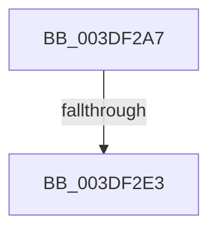

# sub_003DF2A7

- RVA: `0x003DF2A7`–`0x003DF2F5` (길이 `78` bytes)
- VA: `0x00000001403DF2A7`
- 실행 섹션: `.text`
- PDB 이름 있음: `아니요`; PDB Function 태그: `아니요`
- unwind 정보 RVA: `0x0009478C`
- 디코드: `17`개 명령, `78/78` bytes 표시
- 미해석 바이트: `0` (있으면 어셈블리에 `.byte`로 보존)

> 이 문서는 커널 이미지의 기계어와 PDB 기호를 분석해 생성했습니다. 4번과 5번은 함수 원형과 자료형을 바이너리 사용 방식에서 추정한 C 해석이며 원본 소스 복구 결과는 아닙니다.

## 1. Dependencies

- 직접 호출 지점: **2**; 고유 호출 대상: **2**
- 직접 호출자로 확인된 함수: **0**
- RIP 상대 이미지 참조: **1**

### Outgoing calls
- `0x003DF2C3` → [KeBugCheckEx](../4F/KeBugCheckEx_function_004FD660.md) (function, `0x004FD660`)
- `0x003DF2EA` → [KiRaiseIrqlProcessIrqlFlags](../4F/KiRaiseIrqlProcessIrqlFlags_function_004F56FC.md) (function, `0x004F56FC`)

### Direct callers
- 이 함수 시작 RVA로 연결되는 직접 call은 확인되지 않았습니다. 간접 호출은 완전히 역산할 수 없습니다.

### Static image references
- `0x003DF2D6` → RVA `0x00FC6D20` (`ALMOSTRO`; read)

## 2. Other-region calls and transfers

- 다른 실행 섹션으로 향하는 call: **0**
- call이 아닌 외부 분기/꼬리 이동: **2**
  - `0x003DF2DD` → [sub_006EA4E8](../6E/Unknown_function_006EA4E8.md) (`tail-transfer`)
  - `0x003DF2F0` → [sub_006EA4E8](../6E/Unknown_function_006EA4E8.md) (`tail-transfer`)

## 3. Assembly (complete function range)

```asm
003DF2A7  45 33 C9                        xor r9d, r9d
003DF2AA  48 C7 44 24 20 00 00 00 00      mov qword ptr [rsp + 0x20], 0
003DF2B3  BA 00 10 00 00                  mov edx, 0x1000
003DF2B8  B9 AC 00 00 00                  mov ecx, 0xac
003DF2BD  41 B8 03 EF 00 00               mov r8d, 0xef03
003DF2C3  E8 98 E3 11 00                  call 0x1404fd660
003DF2C8  CC                              int3
003DF2C9  44 0F 20 C6                     mov rsi, cr8
003DF2CD  B8 02 00 00 00                  mov eax, 2
003DF2D2  44 0F 22 C0                     mov cr8, rax
003DF2D6  83 3D 43 7A BE 00 00            cmp dword ptr [rip + 0xbe7a43], 0
003DF2DD  0F 84 05 B2 30 00               je 0x1406ea4e8
003DF2E3  0F B6 D0                        movzx edx, al
003DF2E6  40 0F B6 CE                     movzx ecx, sil
003DF2EA  E8 0D 64 11 00                  call 0x1404f56fc
003DF2EF  90                              nop
003DF2F0  E9 F3 B1 30 00                  jmp 0x1406ea4e8
```

## 4. C-style interpretation (structured pseudocode)

```c
__int64 __fastcall sub_003DF2A7(__int64 a1, __int64 a2, __int64 a3, int a4)
{
    __int64 result;
    unsigned __int64 v_stack_p20;

    a4 = 0;
    v_stack_p20 = 0;
    result = KeBugCheckEx(172, (unsigned int)(0x1000ULL), (unsigned int)(0xEF03ULL), a4);
    result = KiRaiseIrqlProcessIrqlFlags((unsigned __int8)(v_cr8), 2, (unsigned int)(0xEF03ULL), a4);
}
```

## 5. (Beta) C Style

```c
int64_t sub_003DF2A7(int64_t Arg1, int64_t Arg2, int64_t Arg3, int32_t Arg4)
{
    int64_t result;
    uint64_t v_stack_p20;

    Arg4 = 0;
    v_stack_p20 = 0;
    result = KeBugCheckEx(172, (uint32_t)(0x1000ULL), (uint32_t)(0xEF03ULL), Arg4);
    result = KiRaiseIrqlProcessIrqlFlags((uint8_t)(v_cr8), 2, (uint32_t)(0xEF03ULL), Arg4);
}
```

## 6. Execution-region graph

[열기: 2D/3D 그래프와 함수 탐색 컨트롤 패널](../../../control-panel.html?section=text&rva=0x003DF2A7&view=graph)

- 2D 그래프는 위에서 아래로 흐르고, 3D 그래프는 빈 공간을 드래그해 회전합니다. Shift+드래그는 이동, 휠은 확대·축소, 함수 노드 선택은 대상 보고서 이동입니다.

### Static fallback


