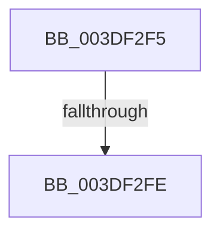

# sub_003DF2F5

- RVA: `0x003DF2F5`–`0x003DF335` (길이 `64` bytes)
- VA: `0x00000001403DF2F5`
- 실행 섹션: `.text`
- PDB 이름 있음: `아니요`; PDB Function 태그: `아니요`
- unwind 정보 RVA: `0x000947A4`
- 디코드: `13`개 명령, `64/64` bytes 표시
- 미해석 바이트: `0` (있으면 어셈블리에 `.byte`로 보존)

> 이 문서는 커널 이미지의 기계어와 PDB 기호를 분석해 생성했습니다. 4번과 5번은 함수 원형과 자료형을 바이너리 사용 방식에서 추정한 C 해석이며 원본 소스 복구 결과는 아닙니다.

## 1. Dependencies

- 직접 호출 지점: **1**; 고유 호출 대상: **1**
- 직접 호출자로 확인된 함수: **0**
- RIP 상대 이미지 참조: **0**

### Outgoing calls
- `0x003DF320` → [HalpFlushMapBuffers](../55/HalpFlushMapBuffers_function_00551358.md) (function, `0x00551358`)

### Direct callers
- 이 함수 시작 RVA로 연결되는 직접 call은 확인되지 않았습니다. 간접 호출은 완전히 역산할 수 없습니다.

### Static image references
- 디코드된 RIP-relative 메모리 참조가 없습니다.

## 2. Other-region calls and transfers

- 다른 실행 섹션으로 향하는 call: **0**
- call이 아닌 외부 분기/꼬리 이동: **2**
  - `0x003DF2F8` → [sub_003DF08F + 0x38](Unknown_function_003DF08F.md) (`tail-transfer`)
  - `0x003DF330` → [sub_003DF08F + 0x38](Unknown_function_003DF08F.md) (`tail-transfer`)

## 3. Assembly (complete function range)

```asm
003DF2F5  40 84 ED                        test bpl, bpl
003DF2F8  0F 85 C9 FD FF FF               jne 0x1403df0c7
003DF2FE  0F B6 84 24 F8 00 00 00         movzx eax, byte ptr [rsp + 0xf8]
003DF306  45 8B CF                        mov r9d, r15d
003DF309  4C 8B 84 24 D8 00 00 00         mov r8, qword ptr [rsp + 0xd8]
003DF311  48 8B D3                        mov rdx, rbx
003DF314  88 44 24 28                     mov byte ptr [rsp + 0x28], al
003DF318  49 8B CA                        mov rcx, r10
003DF31B  40 88 6C 24 20                  mov byte ptr [rsp + 0x20], bpl
003DF320  E8 33 20 17 00                  call 0x140551358
003DF325  4C 8B 94 24 C0 00 00 00         mov r10, qword ptr [rsp + 0xc0]
003DF32D  48 8B CB                        mov rcx, rbx
003DF330  E9 92 FD FF FF                  jmp 0x1403df0c7
```

## 4. C-style interpretation (structured pseudocode)

```c
__int64 __fastcall sub_003DF2F5(__int64 a1, __int64 a2, __int64 a3, __int64 a4, __int64 a5, __int64 a6, __int64 a7, __int64 a8, __int64 a9, __int64 a10, __int64 a11, __int64 a12, __int64 a13, __int64 a14, __int64 a15, __int64 a16, __int64 a17, __int64 a18, __int64 a19, __int64 a20, __int64 a21, __int64 a22, __int64 a23, __int64 a24, __int64 a25, __int64 a26, __int64 a27, __int64 a28, __int64 a29, __int64 a30, unsigned __int8 a31)
{
    __int64 result;
    unsigned __int8 v_stack_p20;
    unsigned __int8 v_stack_p28;

    v_stack_p28 = a31;
    v_stack_p20 = (unsigned __int8)(v_rbp);
    result = HalpFlushMapBuffers(v_r10, v_rbx, a27, (unsigned int)((unsigned int)(v_r15)));
}
```

## 5. (Beta) C Style

```c
int64_t sub_003DF2F5(int64_t Arg1, int64_t Arg2, int64_t Arg3, int64_t Arg4, uint64_t Arg5, uint64_t Arg6, uint64_t Arg7, uint64_t Arg8, uint64_t Arg9, uint64_t Arg10, uint64_t Arg11, uint64_t Arg12, uint64_t Arg13, uint64_t Arg14, uint64_t Arg15, uint64_t Arg16, uint64_t Arg17, uint64_t Arg18, uint64_t Arg19, uint64_t Arg20, uint64_t Arg21, uint64_t Arg22, uint64_t Arg23, int64_t Arg24, uint64_t Arg25, uint64_t Arg26, int64_t Arg27, uint64_t Arg28, uint64_t Arg29, uint64_t Arg30, uint8_t Arg31)
{
    int64_t result;
    uint8_t v_stack_p20;
    uint8_t v_stack_p28;

    v_stack_p28 = Arg31;
    v_stack_p20 = (uint8_t)(local_rbp);
    result = HalpFlushMapBuffers(local_r10, local_rbx, Arg27, (uint32_t)((uint32_t)(local_r15)));
}
```

## 6. Execution-region graph

[열기: 2D/3D 그래프와 함수 탐색 컨트롤 패널](../../../control-panel.html?section=text&rva=0x003DF2F5&view=graph)

- 2D 그래프는 위에서 아래로 흐르고, 3D 그래프는 빈 공간을 드래그해 회전합니다. Shift+드래그는 이동, 휠은 확대·축소, 함수 노드 선택은 대상 보고서 이동입니다.

### Static fallback


