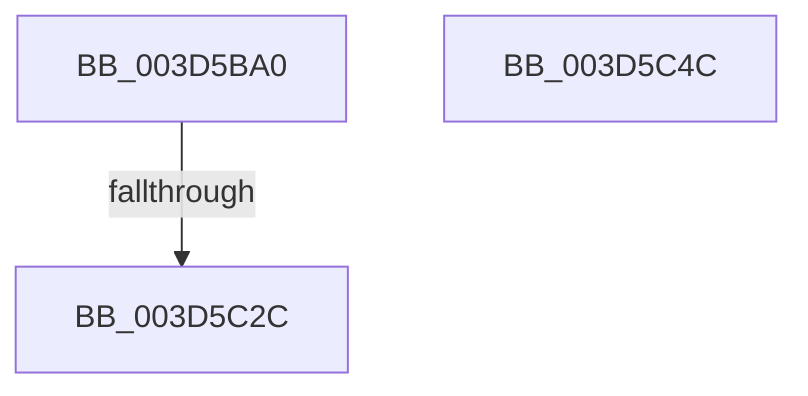

# VslKernelShadowStackAssist

- RVA: `0x003D5BA0`–`0x003D5C4D` (길이 `173` bytes)
- VA: `0x00000001403D5BA0`
- 실행 섹션: `.text`
- PDB 이름 있음: `예`; PDB Function 태그: `예`
- unwind 정보 RVA: `0x00093A50`
- 디코드: `51`개 명령, `173/173` bytes 표시
- 미해석 바이트: `0` (있으면 어셈블리에 `.byte`로 보존)

> 이 문서는 커널 이미지의 기계어와 PDB 기호를 분석해 생성했습니다. 4번과 5번은 함수 원형과 자료형을 바이너리 사용 방식에서 추정한 C 해석이며 원본 소스 복구 결과는 아닙니다.

## 1. Dependencies

- 직접 호출 지점: **3**; 고유 호출 대상: **3**
- 직접 호출자로 확인된 함수: **7**
- RIP 상대 이미지 참조: **1**

### Outgoing calls
- `0x003D5BDE` → [memset](../6C/memset_function_006C6C40.md) (function, `0x006C6C40`)
- `0x003D5C1D` → [VslpEnterIumSecureMode](../23/VslpEnterIumSecureMode_function_00235E50.md) (function, `0x00235E50`)
- `0x003D5C33` → [_security_check_cookie](../6A/_security_check_cookie_function_006AC640.md) (function, `0x006AC640`)

### Direct callers
- [KeKernelShadowStackRestoreContext](KeKernelShadowStackRestoreContext_function_003D5B30.md) at `0x003D5B7C`
- [KxContextToKframes](KxContextToKframes_function_003D6850.md) at `0x003D6D2C`
- [KiProcessControlProtectionFromKernelMode](../44/KiProcessControlProtectionFromKernelMode_function_00444B2C.md) at `0x00444BE3`
- [KiProcessDeferredDpcWatchdogViolation](../4D/KiProcessDeferredDpcWatchdogViolation_function_004D1A64.md) at `0x004D1B1A`
- [KiCheckForFreezeExecution](../5B/KiCheckForFreezeExecution_function_005B41E0.md) at `0x005B4298`
- [KiKernelShadowStackAssistMceAlternateReturn](../5C/KiKernelShadowStackAssistMceAlternateReturn_function_005C8220.md) at `0x005C8270`
- [KiDebugTrapOrFault](../6B/KiDebugTrapOrFault_function_006BCD80.md) at `0x006BCE5D`

### Static image references
- `0x003D5BB9` → RVA `0x00E0A740` (`.data`; read)

## 2. Other-region calls and transfers

- 다른 실행 섹션으로 향하는 call: **0**
- call이 아닌 외부 분기/꼬리 이동: **1**
  - `0x003D5C26` → [sub_006E97E8](../6E/Unknown_function_006E97E8.md) (`tail-transfer`)

## 3. Assembly (complete function range)

```asm
003D5BA0  40 55                           push rbp
003D5BA2  53                              push rbx
003D5BA3  56                              push rsi
003D5BA4  57                              push rdi
003D5BA5  41 54                           push r12
003D5BA7  41 55                           push r13
003D5BA9  41 56                           push r14
003D5BAB  41 57                           push r15
003D5BAD  48 8D 6C 24 A8                  lea rbp, [rsp - 0x58]
003D5BB2  48 81 EC 58 01 00 00            sub rsp, 0x158
003D5BB9  48 8B 05 80 4B A3 00            mov rax, qword ptr [rip + 0xa34b80]
003D5BC0  48 33 C4                        xor rax, rsp
003D5BC3  48 89 45 40                     mov qword ptr [rbp + 0x40], rax
003D5BC7  48 8B F2                        mov rsi, rdx
003D5BCA  48 63 F9                        movsxd rdi, ecx
003D5BCD  33 D2                           xor edx, edx
003D5BCF  48 8D 4C 24 30                  lea rcx, [rsp + 0x30]
003D5BD4  4D 8B F0                        mov r14, r8
003D5BD7  4D 8B F9                        mov r15, r9
003D5BDA  44 8D 42 68                     lea r8d, [rdx + 0x68]
003D5BDE  E8 5D 10 2F 00                  call 0x1406c6c40
003D5BE3  4C 8B A5 C0 00 00 00            mov r12, qword ptr [rbp + 0xc0]
003D5BEA  4C 8D 4C 24 30                  lea r9, [rsp + 0x30]
003D5BEF  4C 63 AD C8 00 00 00            movsxd r13, dword ptr [rbp + 0xc8]
003D5BF6  BA 13 01 00 00                  mov edx, 0x113
003D5BFB  45 33 C0                        xor r8d, r8d
003D5BFE  4C 89 64 24 58                  mov qword ptr [rsp + 0x58], r12
003D5C03  B1 02                           mov cl, 2
003D5C05  44 89 6C 24 60                  mov dword ptr [rsp + 0x60], r13d
003D5C0A  89 7C 24 38                     mov dword ptr [rsp + 0x38], edi
003D5C0E  48 89 74 24 40                  mov qword ptr [rsp + 0x40], rsi
003D5C13  4C 89 74 24 48                  mov qword ptr [rsp + 0x48], r14
003D5C18  4C 89 7C 24 50                  mov qword ptr [rsp + 0x50], r15
003D5C1D  E8 2E 02 E6 FF                  call 0x140235e50
003D5C22  8B D8                           mov ebx, eax
003D5C24  85 C0                           test eax, eax
003D5C26  0F 88 BC 3B 31 00               js 0x1406e97e8
003D5C2C  48 8B 4D 40                     mov rcx, qword ptr [rbp + 0x40]
003D5C30  48 33 CC                        xor rcx, rsp
003D5C33  E8 08 6A 2D 00                  call 0x1406ac640
003D5C38  48 81 C4 58 01 00 00            add rsp, 0x158
003D5C3F  41 5F                           pop r15
003D5C41  41 5E                           pop r14
003D5C43  41 5D                           pop r13
003D5C45  41 5C                           pop r12
003D5C47  5F                              pop rdi
003D5C48  5E                              pop rsi
003D5C49  5B                              pop rbx
003D5C4A  5D                              pop rbp
003D5C4B  C3                              ret
003D5C4C  CC                              int3
```

## 4. C-style interpretation (structured pseudocode)

```c
__int64 __fastcall VslKernelShadowStackAssist(int a1, __int64 a2, __int64 a3, __int64 a4, __int64 a5, unsigned int a6)
{
    __int64 result;
    __int64 v_rsp;
    unsigned int v_stack_m138;
    unsigned __int64 v_stack_m140;
    unsigned __int64 v_stack_m148;
    unsigned __int64 v_stack_m150;
    unsigned __int64 v_stack_m158;
    unsigned int v_stack_m160;
    unsigned __int64 v_stack_m168;
    unsigned __int64 v_stack_m58;
    unsigned __int64 v_stack_m98;

    v_rsp = (v_rsp) - (344);
    result = (*(unsigned __int64 *)(v_rip + 10701696)) ^ (v_rsp);
    v_stack_m58 = result;
    a2 = 0;
    result = memset(v_stack_m168, a2, a2 + 104, a4);
    a3 = 0;
    v_stack_m140 = a5;
    v_stack_m138 = (unsigned int)((int)(a6));
    v_stack_m160 = (unsigned int)((int)(a1));
    v_stack_m158 = 0;
    v_stack_m150 = 0;
    v_stack_m148 = a4;
    result = VslpEnterIumSecureMode(2, 275, a3, v_stack_m168);
    a1 = (v_stack_m58) ^ (v_rsp);
    result = _security_check_cookie(a1, 275, a3, v_stack_m168);
    v_rsp = (v_rsp) + (344);
    return result;
}
```

## 5. (Beta) C Style

```c
int64_t VslKernelShadowStackAssist(int32_t Arg1, int64_t Arg2, int64_t Arg3, int64_t Arg4, int64_t Arg5, uint32_t Arg6)
{
    int64_t result;
    int64_t local_rsp;
    uint32_t v_stack_m138;
    uint64_t v_stack_m140;
    uint64_t v_stack_m148;
    uint64_t v_stack_m150;
    uint64_t v_stack_m158;
    uint32_t v_stack_m160;
    uint64_t v_stack_m168;
    uint64_t v_stack_m58;
    uint64_t v_stack_m98;

    local_rsp = (local_rsp) - (344);
    result = (*(uint64_t *)(v_rip + 0xA34B80)) ^ (local_rsp);
    v_stack_m58 = result;
    Arg2 = 0;
    result = memset(v_stack_m168, Arg2, Arg2 + 104, Arg4);
    Arg3 = 0;
    v_stack_m140 = Arg5;
    v_stack_m138 = (uint32_t)((int32_t)(Arg6));
    v_stack_m160 = (uint32_t)((int32_t)(Arg1));
    v_stack_m158 = 0;
    v_stack_m150 = 0;
    v_stack_m148 = Arg4;
    result = VslpEnterIumSecureMode(2, 275, Arg3, v_stack_m168);
    Arg1 = (v_stack_m58) ^ (local_rsp);
    result = _security_check_cookie(Arg1, 275, Arg3, v_stack_m168);
    local_rsp = (local_rsp) + (344);
    return result;
}
```

## 6. Execution-region graph

[열기: 2D/3D 그래프와 함수 탐색 컨트롤 패널](../../../control-panel.html?section=text&rva=0x003D5BA0&view=graph)

- 2D 그래프는 위에서 아래로 흐르고, 3D 그래프는 빈 공간을 드래그해 회전합니다. Shift+드래그는 이동, 휠은 확대·축소, 함수 노드 선택은 대상 보고서 이동입니다.

### Static fallback


