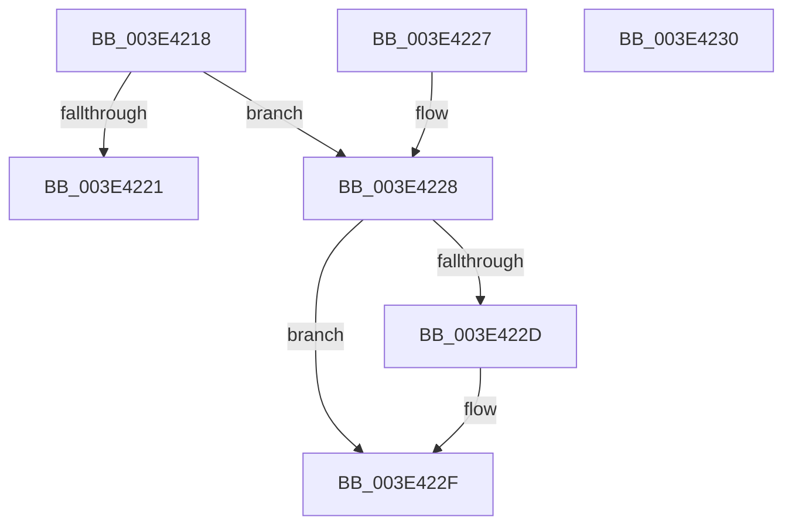

# BgpFmRoundUp

- RVA: `0x003E4218`–`0x003E4231` (길이 `25` bytes)
- VA: `0x00000001403E4218`
- 실행 섹션: `.text`
- PDB 이름 있음: `예`; PDB Function 태그: `아니요`
- unwind 정보 RVA: `0x000DB714`
- 디코드: `12`개 명령, `25/25` bytes 표시
- 미해석 바이트: `0` (있으면 어셈블리에 `.byte`로 보존)

> 이 문서는 커널 이미지의 기계어와 PDB 기호를 분석해 생성했습니다. 4번과 5번은 함수 원형과 자료형을 바이너리 사용 방식에서 추정한 C 해석이며 원본 소스 복구 결과는 아닙니다.

## 1. Dependencies

- 직접 호출 지점: **0**; 고유 호출 대상: **0**
- 직접 호출자로 확인된 함수: **3**
- RIP 상대 이미지 참조: **0**

### Outgoing calls
- 직접 디코드된 call 명령이 없습니다.

### Direct callers
- [RaspScanConvert](RaspScanConvert_function_003E3760.md) at `0x003E37D9`
- [RaspScanConvert](RaspScanConvert_function_003E3760.md) at `0x003E37E6`
- [BgpRasPrintGlyph](../47/BgpRasPrintGlyph_function_0047F3B4.md) at `0x0047F619`
- [BgpRasGetGlyphTextCellDimensions](../6A/BgpRasGetGlyphTextCellDimensions_function_006A18D8.md) at `0x006A1941`

### Static image references
- 디코드된 RIP-relative 메모리 참조가 없습니다.

## 2. Other-region calls and transfers

- 다른 실행 섹션으로 향하는 call: **0**
- 별도 외부 분기/꼬리 이동을 확인하지 못했습니다.

## 3. Assembly (complete function range)

```asm
003E4218  8B C1                           mov eax, ecx
003E421A  C1 F8 06                        sar eax, 6
003E421D  85 C9                           test ecx, ecx
003E421F  79 07                           jns 0x1403e4228
003E4221  0D 00 00 00 FC                  or eax, 0xfc000000
003E4226  C3                              ret
003E4227  CC                              int3
003E4228  F6 C1 3F                        test cl, 0x3f
003E422B  74 02                           je 0x1403e422f
003E422D  FF C0                           inc eax
003E422F  C3                              ret
003E4230  CC                              int3
```

## 4. C-style interpretation (structured pseudocode)

```c
__int64 __fastcall BgpFmRoundUp(int a1)
{
    __int64 result;

    result = (unsigned int)(((unsigned int)(a1)) >> (6));
    if (!sign_flag) goto loc_003E4228;
    result = (unsigned int)((result) | (0xFC000000ULL));
    return result;
loc_003E4228:
    if ((((unsigned __int8)(a1)) & (63)) != 0) {
        result = (unsigned int)((result) + 1);
    }
    return result;
}
```

## 5. (Beta) C Style

```c
int64_t BgpFmRoundUp(int32_t Arg1)
{
    int64_t result;

    result = (uint32_t)(((uint32_t)(Arg1)) >> (6));
    if (!sign_flag) goto loc_003E4228;
    result = (uint32_t)((result) | (0xFC000000ULL));
    return result;
loc_003E4228:
    if ((((uint8_t)(Arg1)) & (63)) != 0) {
        result = (uint32_t)((result) + 1);
    }
    return result;
}
```

## 6. Execution-region graph

[열기: 2D/3D 그래프와 함수 탐색 컨트롤 패널](../../../control-panel.html?section=text&rva=0x003E4218&view=graph)

- 2D 그래프는 위에서 아래로 흐르고, 3D 그래프는 빈 공간을 드래그해 회전합니다. Shift+드래그는 이동, 휠은 확대·축소, 함수 노드 선택은 대상 보고서 이동입니다.

### Static fallback


