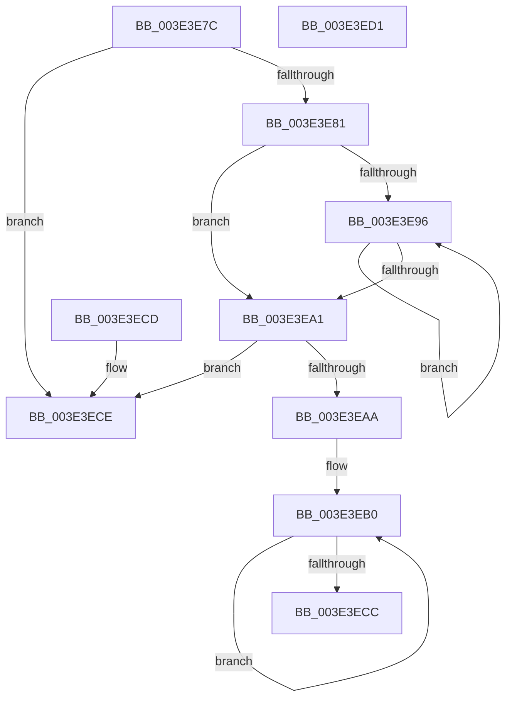

# BgpFmSqrt

- RVA: `0x003E3E7C`–`0x003E3ED2` (길이 `86` bytes)
- VA: `0x00000001403E3E7C`
- 실행 섹션: `.text`
- PDB 이름 있음: `예`; PDB Function 태그: `아니요`
- unwind 정보 RVA: `0x000DB714`
- 디코드: `31`개 명령, `86/86` bytes 표시
- 미해석 바이트: `0` (있으면 어셈블리에 `.byte`로 보존)

> 이 문서는 커널 이미지의 기계어와 PDB 기호를 분석해 생성했습니다. 4번과 5번은 함수 원형과 자료형을 바이너리 사용 방식에서 추정한 C 해석이며 원본 소스 복구 결과는 아닙니다.

## 1. Dependencies

- 직접 호출 지점: **0**; 고유 호출 대상: **0**
- 직접 호출자로 확인된 함수: **1**
- RIP 상대 이미지 참조: **0**

### Outgoing calls
- 직접 디코드된 call 명령이 없습니다.

### Direct callers
- [RaspTestIntersection](RaspTestIntersection_function_003E3BBC.md) at `0x003E3D28`

### Static image references
- 디코드된 RIP-relative 메모리 참조가 없습니다.

## 2. Other-region calls and transfers

- 다른 실행 섹션으로 향하는 call: **0**
- 별도 외부 분기/꼬리 이동을 확인하지 못했습니다.

## 3. Assembly (complete function range)

```asm
003E3E7C  48 85 C9                        test rcx, rcx
003E3E7F  7E 4D                           jle 0x1403e3ece
003E3E81  4C 8B C1                        mov r8, rcx
003E3E84  48 8D 41 01                     lea rax, [rcx + 1]
003E3E88  49 C1 E0 20                     shl r8, 0x20
003E3E8C  33 D2                           xor edx, edx
003E3E8E  48 D1 F8                        sar rax, 1
003E3E91  48 85 C0                        test rax, rax
003E3E94  7E 0B                           jle 0x1403e3ea1
003E3E96  48 2B C2                        sub rax, rdx
003E3E99  48 FF C2                        inc rdx
003E3E9C  48 3B C2                        cmp rax, rdx
003E3E9F  7F F5                           jg 0x1403e3e96
003E3EA1  48 C1 E2 10                     shl rdx, 0x10
003E3EA5  48 85 D2                        test rdx, rdx
003E3EA8  74 24                           je 0x1403e3ece
003E3EAA  41 B9 07 00 00 00               mov r9d, 7
003E3EB0  48 8B C2                        mov rax, rdx
003E3EB3  48 8D 0C 12                     lea rcx, [rdx + rdx]
003E3EB7  48 0F AF C2                     imul rax, rdx
003E3EBB  49 03 C0                        add rax, r8
003E3EBE  48 99                           cqo
003E3EC0  48 F7 F9                        idiv rcx
003E3EC3  48 8B D0                        mov rdx, rax
003E3EC6  49 83 E9 01                     sub r9, 1
003E3ECA  75 E4                           jne 0x1403e3eb0
003E3ECC  C3                              ret
003E3ECD  CC                              int3
003E3ECE  33 C0                           xor eax, eax
003E3ED0  C3                              ret
003E3ED1  CC                              int3
```

## 4. C-style interpretation (structured pseudocode)

```c
__int64 __fastcall BgpFmSqrt(__int64 a1, int a2)
{
    __int64 result;

    if (condition_is_less_or_equal) goto loc_003E3ECE;
    a3 = (a1) << (32);
    a2 = 0;
    result = (a1 + 1) >> (1);
    if (condition_is_less_or_equal) goto loc_003E3EA1;
loc_003E3E96:
    result = (result) - (0);
    a2 = (a2) + 1;
    if (result > a2) goto loc_003E3E96;
loc_003E3EA1:
    a2 = (a2) << (16);
    if (a2 == 0) goto loc_003E3ECE;
loc_003E3EB0:
    result = (a2) * (a2);
    result = (result) + (a3);
    a4 = (7) - (1);
    if (condition_is_not_equal) goto loc_003E3EB0;
    return result;
loc_003E3ECE:
    result = 0;
    return result;
}
```

## 5. (Beta) C Style

```c
int64_t BgpFmSqrt(int64_t Arg1, int32_t Arg2)
{
    int64_t result;

    if (condition_is_less_or_equal) goto loc_003E3ECE;
    a3 = (Arg1) << (32);
    Arg2 = 0;
    result = (Arg1 + 1) >> (1);
    if (condition_is_less_or_equal) goto loc_003E3EA1;
loc_003E3E96:
    result = (result) - (0);
    Arg2 = (Arg2) + 1;
    if (result > Arg2) goto loc_003E3E96;
loc_003E3EA1:
    Arg2 = (Arg2) << (16);
    if (Arg2 == 0) goto loc_003E3ECE;
loc_003E3EB0:
    result = (Arg2) * (Arg2);
    result = (result) + (a3);
    a4 = (7) - (1);
    if (condition_is_not_equal) goto loc_003E3EB0;
    return result;
loc_003E3ECE:
    result = 0;
    return result;
}
```

## 6. Execution-region graph

[열기: 2D/3D 그래프와 함수 탐색 컨트롤 패널](../../../control-panel.html?section=text&rva=0x003E3E7C&view=graph)

- 2D 그래프는 위에서 아래로 흐르고, 3D 그래프는 빈 공간을 드래그해 회전합니다. Shift+드래그는 이동, 휠은 확대·축소, 함수 노드 선택은 대상 보고서 이동입니다.

### Static fallback


