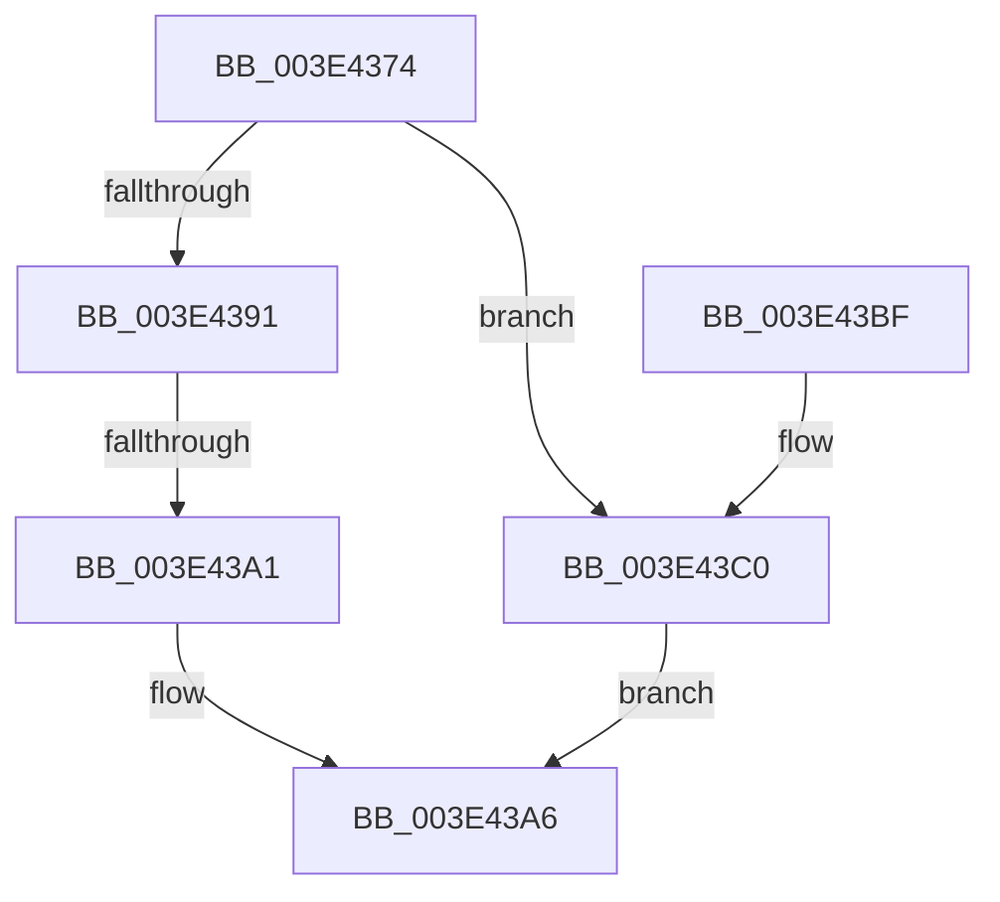

# BgpFwAllocateMemory

- RVA: `0x003E4374`–`0x003E43C4` (길이 `80` bytes)
- VA: `0x00000001403E4374`
- 실행 섹션: `.text`
- PDB 이름 있음: `예`; PDB Function 태그: `예`
- unwind 정보 RVA: `0x00094D38`
- 디코드: `24`개 명령, `80/80` bytes 표시
- 미해석 바이트: `0` (있으면 어셈블리에 `.byte`로 보존)

> 이 문서는 커널 이미지의 기계어와 PDB 기호를 분석해 생성했습니다. 4번과 5번은 함수 원형과 자료형을 바이너리 사용 방식에서 추정한 C 해석이며 원본 소스 복구 결과는 아닙니다.

## 1. Dependencies

- 직접 호출 지점: **1**; 고유 호출 대상: **1**
- 직접 호출자로 확인된 함수: **20**
- RIP 상대 이미지 참조: **1**

### Outgoing calls
- `0x003E43A1` → [BgpFwReserveAllocate](BgpFwReserveAllocate_function_003E5230.md) (function, `0x003E5230`)

### Direct callers
- [RaspAllocateMemory](RaspAllocateMemory_function_003E42F8.md) at `0x003E4324`
- [BgpRasPrintGlyph](../47/BgpRasPrintGlyph_function_0047F3B4.md) at `0x0047F540`
- [BgpFwQueryBootGraphicsInformation](../4C/BgpFwQueryBootGraphicsInformation_function_004CF524.md) at `0x004CF642`
- [BcpGetProgressMessages](../6A/BcpGetProgressMessages_function_006A0B48.md) at `0x006A0B8F`
- [BgpDisplayCharacterGetContext](../../pagebgfx/BC/BgpDisplayCharacterGetContext_function_00BC0860.md) at `0x00BC0885`
- [BgpConsoleInitialize](../../pagebgfx/BC/BgpConsoleInitialize_function_00BC10B0.md) at `0x00BC10F0`
- [ResFwpPageInBackground](../../pagebgfx/BC/ResFwpPageInBackground_function_00BC1BB0.md) at `0x00BC1BDF`
- [BgpTxtCreateRegion](../../pagebgfx/BC/BgpTxtCreateRegion_function_00BC2908.md) at `0x00BC2996`
- [TxtpAddCacheEntry](../../pagebgfx/BC/TxtpAddCacheEntry_function_00BC33FC.md) at `0x00BC3427`
- [AnFwDisplayFade](../../pagebgfx/BC/AnFwDisplayFade_function_00BC36EC.md) at `0x00BC3A27`
- [BgpTxtGetRegionContext](../../pagebgfx/BC/BgpTxtGetRegionContext_function_00BC3D94.md) at `0x00BC3E08`
- [BgpGxRectangleCreate](../../pagebgfx/BC/BgpGxRectangleCreate_function_00BC3E78.md) at `0x00BC3EAE`
- [BgpFwLibraryInitialize](../../pagebgfx/BC/BgpFwLibraryInitialize_function_00BC5400.md) at `0x00BC55B1`
- [BgpFwLibraryInitialize](../../pagebgfx/BC/BgpFwLibraryInitialize_function_00BC5400.md) at `0x00BC57F5`
- [BgpFwLibraryInitialize](../../pagebgfx/BC/BgpFwLibraryInitialize_function_00BC5400.md) at `0x00BC59EB`
- [BgpFwLibraryInitialize](../../pagebgfx/BC/BgpFwLibraryInitialize_function_00BC5400.md) at `0x00BC5A74`
- [BgpFwLibraryInitialize](../../pagebgfx/BC/BgpFwLibraryInitialize_function_00BC5400.md) at `0x00BC5AB6`
- [BgpFwLibraryInitialize](../../pagebgfx/BC/BgpFwLibraryInitialize_function_00BC5400.md) at `0x00BC5AD8`
- [BgpFwLibraryInitialize](../../pagebgfx/BC/BgpFwLibraryInitialize_function_00BC5400.md) at `0x00BC5B8F`
- [BgpFoInitialize](../../init/C8/BgpFoInitialize_function_00C806B0.md) at `0x00C806F6`
- [FopInitializeFonts](../../init/C8/FopInitializeFonts_function_00C808FC.md) at `0x00C8092D`
- [FopReadCmapTable](../../init/C8/FopReadCmapTable_function_00C80A54.md) at `0x00C80AEC`
- [FopReadMappingTable](../../init/C8/FopReadMappingTable_function_00C80BA4.md) at `0x00C80C7F`
- [FopReadMappingTable](../../init/C8/FopReadMappingTable_function_00C80BA4.md) at `0x00C80CB9`
- [FopReadNamingTable](../../init/C8/FopReadNamingTable_function_00C80D90.md) at `0x00C80E24`
- [FopValidateFontNameTable](../../init/C8/FopValidateFontNameTable_function_00C80F14.md) at `0x00C80FD7`
- [BgpBcInitializeCriticalMode](../../init/C8/BgpBcInitializeCriticalMode_function_00C81454.md) at `0x00C815B3`
- [BgpBcInitializeCriticalMode](../../init/C8/BgpBcInitializeCriticalMode_function_00C81454.md) at `0x00C816DA`
- [BgpBcInitializeCriticalMode](../../init/C8/BgpBcInitializeCriticalMode_function_00C81454.md) at `0x00C81804`
- [BgpBcInitializeCriticalMode](../../init/C8/BgpBcInitializeCriticalMode_function_00C81454.md) at `0x00C8181E`
- [BgpBcInitializeCriticalMode](../../init/C8/BgpBcInitializeCriticalMode_function_00C81454.md) at `0x00C81873`
- [BgpBcInitializeCriticalMode](../../init/C8/BgpBcInitializeCriticalMode_function_00C81454.md) at `0x00C81946`

### Static image references
- `0x003E4391` → RVA `0x00EF0450` (`.data`; read)

## 2. Other-region calls and transfers

- 다른 실행 섹션으로 향하는 call: **0**
- call이 아닌 외부 분기/꼬리 이동: **1**
  - `0x003E439B` → [sub_006EA972](../6E/Unknown_function_006EA972.md) (`tail-transfer`)

## 3. Assembly (complete function range)

```asm
003E4374  48 89 5C 24 08                  mov qword ptr [rsp + 8], rbx
003E4379  48 89 6C 24 10                  mov qword ptr [rsp + 0x10], rbp
003E437E  48 89 74 24 18                  mov qword ptr [rsp + 0x18], rsi
003E4383  57                              push rdi
003E4384  41 56                           push r14
003E4386  41 57                           push r15
003E4388  48 83 EC 30                     sub rsp, 0x30
003E438C  48 85 C9                        test rcx, rcx
003E438F  74 2F                           je 0x1403e43c0
003E4391  8B 2D B9 C0 B0 00               mov ebp, dword ptr [rip + 0xb0c0b9]
003E4397  0F BA E5 0B                     bt ebp, 0xb
003E439B  0F 83 D1 65 30 00               jae 0x1406ea972
003E43A1  E8 8A 0E 00 00                  call 0x1403e5230
003E43A6  48 8B 5C 24 50                  mov rbx, qword ptr [rsp + 0x50]
003E43AB  48 8B 6C 24 58                  mov rbp, qword ptr [rsp + 0x58]
003E43B0  48 8B 74 24 60                  mov rsi, qword ptr [rsp + 0x60]
003E43B5  48 83 C4 30                     add rsp, 0x30
003E43B9  41 5F                           pop r15
003E43BB  41 5E                           pop r14
003E43BD  5F                              pop rdi
003E43BE  C3                              ret
003E43BF  CC                              int3
003E43C0  33 C0                           xor eax, eax
003E43C2  EB E2                           jmp 0x1403e43a6
```

## 4. C-style interpretation (structured pseudocode)

```c
__int64 __fastcall BgpFwAllocateMemory(__int64 a1)
{
    __int64 result;
    __int64 v_rsp;
    unsigned __int64 v_stack_p10;
    unsigned __int64 v_stack_p18;
    unsigned __int64 v_stack_p8;

    v_stack_p8 = v_rbx;
    v_stack_p10 = v_rbp;
    v_stack_p18 = v_rsi;
    v_rsp = (v_rsp) - (48);
    if (a1 == 0) goto loc_003E43C0;
    result = BgpFwReserveAllocate(a1, a2, a3, a4);
loc_003E43A6:
    v_rsp = (v_rsp) + (48);
    return result;
loc_003E43C0:
    result = 0;
    goto loc_003E43A6;
}
```

## 5. (Beta) C Style

```c
int64_t BgpFwAllocateMemory(int64_t Arg1)
{
    int64_t result;
    int64_t local_rsp;
    uint64_t v_stack_p10;
    uint64_t v_stack_p18;
    uint64_t v_stack_p8;

    v_stack_p8 = local_rbx;
    v_stack_p10 = local_rbp;
    v_stack_p18 = local_rsi;
    local_rsp = (local_rsp) - (48);
    if (Arg1 == 0) goto loc_003E43C0;
    result = BgpFwReserveAllocate(Arg1, a2, a3, a4);
loc_003E43A6:
    local_rsp = (local_rsp) + (48);
    return result;
loc_003E43C0:
    result = 0;
    goto loc_003E43A6;
}
```

## 6. Execution-region graph

[열기: 2D/3D 그래프와 함수 탐색 컨트롤 패널](../../../control-panel.html?section=text&rva=0x003E4374&view=graph)

- 2D 그래프는 위에서 아래로 흐르고, 3D 그래프는 빈 공간을 드래그해 회전합니다. Shift+드래그는 이동, 휠은 확대·축소, 함수 노드 선택은 대상 보고서 이동입니다.

### Static fallback


