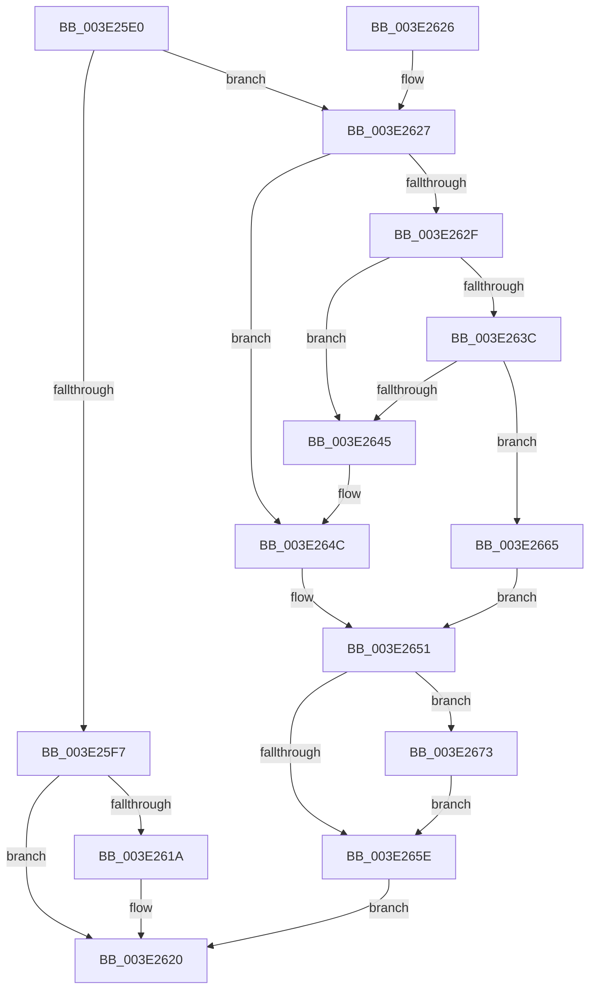

# BgpFwFreeMemory

- RVA: `0x003E25E0`–`0x003E2696` (길이 `182` bytes)
- VA: `0x00000001403E25E0`
- 실행 섹션: `.text`
- PDB 이름 있음: `예`; PDB Function 태그: `아니요`
- unwind 정보 RVA: `0x00069354`
- 디코드: `52`개 명령, `182/182` bytes 표시
- 미해석 바이트: `0` (있으면 어셈블리에 `.byte`로 보존)

> 이 문서는 커널 이미지의 기계어와 PDB 기호를 분석해 생성했습니다. 4번과 5번은 함수 원형과 자료형을 바이너리 사용 방식에서 추정한 C 해석이며 원본 소스 복구 결과는 아닙니다.

## 1. Dependencies

- 직접 호출 지점: **4**; 고유 호출 대상: **4**
- 직접 호출자로 확인된 함수: **26**
- RIP 상대 이미지 참조: **4**

### Outgoing calls
- `0x003E260D` → [RtlClearBits](RtlClearBits_function_003E1A90.md) (function, `0x003E1A90`)
- `0x003E265E` → [ExFreePoolWithTag](../../poolcode/B8/ExFreePoolWithTag_function_00B82870.md) (function, `0x00B82870`)
- `0x003E267A` → [MmUnmapLockedPages](../24/MmUnmapLockedPages_function_00246E60.md) (function, `0x00246E60`)
- `0x003E268A` → [MiFreePagesFromMdl](../3F/MiFreePagesFromMdl_function_003F8300.md) (function, `0x003F8300`)

### Direct callers
- [RaspFreeMemory](RaspFreeMemory_function_003E28E4.md) at `0x003E28EE`
- [BgpFwQueryBootGraphicsInformation](../4C/BgpFwQueryBootGraphicsInformation_function_004CF524.md) at `0x004CF6E8`
- [BgpDisplayCharacterDestroyContext](../../pagebgfx/BC/BgpDisplayCharacterDestroyContext_function_00BC0834.md) at `0x00BC084D`
- [BgpDisplayCharacterGetContext](../../pagebgfx/BC/BgpDisplayCharacterGetContext_function_00BC0860.md) at `0x00BC090A`
- [BgConsoleDestroyInterface](../../pagebgfx/BC/BgConsoleDestroyInterface_function_00BC0940.md) at `0x00BC097E`
- [BgpConsoleInitialize](../../pagebgfx/BC/BgpConsoleInitialize_function_00BC10B0.md) at `0x00BC12DE`
- [BgpFwLibraryDestroy](../../pagebgfx/BC/BgpFwLibraryDestroy_function_00BC1678.md) at `0x00BC16AA`
- [BgpFwLibraryDestroy](../../pagebgfx/BC/BgpFwLibraryDestroy_function_00BC1678.md) at `0x00BC16B6`
- [BgpFwLibraryDestroy](../../pagebgfx/BC/BgpFwLibraryDestroy_function_00BC1678.md) at `0x00BC16CF`
- [BgpFwLibraryDisable](../../pagebgfx/BC/BgpFwLibraryDisable_function_00BC1724.md) at `0x00BC17D2`
- [BgpFwLibraryDisable](../../pagebgfx/BC/BgpFwLibraryDisable_function_00BC1724.md) at `0x00BC17DE`
- [ResFwpDestroyBackground](../../pagebgfx/BC/ResFwpDestroyBackground_function_00BC1B3C.md) at `0x00BC1B68`
- [ResFwpPageInBackground](../../pagebgfx/BC/ResFwpPageInBackground_function_00BC1BB0.md) at `0x00BC1C22`
- [ResFwpPageOutBackground](../../pagebgfx/BC/ResFwpPageOutBackground_function_00BC1C34.md) at `0x00BC1CC7`
- [BgpFoDestroy](../../pagebgfx/BC/BgpFoDestroy_function_00BC273C.md) at `0x00BC27CC`
- [FopFreeFontData](../../pagebgfx/BC/FopFreeFontData_function_00BC2800.md) at `0x00BC283C`
- [FopFreeFontData](../../pagebgfx/BC/FopFreeFontData_function_00BC2800.md) at `0x00BC284A`
- [FopFreeFontData](../../pagebgfx/BC/FopFreeFontData_function_00BC2800.md) at `0x00BC2852`
- [FopFreeFontData](../../pagebgfx/BC/FopFreeFontData_function_00BC2800.md) at `0x00BC285A`
- [FopFreeFontData](../../pagebgfx/BC/FopFreeFontData_function_00BC2800.md) at `0x00BC286D`
- [FopFreeFontData](../../pagebgfx/BC/FopFreeFontData_function_00BC2800.md) at `0x00BC2883`
- [FopFreeMappingTable](../../pagebgfx/BC/FopFreeMappingTable_function_00BC28AC.md) at `0x00BC28BE`
- [FopFreeMappingTable](../../pagebgfx/BC/FopFreeMappingTable_function_00BC28AC.md) at `0x00BC28C6`
- [BgpTxtCreateRegion](../../pagebgfx/BC/BgpTxtCreateRegion_function_00BC2908.md) at `0x00BC2B25`
- [BgpTxtDestroyRegion](../../pagebgfx/BC/BgpTxtDestroyRegion_function_00BC2B5C.md) at `0x00BC2B9B`
- [AnFwDisplayFade](../../pagebgfx/BC/AnFwDisplayFade_function_00BC36EC.md) at `0x00BC37F8`
- [AnFwDisplayFade](../../pagebgfx/BC/AnFwDisplayFade_function_00BC36EC.md) at `0x00BC3800`
- [BgpGxRectangleDestroy](../../pagebgfx/BC/BgpGxRectangleDestroy_function_00BC3F04.md) at `0x00BC3F1C`
- [TxtpDestroyCacheEntry](../../pagebgfx/BC/TxtpDestroyCacheEntry_function_00BC43D4.md) at `0x00BC43E9`
- [BgpFwLibraryInitialize](../../pagebgfx/BC/BgpFwLibraryInitialize_function_00BC5400.md) at `0x00BC5B15`
- [BgpFwLibraryInitialize](../../pagebgfx/BC/BgpFwLibraryInitialize_function_00BC5400.md) at `0x00BC5B1D`
- [BgpFoInitialize](../../init/C8/BgpFoInitialize_function_00C806B0.md) at `0x00C80783`
- [FopReadCmapTable](../../init/C8/FopReadCmapTable_function_00C80A54.md) at `0x00C80B70`
- [FopReadMappingTable](../../init/C8/FopReadMappingTable_function_00C80BA4.md) at `0x00C80D63`
- [FopReadNamingTable](../../init/C8/FopReadNamingTable_function_00C80D90.md) at `0x00C80EE1`
- [FopValidateFontNameTable](../../init/C8/FopValidateFontNameTable_function_00C80F14.md) at `0x00C81044`
- [FopValidateFontNameTable](../../init/C8/FopValidateFontNameTable_function_00C80F14.md) at `0x00C8105F`
- [BgpBcInitializeCriticalMode](../../init/C8/BgpBcInitializeCriticalMode_function_00C81454.md) at `0x00C819A5`
- [BgpBcInitializeCriticalMode](../../init/C8/BgpBcInitializeCriticalMode_function_00C81454.md) at `0x00C819B2`
- [BgpBcInitializeCriticalMode](../../init/C8/BgpBcInitializeCriticalMode_function_00C81454.md) at `0x00C819CC`
- [BgpBcInitializeCriticalMode](../../init/C8/BgpBcInitializeCriticalMode_function_00C81454.md) at `0x00C819DD`
- [BgpBcInitializeCriticalMode](../../init/C8/BgpBcInitializeCriticalMode_function_00C81454.md) at `0x00C819EE`
- [BgpBcInitializeCriticalMode](../../init/C8/BgpBcInitializeCriticalMode_function_00C81454.md) at `0x00C819FF`

### Static image references
- `0x003E25FB` → RVA `0x00E64F58` (`.data`; read)
- `0x003E2602` → RVA `0x00E62388` (`.data`; read)
- `0x003E2612` → RVA `0x00E3EE34` (`.data`; read)
- `0x003E261A` → RVA `0x00E3EE34` (`.data`; write)

## 2. Other-region calls and transfers

- 다른 실행 섹션으로 향하는 call: **1**
  - `0x003E265E` → [ExFreePoolWithTag](../../poolcode/B8/ExFreePoolWithTag_function_00B82870.md) (`.text` → `POOLCODE`)
- 별도 외부 분기/꼬리 이동을 확인하지 못했습니다.

## 3. Assembly (complete function range)

```asm
003E25E0  40 53                           push rbx
003E25E2  48 83 EC 20                     sub rsp, 0x20
003E25E6  48 8D 59 E8                     lea rbx, [rcx - 0x18]
003E25EA  4C 8B C1                        mov r8, rcx
003E25ED  8B 13                           mov edx, dword ptr [rbx]
003E25EF  81 FA 42 47 43 4B               cmp edx, 0x4b434742
003E25F5  75 30                           jne 0x1403e2627
003E25F7  44 8B 41 F0                     mov r8d, dword ptr [rcx - 0x10]
003E25FB  48 8D 0D 56 29 A8 00            lea rcx, [rip + 0xa82956]
003E2602  2B 1D 80 FD A7 00               sub ebx, dword ptr [rip + 0xa7fd80]
003E2608  83 EB 08                        sub ebx, 8
003E260B  8B D3                           mov edx, ebx
003E260D  E8 7E F4 FF FF                  call 0x1403e1a90
003E2612  3B 1D 1C C8 A5 00               cmp ebx, dword ptr [rip + 0xa5c81c]
003E2618  73 06                           jae 0x1403e2620
003E261A  89 1D 14 C8 A5 00               mov dword ptr [rip + 0xa5c814], ebx
003E2620  48 83 C4 20                     add rsp, 0x20
003E2624  5B                              pop rbx
003E2625  C3                              ret
003E2626  CC                              int3
003E2627  81 FA 42 47 42 4B               cmp edx, 0x4b424742
003E262D  75 1D                           jne 0x1403e264c
003E262F  48 8D 41 D8                     lea rax, [rcx - 0x28]
003E2633  4C 8B 10                        mov r10, qword ptr [rax]
003E2636  49 39 42 08                     cmp qword ptr [r10 + 8], rax
003E263A  75 09                           jne 0x1403e2645
003E263C  4C 8B 48 08                     mov r9, qword ptr [rax + 8]
003E2640  49 39 01                        cmp qword ptr [r9], rax
003E2643  74 20                           je 0x1403e2665
003E2645  B9 03 00 00 00                  mov ecx, 3
003E264A  CD 29                           int 0x29
003E264C  B8 20 00 00 00                  mov eax, 0x20
003E2651  48 2B C8                        sub rcx, rax
003E2654  49 81 78 F0 00 10 00 00         cmp qword ptr [r8 - 0x10], 0x1000
003E265C  73 15                           jae 0x1403e2673
003E265E  E8 0D 02 7A 00                  call 0x140b82870
003E2663  EB BB                           jmp 0x1403e2620
003E2665  4D 89 11                        mov qword ptr [r9], r10
003E2668  B8 30 00 00 00                  mov eax, 0x30
003E266D  4D 89 4A 08                     mov qword ptr [r10 + 8], r9
003E2671  EB DE                           jmp 0x1403e2651
003E2673  49 8B 58 F8                     mov rbx, qword ptr [r8 - 8]
003E2677  48 8B D3                        mov rdx, rbx
003E267A  E8 E1 47 E6 FF                  call 0x140246e60
003E267F  45 33 C9                        xor r9d, r9d
003E2682  45 33 C0                        xor r8d, r8d
003E2685  33 D2                           xor edx, edx
003E2687  48 8B CB                        mov rcx, rbx
003E268A  E8 71 5C 01 00                  call 0x1403f8300
003E268F  33 D2                           xor edx, edx
003E2691  48 8B CB                        mov rcx, rbx
003E2694  EB C8                           jmp 0x1403e265e
```

## 4. C-style interpretation (structured pseudocode)

```c
__int64 __fastcall BgpFwFreeMemory(__int64 a1)
{
    __int64 result;
    __int64 v_rbx;
    __int64 v_rsp;

    v_rsp = (v_rsp) - (32);
    if (((unsigned int)((unsigned int)(*(unsigned int *)(a1 - 24)))) != 0x4B434742ULL) goto loc_003E2627;
    v_rbx = (unsigned int)((a1 - 24) - (*(unsigned int *)(v_rip + 11009408)));
    v_rbx = (unsigned int)((v_rbx) - (8));
    result = RtlClearBits(v_rip + 11020630, (unsigned int)((unsigned int)(v_rbx)), (unsigned int)(*(unsigned int *)(a1 - 16)), a4);
    if (((unsigned int)(v_rbx)) < (*(unsigned int *)(v_rip + 10864668))) {
        *(unsigned int *)(v_rip + 10864660) = (unsigned int)(v_rbx);
    }
    v_rsp = (v_rsp) + (32);
    return result;
loc_003E2627:
    if (((unsigned int)((unsigned int)((unsigned int)(v_rbx)))) != 0x4B424742ULL) goto loc_003E264C;
    if ((*(unsigned __int64 *)(*(unsigned __int64 *)(v_rip + 11020630 - 40) + 8)) != (v_rip + 11020630 - 40)) goto loc_003E2645;
    if ((*(unsigned __int64 *)(*(unsigned __int64 *)(v_rip + 11020630 - 40 + 8))) == (v_rip + 11020630 - 40)) goto loc_003E2665;
loc_003E2645:
loc_003E264C:
loc_003E2651:
    a1 = (3) - (32);
    if ((*(unsigned __int64 *)((unsigned int)(*(unsigned int *)(a1 - 16)) - 16)) >= 0x1000ULL) goto loc_003E2673;
loc_003E265E:
    result = ExFreePoolWithTag(a1, (unsigned int)((unsigned int)(v_rbx)), (unsigned int)(*(unsigned int *)(a1 - 16)), *(unsigned __int64 *)(v_rip + 11020630 - 40 + 8));
    goto loc_003E2620;
loc_003E2665:
    *(unsigned __int64 *)(*(unsigned __int64 *)(v_rip + 11020630 - 40 + 8)) = *(unsigned __int64 *)(v_rip + 11020630 - 40);
    *(unsigned __int64 *)(*(unsigned __int64 *)(v_rip + 11020630 - 40) + 8) = *(unsigned __int64 *)(v_rip + 11020630 - 40 + 8);
    goto loc_003E2651;
loc_003E2673:
    result = MmUnmapLockedPages(a1, *(unsigned __int64 *)((unsigned int)(*(unsigned int *)(a1 - 16)) - 8), (unsigned int)(*(unsigned int *)(a1 - 16)), *(unsigned __int64 *)(v_rip + 11020630 - 40 + 8));
    a4 = 0;
    a3 = 0;
    a2 = 0;
    result = MiFreePagesFromMdl(*(unsigned __int64 *)((unsigned int)(*(unsigned int *)(a1 - 16)) - 8), a2, a3, a4);
    a2 = 0;
    goto loc_003E265E;
}
```

## 5. (Beta) C Style

```c
int64_t BgpFwFreeMemory(void *Arg1)
{
    uint8_t *arg1 = (uint8_t *)Arg1;

    int64_t result;
    int64_t local_rbx;
    int64_t local_rsp;

    local_rsp = (local_rsp) - (32);
    if (((uint32_t)((uint32_t)(*(uint32_t *)(arg1 - 0x18)))) != 0x4B434742ULL) goto loc_003E2627;
    local_rbx = (uint32_t)((Arg1 - 24) - (*(uint32_t *)(v_rip + 0xA7FD80)));
    local_rbx = (uint32_t)((local_rbx) - (8));
    result = RtlClearBits(v_rip + 11020630, (uint32_t)((uint32_t)(local_rbx)), (uint32_t)(*(uint32_t *)(arg1 - 0x10)), a4);
    if (((uint32_t)(local_rbx)) < (*(uint32_t *)(v_rip + 0xA5C81C))) {
        *(uint32_t *)(v_rip + 0xA5C814) = (uint32_t)(local_rbx);
    }
    local_rsp = (local_rsp) + (32);
    return result;
loc_003E2627:
    if (((uint32_t)((uint32_t)((uint32_t)(local_rbx)))) != 0x4B424742ULL) goto loc_003E264C;
    if ((*(uint64_t *)(*(uint64_t *)(v_rip + 0xA82956 - 0x28) + 0x8)) != (v_rip + 11020630 - 40)) goto loc_003E2645;
    if ((*(uint64_t *)(*(uint64_t *)(v_rip + 0xA82956 - 0x28 + 0x8))) == (v_rip + 11020630 - 40)) goto loc_003E2665;
loc_003E2645:
loc_003E264C:
loc_003E2651:
    Arg1 = (3) - (32);
    if ((*(uint64_t *)((uint32_t)(*(uint32_t *)(arg1 - 0x10)) - 0x10)) >= 0x1000ULL) goto loc_003E2673;
loc_003E265E:
    result = ExFreePoolWithTag(Arg1, (uint32_t)((uint32_t)(local_rbx)), (uint32_t)(*(uint32_t *)(arg1 - 0x10)), *(uint64_t *)(v_rip + 0xA82956 - 0x28 + 0x8));
    goto loc_003E2620;
loc_003E2665:
    *(uint64_t *)(*(uint64_t *)(v_rip + 0xA82956 - 0x28 + 0x8)) = *(uint64_t *)(v_rip + 0xA82956 - 0x28);
    *(uint64_t *)(*(uint64_t *)(v_rip + 0xA82956 - 0x28) + 0x8) = *(uint64_t *)(v_rip + 0xA82956 - 0x28 + 0x8);
    goto loc_003E2651;
loc_003E2673:
    result = MmUnmapLockedPages(Arg1, *(uint64_t *)((uint32_t)(*(uint32_t *)(arg1 - 0x10)) - 0x8), (uint32_t)(*(uint32_t *)(arg1 - 0x10)), *(uint64_t *)(v_rip + 0xA82956 - 0x28 + 0x8));
    a4 = 0;
    a3 = 0;
    a2 = 0;
    result = MiFreePagesFromMdl(*(uint64_t *)((uint32_t)(*(uint32_t *)(arg1 - 0x10)) - 0x8), a2, a3, a4);
    a2 = 0;
    goto loc_003E265E;
}
```

### 관측된 메모리 오프셋

구조체 형식이 확인되지 않은 접근은 인자 기준의 오프셋으로만 기록했습니다.

| 기준 인자 | 오프셋 표현 | 폭 (bit) | 접근 |
|---|---:|---:|---|
| `Arg1` | `- 0x28` | `64` | `R` |
| `Arg1` | `- 0x18` | `64` | `R` |
| `Arg1` | `- 0x10` | `32` | `R` |
| `Arg1` | `- 0x10` | `64` | `R` |
| `Arg1` | `- 0x8` | `64` | `R` |
| `Arg1` | `+ 0x0` | `32` | `R` |
| `Arg1` | `+ 0x0` | `64` | `R` |
| `Arg1` | `+ 0x8` | `64` | `R` |

## 6. Execution-region graph

[열기: 2D/3D 그래프와 함수 탐색 컨트롤 패널](../../../control-panel.html?section=text&rva=0x003E25E0&view=graph)

- 2D 그래프는 위에서 아래로 흐르고, 3D 그래프는 빈 공간을 드래그해 회전합니다. Shift+드래그는 이동, 휠은 확대·축소, 함수 노드 선택은 대상 보고서 이동입니다.

### Static fallback


