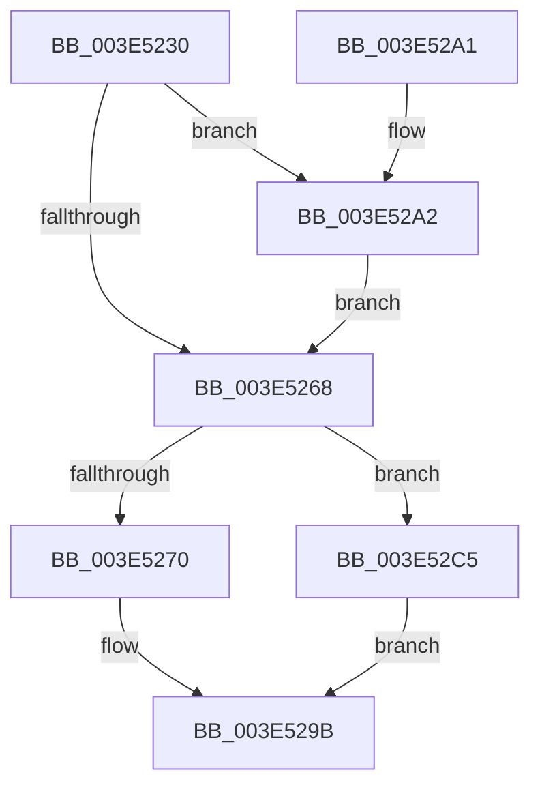

# BgpFwReserveAllocate

- RVA: `0x003E5230`–`0x003E52C9` (길이 `153` bytes)
- VA: `0x00000001403E5230`
- 실행 섹션: `.text`
- PDB 이름 있음: `예`; PDB Function 태그: `아니요`
- unwind 정보 RVA: `0x00094E68`
- 디코드: `40`개 명령, `153/153` bytes 표시
- 미해석 바이트: `0` (있으면 어셈블리에 `.byte`로 보존)

> 이 문서는 커널 이미지의 기계어와 PDB 기호를 분석해 생성했습니다. 4번과 5번은 함수 원형과 자료형을 바이너리 사용 방식에서 추정한 C 해석이며 원본 소스 복구 결과는 아닙니다.

## 1. Dependencies

- 직접 호출 지점: **2**; 고유 호출 대상: **1**
- 직접 호출자로 확인된 함수: **1**
- RIP 상대 이미지 참조: **6**

### Outgoing calls
- `0x003E5252` → [RtlFindClearBitsAndSet](RtlFindClearBitsAndSet_function_003E0CD0.md) (function, `0x003E0CD0`)
- `0x003E52B5` → [RtlFindClearBitsAndSet](RtlFindClearBitsAndSet_function_003E0CD0.md) (function, `0x003E0CD0`)

### Direct callers
- [BgpFwAllocateMemory](BgpFwAllocateMemory_function_003E4374.md) at `0x003E43A1`

### Static image references
- `0x003E5236` → RVA `0x00E3EE34` (`.data`; read)
- `0x003E5245` → RVA `0x00E64F58` (`.data`; read)
- `0x003E525A` → RVA `0x00E3EE38` (`.data`; read)
- `0x003E5277` → RVA `0x00E3EE34` (`.data`; write)
- `0x003E527D` → RVA `0x00E62388` (`.data`; read)
- `0x003E52A2` → RVA `0x00E3EE34` (`.data`; read/write)

## 2. Other-region calls and transfers

- 다른 실행 섹션으로 향하는 call: **0**
- 별도 외부 분기/꼬리 이동을 확인하지 못했습니다.

## 3. Assembly (complete function range)

```asm
003E5230  40 53                           push rbx
003E5232  48 83 EC 20                     sub rsp, 0x20
003E5236  44 8B 05 F7 9B A5 00            mov r8d, dword ptr [rip + 0xa59bf7]
003E523D  48 8D 59 0F                     lea rbx, [rcx + 0xf]
003E5241  48 83 E3 F0                     and rbx, 0xfffffffffffffff0
003E5245  48 8D 0D 0C FD A7 00            lea rcx, [rip + 0xa7fd0c]
003E524C  48 83 C3 20                     add rbx, 0x20
003E5250  8B D3                           mov edx, ebx
003E5252  E8 79 BA FF FF                  call 0x1403e0cd0
003E5257  44 8B C0                        mov r8d, eax
003E525A  8B 05 D8 9B A5 00               mov eax, dword ptr [rip + 0xa59bd8]
003E5260  8D 50 F0                        lea edx, [rax - 0x10]
003E5263  44 3B C2                        cmp r8d, edx
003E5266  77 3A                           ja 0x1403e52a2
003E5268  83 C0 F0                        add eax, -0x10
003E526B  44 3B C0                        cmp r8d, eax
003E526E  77 55                           ja 0x1403e52c5
003E5270  42 8D 04 03                     lea eax, [rbx + r8]
003E5274  41 8B C8                        mov ecx, r8d
003E5277  89 05 B7 9B A5 00               mov dword ptr [rip + 0xa59bb7], eax
003E527D  48 8B 05 04 D1 A7 00            mov rax, qword ptr [rip + 0xa7d104]
003E5284  48 83 C0 20                     add rax, 0x20
003E5288  48 03 C1                        add rax, rcx
003E528B  48 83 60 F8 00                  and qword ptr [rax - 8], 0
003E5290  C7 40 E8 42 47 43 4B            mov dword ptr [rax - 0x18], 0x4b434742
003E5297  48 89 58 F0                     mov qword ptr [rax - 0x10], rbx
003E529B  48 83 C4 20                     add rsp, 0x20
003E529F  5B                              pop rbx
003E52A0  C3                              ret
003E52A1  CC                              int3
003E52A2  83 25 8B 9B A5 00 00            and dword ptr [rip + 0xa59b8b], 0
003E52A9  48 8D 0D A8 FC A7 00            lea rcx, [rip + 0xa7fca8]
003E52B0  45 33 C0                        xor r8d, r8d
003E52B3  8B D3                           mov edx, ebx
003E52B5  E8 16 BA FF FF                  call 0x1403e0cd0
003E52BA  44 8B C0                        mov r8d, eax
003E52BD  8B 05 75 9B A5 00               mov eax, dword ptr [rip + 0xa59b75]
003E52C3  EB A3                           jmp 0x1403e5268
003E52C5  33 C0                           xor eax, eax
003E52C7  EB D2                           jmp 0x1403e529b
```

## 4. C-style interpretation (structured pseudocode)

```c
__int64 __fastcall BgpFwReserveAllocate(__int64 a1)
{
    __int64 result;
    __int64 v_rbx;
    __int64 v_rsp;

    v_rsp = (v_rsp) - (32);
    v_rbx = (a1 + 15) & (-16);
    v_rbx = (v_rbx) + (32);
    result = RtlFindClearBitsAndSet(v_rip + 11009292, (unsigned int)((unsigned int)(v_rbx)), (unsigned int)(*(unsigned int *)(v_rip + 10853367)), a4);
    if (((unsigned int)((unsigned int)((unsigned int)(result)))) > ((unsigned int)((unsigned int)(*(unsigned int *)(v_rip + 10853336)) - 16))) goto loc_003E52A2;
loc_003E5268:
    result = (unsigned int)(((unsigned int)(*(unsigned int *)(v_rip + 10853336))) + (-16));
    if (((unsigned int)((unsigned int)((unsigned int)(result)))) > ((unsigned int)(result))) goto loc_003E52C5;
    *(unsigned int *)(v_rip + 10853303) = (unsigned int)(v_rbx + (unsigned int)((unsigned int)(result)) * 1);
    result = (*(unsigned __int64 *)(v_rip + 10998020)) + (32);
    result = (result) + ((unsigned int)((unsigned int)((unsigned int)((unsigned int)(result)))));
    *(unsigned int *)(result - 24) = 0x4B434742ULL;
    *(unsigned __int64 *)(result - 16) = v_rbx;
loc_003E529B:
    v_rsp = (v_rsp) + (32);
    return result;
loc_003E52A2:
    a3 = 0;
    result = RtlFindClearBitsAndSet(v_rip + 11009192, (unsigned int)((unsigned int)(v_rbx)), a3, a4);
    goto loc_003E5268;
loc_003E52C5:
    result = 0;
    goto loc_003E529B;
}
```

## 5. (Beta) C Style

```c
int64_t BgpFwReserveAllocate(void *Arg1)
{
    uint8_t *arg1 = (uint8_t *)Arg1;

    int64_t result;
    int64_t local_rbx;
    int64_t local_rsp;

    local_rsp = (local_rsp) - (32);
    local_rbx = (Arg1 + 15) & (-16);
    local_rbx = (local_rbx) + (32);
    result = RtlFindClearBitsAndSet(v_rip + 11009292, (uint32_t)((uint32_t)(local_rbx)), (uint32_t)(*(uint32_t *)(v_rip + 0xA59BF7)), a4);
    if (((uint32_t)((uint32_t)((uint32_t)(result)))) > ((uint32_t)((uint32_t)(*(uint32_t *)(v_rip + 0xA59BD8)) - 16))) goto loc_003E52A2;
loc_003E5268:
    result = (uint32_t)(((uint32_t)(*(uint32_t *)(v_rip + 0xA59BD8))) + (-16));
    if (((uint32_t)((uint32_t)((uint32_t)(result)))) > ((uint32_t)(result))) goto loc_003E52C5;
    *(uint32_t *)(v_rip + 0xA59BB7) = (uint32_t)(local_rbx + (uint32_t)((uint32_t)(result)) * 1);
    result = (*(uint64_t *)(v_rip + 0xA7D104)) + (32);
    result = (result) + ((uint32_t)((uint32_t)((uint32_t)((uint32_t)(result)))));
    *(uint32_t *)(result - 0x18) = 0x4B434742ULL;
    *(uint64_t *)(result - 0x10) = local_rbx;
loc_003E529B:
    local_rsp = (local_rsp) + (32);
    return result;
loc_003E52A2:
    a3 = 0;
    result = RtlFindClearBitsAndSet(v_rip + 11009192, (uint32_t)((uint32_t)(local_rbx)), a3, a4);
    goto loc_003E5268;
loc_003E52C5:
    result = 0;
    goto loc_003E529B;
}
```

### 관측된 메모리 오프셋

구조체 형식이 확인되지 않은 접근은 인자 기준의 오프셋으로만 기록했습니다.

| 기준 인자 | 오프셋 표현 | 폭 (bit) | 접근 |
|---|---:|---:|---|
| `Arg1` | `+ 0x0 + r8*1` | `32` | `R` |
| `Arg1` | `+ 0xF` | `64` | `R` |

## 6. Execution-region graph

[열기: 2D/3D 그래프와 함수 탐색 컨트롤 패널](../../../control-panel.html?section=text&rva=0x003E5230&view=graph)

- 2D 그래프는 위에서 아래로 흐르고, 3D 그래프는 빈 공간을 드래그해 회전합니다. Shift+드래그는 이동, 휠은 확대·축소, 함수 노드 선택은 대상 보고서 이동입니다.

### Static fallback


