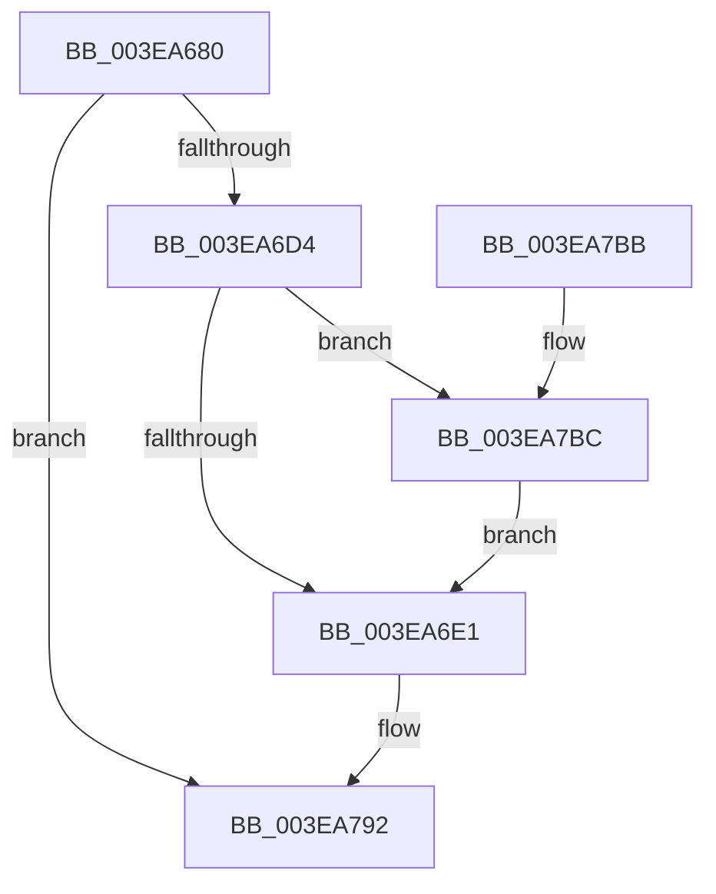

# EtwTraceContAllocationEvent

- RVA: `0x003EA680`–`0x003EA7CC` (길이 `332` bytes)
- VA: `0x00000001403EA680`
- 실행 섹션: `.text`
- PDB 이름 있음: `예`; PDB Function 태그: `아니요`
- unwind 정보 RVA: `0x00095920`
- 디코드: `82`개 명령, `332/332` bytes 표시
- 미해석 바이트: `0` (있으면 어셈블리에 `.byte`로 보존)

> 이 문서는 커널 이미지의 기계어와 PDB 기호를 분석해 생성했습니다. 4번과 5번은 함수 원형과 자료형을 바이너리 사용 방식에서 추정한 C 해석이며 원본 소스 복구 결과는 아닙니다.

## 1. Dependencies

- 직접 호출 지점: **5**; 고유 호출 대상: **5**
- 직접 호출자로 확인된 함수: **1**
- RIP 상대 이미지 참조: **3**

### Outgoing calls
- `0x003EA6C7` → [EtwEventEnabled](../39/EtwEventEnabled_function_00392450.md) (function, `0x00392450`)
- `0x003EA6E8` → [EtwpGetDurationSince](EtwpGetDurationSince_function_003EA7D4.md) (function, `0x003EA7D4`)
- `0x003EA78D` → [EtwWriteEx](../25/EtwWriteEx_function_0025F0D0.md) (function, `0x0025F0D0`)
- `0x003EA799` → [_security_check_cookie](../6A/_security_check_cookie_function_006AC640.md) (function, `0x006AC640`)
- `0x003EA7BF` → [MmGetPhysicalAddress](../23/MmGetPhysicalAddress_function_0023A500.md) (function, `0x0023A500`)

### Direct callers
- [MiAllocateContiguousMemory](MiAllocateContiguousMemory_function_003E9FDC.md) at `0x003EA3D5`

### Static image references
- `0x003EA69F` → RVA `0x00E0A740` (`.data`; read)
- `0x003EA6B3` → RVA `0x00EFF848` (`.data`; read)
- `0x003EA6BA` → RVA `0x00012CF8` (`.rdata`; read)

## 2. Other-region calls and transfers

- 다른 실행 섹션으로 향하는 call: **0**
- 별도 외부 분기/꼬리 이동을 확인하지 못했습니다.

## 3. Assembly (complete function range)

```asm
003EA680  48 8B C4                        mov rax, rsp
003EA683  48 89 58 10                     mov qword ptr [rax + 0x10], rbx
003EA687  48 89 70 18                     mov qword ptr [rax + 0x18], rsi
003EA68B  48 89 78 20                     mov qword ptr [rax + 0x20], rdi
003EA68F  55                              push rbp
003EA690  41 56                           push r14
003EA692  41 57                           push r15
003EA694  48 8D 68 E1                     lea rbp, [rax - 0x1f]
003EA698  48 81 EC C0 00 00 00            sub rsp, 0xc0
003EA69F  48 8B 05 9A 00 A2 00            mov rax, qword ptr [rip + 0xa2009a]
003EA6A6  48 33 C4                        xor rax, rsp
003EA6A9  48 89 45 F7                     mov qword ptr [rbp - 9], rax
003EA6AD  4C 8B FA                        mov r15, rdx
003EA6B0  48 8B F9                        mov rdi, rcx
003EA6B3  48 8B 0D 8E 51 B1 00            mov rcx, qword ptr [rip + 0xb1518e]
003EA6BA  48 8D 15 37 86 C2 FF            lea rdx, [rip - 0x3d79c9]
003EA6C1  49 8B F1                        mov rsi, r9
003EA6C4  4D 8B F0                        mov r14, r8
003EA6C7  E8 84 7D FA FF                  call 0x140392450
003EA6CC  84 C0                           test al, al
003EA6CE  0F 84 BE 00 00 00               je 0x1403ea792
003EA6D4  48 83 CB FF                     or rbx, 0xffffffffffffffff
003EA6D8  48 85 FF                        test rdi, rdi
003EA6DB  0F 85 DB 00 00 00               jne 0x1403ea7bc
003EA6E1  48 8B 8D 87 00 00 00            mov rcx, qword ptr [rbp + 0x87]
003EA6E8  E8 E7 00 00 00                  call 0x1403ea7d4
003EA6ED  83 65 D7 00                     and dword ptr [rbp - 0x29], 0
003EA6F1  48 8D 15 00 86 C2 FF            lea rdx, [rip - 0x3d7a00]
003EA6F8  83 65 F3 00                     and dword ptr [rbp - 0xd], 0
003EA6FC  41 B9 01 00 00 00               mov r9d, 1
003EA702  48 8B 0D 3F 51 B1 00            mov rcx, qword ptr [rip + 0xb1513f]
003EA709  45 33 C0                        xor r8d, r8d
003EA70C  48 89 45 87                     mov qword ptr [rbp - 0x79], rax
003EA710  48 8B 45 47                     mov rax, qword ptr [rbp + 0x47]
003EA714  48 C1 E0 0C                     shl rax, 0xc
003EA718  48 89 45 A7                     mov qword ptr [rbp - 0x59], rax
003EA71C  8B 45 4F                        mov eax, dword ptr [rbp + 0x4f]
003EA71F  89 45 BF                        mov dword ptr [rbp - 0x41], eax
003EA722  8B 45 57                        mov eax, dword ptr [rbp + 0x57]
003EA725  89 45 C3                        mov dword ptr [rbp - 0x3d], eax
003EA728  8B 45 5F                        mov eax, dword ptr [rbp + 0x5f]
003EA72B  89 45 C7                        mov dword ptr [rbp - 0x39], eax
003EA72E  8B 45 67                        mov eax, dword ptr [rbp + 0x67]
003EA731  89 45 CB                        mov dword ptr [rbp - 0x35], eax
003EA734  8B 45 6F                        mov eax, dword ptr [rbp + 0x6f]
003EA737  89 45 CF                        mov dword ptr [rbp - 0x31], eax
003EA73A  0F B6 45 77                     movzx eax, byte ptr [rbp + 0x77]
003EA73E  89 45 D3                        mov dword ptr [rbp - 0x2d], eax
003EA741  48 8D 45 87                     lea rax, [rbp - 0x79]
003EA745  48 89 45 E7                     mov qword ptr [rbp - 0x19], rax
003EA749  48 8D 45 E7                     lea rax, [rbp - 0x19]
003EA74D  48 89 44 24 38                  mov qword ptr [rsp + 0x38], rax
003EA752  44 89 4C 24 30                  mov dword ptr [rsp + 0x30], r9d
003EA757  48 83 64 24 28 00               and qword ptr [rsp + 0x28], 0
003EA75D  48 83 64 24 20 00               and qword ptr [rsp + 0x20], 0
003EA763  48 C1 E6 0C                     shl rsi, 0xc
003EA767  49 C1 E6 0C                     shl r14, 0xc
003EA76B  48 81 CE FF 0F 00 00            or rsi, 0xfff
003EA772  4C 89 7D 8F                     mov qword ptr [rbp - 0x71], r15
003EA776  4C 89 75 97                     mov qword ptr [rbp - 0x69], r14
003EA77A  48 89 75 9F                     mov qword ptr [rbp - 0x61], rsi
003EA77E  48 89 5D AF                     mov qword ptr [rbp - 0x51], rbx
003EA782  48 89 7D B7                     mov qword ptr [rbp - 0x49], rdi
003EA786  C7 45 EF 54 00 00 00            mov dword ptr [rbp - 0x11], 0x54
003EA78D  E8 3E 49 E7 FF                  call 0x14025f0d0
003EA792  48 8B 4D F7                     mov rcx, qword ptr [rbp - 9]
003EA796  48 33 CC                        xor rcx, rsp
003EA799  E8 A2 1E 2C 00                  call 0x1406ac640
003EA79E  4C 8D 9C 24 C0 00 00 00         lea r11, [rsp + 0xc0]
003EA7A6  49 8B 5B 28                     mov rbx, qword ptr [r11 + 0x28]
003EA7AA  49 8B 73 30                     mov rsi, qword ptr [r11 + 0x30]
003EA7AE  49 8B 7B 38                     mov rdi, qword ptr [r11 + 0x38]
003EA7B2  49 8B E3                        mov rsp, r11
003EA7B5  41 5F                           pop r15
003EA7B7  41 5E                           pop r14
003EA7B9  5D                              pop rbp
003EA7BA  C3                              ret
003EA7BB  CC                              int3
003EA7BC  48 8B CF                        mov rcx, rdi
003EA7BF  E8 3C FD E4 FF                  call 0x14023a500
003EA7C4  48 8B D8                        mov rbx, rax
003EA7C7  E9 15 FF FF FF                  jmp 0x1403ea6e1
```

## 4. C-style interpretation (structured pseudocode)

```c
__int64 __fastcall EtwTraceContAllocationEvent(__int64 a1, __int64 a2, __int64 a3, __int64 a4)
{
    __int64 result;
    __int64 v_r14;
    __int64 v_rbx;
    __int64 v_rsi;
    __int64 v_rsp;
    unsigned __int64 v_stack_m18;
    unsigned __int64 v_stack_mA0;
    unsigned int v_stack_mA8;
    unsigned __int64 v_stack_mB0;
    unsigned __int64 v_stack_mB8;

    *(unsigned __int64 *)(v_rsp + 16) = v_rbx;
    *(unsigned __int64 *)(v_rsp + 24) = v_rsi;
    *(unsigned __int64 *)(v_rsp + 32) = v_rdi;
    v_rsp = (v_rsp) - (192);
    result = (*(unsigned __int64 *)(v_rip + 10616986)) ^ (v_rsp);
    *(unsigned __int64 *)(v_rsp - 31 - 9) = result;
    result = EtwEventEnabled(*(unsigned __int64 *)(v_rip + 11620750), v_rip - 4028873, a3, a4);
    if ((unsigned __int8)(result) == 0) goto loc_003EA792;
    v_rbx = (v_rbx) | (-1);
    if (a1 != 0) goto loc_003EA7BC;
loc_003EA6E1:
    result = EtwpGetDurationSince(*(unsigned __int64 *)(v_rsp - 31 + 135), v_rip - 4028873, a3, a4);
    a3 = 0;
    *(unsigned __int64 *)(v_rsp - 31 - 121) = result;
    result = (*(unsigned __int64 *)(v_rsp - 31 + 71)) << (12);
    *(unsigned __int64 *)(v_rsp - 31 - 89) = result;
    *(unsigned int *)(v_rsp - 31 - 65) = (unsigned int)((unsigned int)(*(unsigned int *)(v_rsp - 31 + 79)));
    *(unsigned int *)(v_rsp - 31 - 61) = (unsigned int)((unsigned int)(*(unsigned int *)(v_rsp - 31 + 87)));
    *(unsigned int *)(v_rsp - 31 - 57) = (unsigned int)((unsigned int)(*(unsigned int *)(v_rsp - 31 + 95)));
    *(unsigned int *)(v_rsp - 31 - 53) = (unsigned int)((unsigned int)(*(unsigned int *)(v_rsp - 31 + 103)));
    *(unsigned int *)(v_rsp - 31 - 49) = (unsigned int)((unsigned int)(*(unsigned int *)(v_rsp - 31 + 111)));
    *(unsigned int *)(v_rsp - 31 - 45) = (unsigned int)(*(unsigned __int8 *)(v_rsp - 31 + 119));
    *(unsigned __int64 *)(v_rsp - 31 - 25) = v_rsp - 31 - 121;
    v_stack_mA0 = v_rsp - 31 - 25;
    v_stack_mA8 = 1;
    v_rsi = (a4) << (12);
    v_r14 = (a3) << (12);
    v_rsi = (v_rsi) | (0xFFFULL);
    *(unsigned __int64 *)(v_rsp - 31 - 113) = a2;
    *(unsigned __int64 *)(v_rsp - 31 - 105) = v_r14;
    *(unsigned __int64 *)(v_rsp - 31 - 97) = v_rsi;
    *(unsigned __int64 *)(v_rsp - 31 - 81) = v_rbx;
    *(unsigned __int64 *)(v_rsp - 31 - 73) = a1;
    *(unsigned int *)(v_rsp - 31 - 17) = 84;
    result = EtwWriteEx(*(unsigned __int64 *)(v_rip + 11620671), v_rip - 4028928, a3, 1);
loc_003EA792:
    a1 = (*(unsigned __int64 *)(v_rsp - 31 - 9)) ^ (v_rsp);
    result = _security_check_cookie(a1, v_rip - 4028928, a3, 1);
    return result;
loc_003EA7BC:
    result = MmGetPhysicalAddress(*(unsigned __int64 *)(v_stack_m18 + 56), v_rip - 4028928, a3, 1);
    goto loc_003EA6E1;
}
```

## 5. (Beta) C Style

```c
int64_t EtwTraceContAllocationEvent(int64_t Arg1, int64_t Arg2, int64_t Arg3, int64_t Arg4)
{
    int64_t result;
    int64_t local_r14;
    int64_t local_rbx;
    int64_t local_rsi;
    int64_t local_rsp;
    uint64_t v_stack_m18;
    uint64_t v_stack_mA0;
    uint32_t v_stack_mA8;
    uint64_t v_stack_mB0;
    uint64_t v_stack_mB8;

    *(uint64_t *)(local_rsp + 0x10) = local_rbx;
    *(uint64_t *)(local_rsp + 0x18) = local_rsi;
    *(uint64_t *)(local_rsp + 0x20) = local_rdi;
    local_rsp = (local_rsp) - (192);
    result = (*(uint64_t *)(v_rip + 0xA2009A)) ^ (local_rsp);
    *(uint64_t *)(local_rsp - 0x1F - 0x9) = result;
    result = EtwEventEnabled(*(uint64_t *)(v_rip + 0xB1518E), v_rip - 4028873, Arg3, Arg4);
    if ((uint8_t)(result) == 0) goto loc_003EA792;
    local_rbx = (local_rbx) | (-1);
    if (Arg1 != 0) goto loc_003EA7BC;
loc_003EA6E1:
    result = EtwpGetDurationSince(*(uint64_t *)(local_rsp - 0x1F + 0x87), v_rip - 4028873, Arg3, Arg4);
    Arg3 = 0;
    *(uint64_t *)(local_rsp - 0x1F - 0x79) = result;
    result = (*(uint64_t *)(local_rsp - 0x1F + 0x47)) << (12);
    *(uint64_t *)(local_rsp - 0x1F - 0x59) = result;
    *(uint32_t *)(local_rsp - 0x1F - 0x41) = (uint32_t)((uint32_t)(*(uint32_t *)(local_rsp - 0x1F + 0x4F)));
    *(uint32_t *)(local_rsp - 0x1F - 0x3D) = (uint32_t)((uint32_t)(*(uint32_t *)(local_rsp - 0x1F + 0x57)));
    *(uint32_t *)(local_rsp - 0x1F - 0x39) = (uint32_t)((uint32_t)(*(uint32_t *)(local_rsp - 0x1F + 0x5F)));
    *(uint32_t *)(local_rsp - 0x1F - 0x35) = (uint32_t)((uint32_t)(*(uint32_t *)(local_rsp - 0x1F + 0x67)));
    *(uint32_t *)(local_rsp - 0x1F - 0x31) = (uint32_t)((uint32_t)(*(uint32_t *)(local_rsp - 0x1F + 0x6F)));
    *(uint32_t *)(local_rsp - 0x1F - 0x2D) = (uint32_t)(*(uint8_t *)(local_rsp - 0x1F + 0x77));
    *(uint64_t *)(local_rsp - 0x1F - 0x19) = local_rsp - 31 - 121;
    v_stack_mA0 = local_rsp - 31 - 25;
    v_stack_mA8 = 1;
    local_rsi = (Arg4) << (12);
    local_r14 = (Arg3) << (12);
    local_rsi = (local_rsi) | (0xFFFULL);
    *(uint64_t *)(local_rsp - 0x1F - 0x71) = Arg2;
    *(uint64_t *)(local_rsp - 0x1F - 0x69) = local_r14;
    *(uint64_t *)(local_rsp - 0x1F - 0x61) = local_rsi;
    *(uint64_t *)(local_rsp - 0x1F - 0x51) = local_rbx;
    *(uint64_t *)(local_rsp - 0x1F - 0x49) = Arg1;
    *(uint32_t *)(local_rsp - 0x1F - 0x11) = 84;
    result = EtwWriteEx(*(uint64_t *)(v_rip + 0xB1513F), v_rip - 4028928, Arg3, 1);
loc_003EA792:
    Arg1 = (*(uint64_t *)(local_rsp - 0x1F - 0x9)) ^ (local_rsp);
    result = _security_check_cookie(Arg1, v_rip - 4028928, Arg3, 1);
    return result;
loc_003EA7BC:
    result = MmGetPhysicalAddress(*(uint64_t *)(v_stack_m18 + 0x38), v_rip - 4028928, Arg3, 1);
    goto loc_003EA6E1;
}
```

## 6. Execution-region graph

[열기: 2D/3D 그래프와 함수 탐색 컨트롤 패널](../../../control-panel.html?section=text&rva=0x003EA680&view=graph)

- 2D 그래프는 위에서 아래로 흐르고, 3D 그래프는 빈 공간을 드래그해 회전합니다. Shift+드래그는 이동, 휠은 확대·축소, 함수 노드 선택은 대상 보고서 이동입니다.

### Static fallback


