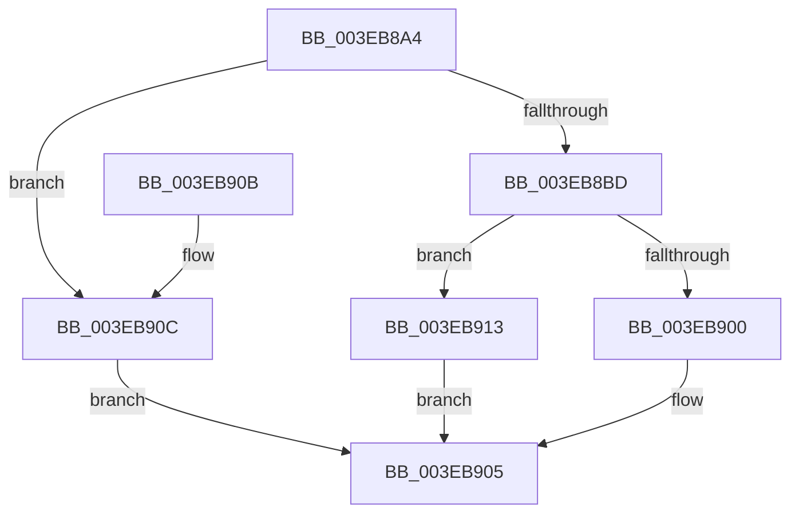

# EtwpAddLastDroppedEvent

- RVA: `0x003EB8A4`–`0x003EB939` (길이 `149` bytes)
- VA: `0x00000001403EB8A4`
- 실행 섹션: `.text`
- PDB 이름 있음: `예`; PDB Function 태그: `아니요`
- unwind 정보 RVA: `0x00095AA4`
- 디코드: `39`개 명령, `149/149` bytes 표시
- 미해석 바이트: `0` (있으면 어셈블리에 `.byte`로 보존)

> 이 문서는 커널 이미지의 기계어와 PDB 기호를 분석해 생성했습니다. 4번과 5번은 함수 원형과 자료형을 바이너리 사용 방식에서 추정한 C 해석이며 원본 소스 복구 결과는 아닙니다.

## 1. Dependencies

- 직접 호출 지점: **4**; 고유 호출 대상: **3**
- 직접 호출자로 확인된 함수: **1**
- RIP 상대 이미지 참조: **0**

### Outgoing calls
- `0x003EB8C1` → [EtwpQueryUsedProcessorCount](EtwpQueryUsedProcessorCount_function_003EB940.md) (function, `0x003EB940`)
- `0x003EB8F3` → [EtwpAddEventToBuffer](../../page/9C/EtwpAddEventToBuffer_function_009C2524.md) (function, `0x009C2524`)
- `0x003EB916` → [EtwpQueryUsedProcessorCount](EtwpQueryUsedProcessorCount_function_003EB940.md) (function, `0x003EB940`)
- `0x003EB930` → [memcpy](../6C/memcpy_function_006C6840.md) (function, `0x006C6840`)

### Direct callers
- [EtwpFinalizeHeader](../../page/9C/EtwpFinalizeHeader_function_009C1EF0.md) at `0x009C20A7`

### Static image references
- 디코드된 RIP-relative 메모리 참조가 없습니다.

## 2. Other-region calls and transfers

- 다른 실행 섹션으로 향하는 call: **1**
  - `0x003EB8F3` → [EtwpAddEventToBuffer](../../page/9C/EtwpAddEventToBuffer_function_009C2524.md) (`.text` → `PAGE`)
- 별도 외부 분기/꼬리 이동을 확인하지 못했습니다.

## 3. Assembly (complete function range)

```asm
003EB8A4  40 53                           push rbx
003EB8A6  48 83 EC 40                     sub rsp, 0x40
003EB8AA  48 83 B9 30 06 00 00 00         cmp qword ptr [rcx + 0x630], 0
003EB8B2  45 8B C8                        mov r9d, r8d
003EB8B5  4C 8B D2                        mov r10, rdx
003EB8B8  48 8B D9                        mov rbx, rcx
003EB8BB  74 4F                           je 0x1403eb90c
003EB8BD  44 2B 4A 30                     sub r9d, dword ptr [rdx + 0x30]
003EB8C1  E8 7A 00 00 00                  call 0x1403eb940
003EB8C6  48 8D 4C 24 50                  lea rcx, [rsp + 0x50]
003EB8CB  48 89 4C 24 30                  mov qword ptr [rsp + 0x30], rcx
003EB8D0  4C 8D 42 58                     lea r8, [rdx + 0x58]
003EB8D4  44 89 4C 24 28                  mov dword ptr [rsp + 0x28], r9d
003EB8D9  BA 52 00 00 00                  mov edx, 0x52
003EB8DE  4C 8B 8B 30 06 00 00            mov r9, qword ptr [rbx + 0x630]
003EB8E5  8D 04 C5 08 00 00 00            lea eax, [rax*8 + 8]
003EB8EC  49 8B CA                        mov rcx, r10
003EB8EF  89 44 24 20                     mov dword ptr [rsp + 0x20], eax
003EB8F3  E8 2C 6C 5D 00                  call 0x1409c2524
003EB8F8  48 8B D0                        mov rdx, rax
003EB8FB  48 85 C0                        test rax, rax
003EB8FE  75 13                           jne 0x1403eb913
003EB900  B8 06 02 00 C0                  mov eax, 0xc0000206
003EB905  48 83 C4 40                     add rsp, 0x40
003EB909  5B                              pop rbx
003EB90A  C3                              ret
003EB90B  CC                              int3
003EB90C  B8 BB 00 00 C0                  mov eax, 0xc00000bb
003EB911  EB F2                           jmp 0x1403eb905
003EB913  48 8B CB                        mov rcx, rbx
003EB916  E8 25 00 00 00                  call 0x1403eb940
003EB91B  44 8B C0                        mov r8d, eax
003EB91E  48 8D 4A 08                     lea rcx, [rdx + 8]
003EB922  44 89 02                        mov dword ptr [rdx], r8d
003EB925  48 8B 93 30 06 00 00            mov rdx, qword ptr [rbx + 0x630]
003EB92C  49 C1 E0 03                     shl r8, 3
003EB930  E8 0B AF 2D 00                  call 0x1406c6840
003EB935  33 C0                           xor eax, eax
003EB937  EB CC                           jmp 0x1403eb905
```

## 4. C-style interpretation (structured pseudocode)

```c
__int64 __fastcall EtwpAddLastDroppedEvent(__int64 a1, __int64 a2, int a3)
{
    __int64 result;
    __int64 v_rsp;
    unsigned __int64 v_stack_m18;
    unsigned int v_stack_m20;
    unsigned int v_stack_m28;
    unsigned __int64 v_stack_p8;

    v_rsp = (v_rsp) - (64);
    if ((*(unsigned __int64 *)(a1 + 1584)) == 0) goto loc_003EB90C;
    a4 = (unsigned int)(((unsigned int)(a3)) - (*(unsigned int *)(a2 + 48)));
    result = EtwpQueryUsedProcessorCount(a1, a2, a3, a4);
    v_stack_m18 = v_stack_p8;
    v_stack_m20 = (unsigned int)(a4);
    v_stack_m28 = (unsigned int)(result * 8 + 8);
    result = EtwpAddEventToBuffer(a2, 82, a2 + 88, *(unsigned __int64 *)(a1 + 1584));
    if (result != 0) goto loc_003EB913;
loc_003EB905:
    v_rsp = (v_rsp) + (64);
    return (unsigned int)(0xC0000206ULL);
loc_003EB90C:
    goto loc_003EB905;
loc_003EB913:
    result = EtwpQueryUsedProcessorCount(a1, result, a2 + 88, *(unsigned __int64 *)(a1 + 1584));
    *(unsigned int *)(result) = (unsigned int)((unsigned int)((unsigned int)(result)));
    a3 = ((unsigned int)((unsigned int)(result))) << (3);
    result = memcpy(result + 8, *(unsigned __int64 *)(a1 + 1584), a3, *(unsigned __int64 *)(a1 + 1584));
    result = 0;
    goto loc_003EB905;
}
```

## 5. (Beta) C Style

```c
int64_t EtwpAddLastDroppedEvent(void *Arg1, void *Arg2, int32_t Arg3)
{
    uint8_t *arg1 = (uint8_t *)Arg1;
    uint8_t *arg2 = (uint8_t *)Arg2;

    int64_t result;
    int64_t local_rsp;
    uint64_t v_stack_m18;
    uint32_t v_stack_m20;
    uint32_t v_stack_m28;
    uint64_t v_stack_p8;

    local_rsp = (local_rsp) - (64);
    if ((*(uint64_t *)(arg1 + 0x630)) == 0) goto loc_003EB90C;
    a4 = (uint32_t)(((uint32_t)(Arg3)) - (*(uint32_t *)(arg2 + 0x30)));
    result = EtwpQueryUsedProcessorCount(Arg1, Arg2, Arg3, a4);
    v_stack_m18 = v_stack_p8;
    v_stack_m20 = (uint32_t)(a4);
    v_stack_m28 = (uint32_t)(result * 8 + 8);
    result = EtwpAddEventToBuffer(Arg2, 82, Arg2 + 88, *(uint64_t *)(arg1 + 0x630));
    if (result != 0) goto loc_003EB913;
loc_003EB905:
    local_rsp = (local_rsp) + (64);
    return (uint32_t)(0xC0000206ULL);
loc_003EB90C:
    goto loc_003EB905;
loc_003EB913:
    result = EtwpQueryUsedProcessorCount(Arg1, result, Arg2 + 88, *(uint64_t *)(arg1 + 0x630));
    *(uint32_t *)(result) = (uint32_t)((uint32_t)((uint32_t)(result)));
    Arg3 = ((uint32_t)((uint32_t)(result))) << (3);
    result = memcpy(result + 8, *(uint64_t *)(arg1 + 0x630), Arg3, *(uint64_t *)(arg1 + 0x630));
    result = 0;
    goto loc_003EB905;
}
```

### 관측된 메모리 오프셋

구조체 형식이 확인되지 않은 접근은 인자 기준의 오프셋으로만 기록했습니다.

| 기준 인자 | 오프셋 표현 | 폭 (bit) | 접근 |
|---|---:|---:|---|
| `Arg1` | `+ 0x630` | `64` | `R` |
| `Arg2` | `+ 0x30` | `32` | `R` |

## 6. Execution-region graph

[열기: 2D/3D 그래프와 함수 탐색 컨트롤 패널](../../../control-panel.html?section=text&rva=0x003EB8A4&view=graph)

- 2D 그래프는 위에서 아래로 흐르고, 3D 그래프는 빈 공간을 드래그해 회전합니다. Shift+드래그는 이동, 휠은 확대·축소, 함수 노드 선택은 대상 보고서 이동입니다.

### Static fallback


