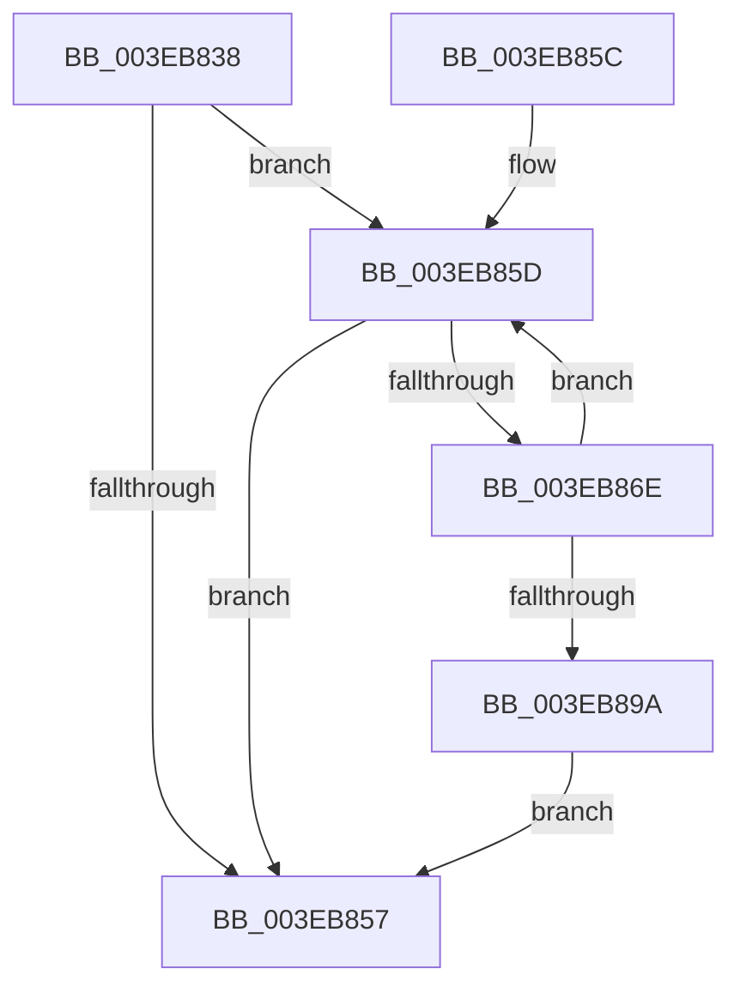

# EtwpAdjustLastBranchLookasideBuffers

- RVA: `0x003EB838`–`0x003EB89C` (길이 `100` bytes)
- VA: `0x00000001403EB838`
- 실행 섹션: `.text`
- PDB 이름 있음: `예`; PDB Function 태그: `아니요`
- unwind 정보 RVA: `0x0005C794`
- 디코드: `28`개 명령, `100/100` bytes 표시
- 미해석 바이트: `0` (있으면 어셈블리에 `.byte`로 보존)

> 이 문서는 커널 이미지의 기계어와 PDB 기호를 분석해 생성했습니다. 4번과 5번은 함수 원형과 자료형을 바이너리 사용 방식에서 추정한 C 해석이며 원본 소스 복구 결과는 아닙니다.

## 1. Dependencies

- 직접 호출 지점: **2**; 고유 호출 대상: **2**
- 직접 호출자로 확인된 함수: **1**
- RIP 상대 이미지 참조: **5**

### Outgoing calls
- `0x003EB864` → [ExpInterlockedPopEntrySList](../6B/ExpInterlockedPopEntrySList_function_006BA570.md) (function, `0x006BA570`)
- `0x003EB873` → [ExFreePoolWithTag](../../poolcode/B8/ExFreePoolWithTag_function_00B82870.md) (function, `0x00B82870`)

### Direct callers
- [EtwpAdjustTraceBuffers](EtwpAdjustTraceBuffers_function_003EB5F0.md) at `0x003EB632`

### Static image references
- `0x003EB83C` → RVA `0x00FC6A80` (`ALMOSTRO`; read)
- `0x003EB842` → RVA `0x00E28FC0` (`.data`; read)
- `0x003EB848` → RVA `0x00E28FC4` (`.data`; read)
- `0x003EB85D` → RVA `0x00E28FB0` (`.data`; read)
- `0x003EB87B` → RVA `0x00E28FC4` (`.data`; read/write)

## 2. Other-region calls and transfers

- 다른 실행 섹션으로 향하는 call: **1**
  - `0x003EB873` → [ExFreePoolWithTag](../../poolcode/B8/ExFreePoolWithTag_function_00B82870.md) (`.text` → `POOLCODE`)
- 별도 외부 분기/꼬리 이동을 확인하지 못했습니다.

## 3. Assembly (complete function range)

```asm
003EB838  48 83 EC 28                     sub rsp, 0x28
003EB83C  8B 05 3E B2 BD 00               mov eax, dword ptr [rip + 0xbdb23e]
003EB842  8B 15 78 D7 A3 00               mov edx, dword ptr [rip + 0xa3d778]
003EB848  8B 0D 76 D7 A3 00               mov ecx, dword ptr [rip + 0xa3d776]
003EB84E  0F AF D0                        imul edx, eax
003EB851  03 D2                           add edx, edx
003EB853  3B CA                           cmp ecx, edx
003EB855  7F 06                           jg 0x1403eb85d
003EB857  48 83 C4 28                     add rsp, 0x28
003EB85B  C3                              ret
003EB85C  CC                              int3
003EB85D  48 8D 0D 4C D7 A3 00            lea rcx, [rip + 0xa3d74c]
003EB864  E8 07 ED 2C 00                  call 0x1406ba570
003EB869  48 85 C0                        test rax, rax
003EB86C  74 E9                           je 0x1403eb857
003EB86E  33 D2                           xor edx, edx
003EB870  48 8B C8                        mov rcx, rax
003EB873  E8 F8 6F 79 00                  call 0x140b82870
003EB878  83 CA FF                        or edx, 0xffffffff
003EB87B  F0 0F C1 15 41 D7 A3 00         lock xadd dword ptr [rip + 0xa3d741], edx
003EB883  8B 05 F7 B1 BD 00               mov eax, dword ptr [rip + 0xbdb1f7]
003EB889  FF CA                           dec edx
003EB88B  8B 0D 2F D7 A3 00               mov ecx, dword ptr [rip + 0xa3d72f]
003EB891  0F AF C8                        imul ecx, eax
003EB894  03 C9                           add ecx, ecx
003EB896  3B D1                           cmp edx, ecx
003EB898  7F C3                           jg 0x1403eb85d
003EB89A  EB BB                           jmp 0x1403eb857
```

## 4. C-style interpretation (structured pseudocode)

```c
__int64 __fastcall EtwpAdjustLastBranchLookasideBuffers(void)
{
    __int64 result;
    __int64 v_rsp;

    v_rsp = (v_rsp) - (40);
    a2 = (unsigned int)(((unsigned int)(*(unsigned int *)(v_rip + 10737528))) * ((unsigned int)((unsigned int)(*(unsigned int *)(v_rip + 12431934)))));
    a2 = (unsigned int)((a2) + ((unsigned int)(a2)));
    if (((unsigned int)((unsigned int)(*(unsigned int *)(v_rip + 10737526)))) > ((unsigned int)(a2))) goto loc_003EB85D;
loc_003EB857:
    v_rsp = (v_rsp) + (40);
    return (unsigned int)(*(unsigned int *)(v_rip + 12431934));
loc_003EB85D:
    result = ExpInterlockedPopEntrySList(v_rip + 10737484, a2, a3, a4);
    if (result == 0) goto loc_003EB857;
    a2 = 0;
    result = ExFreePoolWithTag(result, a2, a3, a4);
    a2 = (unsigned int)((a2) | (0xFFFFFFFFULL));
    a2 = (unsigned int)((a2) - 1);
    a1 = (unsigned int)(((unsigned int)(*(unsigned int *)(v_rip + 10737455))) * ((unsigned int)((unsigned int)(*(unsigned int *)(v_rip + 12431863)))));
    a1 = (unsigned int)((a1) + ((unsigned int)(a1)));
    if (((unsigned int)(a2)) > ((unsigned int)(a1))) goto loc_003EB85D;
    goto loc_003EB857;
}
```

## 5. (Beta) C Style

```c
void EtwpAdjustLastBranchLookasideBuffers(void)
{
    int64_t result;
    int64_t local_rsp;

    local_rsp = (local_rsp) - (40);
    a2 = (uint32_t)(((uint32_t)(*(uint32_t *)(v_rip + 0xA3D778))) * ((uint32_t)((uint32_t)(*(uint32_t *)(v_rip + 0xBDB23E)))));
    a2 = (uint32_t)((a2) + ((uint32_t)(a2)));
    if (((uint32_t)((uint32_t)(*(uint32_t *)(v_rip + 0xA3D776)))) > ((uint32_t)(a2))) goto loc_003EB85D;
loc_003EB857:
    local_rsp = (local_rsp) + (40);
    return (uint32_t)(*(uint32_t *)(v_rip + 0xBDB23E));
loc_003EB85D:
    result = ExpInterlockedPopEntrySList(v_rip + 10737484, a2, a3, a4);
    if (result == 0) goto loc_003EB857;
    a2 = 0;
    result = ExFreePoolWithTag(result, a2, a3, a4);
    a2 = (uint32_t)((a2) | (0xFFFFFFFFULL));
    a2 = (uint32_t)((a2) - 1);
    a1 = (uint32_t)(((uint32_t)(*(uint32_t *)(v_rip + 0xA3D72F))) * ((uint32_t)((uint32_t)(*(uint32_t *)(v_rip + 0xBDB1F7)))));
    a1 = (uint32_t)((a1) + ((uint32_t)(a1)));
    if (((uint32_t)(a2)) > ((uint32_t)(a1))) goto loc_003EB85D;
    goto loc_003EB857;
}
```

## 6. Execution-region graph

[열기: 2D/3D 그래프와 함수 탐색 컨트롤 패널](../../../control-panel.html?section=text&rva=0x003EB838&view=graph)

- 2D 그래프는 위에서 아래로 흐르고, 3D 그래프는 빈 공간을 드래그해 회전합니다. Shift+드래그는 이동, 휠은 확대·축소, 함수 노드 선택은 대상 보고서 이동입니다.

### Static fallback


