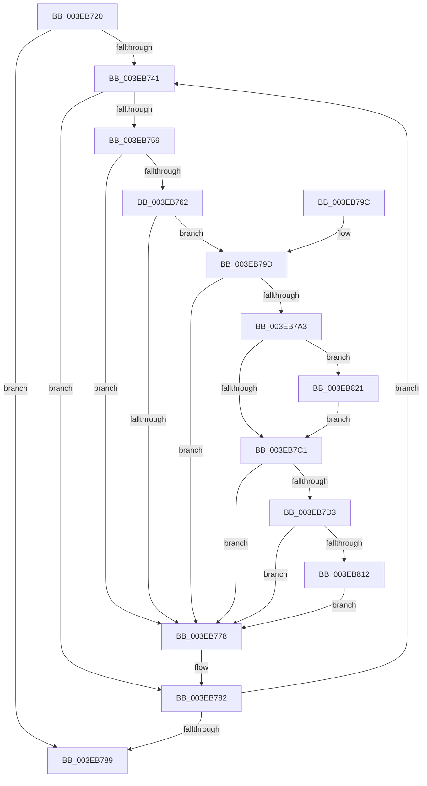

# EtwpAdjustSiloTraceBuffers

- RVA: `0x003EB720`–`0x003EB831` (길이 `273` bytes)
- VA: `0x00000001403EB720`
- 실행 섹션: `.text`
- PDB 이름 있음: `예`; PDB Function 태그: `아니요`
- unwind 정보 RVA: `0x00095A8C`
- 디코드: `78`개 명령, `273/273` bytes 표시
- 미해석 바이트: `0` (있으면 어셈블리에 `.byte`로 보존)

> 이 문서는 커널 이미지의 기계어와 PDB 기호를 분석해 생성했습니다. 4번과 5번은 함수 원형과 자료형을 바이너리 사용 방식에서 추정한 C 해석이며 원본 소스 복구 결과는 아닙니다.

## 1. Dependencies

- 직접 호출 지점: **9**; 고유 호출 대상: **9**
- 직접 호출자로 확인된 함수: **1**
- RIP 상대 이미지 참조: **0**

### Outgoing calls
- `0x003EB74C` → [EtwpAcquireLoggerContextByLoggerId](../../page/93/EtwpAcquireLoggerContextByLoggerId_function_00932920.md) (function, `0x00932920`)
- `0x003EB76B` → [EtwpQueryUsedProcessorCount](EtwpQueryUsedProcessorCount_function_003EB940.md) (function, `0x003EB940`)
- `0x003EB77D` → [EtwpReleaseLoggerContext](../../page/A0/EtwpReleaseLoggerContext_function_00A04160.md) (function, `0x00A04160`)
- `0x003EB7A8` → [EtwpLockBufferList](EtwpLockBufferList_function_003EB49C.md) (function, `0x003EB49C`)
- `0x003EB7B4` → [EtwpDequeueBuffer](EtwpDequeueBuffer_function_003EB434.md) (function, `0x003EB434`)
- `0x003EB7C9` → [EtwpUnlockBufferList](../2D/EtwpUnlockBufferList_function_002DFC28.md) (function, `0x002DFC28`)
- `0x003EB804` → [EtwpFreeTraceBuffer](EtwpFreeTraceBuffer_function_003EB978.md) (function, `0x003EB978`)
- `0x003EB817` → [ExFreePoolWithTag](../../poolcode/B8/ExFreePoolWithTag_function_00B82870.md) (function, `0x00B82870`)
- `0x003EB827` → [EtwpRemoveBufferFromGlobalList](../4F/EtwpRemoveBufferFromGlobalList_function_004F6DE8.md) (function, `0x004F6DE8`)

### Direct callers
- [EtwpAdjustTraceBuffers](EtwpAdjustTraceBuffers_function_003EB5F0.md) at `0x003EB617`
- [EtwpAdjustTraceBuffers](EtwpAdjustTraceBuffers_function_003EB5F0.md) at `0x003EB695`

### Static image references
- 디코드된 RIP-relative 메모리 참조가 없습니다.

## 2. Other-region calls and transfers

- 다른 실행 섹션으로 향하는 call: **3**
  - `0x003EB74C` → [EtwpAcquireLoggerContextByLoggerId](../../page/93/EtwpAcquireLoggerContextByLoggerId_function_00932920.md) (`.text` → `PAGE`)
  - `0x003EB77D` → [EtwpReleaseLoggerContext](../../page/A0/EtwpReleaseLoggerContext_function_00A04160.md) (`.text` → `PAGE`)
  - `0x003EB817` → [ExFreePoolWithTag](../../poolcode/B8/ExFreePoolWithTag_function_00B82870.md) (`.text` → `POOLCODE`)
- 별도 외부 분기/꼬리 이동을 확인하지 못했습니다.

## 3. Assembly (complete function range)

```asm
003EB720  48 89 5C 24 10                  mov qword ptr [rsp + 0x10], rbx
003EB725  48 89 6C 24 18                  mov qword ptr [rsp + 0x18], rbp
003EB72A  56                              push rsi
003EB72B  57                              push rdi
003EB72C  41 56                           push r14
003EB72E  48 83 EC 20                     sub rsp, 0x20
003EB732  33 FF                           xor edi, edi
003EB734  C6 44 24 40 00                  mov byte ptr [rsp + 0x40], 0
003EB739  48 8B F1                        mov rsi, rcx
003EB73C  39 79 10                        cmp dword ptr [rcx + 0x10], edi
003EB73F  76 48                           jbe 0x1403eb789
003EB741  45 33 C0                        xor r8d, r8d
003EB744  8B D7                           mov edx, edi
003EB746  48 8B CE                        mov rcx, rsi
003EB749  45 33 F6                        xor r14d, r14d
003EB74C  E8 CF 71 54 00                  call 0x140932920
003EB751  48 8B D8                        mov rbx, rax
003EB754  48 85 C0                        test rax, rax
003EB757  74 29                           je 0x1403eb782
003EB759  F7 40 0C 00 04 00 00            test dword ptr [rax + 0xc], 0x400
003EB760  75 16                           jne 0x1403eb778
003EB762  8B 90 E4 00 00 00               mov edx, dword ptr [rax + 0xe4]
003EB768  48 8B C8                        mov rcx, rax
003EB76B  E8 D0 01 00 00                  call 0x1403eb940
003EB770  3B 91 E0 00 00 00               cmp edx, dword ptr [rcx + 0xe0]
003EB776  77 25                           ja 0x1403eb79d
003EB778  33 D2                           xor edx, edx
003EB77A  48 8B CB                        mov rcx, rbx
003EB77D  E8 DE 89 61 00                  call 0x140a04160
003EB782  FF C7                           inc edi
003EB784  3B 7E 10                        cmp edi, dword ptr [rsi + 0x10]
003EB787  72 B8                           jb 0x1403eb741
003EB789  48 8B 5C 24 48                  mov rbx, qword ptr [rsp + 0x48]
003EB78E  48 8B 6C 24 50                  mov rbp, qword ptr [rsp + 0x50]
003EB793  48 83 C4 20                     add rsp, 0x20
003EB797  41 5E                           pop r14
003EB799  5F                              pop rdi
003EB79A  5E                              pop rsi
003EB79B  C3                              ret
003EB79C  CC                              int3
003EB79D  03 C0                           add eax, eax
003EB79F  3B D0                           cmp edx, eax
003EB7A1  76 D5                           jbe 0x1403eb778
003EB7A3  48 8D 54 24 40                  lea rdx, [rsp + 0x40]
003EB7A8  E8 EF FC FF FF                  call 0x1403eb49c
003EB7AD  48 8D 53 30                     lea rdx, [rbx + 0x30]
003EB7B1  48 8B CB                        mov rcx, rbx
003EB7B4  E8 7B FC FF FF                  call 0x1403eb434
003EB7B9  48 8B E8                        mov rbp, rax
003EB7BC  48 85 C0                        test rax, rax
003EB7BF  75 60                           jne 0x1403eb821
003EB7C1  48 8D 54 24 40                  lea rdx, [rsp + 0x40]
003EB7C6  48 8B CB                        mov rcx, rbx
003EB7C9  E8 5A 44 EF FF                  call 0x1402dfc28
003EB7CE  48 85 ED                        test rbp, rbp
003EB7D1  74 A5                           je 0x1403eb778
003EB7D3  F0 FF 8B E8 00 00 00            lock dec dword ptr [rbx + 0xe8]
003EB7DA  F0 FF 8B E4 00 00 00            lock dec dword ptr [rbx + 0xe4]
003EB7E1  8B 53 04                        mov edx, dword ptr [rbx + 4]
003EB7E4  8B 8B 2C 01 00 00               mov ecx, dword ptr [rbx + 0x12c]
003EB7EA  F7 DA                           neg edx
003EB7EC  48 8B 83 50 05 00 00            mov rax, qword ptr [rbx + 0x550]
003EB7F3  83 E1 01                        and ecx, 1
003EB7F6  F0 01 94 88 2C 11 00 00         lock add dword ptr [rax + rcx*4 + 0x112c], edx
003EB7FE  48 8B D5                        mov rdx, rbp
003EB801  48 8B CB                        mov rcx, rbx
003EB804  E8 6F 01 00 00                  call 0x1403eb978
003EB809  4D 85 F6                        test r14, r14
003EB80C  0F 84 66 FF FF FF               je 0x1403eb778
003EB812  33 D2                           xor edx, edx
003EB814  49 8B CE                        mov rcx, r14
003EB817  E8 54 70 79 00                  call 0x140b82870
003EB81C  E9 57 FF FF FF                  jmp 0x1403eb778
003EB821  48 8B D5                        mov rdx, rbp
003EB824  48 8B CB                        mov rcx, rbx
003EB827  E8 BC B5 10 00                  call 0x1404f6de8
003EB82C  4C 8B F0                        mov r14, rax
003EB82F  EB 90                           jmp 0x1403eb7c1
```

## 4. C-style interpretation (structured pseudocode)

```c
__int64 __fastcall EtwpAdjustSiloTraceBuffers(__int64 a1, __int64 a2, int a3)
{
    __int64 result;
    __int64 v_r14;
    __int64 v_rdi;
    __int64 v_rsp;
    unsigned __int64 v_stack_p10;
    unsigned __int64 v_stack_p18;
    unsigned __int64 v_stack_p40;
    unsigned __int8 v_stack_p8;

    v_stack_p10 = v_rbx;
    v_stack_p18 = v_rbp;
    v_rsp = (v_rsp) - (32);
    v_rdi = 0;
    v_stack_p8 = 0;
    if ((*(unsigned int *)(a1 + 16)) <= 0) goto loc_003EB789;
loc_003EB741:
    a3 = 0;
    v_r14 = 0;
    result = EtwpAcquireLoggerContextByLoggerId(a1, 0, a3, a4);
    if (result == 0) goto loc_003EB782;
    if (((*(unsigned int *)(result + 12)) & (0x400ULL)) != 0) goto loc_003EB778;
    result = EtwpQueryUsedProcessorCount(result, (unsigned int)(*(unsigned int *)(result + 228)), a3, a4);
    if (((unsigned int)((unsigned int)(*(unsigned int *)(result + 228)))) > (*(unsigned int *)(result + 224))) goto loc_003EB79D;
loc_003EB778:
    a2 = 0;
    result = EtwpReleaseLoggerContext(result, a2, a3, a4);
loc_003EB782:
    v_rdi = (unsigned int)((v_rdi) + 1);
    if (((unsigned int)(v_rdi)) < (*(unsigned int *)(a1 + 16))) goto loc_003EB741;
loc_003EB789:
    v_rsp = (v_rsp) + (32);
    return result;
loc_003EB79D:
    result = (unsigned int)((result) + ((unsigned int)(result)));
    if (0 <= ((unsigned int)(result))) goto loc_003EB778;
    result = EtwpLockBufferList(result, v_stack_p40, a3, a4);
    result = EtwpDequeueBuffer(v_stack_p10, v_stack_p10 + 48, a3, a4);
    if (result != 0) goto loc_003EB821;
loc_003EB7C1:
    result = EtwpUnlockBufferList(v_stack_p10, v_stack_p40, a3, a4);
    if (result == 0) goto loc_003EB778;
    a2 = (unsigned int)(-((unsigned int)(*(unsigned int *)(v_stack_p10 + 4))));
    a1 = (unsigned int)(((unsigned int)(*(unsigned int *)(v_stack_p10 + 300))) & (1));
    result = EtwpFreeTraceBuffer(v_stack_p10, result, a3, a4);
    if (0 == 0) goto loc_003EB778;
    a2 = 0;
    result = ExFreePoolWithTag(0, a2, a3, a4);
    goto loc_003EB778;
loc_003EB821:
    result = EtwpRemoveBufferFromGlobalList(v_stack_p10, result, a3, a4);
    goto loc_003EB7C1;
}
```

## 5. (Beta) C Style

```c
int64_t EtwpAdjustSiloTraceBuffers(void *Arg1, int64_t Arg2, int32_t Arg3)
{
    uint8_t *arg1 = (uint8_t *)Arg1;

    int64_t result;
    int64_t local_r14;
    int64_t local_rdi;
    int64_t local_rsp;
    uint64_t v_stack_p10;
    uint64_t v_stack_p18;
    uint64_t v_stack_p40;
    uint8_t v_stack_p8;

    v_stack_p10 = local_rbx;
    v_stack_p18 = local_rbp;
    local_rsp = (local_rsp) - (32);
    local_rdi = 0;
    v_stack_p8 = 0;
    if ((*(uint32_t *)(arg1 + 0x10)) <= 0) goto loc_003EB789;
loc_003EB741:
    Arg3 = 0;
    local_r14 = 0;
    result = EtwpAcquireLoggerContextByLoggerId(Arg1, 0, Arg3, a4);
    if (result == 0) goto loc_003EB782;
    if (((*(uint32_t *)(result + 0xC)) & (0x400ULL)) != 0) goto loc_003EB778;
    result = EtwpQueryUsedProcessorCount(result, (uint32_t)(*(uint32_t *)(result + 0xE4)), Arg3, a4);
    if (((uint32_t)((uint32_t)(*(uint32_t *)(result + 0xE4)))) > (*(uint32_t *)(result + 0xE0))) goto loc_003EB79D;
loc_003EB778:
    Arg2 = 0;
    result = EtwpReleaseLoggerContext(result, Arg2, Arg3, a4);
loc_003EB782:
    local_rdi = (uint32_t)((local_rdi) + 1);
    if (((uint32_t)(local_rdi)) < (*(uint32_t *)(arg1 + 0x10))) goto loc_003EB741;
loc_003EB789:
    local_rsp = (local_rsp) + (32);
    return result;
loc_003EB79D:
    result = (uint32_t)((result) + ((uint32_t)(result)));
    if (0 <= ((uint32_t)(result))) goto loc_003EB778;
    result = EtwpLockBufferList(result, v_stack_p40, Arg3, a4);
    result = EtwpDequeueBuffer(v_stack_p10, v_stack_p10 + 48, Arg3, a4);
    if (result != 0) goto loc_003EB821;
loc_003EB7C1:
    result = EtwpUnlockBufferList(v_stack_p10, v_stack_p40, Arg3, a4);
    if (result == 0) goto loc_003EB778;
    Arg2 = (uint32_t)(-((uint32_t)(*(uint32_t *)(v_stack_p10 + 0x4))));
    Arg1 = (uint32_t)(((uint32_t)(*(uint32_t *)(v_stack_p10 + 0x12C))) & (1));
    result = EtwpFreeTraceBuffer(v_stack_p10, result, Arg3, a4);
    if (0 == 0) goto loc_003EB778;
    Arg2 = 0;
    result = ExFreePoolWithTag(0, Arg2, Arg3, a4);
    goto loc_003EB778;
loc_003EB821:
    result = EtwpRemoveBufferFromGlobalList(v_stack_p10, result, Arg3, a4);
    goto loc_003EB7C1;
}
```

### 관측된 메모리 오프셋

구조체 형식이 확인되지 않은 접근은 인자 기준의 오프셋으로만 기록했습니다.

| 기준 인자 | 오프셋 표현 | 폭 (bit) | 접근 |
|---|---:|---:|---|
| `Arg1` | `+ 0x10` | `32` | `R` |

## 6. Execution-region graph

[열기: 2D/3D 그래프와 함수 탐색 컨트롤 패널](../../../control-panel.html?section=text&rva=0x003EB720&view=graph)

- 2D 그래프는 위에서 아래로 흐르고, 3D 그래프는 빈 공간을 드래그해 회전합니다. Shift+드래그는 이동, 휠은 확대·축소, 함수 노드 선택은 대상 보고서 이동입니다.

### Static fallback


