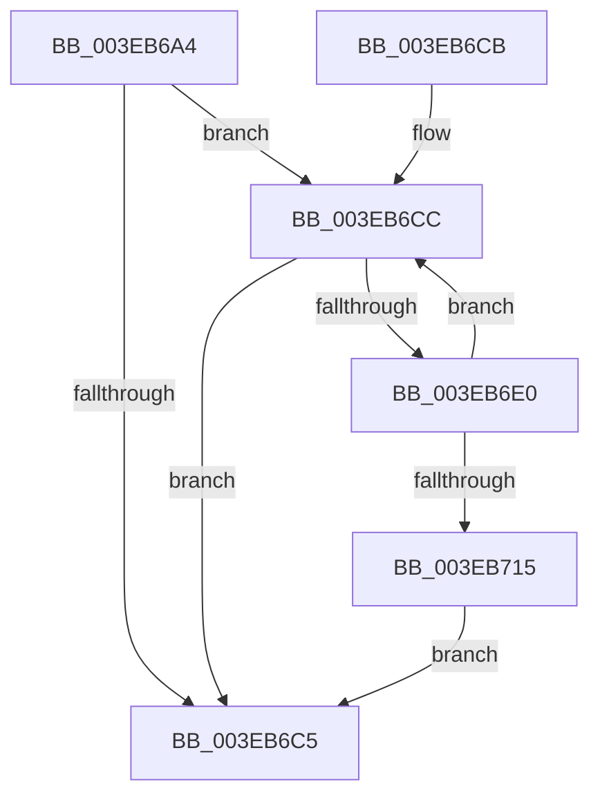

# EtwpAdjustStackLookasideBuffers

- RVA: `0x003EB6A4`–`0x003EB717` (길이 `115` bytes)
- VA: `0x00000001403EB6A4`
- 실행 섹션: `.text`
- PDB 이름 있음: `예`; PDB Function 태그: `아니요`
- unwind 정보 RVA: `0x00095A80`
- 디코드: `33`개 명령, `115/115` bytes 표시
- 미해석 바이트: `0` (있으면 어셈블리에 `.byte`로 보존)

> 이 문서는 커널 이미지의 기계어와 PDB 기호를 분석해 생성했습니다. 4번과 5번은 함수 원형과 자료형을 바이너리 사용 방식에서 추정한 C 해석이며 원본 소스 복구 결과는 아닙니다.

## 1. Dependencies

- 직접 호출 지점: **3**; 고유 호출 대상: **3**
- 직접 호출자로 확인된 함수: **1**
- RIP 상대 이미지 참조: **5**

### Outgoing calls
- `0x003EB6D3` → [ExpInterlockedPopEntrySList](../6B/ExpInterlockedPopEntrySList_function_006BA570.md) (function, `0x006BA570`)
- `0x003EB6E4` → [KeFreeCalloutStack](../../page/A9/KeFreeCalloutStack_function_00A99AB0.md) (function, `0x00A99AB0`)
- `0x003EB6EE` → [ExFreePoolWithTag](../../poolcode/B8/ExFreePoolWithTag_function_00B82870.md) (function, `0x00B82870`)

### Direct callers
- [EtwpAdjustTraceBuffers](EtwpAdjustTraceBuffers_function_003EB5F0.md) at `0x003EB62D`

### Static image references
- `0x003EB6AA` → RVA `0x00FC6A80` (`ALMOSTRO`; read)
- `0x003EB6B0` → RVA `0x00E28F90` (`.data`; read)
- `0x003EB6B6` → RVA `0x00E28F94` (`.data`; read)
- `0x003EB6CC` → RVA `0x00E28F80` (`.data`; read)
- `0x003EB6F6` → RVA `0x00E28F94` (`.data`; read/write)

## 2. Other-region calls and transfers

- 다른 실행 섹션으로 향하는 call: **2**
  - `0x003EB6E4` → [KeFreeCalloutStack](../../page/A9/KeFreeCalloutStack_function_00A99AB0.md) (`.text` → `PAGE`)
  - `0x003EB6EE` → [ExFreePoolWithTag](../../poolcode/B8/ExFreePoolWithTag_function_00B82870.md) (`.text` → `POOLCODE`)
- 별도 외부 분기/꼬리 이동을 확인하지 못했습니다.

## 3. Assembly (complete function range)

```asm
003EB6A4  40 53                           push rbx
003EB6A6  48 83 EC 20                     sub rsp, 0x20
003EB6AA  8B 05 D0 B3 BD 00               mov eax, dword ptr [rip + 0xbdb3d0]
003EB6B0  8B 15 DA D8 A3 00               mov edx, dword ptr [rip + 0xa3d8da]
003EB6B6  8B 0D D8 D8 A3 00               mov ecx, dword ptr [rip + 0xa3d8d8]
003EB6BC  0F AF D0                        imul edx, eax
003EB6BF  03 D2                           add edx, edx
003EB6C1  3B CA                           cmp ecx, edx
003EB6C3  7F 07                           jg 0x1403eb6cc
003EB6C5  48 83 C4 20                     add rsp, 0x20
003EB6C9  5B                              pop rbx
003EB6CA  C3                              ret
003EB6CB  CC                              int3
003EB6CC  48 8D 0D AD D8 A3 00            lea rcx, [rip + 0xa3d8ad]
003EB6D3  E8 98 EE 2C 00                  call 0x1406ba570
003EB6D8  48 8B D8                        mov rbx, rax
003EB6DB  48 85 C0                        test rax, rax
003EB6DE  74 E5                           je 0x1403eb6c5
003EB6E0  48 8B 48 18                     mov rcx, qword ptr [rax + 0x18]
003EB6E4  E8 C7 E3 6A 00                  call 0x140a99ab0
003EB6E9  33 D2                           xor edx, edx
003EB6EB  48 8B CB                        mov rcx, rbx
003EB6EE  E8 7D 71 79 00                  call 0x140b82870
003EB6F3  83 CA FF                        or edx, 0xffffffff
003EB6F6  F0 0F C1 15 96 D8 A3 00         lock xadd dword ptr [rip + 0xa3d896], edx
003EB6FE  8B 05 7C B3 BD 00               mov eax, dword ptr [rip + 0xbdb37c]
003EB704  FF CA                           dec edx
003EB706  8B 0D 84 D8 A3 00               mov ecx, dword ptr [rip + 0xa3d884]
003EB70C  0F AF C8                        imul ecx, eax
003EB70F  03 C9                           add ecx, ecx
003EB711  3B D1                           cmp edx, ecx
003EB713  7F B7                           jg 0x1403eb6cc
003EB715  EB AE                           jmp 0x1403eb6c5
```

## 4. C-style interpretation (structured pseudocode)

```c
__int64 __fastcall EtwpAdjustStackLookasideBuffers(void)
{
    __int64 result;
    __int64 v_rsp;

    v_rsp = (v_rsp) - (32);
    a2 = (unsigned int)(((unsigned int)(*(unsigned int *)(v_rip + 10737882))) * ((unsigned int)((unsigned int)(*(unsigned int *)(v_rip + 12432336)))));
    a2 = (unsigned int)((a2) + ((unsigned int)(a2)));
    if (((unsigned int)((unsigned int)(*(unsigned int *)(v_rip + 10737880)))) > ((unsigned int)(a2))) goto loc_003EB6CC;
loc_003EB6C5:
    v_rsp = (v_rsp) + (32);
    return (unsigned int)(*(unsigned int *)(v_rip + 12432336));
loc_003EB6CC:
    result = ExpInterlockedPopEntrySList(v_rip + 10737837, a2, a3, a4);
    if (result == 0) goto loc_003EB6C5;
    result = KeFreeCalloutStack(*(unsigned __int64 *)(result + 24), a2, a3, a4);
    a2 = 0;
    result = ExFreePoolWithTag(result, a2, a3, a4);
    a2 = (unsigned int)((a2) | (0xFFFFFFFFULL));
    a2 = (unsigned int)((a2) - 1);
    a1 = (unsigned int)(((unsigned int)(*(unsigned int *)(v_rip + 10737796))) * ((unsigned int)((unsigned int)(*(unsigned int *)(v_rip + 12432252)))));
    a1 = (unsigned int)((a1) + ((unsigned int)(a1)));
    if (((unsigned int)(a2)) > ((unsigned int)(a1))) goto loc_003EB6CC;
    goto loc_003EB6C5;
}
```

## 5. (Beta) C Style

```c
void EtwpAdjustStackLookasideBuffers(void)
{
    int64_t result;
    int64_t local_rsp;

    local_rsp = (local_rsp) - (32);
    a2 = (uint32_t)(((uint32_t)(*(uint32_t *)(v_rip + 0xA3D8DA))) * ((uint32_t)((uint32_t)(*(uint32_t *)(v_rip + 0xBDB3D0)))));
    a2 = (uint32_t)((a2) + ((uint32_t)(a2)));
    if (((uint32_t)((uint32_t)(*(uint32_t *)(v_rip + 0xA3D8D8)))) > ((uint32_t)(a2))) goto loc_003EB6CC;
loc_003EB6C5:
    local_rsp = (local_rsp) + (32);
    return (uint32_t)(*(uint32_t *)(v_rip + 0xBDB3D0));
loc_003EB6CC:
    result = ExpInterlockedPopEntrySList(v_rip + 10737837, a2, a3, a4);
    if (result == 0) goto loc_003EB6C5;
    result = KeFreeCalloutStack(*(uint64_t *)(result + 0x18), a2, a3, a4);
    a2 = 0;
    result = ExFreePoolWithTag(result, a2, a3, a4);
    a2 = (uint32_t)((a2) | (0xFFFFFFFFULL));
    a2 = (uint32_t)((a2) - 1);
    a1 = (uint32_t)(((uint32_t)(*(uint32_t *)(v_rip + 0xA3D884))) * ((uint32_t)((uint32_t)(*(uint32_t *)(v_rip + 0xBDB37C)))));
    a1 = (uint32_t)((a1) + ((uint32_t)(a1)));
    if (((uint32_t)(a2)) > ((uint32_t)(a1))) goto loc_003EB6CC;
    goto loc_003EB6C5;
}
```

## 6. Execution-region graph

[열기: 2D/3D 그래프와 함수 탐색 컨트롤 패널](../../../control-panel.html?section=text&rva=0x003EB6A4&view=graph)

- 2D 그래프는 위에서 아래로 흐르고, 3D 그래프는 빈 공간을 드래그해 회전합니다. Shift+드래그는 이동, 휠은 확대·축소, 함수 노드 선택은 대상 보고서 이동입니다.

### Static fallback


