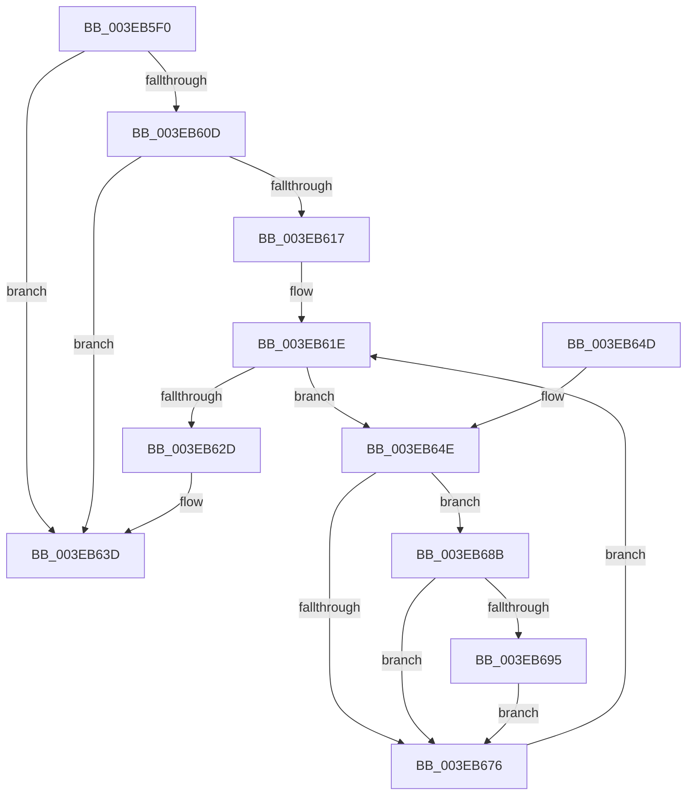

# EtwpAdjustTraceBuffers

- RVA: `0x003EB5F0`–`0x003EB69C` (길이 `172` bytes)
- VA: `0x00000001403EB5F0`
- 실행 섹션: `.text`
- PDB 이름 있음: `예`; PDB Function 태그: `아니요`
- unwind 정보 RVA: `0x00095A6C`
- 디코드: `43`개 명령, `172/172` bytes 표시
- 미해석 바이트: `0` (있으면 어셈블리에 `.byte`로 보존)

> 이 문서는 커널 이미지의 기계어와 PDB 기호를 분석해 생성했습니다. 4번과 5번은 함수 원형과 자료형을 바이너리 사용 방식에서 추정한 C 해석이며 원본 소스 복구 결과는 아닙니다.

## 1. Dependencies

- 직접 호출 지점: **6**; 고유 호출 대상: **5**
- 직접 호출자로 확인된 함수: **0**
- RIP 상대 이미지 참조: **2**

### Outgoing calls
- `0x003EB617` → [EtwpAdjustSiloTraceBuffers](EtwpAdjustSiloTraceBuffers_function_003EB720.md) (function, `0x003EB720`)
- `0x003EB620` → [PspGetNextSilo](../../page/91/PspGetNextSilo_function_00919F78.md) (function, `0x00919F78`)
- `0x003EB62D` → [EtwpAdjustStackLookasideBuffers](EtwpAdjustStackLookasideBuffers_function_003EB6A4.md) (function, `0x003EB6A4`)
- `0x003EB632` → [EtwpAdjustLastBranchLookasideBuffers](EtwpAdjustLastBranchLookasideBuffers_function_003EB838.md) (function, `0x003EB838`)
- `0x003EB665` → [PsGetCurrentServerSiloGlobals](../2F/PsGetCurrentServerSiloGlobals_function_002FE1F0.md) (function, `0x002FE1F0`)
- `0x003EB695` → [EtwpAdjustSiloTraceBuffers](EtwpAdjustSiloTraceBuffers_function_003EB720.md) (function, `0x003EB720`)

### Direct callers
- 이 함수 시작 RVA로 연결되는 직접 call은 확인되지 않았습니다. 간접 호출은 완전히 역산할 수 없습니다.

### Static image references
- `0x003EB5FF` → RVA `0x00FC6AA8` (`ALMOSTRO`; read)
- `0x003EB637` → RVA `0x00EFF280` (`.data`; read/write)

## 2. Other-region calls and transfers

- 다른 실행 섹션으로 향하는 call: **1**
  - `0x003EB620` → [PspGetNextSilo](../../page/91/PspGetNextSilo_function_00919F78.md) (`.text` → `PAGE`)
- 별도 외부 분기/꼬리 이동을 확인하지 못했습니다.

## 3. Assembly (complete function range)

```asm
003EB5F0  48 89 5C 24 08                  mov qword ptr [rsp + 8], rbx
003EB5F5  48 89 74 24 10                  mov qword ptr [rsp + 0x10], rsi
003EB5FA  57                              push rdi
003EB5FB  48 83 EC 20                     sub rsp, 0x20
003EB5FF  48 8B 0D A2 B4 BD 00            mov rcx, qword ptr [rip + 0xbdb4a2]
003EB606  33 DB                           xor ebx, ebx
003EB608  48 85 C9                        test rcx, rcx
003EB60B  74 30                           je 0x1403eb63d
003EB60D  8B 81 F4 10 00 00               mov eax, dword ptr [rcx + 0x10f4]
003EB613  85 C0                           test eax, eax
003EB615  75 26                           jne 0x1403eb63d
003EB617  E8 04 01 00 00                  call 0x1403eb720
003EB61C  33 C9                           xor ecx, ecx
003EB61E  B2 01                           mov dl, 1
003EB620  E8 53 E9 52 00                  call 0x140919f78
003EB625  48 8B F8                        mov rdi, rax
003EB628  48 85 C0                        test rax, rax
003EB62B  75 21                           jne 0x1403eb64e
003EB62D  E8 72 00 00 00                  call 0x1403eb6a4
003EB632  E8 01 02 00 00                  call 0x1403eb838
003EB637  87 1D 43 3C B1 00               xchg dword ptr [rip + 0xb13c43], ebx
003EB63D  48 8B 5C 24 30                  mov rbx, qword ptr [rsp + 0x30]
003EB642  48 8B 74 24 38                  mov rsi, qword ptr [rsp + 0x38]
003EB647  48 83 C4 20                     add rsp, 0x20
003EB64B  5F                              pop rdi
003EB64C  C3                              ret
003EB64D  CC                              int3
003EB64E  65 48 8B 0C 25 88 01 00 00      mov rcx, qword ptr gs:[0x188]
003EB657  48 8B B1 98 06 00 00            mov rsi, qword ptr [rcx + 0x698]
003EB65E  48 89 B9 98 06 00 00            mov qword ptr [rcx + 0x698], rdi
003EB665  E8 86 2B F1 FF                  call 0x1402fe1f0
003EB66A  48 8B 88 40 03 00 00            mov rcx, qword ptr [rax + 0x340]
003EB671  48 85 C9                        test rcx, rcx
003EB674  75 15                           jne 0x1403eb68b
003EB676  65 48 8B 04 25 88 01 00 00      mov rax, qword ptr gs:[0x188]
003EB67F  48 8B CF                        mov rcx, rdi
003EB682  48 89 B0 98 06 00 00            mov qword ptr [rax + 0x698], rsi
003EB689  EB 93                           jmp 0x1403eb61e
003EB68B  8B 81 F4 10 00 00               mov eax, dword ptr [rcx + 0x10f4]
003EB691  85 C0                           test eax, eax
003EB693  75 E1                           jne 0x1403eb676
003EB695  E8 86 00 00 00                  call 0x1403eb720
003EB69A  EB DA                           jmp 0x1403eb676
```

## 4. C-style interpretation (structured pseudocode)

```c
__int64 __fastcall EtwpAdjustTraceBuffers(void)
{
    __int64 result;
    __int64 v_rbx;
    __int64 v_rsp;
    unsigned __int64 v_stack_p10;
    unsigned __int64 v_stack_p8;

    v_stack_p8 = v_rbx;
    v_stack_p10 = v_rsi;
    v_rsp = (v_rsp) - (32);
    v_rbx = 0;
    if (*(unsigned __int64 *)(v_rip + 12432546) == 0) goto loc_003EB63D;
    if ((unsigned int)((unsigned int)(*(unsigned int *)(*(unsigned __int64 *)(v_rip + 12432546) + 4340))) != 0) goto loc_003EB63D;
    result = EtwpAdjustSiloTraceBuffers(*(unsigned __int64 *)(v_rip + 12432546), a2, a3, a4);
    a1 = 0;
loc_003EB61E:
    result = PspGetNextSilo(a1, 1, a3, a4);
    if (result != 0) goto loc_003EB64E;
    result = EtwpAdjustStackLookasideBuffers(a1, 1, a3, a4);
    result = EtwpAdjustLastBranchLookasideBuffers(a1, 1, a3, a4);
loc_003EB63D:
    v_rsp = (v_rsp) + (32);
    return result;
loc_003EB64E:
    *(unsigned __int64 *)(*(unsigned __int64 *)(gs_base + (0 + 392)) + 1688) = result;
    result = PsGetCurrentServerSiloGlobals(*(unsigned __int64 *)(gs_base + (0 + 392)), 1, a3, a4);
    if (*(unsigned __int64 *)(result + 832) != 0) goto loc_003EB68B;
loc_003EB676:
    *(unsigned __int64 *)(*(unsigned __int64 *)(gs_base + (0 + 392)) + 1688) = *(unsigned __int64 *)(*(unsigned __int64 *)(gs_base + (0 + 392)) + 1688);
    goto loc_003EB61E;
loc_003EB68B:
    if ((unsigned int)((unsigned int)(*(unsigned int *)(result + 4340))) != 0) goto loc_003EB676;
    result = EtwpAdjustSiloTraceBuffers(result, 1, a3, a4);
    goto loc_003EB676;
}
```

## 5. (Beta) C Style

```c
void EtwpAdjustTraceBuffers(void)
{
    int64_t result;
    int64_t local_rbx;
    int64_t local_rsp;
    uint64_t v_stack_p10;
    uint64_t v_stack_p8;

    v_stack_p8 = local_rbx;
    v_stack_p10 = local_rsi;
    local_rsp = (local_rsp) - (32);
    local_rbx = 0;
    if (*(uint64_t *)(v_rip + 0xBDB4A2) == 0) goto loc_003EB63D;
    if ((uint32_t)((uint32_t)(*(uint32_t *)(*(uint64_t *)(v_rip + 0xBDB4A2) + 0x10F4))) != 0) goto loc_003EB63D;
    result = EtwpAdjustSiloTraceBuffers(*(uint64_t *)(v_rip + 0xBDB4A2), a2, a3, a4);
    a1 = 0;
loc_003EB61E:
    result = PspGetNextSilo(a1, 1, a3, a4);
    if (result != 0) goto loc_003EB64E;
    result = EtwpAdjustStackLookasideBuffers(a1, 1, a3, a4);
    result = EtwpAdjustLastBranchLookasideBuffers(a1, 1, a3, a4);
loc_003EB63D:
    local_rsp = (local_rsp) + (32);
    return result;
loc_003EB64E:
    *(uint64_t *)(*(uint64_t *)(gs_base + (0 + 0x188)) + 0x698) = result;
    result = PsGetCurrentServerSiloGlobals(*(uint64_t *)(gs_base + (0 + 0x188)), 1, a3, a4);
    if (*(uint64_t *)(result + 0x340) != 0) goto loc_003EB68B;
loc_003EB676:
    *(uint64_t *)(*(uint64_t *)(gs_base + (0 + 0x188)) + 0x698) = *(uint64_t *)(*(uint64_t *)(gs_base + (0 + 0x188)) + 0x698);
    goto loc_003EB61E;
loc_003EB68B:
    if ((uint32_t)((uint32_t)(*(uint32_t *)(result + 0x10F4))) != 0) goto loc_003EB676;
    result = EtwpAdjustSiloTraceBuffers(result, 1, a3, a4);
    goto loc_003EB676;
}
```

## 6. Execution-region graph

[열기: 2D/3D 그래프와 함수 탐색 컨트롤 패널](../../../control-panel.html?section=text&rva=0x003EB5F0&view=graph)

- 2D 그래프는 위에서 아래로 흐르고, 3D 그래프는 빈 공간을 드래그해 회전합니다. Shift+드래그는 이동, 휠은 확대·축소, 함수 노드 선택은 대상 보고서 이동입니다.

### Static fallback


