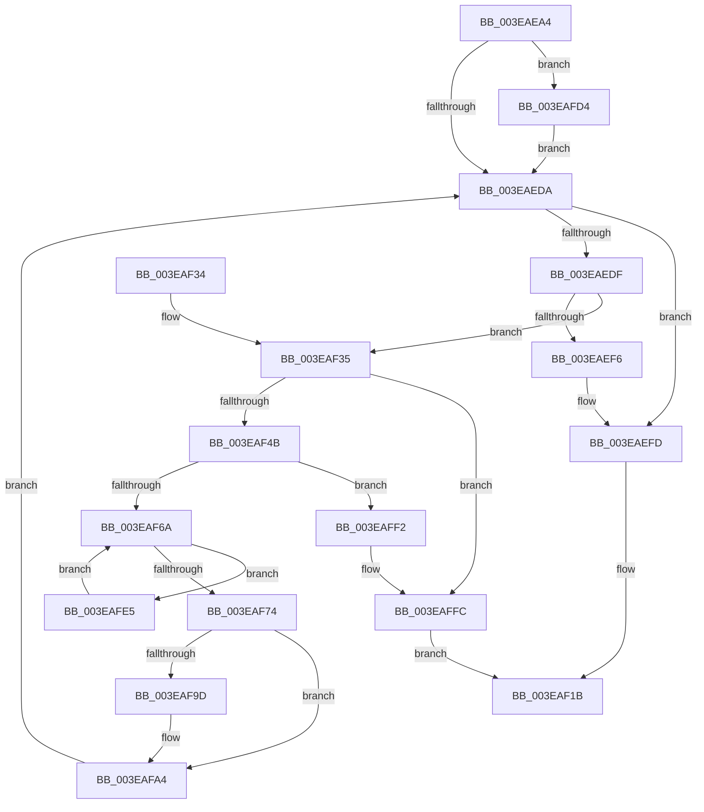

# EtwpAllocateFreeBuffers

- RVA: `0x003EAEA4`–`0x003EB008` (길이 `356` bytes)
- VA: `0x00000001403EAEA4`
- 실행 섹션: `.text`
- PDB 이름 있음: `예`; PDB Function 태그: `아니요`
- unwind 정보 RVA: `0x000959C8`
- 디코드: `92`개 명령, `356/356` bytes 표시
- 미해석 바이트: `0` (있으면 어셈블리에 `.byte`로 보존)

> 이 문서는 커널 이미지의 기계어와 PDB 기호를 분석해 생성했습니다. 4번과 5번은 함수 원형과 자료형을 바이너리 사용 방식에서 추정한 C 해석이며 원본 소스 복구 결과는 아닙니다.

## 1. Dependencies

- 직접 호출 지점: **7**; 고유 호출 대상: **7**
- 직접 호출자로 확인된 함수: **3**
- RIP 상대 이미지 참조: **0**

### Outgoing calls
- `0x003EAF3A` → [EtwpAllocateTraceBuffer](EtwpAllocateTraceBuffer_function_003EB070.md) (function, `0x003EB070`)
- `0x003EAF59` → [ExAllocatePool2](../../poolcode/B8/ExAllocatePool2_function_00B820F0.md) (function, `0x00B820F0`)
- `0x003EAF7A` → [EtwpInitializeBufferHeader](EtwpInitializeBufferHeader_function_003EB010.md) (function, `0x003EB010`)
- `0x003EAF8B` → [EtwpLockBufferList](EtwpLockBufferList_function_003EB49C.md) (function, `0x003EB49C`)
- `0x003EAFBA` → [EtwpUnlockBufferList](../2D/EtwpUnlockBufferList_function_002DFC28.md) (function, `0x002DFC28`)
- `0x003EAFC8` → [EtwpEnqueueAvailableBuffer](../2F/EtwpEnqueueAvailableBuffer_function_002FE7DC.md) (function, `0x002FE7DC`)
- `0x003EAFF7` → [ExFreePoolWithTag](../../poolcode/B8/ExFreePoolWithTag_function_00B82870.md) (function, `0x00B82870`)

### Direct callers
- [EtwpReserveTraceBuffer](../2F/EtwpReserveTraceBuffer_function_002FC8C0.md) at `0x002FCBC7`
- [EtwpAdjustFreeBuffers](../../page/9B/EtwpAdjustFreeBuffers_function_009BE91C.md) at `0x009BE954`
- [EtwpAllocateTraceBufferPool](../../page/A7/EtwpAllocateTraceBufferPool_function_00A74750.md) at `0x00A74806`

### Static image references
- 디코드된 RIP-relative 메모리 참조가 없습니다.

## 2. Other-region calls and transfers

- 다른 실행 섹션으로 향하는 call: **2**
  - `0x003EAF59` → [ExAllocatePool2](../../poolcode/B8/ExAllocatePool2_function_00B820F0.md) (`.text` → `POOLCODE`)
  - `0x003EAFF7` → [ExFreePoolWithTag](../../poolcode/B8/ExFreePoolWithTag_function_00B82870.md) (`.text` → `POOLCODE`)
- 별도 외부 분기/꼬리 이동을 확인하지 못했습니다.

## 3. Assembly (complete function range)

```asm
003EAEA4  48 89 5C 24 08                  mov qword ptr [rsp + 8], rbx
003EAEA9  48 89 6C 24 18                  mov qword ptr [rsp + 0x18], rbp
003EAEAE  56                              push rsi
003EAEAF  57                              push rdi
003EAEB0  41 54                           push r12
003EAEB2  41 56                           push r14
003EAEB4  41 57                           push r15
003EAEB6  48 83 EC 20                     sub rsp, 0x20
003EAEBA  8B 69 04                        mov ebp, dword ptr [rcx + 4]
003EAEBD  33 F6                           xor esi, esi
003EAEBF  F7 81 30 03 00 00 00 10 00 00   test dword ptr [rcx + 0x330], 0x1000
003EAEC9  44 8B E2                        mov r12d, edx
003EAECC  48 8B D9                        mov rbx, rcx
003EAECF  40 88 74 24 58                  mov byte ptr [rsp + 0x58], sil
003EAED4  0F 85 FA 00 00 00               jne 0x1403eafd4
003EAEDA  41 3B F4                        cmp esi, r12d
003EAEDD  73 1E                           jae 0x1403eaefd
003EAEDF  BF 01 00 00 00                  mov edi, 1
003EAEE4  F0 0F C1 BB E8 00 00 00         lock xadd dword ptr [rbx + 0xe8], edi
003EAEEC  FF C7                           inc edi
003EAEEE  3B BB EC 00 00 00               cmp edi, dword ptr [rbx + 0xec]
003EAEF4  76 3F                           jbe 0x1403eaf35
003EAEF6  F0 FF 8B E8 00 00 00            lock dec dword ptr [rbx + 0xe8]
003EAEFD  8B 8B 2C 01 00 00               mov ecx, dword ptr [rbx + 0x12c]
003EAF03  8B D6                           mov edx, esi
003EAF05  0F AF 53 04                     imul edx, dword ptr [rbx + 4]
003EAF09  48 8B 83 50 05 00 00            mov rax, qword ptr [rbx + 0x550]
003EAF10  83 E1 01                        and ecx, 1
003EAF13  F0 01 94 88 2C 11 00 00         lock add dword ptr [rax + rcx*4 + 0x112c], edx
003EAF1B  48 8B 5C 24 50                  mov rbx, qword ptr [rsp + 0x50]
003EAF20  8B C6                           mov eax, esi
003EAF22  48 8B 6C 24 60                  mov rbp, qword ptr [rsp + 0x60]
003EAF27  48 83 C4 20                     add rsp, 0x20
003EAF2B  41 5F                           pop r15
003EAF2D  41 5E                           pop r14
003EAF2F  41 5C                           pop r12
003EAF31  5F                              pop rdi
003EAF32  5E                              pop rsi
003EAF33  C3                              ret
003EAF34  CC                              int3
003EAF35  8B D5                           mov edx, ebp
003EAF37  48 8B CB                        mov rcx, rbx
003EAF3A  E8 31 01 00 00                  call 0x1403eb070
003EAF3F  4C 8B F0                        mov r14, rax
003EAF42  48 85 C0                        test rax, rax
003EAF45  0F 84 B1 00 00 00               je 0x1403eaffc
003EAF4B  BA 18 00 00 00                  mov edx, 0x18
003EAF50  41 B8 45 74 77 6E               mov r8d, 0x6e777445
003EAF56  8D 4A 28                        lea ecx, [rdx + 0x28]
003EAF59  E8 92 71 79 00                  call 0x140b820f0
003EAF5E  4C 8B F8                        mov r15, rax
003EAF61  48 85 C0                        test rax, rax
003EAF64  0F 84 88 00 00 00               je 0x1403eaff2
003EAF6A  8B 83 F4 00 00 00               mov eax, dword ptr [rbx + 0xf4]
003EAF70  3B C7                           cmp eax, edi
003EAF72  72 71                           jb 0x1403eafe5
003EAF74  49 8B D6                        mov rdx, r14
003EAF77  48 8B CB                        mov rcx, rbx
003EAF7A  E8 91 00 00 00                  call 0x1403eb010
003EAF7F  48 8D 54 24 58                  lea rdx, [rsp + 0x58]
003EAF84  4D 89 77 10                     mov qword ptr [r15 + 0x10], r14
003EAF88  48 8B CB                        mov rcx, rbx
003EAF8B  E8 0C 05 00 00                  call 0x1403eb49c
003EAF90  48 8D 43 50                     lea rax, [rbx + 0x50]
003EAF94  48 8B 48 08                     mov rcx, qword ptr [rax + 8]
003EAF98  48 39 01                        cmp qword ptr [rcx], rax
003EAF9B  74 07                           je 0x1403eafa4
003EAF9D  B9 03 00 00 00                  mov ecx, 3
003EAFA2  CD 29                           int 0x29
003EAFA4  49 89 4F 08                     mov qword ptr [r15 + 8], rcx
003EAFA8  48 8D 54 24 58                  lea rdx, [rsp + 0x58]
003EAFAD  49 89 07                        mov qword ptr [r15], rax
003EAFB0  4C 89 39                        mov qword ptr [rcx], r15
003EAFB3  48 8B CB                        mov rcx, rbx
003EAFB6  4C 89 78 08                     mov qword ptr [rax + 8], r15
003EAFBA  E8 69 4C EF FF                  call 0x1402dfc28
003EAFBF  45 33 C0                        xor r8d, r8d
003EAFC2  49 8B D6                        mov rdx, r14
003EAFC5  48 8B CB                        mov rcx, rbx
003EAFC8  E8 0F 38 F1 FF                  call 0x1402fe7dc
003EAFCD  FF C6                           inc esi
003EAFCF  E9 06 FF FF FF                  jmp 0x1403eaeda
003EAFD4  81 C5 FF 0F 00 00               add ebp, 0xfff
003EAFDA  81 E5 00 F0 FF FF               and ebp, 0xfffff000
003EAFE0  E9 F5 FE FF FF                  jmp 0x1403eaeda
003EAFE5  F0 0F B1 BB F4 00 00 00         lock cmpxchg dword ptr [rbx + 0xf4], edi
003EAFED  E9 78 FF FF FF                  jmp 0x1403eaf6a
003EAFF2  33 D2                           xor edx, edx
003EAFF4  49 8B CE                        mov rcx, r14
003EAFF7  E8 74 78 79 00                  call 0x140b82870
003EAFFC  F0 FF 8B E8 00 00 00            lock dec dword ptr [rbx + 0xe8]
003EB003  E9 13 FF FF FF                  jmp 0x1403eaf1b
```

## 4. C-style interpretation (structured pseudocode)

```c
__int64 __fastcall EtwpAllocateFreeBuffers(__int64 a1, int a2)
{
    __int64 result;
    __int64 v_rbp;
    __int64 v_rdi;
    __int64 v_rsi;
    __int64 v_rsp;
    unsigned __int8 v_stack_p10;
    unsigned __int64 v_stack_p18;
    unsigned __int64 v_stack_p58;
    unsigned __int64 v_stack_p8;

    v_stack_p8 = v_rbx;
    v_stack_p18 = v_rbp;
    v_rsp = (v_rsp) - (32);
    v_rsi = 0;
    v_stack_p10 = 0;
    if (((*(unsigned int *)(a1 + 816)) & (0x1000ULL)) != 0) goto loc_003EAFD4;
loc_003EAEDA:
    if (0 >= ((unsigned int)((unsigned int)(a2)))) goto loc_003EAEFD;
    v_rdi = (unsigned int)((1) + 1);
    if (((unsigned int)(v_rdi)) <= (*(unsigned int *)(a1 + 236))) goto loc_003EAF35;
loc_003EAEFD:
    a2 = (unsigned int)((0) * (*(unsigned int *)(a1 + 4)));
    a1 = (unsigned int)(((unsigned int)(*(unsigned int *)(a1 + 300))) & (1));
loc_003EAF1B:
    v_rsp = (v_rsp) + (32);
    return 0;
loc_003EAF35:
    result = EtwpAllocateTraceBuffer(v_stack_p8, (unsigned int)((unsigned int)(v_stack_p18)), a3, a4);
    if (result == 0) goto loc_003EAFFC;
    result = ExAllocatePool2(24 + 40, 24, (unsigned int)(0x6E777445ULL), a4);
    if (result == 0) goto loc_003EAFF2;
loc_003EAF6A:
    if (((unsigned int)((unsigned int)(*(unsigned int *)(v_stack_p8 + 244)))) < ((unsigned int)(v_rdi))) goto loc_003EAFE5;
    result = EtwpInitializeBufferHeader(v_stack_p8, result, (unsigned int)(0x6E777445ULL), a4);
    *(unsigned __int64 *)(result + 16) = result;
    result = EtwpLockBufferList(v_stack_p8, v_stack_p58, (unsigned int)(0x6E777445ULL), a4);
    if ((*(unsigned __int64 *)(*(unsigned __int64 *)(v_stack_p8 + 80 + 8))) != (v_stack_p8 + 80)) {
        a1 = 3;
    }
    *(unsigned __int64 *)(result + 8) = a1;
    *(unsigned __int64 *)(result) = v_stack_p8 + 80;
    *(unsigned __int64 *)(a1) = result;
    *(unsigned __int64 *)(v_stack_p8 + 80 + 8) = result;
    result = EtwpUnlockBufferList(v_stack_p8, v_stack_p58, (unsigned int)(0x6E777445ULL), a4);
    a3 = 0;
    result = EtwpEnqueueAvailableBuffer(v_stack_p8, result, a3, a4);
    v_rsi = (unsigned int)((v_rsi) + 1);
    goto loc_003EAEDA;
loc_003EAFD4:
    v_rbp = (unsigned int)((v_stack_p18) + (0xFFFULL));
    v_rbp = (unsigned int)((v_rbp) & (0xFFFFF000ULL));
    goto loc_003EAEDA;
loc_003EAFE5:
    goto loc_003EAF6A;
loc_003EAFF2:
    a2 = 0;
    result = ExFreePoolWithTag(result, a2, a3, a4);
loc_003EAFFC:
    goto loc_003EAF1B;
}
```

## 5. (Beta) C Style

```c
int64_t EtwpAllocateFreeBuffers(void *Arg1, int32_t Arg2)
{
    uint8_t *arg1 = (uint8_t *)Arg1;

    int64_t result;
    int64_t local_rbp;
    int64_t local_rdi;
    int64_t local_rsi;
    int64_t local_rsp;
    uint8_t v_stack_p10;
    uint64_t v_stack_p18;
    uint64_t v_stack_p58;
    uint64_t v_stack_p8;

    v_stack_p8 = local_rbx;
    v_stack_p18 = local_rbp;
    local_rsp = (local_rsp) - (32);
    local_rsi = 0;
    v_stack_p10 = 0;
    if (((*(uint32_t *)(arg1 + 0x330)) & (0x1000ULL)) != 0) goto loc_003EAFD4;
loc_003EAEDA:
    if (0 >= ((uint32_t)((uint32_t)(Arg2)))) goto loc_003EAEFD;
    local_rdi = (uint32_t)((1) + 1);
    if (((uint32_t)(local_rdi)) <= (*(uint32_t *)(arg1 + 0xEC))) goto loc_003EAF35;
loc_003EAEFD:
    Arg2 = (uint32_t)((0) * (*(uint32_t *)(arg1 + 0x4)));
    Arg1 = (uint32_t)(((uint32_t)(*(uint32_t *)(arg1 + 0x12C))) & (1));
loc_003EAF1B:
    local_rsp = (local_rsp) + (32);
    return 0;
loc_003EAF35:
    result = EtwpAllocateTraceBuffer(v_stack_p8, (uint32_t)((uint32_t)(v_stack_p18)), a3, a4);
    if (result == 0) goto loc_003EAFFC;
    result = ExAllocatePool2(24 + 40, 24, (uint32_t)(0x6E777445ULL), a4);
    if (result == 0) goto loc_003EAFF2;
loc_003EAF6A:
    if (((uint32_t)((uint32_t)(*(uint32_t *)(v_stack_p8 + 0xF4)))) < ((uint32_t)(local_rdi))) goto loc_003EAFE5;
    result = EtwpInitializeBufferHeader(v_stack_p8, result, (uint32_t)(0x6E777445ULL), a4);
    *(uint64_t *)(result + 0x10) = result;
    result = EtwpLockBufferList(v_stack_p8, v_stack_p58, (uint32_t)(0x6E777445ULL), a4);
    if ((*(uint64_t *)(*(uint64_t *)(v_stack_p8 + 0x50 + 0x8))) != (v_stack_p8 + 80)) {
        Arg1 = 3;
    }
    *(void **)(result + 0x8) = Arg1;
    *(uint64_t *)(result) = v_stack_p8 + 80;
    *(uint64_t *)(arg1) = result;
    *(uint64_t *)(v_stack_p8 + 0x50 + 0x8) = result;
    result = EtwpUnlockBufferList(v_stack_p8, v_stack_p58, (uint32_t)(0x6E777445ULL), a4);
    a3 = 0;
    result = EtwpEnqueueAvailableBuffer(v_stack_p8, result, a3, a4);
    local_rsi = (uint32_t)((local_rsi) + 1);
    goto loc_003EAEDA;
loc_003EAFD4:
    local_rbp = (uint32_t)((v_stack_p18) + (0xFFFULL));
    local_rbp = (uint32_t)((local_rbp) & (0xFFFFF000ULL));
    goto loc_003EAEDA;
loc_003EAFE5:
    goto loc_003EAF6A;
loc_003EAFF2:
    Arg2 = 0;
    result = ExFreePoolWithTag(result, Arg2, a3, a4);
loc_003EAFFC:
    goto loc_003EAF1B;
}
```

### 관측된 메모리 오프셋

구조체 형식이 확인되지 않은 접근은 인자 기준의 오프셋으로만 기록했습니다.

| 기준 인자 | 오프셋 표현 | 폭 (bit) | 접근 |
|---|---:|---:|---|
| `Arg1` | `+ 0x4` | `32` | `R` |
| `Arg1` | `+ 0x8` | `64` | `R` |
| `Arg1` | `+ 0x8` | `64` | `W` |
| `Arg1` | `+ 0x50` | `64` | `R` |
| `Arg1` | `+ 0xE8` | `32` | `R/W` |
| `Arg1` | `+ 0xEC` | `32` | `R` |
| `Arg1` | `+ 0xF4` | `32` | `R` |
| `Arg1` | `+ 0x12C` | `32` | `R` |
| `Arg1` | `+ 0x330` | `32` | `R` |
| `Arg1` | `+ 0x550` | `64` | `R` |

## 6. Execution-region graph

[열기: 2D/3D 그래프와 함수 탐색 컨트롤 패널](../../../control-panel.html?section=text&rva=0x003EAEA4&view=graph)

- 2D 그래프는 위에서 아래로 흐르고, 3D 그래프는 빈 공간을 드래그해 회전합니다. Shift+드래그는 이동, 휠은 확대·축소, 함수 노드 선택은 대상 보고서 이동입니다.

### Static fallback


