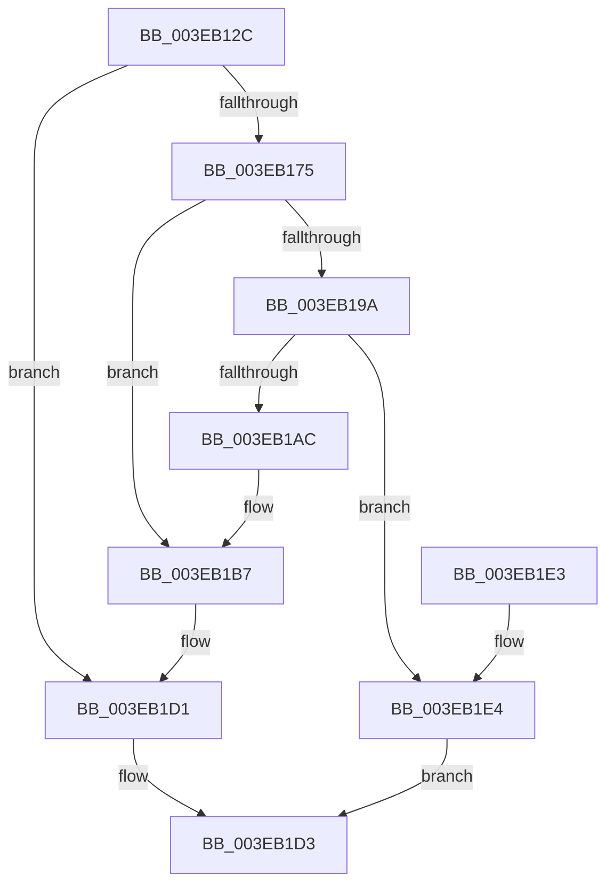

# EtwpAllocatePartitionMemory

- RVA: `0x003EB12C`–`0x003EB1E9` (길이 `189` bytes)
- VA: `0x00000001403EB12C`
- 실행 섹션: `.text`
- PDB 이름 있음: `예`; PDB Function 태그: `아니요`
- unwind 정보 RVA: `0x00095A0C`
- 디코드: `55`개 명령, `189/189` bytes 표시
- 미해석 바이트: `0` (있으면 어셈블리에 `.byte`로 보존)

> 이 문서는 커널 이미지의 기계어와 PDB 기호를 분석해 생성했습니다. 4번과 5번은 함수 원형과 자료형을 바이너리 사용 방식에서 추정한 C 해석이며 원본 소스 복구 결과는 아닙니다.

## 1. Dependencies

- 직접 호출 지점: **6**; 고유 호출 대상: **6**
- 직접 호출자로 확인된 함수: **1**
- RIP 상대 이미지 참조: **0**

### Outgoing calls
- `0x003EB168` → [MmAllocatePartitionNodePagesForMdlEx](MmAllocatePartitionNodePagesForMdlEx_function_003EA960.md) (function, `0x003EA960`)
- `0x003EB18D` → [MmMapLockedPagesSpecifyCache](../31/MmMapLockedPagesSpecifyCache_function_00318800.md) (function, `0x00318800`)
- `0x003EB1A3` → [EtwpRegisterPartitionPages](../65/EtwpRegisterPartitionPages_function_00652960.md) (function, `0x00652960`)
- `0x003EB1B2` → [MmUnmapLockedPages](../24/MmUnmapLockedPages_function_00246E60.md) (function, `0x00246E60`)
- `0x003EB1C2` → [MiFreePagesFromMdl](../3F/MiFreePagesFromMdl_function_003F8300.md) (function, `0x003F8300`)
- `0x003EB1CC` → [ExFreePoolWithTag](../../poolcode/B8/ExFreePoolWithTag_function_00B82870.md) (function, `0x00B82870`)

### Direct callers
- [EtwpAllocateTraceBuffer](EtwpAllocateTraceBuffer_function_003EB070.md) at `0x003EB0D9`

### Static image references
- 디코드된 RIP-relative 메모리 참조가 없습니다.

## 2. Other-region calls and transfers

- 다른 실행 섹션으로 향하는 call: **1**
  - `0x003EB1CC` → [ExFreePoolWithTag](../../poolcode/B8/ExFreePoolWithTag_function_00B82870.md) (`.text` → `POOLCODE`)
- 별도 외부 분기/꼬리 이동을 확인하지 못했습니다.

## 3. Assembly (complete function range)

```asm
003EB12C  48 89 5C 24 08                  mov qword ptr [rsp + 8], rbx
003EB131  48 89 74 24 10                  mov qword ptr [rsp + 0x10], rsi
003EB136  57                              push rdi
003EB137  48 83 EC 40                     sub rsp, 0x40
003EB13B  48 8B 01                        mov rax, qword ptr [rcx]
003EB13E  48 8B F1                        mov rsi, rcx
003EB141  48 89 44 24 38                  mov qword ptr [rsp + 0x38], rax
003EB146  4C 8B CA                        mov r9, rdx
003EB149  C7 44 24 30 05 00 00 00         mov dword ptr [rsp + 0x30], 5
003EB151  BF 01 00 00 00                  mov edi, 1
003EB156  83 64 24 28 00                  and dword ptr [rsp + 0x28], 0
003EB15B  45 33 C0                        xor r8d, r8d
003EB15E  48 83 CA FF                     or rdx, 0xffffffffffffffff
003EB162  89 7C 24 20                     mov dword ptr [rsp + 0x20], edi
003EB166  33 C9                           xor ecx, ecx
003EB168  E8 F3 F7 FF FF                  call 0x1403ea960
003EB16D  48 8B D8                        mov rbx, rax
003EB170  48 85 C0                        test rax, rax
003EB173  74 5C                           je 0x1403eb1d1
003EB175  C7 44 24 28 20 00 00 40         mov dword ptr [rsp + 0x28], 0x40000020
003EB17D  45 33 C9                        xor r9d, r9d
003EB180  83 64 24 20 00                  and dword ptr [rsp + 0x20], 0
003EB185  44 8B C7                        mov r8d, edi
003EB188  33 D2                           xor edx, edx
003EB18A  48 8B C8                        mov rcx, rax
003EB18D  E8 6E D6 F2 FF                  call 0x140318800
003EB192  48 8B F8                        mov rdi, rax
003EB195  48 85 C0                        test rax, rax
003EB198  74 1D                           je 0x1403eb1b7
003EB19A  4C 8B C0                        mov r8, rax
003EB19D  48 8B D3                        mov rdx, rbx
003EB1A0  48 8B CE                        mov rcx, rsi
003EB1A3  E8 B8 77 26 00                  call 0x140652960
003EB1A8  84 C0                           test al, al
003EB1AA  75 38                           jne 0x1403eb1e4
003EB1AC  48 8B D3                        mov rdx, rbx
003EB1AF  48 8B CF                        mov rcx, rdi
003EB1B2  E8 A9 BC E5 FF                  call 0x140246e60
003EB1B7  45 33 C9                        xor r9d, r9d
003EB1BA  45 33 C0                        xor r8d, r8d
003EB1BD  33 D2                           xor edx, edx
003EB1BF  48 8B CB                        mov rcx, rbx
003EB1C2  E8 39 D1 00 00                  call 0x1403f8300
003EB1C7  33 D2                           xor edx, edx
003EB1C9  48 8B CB                        mov rcx, rbx
003EB1CC  E8 9F 76 79 00                  call 0x140b82870
003EB1D1  33 C0                           xor eax, eax
003EB1D3  48 8B 5C 24 50                  mov rbx, qword ptr [rsp + 0x50]
003EB1D8  48 8B 74 24 58                  mov rsi, qword ptr [rsp + 0x58]
003EB1DD  48 83 C4 40                     add rsp, 0x40
003EB1E1  5F                              pop rdi
003EB1E2  C3                              ret
003EB1E3  CC                              int3
003EB1E4  48 8B C7                        mov rax, rdi
003EB1E7  EB EA                           jmp 0x1403eb1d3
```

## 4. C-style interpretation (structured pseudocode)

```c
__int64 __fastcall EtwpAllocatePartitionMemory(__int64 a1, __int64 a2, int a3)
{
    __int64 result;
    __int64 v_rsp;
    unsigned __int64 v_stack_m10;
    unsigned int v_stack_m18;
    unsigned int v_stack_m20;
    unsigned int v_stack_m28;
    unsigned __int64 v_stack_p10;
    unsigned __int64 v_stack_p8;

    v_stack_p8 = v_rbx;
    v_stack_p10 = v_rsi;
    v_rsp = (v_rsp) - (64);
    v_stack_m10 = *(unsigned __int64 *)(a1);
    v_stack_m18 = 5;
    a3 = 0;
    a2 = (a2) | (-1);
    v_stack_m28 = 1;
    a1 = 0;
    result = MmAllocatePartitionNodePagesForMdlEx(a1, a2, a3, a2);
    if (result == 0) goto loc_003EB1D1;
    v_stack_m20 = 0x40000020ULL;
    a4 = 0;
    a2 = 0;
    result = MmMapLockedPagesSpecifyCache(result, a2, 1, a4);
    if (result == 0) goto loc_003EB1B7;
    result = EtwpRegisterPartitionPages(0, result, result, a4);
    if ((unsigned __int8)(result) != 0) goto loc_003EB1E4;
    result = MmUnmapLockedPages(result, result, result, a4);
loc_003EB1B7:
    a4 = 0;
    a3 = 0;
    a2 = 0;
    result = MiFreePagesFromMdl(result, a2, a3, a4);
    a2 = 0;
    result = ExFreePoolWithTag(result, a2, a3, a4);
loc_003EB1D1:
    result = 0;
loc_003EB1D3:
    v_rsp = (v_rsp) + (64);
    return result;
loc_003EB1E4:
    goto loc_003EB1D3;
}
```

## 5. (Beta) C Style

```c
int64_t EtwpAllocatePartitionMemory(void *Arg1, int64_t Arg2, int32_t Arg3)
{
    uint8_t *arg1 = (uint8_t *)Arg1;

    int64_t result;
    int64_t local_rsp;
    uint64_t v_stack_m10;
    uint32_t v_stack_m18;
    uint32_t v_stack_m20;
    uint32_t v_stack_m28;
    uint64_t v_stack_p10;
    uint64_t v_stack_p8;

    v_stack_p8 = local_rbx;
    v_stack_p10 = local_rsi;
    local_rsp = (local_rsp) - (64);
    v_stack_m10 = *(uint64_t *)(arg1);
    v_stack_m18 = 5;
    Arg3 = 0;
    Arg2 = (Arg2) | (-1);
    v_stack_m28 = 1;
    Arg1 = 0;
    result = MmAllocatePartitionNodePagesForMdlEx(Arg1, Arg2, Arg3, Arg2);
    if (result == 0) goto loc_003EB1D1;
    v_stack_m20 = 0x40000020ULL;
    a4 = 0;
    Arg2 = 0;
    result = MmMapLockedPagesSpecifyCache(result, Arg2, 1, a4);
    if (result == 0) goto loc_003EB1B7;
    result = EtwpRegisterPartitionPages(0, result, result, a4);
    if ((uint8_t)(result) != 0) goto loc_003EB1E4;
    result = MmUnmapLockedPages(result, result, result, a4);
loc_003EB1B7:
    a4 = 0;
    Arg3 = 0;
    Arg2 = 0;
    result = MiFreePagesFromMdl(result, Arg2, Arg3, a4);
    Arg2 = 0;
    result = ExFreePoolWithTag(result, Arg2, Arg3, a4);
loc_003EB1D1:
    result = 0;
loc_003EB1D3:
    local_rsp = (local_rsp) + (64);
    return result;
loc_003EB1E4:
    goto loc_003EB1D3;
}
```

### 관측된 메모리 오프셋

구조체 형식이 확인되지 않은 접근은 인자 기준의 오프셋으로만 기록했습니다.

| 기준 인자 | 오프셋 표현 | 폭 (bit) | 접근 |
|---|---:|---:|---|
| `Arg1` | `+ 0x0` | `64` | `R` |

## 6. Execution-region graph

[열기: 2D/3D 그래프와 함수 탐색 컨트롤 패널](../../../control-panel.html?section=text&rva=0x003EB12C&view=graph)

- 2D 그래프는 위에서 아래로 흐르고, 3D 그래프는 빈 공간을 드래그해 회전합니다. Shift+드래그는 이동, 휠은 확대·축소, 함수 노드 선택은 대상 보고서 이동입니다.

### Static fallback


