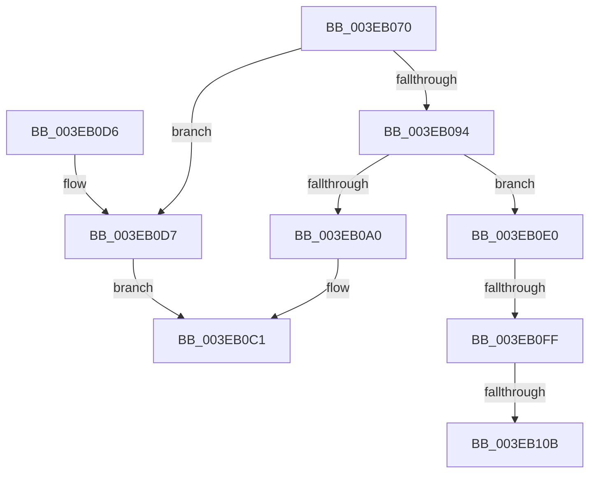

# EtwpAllocateTraceBuffer

- RVA: `0x003EB070`–`0x003EB124` (길이 `180` bytes)
- VA: `0x00000001403EB070`
- 실행 섹션: `.text`
- PDB 이름 있음: `예`; PDB Function 태그: `예`
- unwind 정보 RVA: `0x000959E4`
- 디코드: `45`개 명령, `180/180` bytes 표시
- 미해석 바이트: `0` (있으면 어셈블리에 `.byte`로 보존)

> 이 문서는 커널 이미지의 기계어와 PDB 기호를 분석해 생성했습니다. 4번과 5번은 함수 원형과 자료형을 바이너리 사용 방식에서 추정한 C 해석이며 원본 소스 복구 결과는 아닙니다.

## 1. Dependencies

- 직접 호출 지점: **3**; 고유 호출 대상: **3**
- 직접 호출자로 확인된 함수: **2**
- RIP 상대 이미지 참조: **0**

### Outgoing calls
- `0x003EB0BC` → [ExAllocatePool2](../../poolcode/B8/ExAllocatePool2_function_00B820F0.md) (function, `0x00B820F0`)
- `0x003EB0D9` → [EtwpAllocatePartitionMemory](EtwpAllocatePartitionMemory_function_003EB12C.md) (function, `0x003EB12C`)
- `0x003EB11E` → [KeBugCheckEx](../4F/KeBugCheckEx_function_004FD660.md) (function, `0x004FD660`)

### Direct callers
- [EtwpAllocateFreeBuffers](EtwpAllocateFreeBuffers_function_003EAEA4.md) at `0x003EAF3A`
- [EtwpPreserveLogger](../../page/7B/EtwpPreserveLogger_function_007BEF4C.md) at `0x007BF024`

### Static image references
- 디코드된 RIP-relative 메모리 참조가 없습니다.

## 2. Other-region calls and transfers

- 다른 실행 섹션으로 향하는 call: **1**
  - `0x003EB0BC` → [ExAllocatePool2](../../poolcode/B8/ExAllocatePool2_function_00B820F0.md) (`.text` → `POOLCODE`)
- call이 아닌 외부 분기/꼬리 이동: **2**
  - `0x003EB0F9` → [sub_006EAD16 + 0x2B](../6E/Unknown_function_006EAD16.md) (`tail-transfer`)
  - `0x003EB105` → [sub_006EAD16](../6E/Unknown_function_006EAD16.md) (`tail-transfer`)

## 3. Assembly (complete function range)

```asm
003EB070  48 89 5C 24 08                  mov qword ptr [rsp + 8], rbx
003EB075  48 89 6C 24 10                  mov qword ptr [rsp + 0x10], rbp
003EB07A  48 89 74 24 18                  mov qword ptr [rsp + 0x18], rsi
003EB07F  57                              push rdi
003EB080  48 83 EC 30                     sub rsp, 0x30
003EB084  48 8B D9                        mov rbx, rcx
003EB087  48 81 C1 40 06 00 00            add rcx, 0x640
003EB08E  48 83 39 00                     cmp qword ptr [rcx], 0
003EB092  75 43                           jne 0x1403eb0d7
003EB094  F7 83 30 03 00 00 00 00 00 20   test dword ptr [rbx + 0x330], 0x20000000
003EB09E  75 40                           jne 0x1403eb0e0
003EB0A0  83 BB 2C 01 00 00 01            cmp dword ptr [rbx + 0x12c], 1
003EB0A7  B8 42 00 00 00                  mov eax, 0x42
003EB0AC  B9 02 01 00 00                  mov ecx, 0x102
003EB0B1  8B D2                           mov edx, edx
003EB0B3  0F 45 C8                        cmovne ecx, eax
003EB0B6  41 B8 45 74 77 42               mov r8d, 0x42777445
003EB0BC  E8 2F 70 79 00                  call 0x140b820f0
003EB0C1  48 8B 5C 24 40                  mov rbx, qword ptr [rsp + 0x40]
003EB0C6  48 8B 6C 24 48                  mov rbp, qword ptr [rsp + 0x48]
003EB0CB  48 8B 74 24 50                  mov rsi, qword ptr [rsp + 0x50]
003EB0D0  48 83 C4 30                     add rsp, 0x30
003EB0D4  5F                              pop rdi
003EB0D5  C3                              ret
003EB0D6  CC                              int3
003EB0D7  8B D2                           mov edx, edx
003EB0D9  E8 4E 00 00 00                  call 0x1403eb12c
003EB0DE  EB E1                           jmp 0x1403eb0c1
003EB0E0  8B 6B 04                        mov ebp, dword ptr [rbx + 4]
003EB0E3  48 8B 8B 50 06 00 00            mov rcx, qword ptr [rbx + 0x650]
003EB0EA  48 8B B3 48 06 00 00            mov rsi, qword ptr [rbx + 0x648]
003EB0F1  C1 ED 0C                        shr ebp, 0xc
003EB0F4  8B FD                           mov edi, ebp
003EB0F6  48 85 C9                        test rcx, rcx
003EB0F9  0F 84 42 FC 2F 00               je 0x1406ead41
003EB0FF  48 8B 01                        mov rax, qword ptr [rcx]
003EB102  48 3B C7                        cmp rax, rdi
003EB105  0F 83 0B FC 2F 00               jae 0x1406ead16
003EB10B  BA 00 01 00 00                  mov edx, 0x100
003EB110  48 89 7C 24 20                  mov qword ptr [rsp + 0x20], rdi
003EB115  4C 8B C8                        mov r9, rax
003EB118  4C 8B C3                        mov r8, rbx
003EB11B  8D 4A 1D                        lea ecx, [rdx + 0x1d]
003EB11E  E8 3D 25 11 00                  call 0x1404fd660
003EB123  CC                              int3
```

## 4. C-style interpretation (structured pseudocode)

```c
__int64 __fastcall EtwpAllocateTraceBuffer(__int64 a1, int a2)
{
    __int64 result;
    __int64 v_rbp;
    __int64 v_rsp;
    unsigned __int64 v_stack_p10;
    unsigned __int64 v_stack_p18;
    unsigned __int64 v_stack_p20;
    unsigned __int64 v_stack_p8;

    v_stack_p8 = v_rbx;
    v_stack_p10 = v_rbp;
    v_stack_p18 = v_rsi;
    v_rsp = (v_rsp) - (48);
    a1 = (a1) + (0x640ULL);
    if ((*(unsigned __int64 *)(a1)) != 0) goto loc_003EB0D7;
    if (((*(unsigned int *)(a1 + 816)) & (0x20000000ULL)) != 0) goto loc_003EB0E0;
    a1 = 258;
    if ((*(unsigned int *)(a1 + 300)) != 1) { a1 = 66; }
    result = ExAllocatePool2(a1, (unsigned int)(a2), (unsigned int)(0x42777445ULL), a4);
loc_003EB0C1:
    v_rsp = (v_rsp) + (48);
    return result;
loc_003EB0D7:
    result = EtwpAllocatePartitionMemory(a1, (unsigned int)((unsigned int)((unsigned int)(a2))), (unsigned int)(0x42777445ULL), a4);
    goto loc_003EB0C1;
loc_003EB0E0:
    v_rbp = (unsigned int)(((unsigned int)(*(unsigned int *)(v_stack_p8 + 4))) >> (12));
    v_stack_p20 = (unsigned int)((unsigned int)(v_rbp));
    result = KeBugCheckEx(256 + 29, 256, v_stack_p8, *(unsigned __int64 *)(*(unsigned __int64 *)(v_stack_p8 + 1616)));
    return result;
}
```

## 5. (Beta) C Style

```c
int64_t EtwpAllocateTraceBuffer(void *Arg1, int32_t Arg2)
{
    uint8_t *arg1 = (uint8_t *)Arg1;

    int64_t result;
    int64_t local_rbp;
    int64_t local_rsp;
    uint64_t v_stack_p10;
    uint64_t v_stack_p18;
    uint64_t v_stack_p20;
    uint64_t v_stack_p8;

    v_stack_p8 = local_rbx;
    v_stack_p10 = local_rbp;
    v_stack_p18 = local_rsi;
    local_rsp = (local_rsp) - (48);
    Arg1 = (Arg1) + (0x640ULL);
    if ((*(uint64_t *)(arg1)) != 0) goto loc_003EB0D7;
    if (((*(uint32_t *)(arg1 + 0x330)) & (0x20000000ULL)) != 0) goto loc_003EB0E0;
    Arg1 = 258;
    if ((*(uint32_t *)(arg1 + 0x12C)) != 1) { Arg1 = 66; }
    result = ExAllocatePool2(Arg1, (uint32_t)(Arg2), (uint32_t)(0x42777445ULL), a4);
loc_003EB0C1:
    local_rsp = (local_rsp) + (48);
    return result;
loc_003EB0D7:
    result = EtwpAllocatePartitionMemory(Arg1, (uint32_t)((uint32_t)((uint32_t)(Arg2))), (uint32_t)(0x42777445ULL), a4);
    goto loc_003EB0C1;
loc_003EB0E0:
    local_rbp = (uint32_t)(((uint32_t)(*(uint32_t *)(v_stack_p8 + 0x4))) >> (12));
    v_stack_p20 = (uint32_t)((uint32_t)(local_rbp));
    result = KeBugCheckEx(256 + 29, 256, v_stack_p8, *(uint64_t *)(*(uint64_t *)(v_stack_p8 + 0x650)));
    return result;
}
```

### 관측된 메모리 오프셋

구조체 형식이 확인되지 않은 접근은 인자 기준의 오프셋으로만 기록했습니다.

| 기준 인자 | 오프셋 표현 | 폭 (bit) | 접근 |
|---|---:|---:|---|
| `Arg1` | `+ 0x0` | `64` | `R` |
| `Arg1` | `+ 0x4` | `32` | `R` |
| `Arg1` | `+ 0x12C` | `32` | `R` |
| `Arg1` | `+ 0x330` | `32` | `R` |
| `Arg1` | `+ 0x648` | `64` | `R` |
| `Arg1` | `+ 0x650` | `64` | `R` |

## 6. Execution-region graph

[열기: 2D/3D 그래프와 함수 탐색 컨트롤 패널](../../../control-panel.html?section=text&rva=0x003EB070&view=graph)

- 2D 그래프는 위에서 아래로 흐르고, 3D 그래프는 빈 공간을 드래그해 회전합니다. Shift+드래그는 이동, 휠은 확대·축소, 함수 노드 선택은 대상 보고서 이동입니다.

### Static fallback


