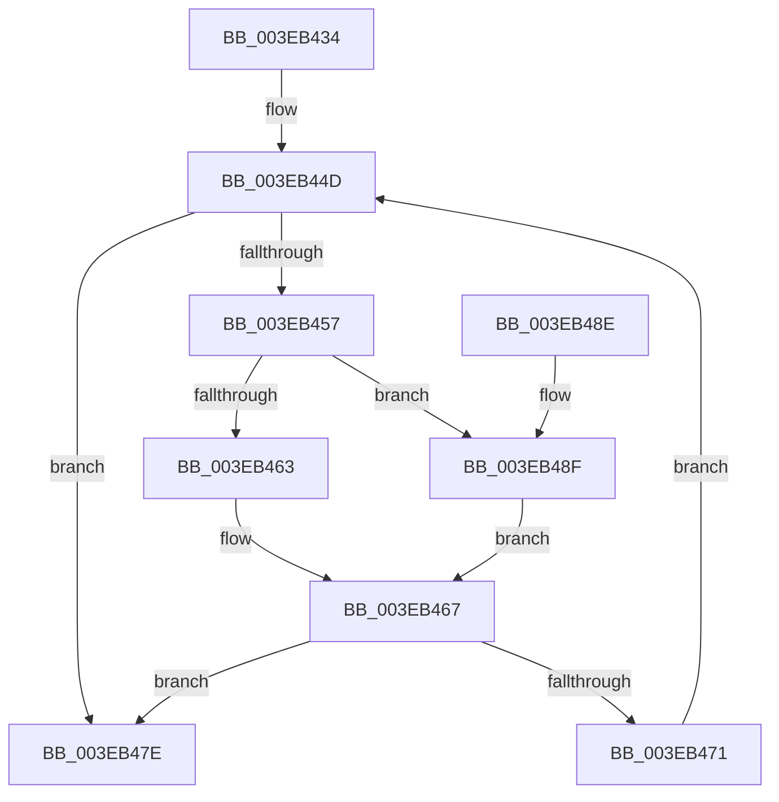

# EtwpDequeueBuffer

- RVA: `0x003EB434`–`0x003EB494` (길이 `96` bytes)
- VA: `0x00000001403EB434`
- 실행 섹션: `.text`
- PDB 이름 있음: `예`; PDB Function 태그: `아니요`
- unwind 정보 RVA: `0x00095A44`
- 디코드: `31`개 명령, `96/96` bytes 표시
- 미해석 바이트: `0` (있으면 어셈블리에 `.byte`로 보존)

> 이 문서는 커널 이미지의 기계어와 PDB 기호를 분석해 생성했습니다. 4번과 5번은 함수 원형과 자료형을 바이너리 사용 방식에서 추정한 C 해석이며 원본 소스 복구 결과는 아닙니다.

## 1. Dependencies

- 직접 호출 지점: **1**; 고유 호출 대상: **1**
- 직접 호출자로 확인된 함수: **3**
- RIP 상대 이미지 참조: **0**

### Outgoing calls
- `0x003EB477` → [EtwpInsertPlaceholderBuffer](../65/EtwpInsertPlaceholderBuffer_function_00653718.md) (function, `0x00653718`)

### Direct callers
- [EtwpDequeueFreeBuffer](EtwpDequeueFreeBuffer_function_003EB1F0.md) at `0x003EB22C`
- [EtwpDequeueFreeBuffer](EtwpDequeueFreeBuffer_function_003EB1F0.md) at `0x003EB28A`
- [EtwpDequeueFreeBuffer](EtwpDequeueFreeBuffer_function_003EB1F0.md) at `0x003EB312`
- [EtwpDequeueFreeBuffer](EtwpDequeueFreeBuffer_function_003EB1F0.md) at `0x003EB395`
- [EtwpAdjustSiloTraceBuffers](EtwpAdjustSiloTraceBuffers_function_003EB720.md) at `0x003EB7B4`
- [EtwpFreeTraceBufferPool](../../page/9C/EtwpFreeTraceBufferPool_function_009C1A74.md) at `0x009C1AC0`
- [EtwpFreeTraceBufferPool](../../page/9C/EtwpFreeTraceBufferPool_function_009C1A74.md) at `0x009C1AF5`

### Static image references
- 디코드된 RIP-relative 메모리 참조가 없습니다.

## 2. Other-region calls and transfers

- 다른 실행 섹션으로 향하는 call: **0**
- 별도 외부 분기/꼬리 이동을 확인하지 못했습니다.

## 3. Assembly (complete function range)

```asm
003EB434  48 89 5C 24 08                  mov qword ptr [rsp + 8], rbx
003EB439  48 89 74 24 10                  mov qword ptr [rsp + 0x10], rsi
003EB43E  57                              push rdi
003EB43F  48 83 EC 20                     sub rsp, 0x20
003EB443  48 8B FA                        mov rdi, rdx
003EB446  48 8D 5A 08                     lea rbx, [rdx + 8]
003EB44A  48 8B F1                        mov rsi, rcx
003EB44D  4C 8B 03                        mov r8, qword ptr [rbx]
003EB450  33 C0                           xor eax, eax
003EB452  4D 85 C0                        test r8, r8
003EB455  74 27                           je 0x1403eb47e
003EB457  49 8B 00                        mov rax, qword ptr [r8]
003EB45A  48 89 03                        mov qword ptr [rbx], rax
003EB45D  49 83 38 00                     cmp qword ptr [r8], 0
003EB461  74 2C                           je 0x1403eb48f
003EB463  49 83 20 00                     and qword ptr [r8], 0
003EB467  49 8D 40 E0                     lea rax, [r8 - 0x20]
003EB46B  83 78 2C 06                     cmp dword ptr [rax + 0x2c], 6
003EB46F  75 0D                           jne 0x1403eb47e
003EB471  48 8B D0                        mov rdx, rax
003EB474  48 8B CE                        mov rcx, rsi
003EB477  E8 9C 82 26 00                  call 0x140653718
003EB47C  EB CF                           jmp 0x1403eb44d
003EB47E  48 8B 5C 24 30                  mov rbx, qword ptr [rsp + 0x30]
003EB483  48 8B 74 24 38                  mov rsi, qword ptr [rsp + 0x38]
003EB488  48 83 C4 20                     add rsp, 0x20
003EB48C  5F                              pop rdi
003EB48D  C3                              ret
003EB48E  CC                              int3
003EB48F  48 89 1F                        mov qword ptr [rdi], rbx
003EB492  EB D3                           jmp 0x1403eb467
```

## 4. C-style interpretation (structured pseudocode)

```c
__int64 __fastcall EtwpDequeueBuffer(__int64 a1, __int64 a2)
{
    __int64 result;
    __int64 v_rsp;
    unsigned __int64 v_stack_p10;
    unsigned __int64 v_stack_p8;

    v_stack_p8 = v_rbx;
    v_stack_p10 = v_rsi;
    v_rsp = (v_rsp) - (32);
loc_003EB44D:
    result = 0;
    if (*(unsigned __int64 *)(a2 + 8) == 0) goto loc_003EB47E;
    *(unsigned __int64 *)(a2 + 8) = *(unsigned __int64 *)(*(unsigned __int64 *)(a2 + 8));
    if ((*(unsigned __int64 *)(*(unsigned __int64 *)(a2 + 8))) == 0) goto loc_003EB48F;
loc_003EB467:
    if ((*(unsigned int *)(*(unsigned __int64 *)(a2 + 8) - 32 + 44)) != 6) goto loc_003EB47E;
    result = EtwpInsertPlaceholderBuffer(a1, *(unsigned __int64 *)(a2 + 8) - 32, *(unsigned __int64 *)(a2 + 8), a4);
    goto loc_003EB44D;
loc_003EB47E:
    v_rsp = (v_rsp) + (32);
    return result;
loc_003EB48F:
    *(unsigned __int64 *)(a2) = v_stack_p8;
    goto loc_003EB467;
}
```

## 5. (Beta) C Style

```c
int64_t EtwpDequeueBuffer(int64_t Arg1, void *Arg2)
{
    uint8_t *arg2 = (uint8_t *)Arg2;

    int64_t result;
    int64_t local_rsp;
    uint64_t v_stack_p10;
    uint64_t v_stack_p8;

    v_stack_p8 = local_rbx;
    v_stack_p10 = local_rsi;
    local_rsp = (local_rsp) - (32);
loc_003EB44D:
    result = 0;
    if (*(uint64_t *)(arg2 + 0x8) == 0) goto loc_003EB47E;
    *(uint64_t *)(arg2 + 0x8) = *(uint64_t *)(*(uint64_t *)(arg2 + 0x8));
    if ((*(uint64_t *)(*(uint64_t *)(arg2 + 0x8))) == 0) goto loc_003EB48F;
loc_003EB467:
    if ((*(uint32_t *)(*(uint64_t *)(arg2 + 0x8) - 0x20 + 0x2C)) != 6) goto loc_003EB47E;
    result = EtwpInsertPlaceholderBuffer(Arg1, *(uint64_t *)(arg2 + 0x8) - 32, *(uint64_t *)(arg2 + 0x8), a4);
    goto loc_003EB44D;
loc_003EB47E:
    local_rsp = (local_rsp) + (32);
    return result;
loc_003EB48F:
    *(uint64_t *)(arg2) = v_stack_p8;
    goto loc_003EB467;
}
```

### 관측된 메모리 오프셋

구조체 형식이 확인되지 않은 접근은 인자 기준의 오프셋으로만 기록했습니다.

| 기준 인자 | 오프셋 표현 | 폭 (bit) | 접근 |
|---|---:|---:|---|
| `Arg2` | `+ 0x0` | `64` | `R` |
| `Arg2` | `+ 0x0` | `64` | `W` |
| `Arg2` | `+ 0x8` | `64` | `R` |

## 6. Execution-region graph

[열기: 2D/3D 그래프와 함수 탐색 컨트롤 패널](../../../control-panel.html?section=text&rva=0x003EB434&view=graph)

- 2D 그래프는 위에서 아래로 흐르고, 3D 그래프는 빈 공간을 드래그해 회전합니다. Shift+드래그는 이동, 휠은 확대·축소, 함수 노드 선택은 대상 보고서 이동입니다.

### Static fallback


