# EtwpDequeueFreeBuffer

- RVA: `0x003EB1F0`–`0x003EB3F5` (길이 `517` bytes)
- VA: `0x00000001403EB1F0`
- 실행 섹션: `.text`
- PDB 이름 있음: `예`; PDB Function 태그: `예`
- unwind 정보 RVA: `0x00095A20`
- 디코드: `131`개 명령, `517/517` bytes 표시
- 미해석 바이트: `0` (있으면 어셈블리에 `.byte`로 보존)

> 이 문서는 커널 이미지의 기계어와 PDB 기호를 분석해 생성했습니다. 4번과 5번은 함수 원형과 자료형을 바이너리 사용 방식에서 추정한 C 해석이며 원본 소스 복구 결과는 아닙니다.

## 1. Dependencies

- 직접 호출 지점: **15**; 고유 호출 대상: **7**
- 직접 호출자로 확인된 함수: **2**
- RIP 상대 이미지 참조: **0**

### Outgoing calls
- `0x003EB220` → [EtwpLockBufferList](EtwpLockBufferList_function_003EB49C.md) (function, `0x003EB49C`)
- `0x003EB22C` → [EtwpDequeueBuffer](EtwpDequeueBuffer_function_003EB434.md) (function, `0x003EB434`)
- `0x003EB23C` → [EtwpUnlockBufferList](../2D/EtwpUnlockBufferList_function_002DFC28.md) (function, `0x002DFC28`)
- `0x003EB24F` → [EtwpResetBufferHeader](EtwpResetBufferHeader_function_003EB558.md) (function, `0x003EB558`)
- `0x003EB268` → [EtwpValidateBuffer](EtwpValidateBuffer_function_003EB3FC.md) (function, `0x003EB3FC`)
- `0x003EB27E` → [EtwpLockBufferList](EtwpLockBufferList_function_003EB49C.md) (function, `0x003EB49C`)
- `0x003EB28A` → [EtwpDequeueBuffer](EtwpDequeueBuffer_function_003EB434.md) (function, `0x003EB434`)
- `0x003EB2B6` → [EtwpUnlockBufferList](../2D/EtwpUnlockBufferList_function_002DFC28.md) (function, `0x002DFC28`)
- `0x003EB2F9` → [EtwpEnqueueOverflowBuffer](../2F/EtwpEnqueueOverflowBuffer_function_002FE644.md) (function, `0x002FE644`)
- `0x003EB306` → [EtwpLockBufferList](EtwpLockBufferList_function_003EB49C.md) (function, `0x003EB49C`)
- `0x003EB312` → [EtwpDequeueBuffer](EtwpDequeueBuffer_function_003EB434.md) (function, `0x003EB434`)
- `0x003EB322` → [EtwpUnlockBufferList](../2D/EtwpUnlockBufferList_function_002DFC28.md) (function, `0x002DFC28`)
- `0x003EB372` → [EtwpResetBufferHeader](EtwpResetBufferHeader_function_003EB558.md) (function, `0x003EB558`)
- `0x003EB395` → [EtwpDequeueBuffer](EtwpDequeueBuffer_function_003EB434.md) (function, `0x003EB434`)
- `0x003EB3C8` → [EtwpDisableCompression](../65/EtwpDisableCompression_function_006534F8.md) (function, `0x006534F8`)

### Direct callers
- [EtwpReserveTraceBuffer](../2F/EtwpReserveTraceBuffer_function_002FC8C0.md) at `0x002FC9FA`
- [EtwpRotateCompressionTarget](../65/EtwpRotateCompressionTarget_function_00653868.md) at `0x006538B3`

### Static image references
- 디코드된 RIP-relative 메모리 참조가 없습니다.

## 2. Other-region calls and transfers

- 다른 실행 섹션으로 향하는 call: **0**
- call이 아닌 외부 분기/꼬리 이동: **3**
  - `0x003EB3A9` → [sub_006EADA0](../6E/Unknown_function_006EADA0.md) (`tail-transfer`)
  - `0x003EB3C0` → [sub_006EADA0](../6E/Unknown_function_006EADA0.md) (`tail-transfer`)
  - `0x003EB3F0` → [sub_006EADA0 + 0x1B](../6E/Unknown_function_006EADA0.md) (`tail-transfer`)

## 3. Assembly (complete function range)

```asm
003EB1F0  48 89 5C 24 18                  mov qword ptr [rsp + 0x18], rbx
003EB1F5  55                              push rbp
003EB1F6  56                              push rsi
003EB1F7  57                              push rdi
003EB1F8  48 83 EC 20                     sub rsp, 0x20
003EB1FC  40 32 ED                        xor bpl, bpl
003EB1FF  48 8B D9                        mov rbx, rcx
003EB202  48 83 79 38 00                  cmp qword ptr [rcx + 0x38], 0
003EB207  40 88 6C 24 40                  mov byte ptr [rsp + 0x40], bpl
003EB20C  0F 84 6A 01 00 00               je 0x1403eb37c
003EB212  F7 41 0C 00 04 00 00            test dword ptr [rcx + 0xc], 0x400
003EB219  48 8D 54 24 40                  lea rdx, [rsp + 0x40]
003EB21E  75 5E                           jne 0x1403eb27e
003EB220  E8 77 02 00 00                  call 0x1403eb49c
003EB225  48 8D 53 30                     lea rdx, [rbx + 0x30]
003EB229  48 8B CB                        mov rcx, rbx
003EB22C  E8 03 02 00 00                  call 0x1403eb434
003EB231  48 8D 54 24 40                  lea rdx, [rsp + 0x40]
003EB236  48 8B CB                        mov rcx, rbx
003EB239  48 8B F8                        mov rdi, rax
003EB23C  E8 E7 49 EF FF                  call 0x1402dfc28
003EB241  48 85 FF                        test rdi, rdi
003EB244  0F 84 3D 01 00 00               je 0x1403eb387
003EB24A  33 D2                           xor edx, edx
003EB24C  48 8B CF                        mov rcx, rdi
003EB24F  E8 04 03 00 00                  call 0x1403eb558
003EB254  C7 47 2C 01 00 00 00            mov dword ptr [rdi + 0x2c], 1
003EB25B  F0 FF 8B E4 00 00 00            lock dec dword ptr [rbx + 0xe4]
003EB262  48 8B D7                        mov rdx, rdi
003EB265  48 8B CB                        mov rcx, rbx
003EB268  E8 8F 01 00 00                  call 0x1403eb3fc
003EB26D  48 8B C7                        mov rax, rdi
003EB270  48 8B 5C 24 50                  mov rbx, qword ptr [rsp + 0x50]
003EB275  48 83 C4 20                     add rsp, 0x20
003EB279  5F                              pop rdi
003EB27A  5E                              pop rsi
003EB27B  5D                              pop rbp
003EB27C  C3                              ret
003EB27D  CC                              int3
003EB27E  E8 19 02 00 00                  call 0x1403eb49c
003EB283  48 8D 53 40                     lea rdx, [rbx + 0x40]
003EB287  48 8B CB                        mov rcx, rbx
003EB28A  E8 A5 01 00 00                  call 0x1403eb434
003EB28F  48 8B F8                        mov rdi, rax
003EB292  48 85 C0                        test rax, rax
003EB295  0F 84 F3 00 00 00               je 0x1403eb38e
003EB29B  8B 83 98 05 00 00               mov eax, dword ptr [rbx + 0x598]
003EB2A1  BE 01 00 00 00                  mov esi, 1
003EB2A6  85 C0                           test eax, eax
003EB2A8  0F 85 F4 00 00 00               jne 0x1403eb3a2
003EB2AE  48 8D 54 24 40                  lea rdx, [rsp + 0x40]
003EB2B3  48 8B CB                        mov rcx, rbx
003EB2B6  E8 6D 49 EF FF                  call 0x1402dfc28
003EB2BB  40 84 ED                        test bpl, bpl
003EB2BE  0F 85 01 01 00 00               jne 0x1403eb3c5
003EB2C4  48 85 FF                        test rdi, rdi
003EB2C7  0F 84 BA 00 00 00               je 0x1403eb387
003EB2CD  F0 FF 8B E4 00 00 00            lock dec dword ptr [rbx + 0xe4]
003EB2D4  F7 43 0C 00 00 00 04            test dword ptr [rbx + 0xc], 0x4000000
003EB2DB  0F 85 F1 00 00 00               jne 0x1403eb3d2
003EB2E1  33 D2                           xor edx, edx
003EB2E3  8B 4F 0C                        mov ecx, dword ptr [rdi + 0xc]
003EB2E6  85 C9                           test ecx, ecx
003EB2E8  75 09                           jne 0x1403eb2f3
003EB2EA  8B C2                           mov eax, edx
003EB2EC  F0 0F B1 77 2C                  lock cmpxchg dword ptr [rdi + 0x2c], esi
003EB2F1  74 39                           je 0x1403eb32c
003EB2F3  48 8B D7                        mov rdx, rdi
003EB2F6  48 8B CB                        mov rcx, rbx
003EB2F9  E8 46 33 F1 FF                  call 0x1402fe644
003EB2FE  48 8D 54 24 40                  lea rdx, [rsp + 0x40]
003EB303  48 8B CB                        mov rcx, rbx
003EB306  E8 91 01 00 00                  call 0x1403eb49c
003EB30B  48 8D 53 30                     lea rdx, [rbx + 0x30]
003EB30F  48 8B CB                        mov rcx, rbx
003EB312  E8 1D 01 00 00                  call 0x1403eb434
003EB317  48 8D 54 24 40                  lea rdx, [rsp + 0x40]
003EB31C  48 8B CB                        mov rcx, rbx
003EB31F  48 8B F8                        mov rdi, rax
003EB322  E8 01 49 EF FF                  call 0x1402dfc28
003EB327  48 85 FF                        test rdi, rdi
003EB32A  75 A1                           jne 0x1403eb2cd
003EB32C  48 85 FF                        test rdi, rdi
003EB32F  74 56                           je 0x1403eb387
003EB331  48 8B 83 28 06 00 00            mov rax, qword ptr [rbx + 0x628]
003EB338  48 85 C0                        test rax, rax
003EB33B  74 30                           je 0x1403eb36d
003EB33D  44 0F B7 47 28                  movzx r8d, word ptr [rdi + 0x28]
003EB342  4A 8B 04 C0                     mov rax, qword ptr [rax + r8*8]
003EB346  EB 0F                           jmp 0x1403eb357
003EB348  48 8B 8B 28 06 00 00            mov rcx, qword ptr [rbx + 0x628]
003EB34F  F0 4A 0F B1 14 C1               lock cmpxchg qword ptr [rcx + r8*8], rdx
003EB355  74 09                           je 0x1403eb360
003EB357  48 8B 57 10                     mov rdx, qword ptr [rdi + 0x10]
003EB35B  48 3B D0                        cmp rdx, rax
003EB35E  7F E8                           jg 0x1403eb348
003EB360  48 8B 83 38 06 00 00            mov rax, qword ptr [rbx + 0x638]
003EB367  48 39 47 18                     cmp qword ptr [rdi + 0x18], rax
003EB36B  7E 78                           jle 0x1403eb3e5
003EB36D  33 D2                           xor edx, edx
003EB36F  48 8B CF                        mov rcx, rdi
003EB372  E8 E1 01 00 00                  call 0x1403eb558
003EB377  E9 E6 FE FF FF                  jmp 0x1403eb262
003EB37C  48 83 79 48 00                  cmp qword ptr [rcx + 0x48], 0
003EB381  0F 85 8B FE FF FF               jne 0x1403eb212
003EB387  33 C0                           xor eax, eax
003EB389  E9 E2 FE FF FF                  jmp 0x1403eb270
003EB38E  48 8D 53 30                     lea rdx, [rbx + 0x30]
003EB392  48 8B CB                        mov rcx, rbx
003EB395  E8 9A 00 00 00                  call 0x1403eb434
003EB39A  48 8B F8                        mov rdi, rax
003EB39D  E9 F9 FE FF FF                  jmp 0x1403eb29b
003EB3A2  48 8B 43 38                     mov rax, qword ptr [rbx + 0x38]
003EB3A6  48 85 C0                        test rax, rax
003EB3A9  0F 84 F1 F9 2F 00               je 0x1406eada0
003EB3AF  8B 40 0C                        mov eax, dword ptr [rax + 0xc]
003EB3B2  83 E8 04                        sub eax, 4
003EB3B5  A9 FD FF FF FF                  test eax, 0xfffffffd
003EB3BA  0F 85 EE FE FF FF               jne 0x1403eb2ae
003EB3C0  E9 DB F9 2F 00                  jmp 0x1406eada0
003EB3C5  48 8B CB                        mov rcx, rbx
003EB3C8  E8 2B 81 26 00                  call 0x1406534f8
003EB3CD  E9 F2 FE FF FF                  jmp 0x1403eb2c4
003EB3D2  8B 57 2C                        mov edx, dword ptr [rdi + 0x2c]
003EB3D5  8D 42 FC                        lea eax, [rdx - 4]
003EB3D8  3B C6                           cmp eax, esi
003EB3DA  0F 86 03 FF FF FF               jbe 0x1403eb2e3
003EB3E0  E9 FC FE FF FF                  jmp 0x1403eb2e1
003EB3E5  48 8B 83 30 06 00 00            mov rax, qword ptr [rbx + 0x630]
003EB3EC  4A 8B 04 C0                     mov rax, qword ptr [rax + r8*8]
003EB3F0  E9 C6 F9 2F 00                  jmp 0x1406eadbb
```

## 4. C-style interpretation (structured pseudocode)

```c
__int64 __fastcall EtwpDequeueFreeBuffer(__int64 a1)
{
    __int64 result;
    __int64 v_rbp;
    __int64 v_rsp;
    unsigned __int64 v_stack_p18;
    unsigned __int64 v_stack_p40;
    unsigned __int8 v_stack_p8;

    v_stack_p18 = v_rbx;
    v_rsp = (v_rsp) - (32);
    v_rbp = 0;
    v_stack_p8 = 0;
    if ((*(unsigned __int64 *)(a1 + 56)) == 0) goto loc_003EB37C;
loc_003EB212:
    if (((*(unsigned int *)(a1 + 12)) & (0x400ULL)) != 0) goto loc_003EB27E;
    result = EtwpLockBufferList(a1, v_stack_p8, a3, a4);
    result = EtwpDequeueBuffer(a1, a1 + 48, a3, a4);
    result = EtwpUnlockBufferList(a1, v_stack_p8, a3, a4);
    if (result == 0) goto loc_003EB387;
    a2 = 0;
    result = EtwpResetBufferHeader(result, a2, a3, a4);
    *(unsigned int *)(result + 44) = 1;
loc_003EB262:
    result = EtwpValidateBuffer(a1, result, a3, a4);
loc_003EB270:
    v_rsp = (v_rsp) + (32);
    return result;
loc_003EB27E:
    result = EtwpLockBufferList(a1, result, a3, a4);
    result = EtwpDequeueBuffer(v_stack_p18, v_stack_p18 + 64, a3, a4);
    if (result == 0) goto loc_003EB38E;
loc_003EB29B:
    if ((unsigned int)((unsigned int)(*(unsigned int *)(v_stack_p18 + 1432))) != 0) goto loc_003EB3A2;
loc_003EB2AE:
    result = EtwpUnlockBufferList(v_stack_p18, v_stack_p40, a3, a4);
    if (0 != 0) goto loc_003EB3C5;
loc_003EB2C4:
    if (result == 0) goto loc_003EB387;
loc_003EB2CD:
    if (((*(unsigned int *)(v_stack_p18 + 12)) & (0x4000000ULL)) != 0) goto loc_003EB3D2;
loc_003EB2E1:
    a2 = 0;
loc_003EB2E3:
    if ((unsigned int)((unsigned int)(*(unsigned int *)(result + 12))) != 0) goto loc_003EB2F3;
    if ((unsigned int)((unsigned int)(*(unsigned int *)(result + 12))) == 0) goto loc_003EB32C;
loc_003EB2F3:
    result = EtwpEnqueueOverflowBuffer(v_stack_p18, result, a3, a4);
    result = EtwpLockBufferList(v_stack_p18, v_stack_p40, a3, a4);
    result = EtwpDequeueBuffer(v_stack_p18, v_stack_p18 + 48, a3, a4);
    result = EtwpUnlockBufferList(v_stack_p18, v_stack_p40, a3, a4);
    if (result != 0) goto loc_003EB2CD;
loc_003EB32C:
    if (result == 0) goto loc_003EB387;
    if (*(unsigned __int64 *)(v_stack_p18 + 1576) == 0) goto loc_003EB36D;
    goto loc_003EB357;
loc_003EB348:
    if (*(unsigned __int64 *)(v_stack_p18 + 1576) == 0) goto loc_003EB360;
loc_003EB357:
    if ((*(unsigned __int64 *)(result + 16)) > (*(unsigned __int64 *)(*(unsigned __int64 *)(v_stack_p18 + 1576) + *(unsigned __int16 *)(result + 40) * 8))) goto loc_003EB348;
loc_003EB360:
    if ((*(unsigned __int64 *)(result + 24)) <= (*(unsigned __int64 *)(v_stack_p18 + 1592))) goto loc_003EB3E5;
loc_003EB36D:
    a2 = 0;
    result = EtwpResetBufferHeader(result, a2, *(unsigned __int16 *)(result + 40), a4);
    goto loc_003EB262;
loc_003EB37C:
    if ((*(unsigned __int64 *)(result + 72)) != 0) goto loc_003EB212;
loc_003EB387:
    result = 0;
    goto loc_003EB270;
loc_003EB38E:
    result = EtwpDequeueBuffer(v_stack_p18, v_stack_p18 + 48, *(unsigned __int16 *)(result + 40), a4);
    goto loc_003EB29B;
loc_003EB3A2:
    result = (unsigned int)(((unsigned int)(*(unsigned int *)(*(unsigned __int64 *)(v_stack_p18 + 56) + 12))) - (4));
    if ((((unsigned int)(result)) & (0xFFFFFFFDULL)) != 0) goto loc_003EB2AE;
loc_003EB3C5:
    result = EtwpDisableCompression(v_stack_p18, v_stack_p18 + 48, *(unsigned __int16 *)(result + 40), a4);
    goto loc_003EB2C4;
loc_003EB3D2:
    if (((unsigned int)((unsigned int)(*(unsigned int *)(result + 44)) - 4)) <= 1) goto loc_003EB2E3;
    goto loc_003EB2E1;
loc_003EB3E5:
}
```

## 5. (Beta) C Style

```c
int64_t EtwpDequeueFreeBuffer(void *Arg1)
{
    uint8_t *arg1 = (uint8_t *)Arg1;

    int64_t result;
    int64_t local_rbp;
    int64_t local_rsp;
    uint64_t v_stack_p18;
    uint64_t v_stack_p40;
    uint8_t v_stack_p8;

    v_stack_p18 = local_rbx;
    local_rsp = (local_rsp) - (32);
    local_rbp = 0;
    v_stack_p8 = 0;
    if ((*(uint64_t *)(arg1 + 0x38)) == 0) goto loc_003EB37C;
loc_003EB212:
    if (((*(uint32_t *)(arg1 + 0xC)) & (0x400ULL)) != 0) goto loc_003EB27E;
    result = EtwpLockBufferList(Arg1, v_stack_p8, a3, a4);
    result = EtwpDequeueBuffer(Arg1, Arg1 + 48, a3, a4);
    result = EtwpUnlockBufferList(Arg1, v_stack_p8, a3, a4);
    if (result == 0) goto loc_003EB387;
    a2 = 0;
    result = EtwpResetBufferHeader(result, a2, a3, a4);
    *(uint32_t *)(result + 0x2C) = 1;
loc_003EB262:
    result = EtwpValidateBuffer(Arg1, result, a3, a4);
loc_003EB270:
    local_rsp = (local_rsp) + (32);
    return result;
loc_003EB27E:
    result = EtwpLockBufferList(Arg1, result, a3, a4);
    result = EtwpDequeueBuffer(v_stack_p18, v_stack_p18 + 64, a3, a4);
    if (result == 0) goto loc_003EB38E;
loc_003EB29B:
    if ((uint32_t)((uint32_t)(*(uint32_t *)(v_stack_p18 + 0x598))) != 0) goto loc_003EB3A2;
loc_003EB2AE:
    result = EtwpUnlockBufferList(v_stack_p18, v_stack_p40, a3, a4);
    if (0 != 0) goto loc_003EB3C5;
loc_003EB2C4:
    if (result == 0) goto loc_003EB387;
loc_003EB2CD:
    if (((*(uint32_t *)(v_stack_p18 + 0xC)) & (0x4000000ULL)) != 0) goto loc_003EB3D2;
loc_003EB2E1:
    a2 = 0;
loc_003EB2E3:
    if ((uint32_t)((uint32_t)(*(uint32_t *)(result + 0xC))) != 0) goto loc_003EB2F3;
    if ((uint32_t)((uint32_t)(*(uint32_t *)(result + 0xC))) == 0) goto loc_003EB32C;
loc_003EB2F3:
    result = EtwpEnqueueOverflowBuffer(v_stack_p18, result, a3, a4);
    result = EtwpLockBufferList(v_stack_p18, v_stack_p40, a3, a4);
    result = EtwpDequeueBuffer(v_stack_p18, v_stack_p18 + 48, a3, a4);
    result = EtwpUnlockBufferList(v_stack_p18, v_stack_p40, a3, a4);
    if (result != 0) goto loc_003EB2CD;
loc_003EB32C:
    if (result == 0) goto loc_003EB387;
    if (*(uint64_t *)(v_stack_p18 + 0x628) == 0) goto loc_003EB36D;
    goto loc_003EB357;
loc_003EB348:
    if (*(uint64_t *)(v_stack_p18 + 0x628) == 0) goto loc_003EB360;
loc_003EB357:
    if ((*(uint64_t *)(result + 0x10)) > (*(uint64_t *)(*(uint64_t *)(v_stack_p18 + 0x628) + *(uint16_t *)(result + 0x28) * 8))) goto loc_003EB348;
loc_003EB360:
    if ((*(uint64_t *)(result + 0x18)) <= (*(uint64_t *)(v_stack_p18 + 0x638))) goto loc_003EB3E5;
loc_003EB36D:
    a2 = 0;
    result = EtwpResetBufferHeader(result, a2, *(uint16_t *)(result + 0x28), a4);
    goto loc_003EB262;
loc_003EB37C:
    if ((*(uint64_t *)(result + 0x48)) != 0) goto loc_003EB212;
loc_003EB387:
    result = 0;
    goto loc_003EB270;
loc_003EB38E:
    result = EtwpDequeueBuffer(v_stack_p18, v_stack_p18 + 48, *(uint16_t *)(result + 0x28), a4);
    goto loc_003EB29B;
loc_003EB3A2:
    result = (uint32_t)(((uint32_t)(*(uint32_t *)(*(uint64_t *)(v_stack_p18 + 0x38) + 0xC))) - (4));
    if ((((uint32_t)(result)) & (0xFFFFFFFDULL)) != 0) goto loc_003EB2AE;
loc_003EB3C5:
    result = EtwpDisableCompression(v_stack_p18, v_stack_p18 + 48, *(uint16_t *)(result + 0x28), a4);
    goto loc_003EB2C4;
loc_003EB3D2:
    if (((uint32_t)((uint32_t)(*(uint32_t *)(result + 0x2C)) - 4)) <= 1) goto loc_003EB2E3;
    goto loc_003EB2E1;
loc_003EB3E5:
}
```

### 관측된 메모리 오프셋

구조체 형식이 확인되지 않은 접근은 인자 기준의 오프셋으로만 기록했습니다.

| 기준 인자 | 오프셋 표현 | 폭 (bit) | 접근 |
|---|---:|---:|---|
| `Arg1` | `+ 0xC` | `32` | `R` |
| `Arg1` | `+ 0x30` | `64` | `R` |
| `Arg1` | `+ 0x38` | `64` | `R` |
| `Arg1` | `+ 0x40` | `64` | `R` |
| `Arg1` | `+ 0x48` | `64` | `R` |
| `Arg1` | `+ 0xE4` | `32` | `R/W` |
| `Arg1` | `+ 0x598` | `32` | `R` |
| `Arg1` | `+ 0x628` | `64` | `R` |
| `Arg1` | `+ 0x630` | `64` | `R` |
| `Arg1` | `+ 0x638` | `64` | `R` |

## 6. Execution-region graph

[열기: 2D/3D 그래프와 함수 탐색 컨트롤 패널](../../../control-panel.html?section=text&rva=0x003EB1F0&view=graph)

- 2D 그래프는 위에서 아래로 흐르고, 3D 그래프는 빈 공간을 드래그해 회전합니다. Shift+드래그는 이동, 휠은 확대·축소, 함수 노드 선택은 대상 보고서 이동입니다.

### Static fallback

```mermaid
flowchart TD
  bb_003EB1F0[BB_003EB1F0]
  bb_003EB212[BB_003EB212]
  bb_003EB220[BB_003EB220]
  bb_003EB24A[BB_003EB24A]
  bb_003EB262[BB_003EB262]
  bb_003EB270[BB_003EB270]
  bb_003EB27D[BB_003EB27D]
  bb_003EB27E[BB_003EB27E]
  bb_003EB29B[BB_003EB29B]
  bb_003EB2AE[BB_003EB2AE]
  bb_003EB2C4[BB_003EB2C4]
  bb_003EB2CD[BB_003EB2CD]
  bb_003EB2E1[BB_003EB2E1]
  bb_003EB2E3[BB_003EB2E3]
  bb_003EB2EA[BB_003EB2EA]
  bb_003EB2F3[BB_003EB2F3]
  bb_003EB32C[BB_003EB32C]
  bb_003EB331[BB_003EB331]
  bb_003EB33D[BB_003EB33D]
  bb_003EB348[BB_003EB348]
  bb_003EB357[BB_003EB357]
  bb_003EB360[BB_003EB360]
  bb_003EB36D[BB_003EB36D]
  bb_003EB37C[BB_003EB37C]
  bb_003EB387[BB_003EB387]
  bb_003EB38E[BB_003EB38E]
  bb_003EB3A2[BB_003EB3A2]
  bb_003EB3AF[BB_003EB3AF]
  bb_003EB3C0[BB_003EB3C0]
  bb_003EB3C5[BB_003EB3C5]
  bb_003EB3D2[BB_003EB3D2]
  bb_003EB3E0[BB_003EB3E0]
  bb_003EB3E5[BB_003EB3E5]
  bb_003EB1F0 -->|branch| bb_003EB37C
  bb_003EB1F0 -->|fallthrough| bb_003EB212
  bb_003EB212 -->|branch| bb_003EB27E
  bb_003EB212 -->|fallthrough| bb_003EB220
  bb_003EB220 -->|branch| bb_003EB387
  bb_003EB220 -->|fallthrough| bb_003EB24A
  bb_003EB24A -->|flow| bb_003EB262
  bb_003EB262 -->|flow| bb_003EB270
  bb_003EB27D -->|flow| bb_003EB27E
  bb_003EB27E -->|branch| bb_003EB38E
  bb_003EB27E -->|fallthrough| bb_003EB29B
  bb_003EB29B -->|branch| bb_003EB3A2
  bb_003EB29B -->|fallthrough| bb_003EB2AE
  bb_003EB2AE -->|branch| bb_003EB3C5
  bb_003EB2AE -->|fallthrough| bb_003EB2C4
  bb_003EB2C4 -->|branch| bb_003EB387
  bb_003EB2C4 -->|fallthrough| bb_003EB2CD
  bb_003EB2CD -->|branch| bb_003EB3D2
  bb_003EB2CD -->|fallthrough| bb_003EB2E1
  bb_003EB2E1 -->|flow| bb_003EB2E3
  bb_003EB2E3 -->|branch| bb_003EB2F3
  bb_003EB2E3 -->|fallthrough| bb_003EB2EA
  bb_003EB2EA -->|branch| bb_003EB32C
  bb_003EB2EA -->|fallthrough| bb_003EB2F3
  bb_003EB2F3 -->|branch| bb_003EB2CD
  bb_003EB2F3 -->|fallthrough| bb_003EB32C
  bb_003EB32C -->|branch| bb_003EB387
  bb_003EB32C -->|fallthrough| bb_003EB331
  bb_003EB331 -->|branch| bb_003EB36D
  bb_003EB331 -->|fallthrough| bb_003EB33D
  bb_003EB33D -->|branch| bb_003EB357
  bb_003EB348 -->|branch| bb_003EB360
  bb_003EB348 -->|fallthrough| bb_003EB357
  bb_003EB357 -->|branch| bb_003EB348
  bb_003EB357 -->|fallthrough| bb_003EB360
  bb_003EB360 -->|branch| bb_003EB3E5
  bb_003EB360 -->|fallthrough| bb_003EB36D
  bb_003EB36D -->|branch| bb_003EB262
  bb_003EB37C -->|branch| bb_003EB212
  bb_003EB37C -->|fallthrough| bb_003EB387
  bb_003EB387 -->|branch| bb_003EB270
  bb_003EB38E -->|branch| bb_003EB29B
  bb_003EB3A2 -->|fallthrough| bb_003EB3AF
  bb_003EB3AF -->|branch| bb_003EB2AE
  bb_003EB3AF -->|fallthrough| bb_003EB3C0
  bb_003EB3C5 -->|branch| bb_003EB2C4
  bb_003EB3D2 -->|branch| bb_003EB2E3
  bb_003EB3D2 -->|fallthrough| bb_003EB3E0
  bb_003EB3E0 -->|branch| bb_003EB2E1
```


