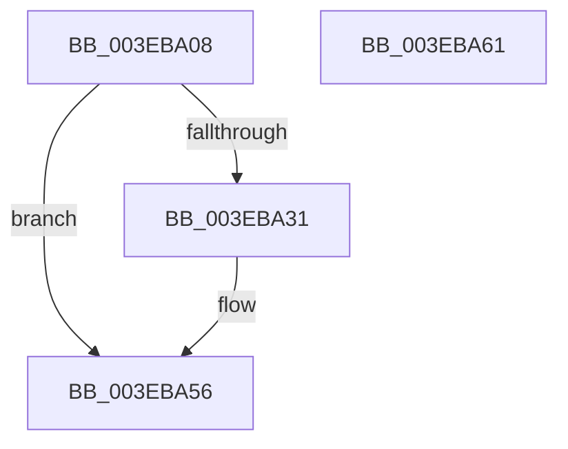

# EtwpFreePartitionMemory

- RVA: `0x003EBA08`–`0x003EBA62` (길이 `90` bytes)
- VA: `0x00000001403EBA08`
- 실행 섹션: `.text`
- PDB 이름 있음: `예`; PDB Function 태그: `아니요`
- unwind 정보 RVA: `0x00095AC0`
- 디코드: `28`개 명령, `90/90` bytes 표시
- 미해석 바이트: `0` (있으면 어셈블리에 `.byte`로 보존)

> 이 문서는 커널 이미지의 기계어와 PDB 기호를 분석해 생성했습니다. 4번과 5번은 함수 원형과 자료형을 바이너리 사용 방식에서 추정한 C 해석이며 원본 소스 복구 결과는 아닙니다.

## 1. Dependencies

- 직접 호출 지점: **4**; 고유 호출 대상: **4**
- 직접 호출자로 확인된 함수: **1**
- RIP 상대 이미지 참조: **0**

### Outgoing calls
- `0x003EBA24` → [EtwpUnregisterPartitionPages](EtwpUnregisterPartitionPages_function_003EBA68.md) (function, `0x003EBA68`)
- `0x003EBA37` → [MmUnmapLockedPages](../24/MmUnmapLockedPages_function_00246E60.md) (function, `0x00246E60`)
- `0x003EBA47` → [MiFreePagesFromMdl](../3F/MiFreePagesFromMdl_function_003F8300.md) (function, `0x003F8300`)
- `0x003EBA51` → [ExFreePoolWithTag](../../poolcode/B8/ExFreePoolWithTag_function_00B82870.md) (function, `0x00B82870`)

### Direct callers
- [EtwpFreeTraceBuffer](EtwpFreeTraceBuffer_function_003EB978.md) at `0x003EB9C8`

### Static image references
- 디코드된 RIP-relative 메모리 참조가 없습니다.

## 2. Other-region calls and transfers

- 다른 실행 섹션으로 향하는 call: **1**
  - `0x003EBA51` → [ExFreePoolWithTag](../../poolcode/B8/ExFreePoolWithTag_function_00B82870.md) (`.text` → `POOLCODE`)
- 별도 외부 분기/꼬리 이동을 확인하지 못했습니다.

## 3. Assembly (complete function range)

```asm
003EBA08  48 8B C4                        mov rax, rsp
003EBA0B  48 89 58 10                     mov qword ptr [rax + 0x10], rbx
003EBA0F  48 89 48 08                     mov qword ptr [rax + 8], rcx
003EBA13  57                              push rdi
003EBA14  48 83 EC 20                     sub rsp, 0x20
003EBA18  48 83 60 08 00                  and qword ptr [rax + 8], 0
003EBA1D  48 8D 48 08                     lea rcx, [rax + 8]
003EBA21  48 8B FA                        mov rdi, rdx
003EBA24  E8 3F 00 00 00                  call 0x1403eba68
003EBA29  48 8B D8                        mov rbx, rax
003EBA2C  48 85 C0                        test rax, rax
003EBA2F  74 25                           je 0x1403eba56
003EBA31  48 8B D0                        mov rdx, rax
003EBA34  48 8B CF                        mov rcx, rdi
003EBA37  E8 24 B4 E5 FF                  call 0x140246e60
003EBA3C  45 33 C9                        xor r9d, r9d
003EBA3F  45 33 C0                        xor r8d, r8d
003EBA42  33 D2                           xor edx, edx
003EBA44  48 8B CB                        mov rcx, rbx
003EBA47  E8 B4 C8 00 00                  call 0x1403f8300
003EBA4C  33 D2                           xor edx, edx
003EBA4E  48 8B CB                        mov rcx, rbx
003EBA51  E8 1A 6E 79 00                  call 0x140b82870
003EBA56  48 8B 5C 24 38                  mov rbx, qword ptr [rsp + 0x38]
003EBA5B  48 83 C4 20                     add rsp, 0x20
003EBA5F  5F                              pop rdi
003EBA60  C3                              ret
003EBA61  CC                              int3
```

## 4. C-style interpretation (structured pseudocode)

```c
__int64 __fastcall EtwpFreePartitionMemory(__int64 a1, __int64 a2, int a3, int a4)
{
    __int64 result;
    __int64 v_rsp;
    unsigned __int64 v_stack_p10;

    *(unsigned __int64 *)(v_rsp + 16) = v_rbx;
    *(unsigned __int64 *)(v_rsp + 8) = a1;
    v_rsp = (v_rsp) - (32);
    result = EtwpUnregisterPartitionPages(v_rsp + 8, a2, a3, a4);
    if (result != 0) {
        a2 = result;
        a1 = a2;
        result = MmUnmapLockedPages(a1, a2, a3, a4);
        a4 = 0;
        a3 = 0;
        a2 = 0;
        a1 = result;
        result = MiFreePagesFromMdl(a1, a2, a3, a4);
        a2 = 0;
        a1 = result;
        result = ExFreePoolWithTag(a1, a2, a3, a4);
    }
    v_rsp = (v_rsp) + (32);
    return result;
}
```

## 5. (Beta) C Style

```c
int64_t EtwpFreePartitionMemory(int64_t Arg1, int64_t Arg2, int32_t Arg3, int32_t Arg4)
{
    int64_t result;
    int64_t local_rsp;
    uint64_t v_stack_p10;

    *(uint64_t *)(local_rsp + 0x10) = local_rbx;
    *(uint64_t *)(local_rsp + 0x8) = Arg1;
    local_rsp = (local_rsp) - (32);
    result = EtwpUnregisterPartitionPages(local_rsp + 8, Arg2, Arg3, Arg4);
    if (result != 0) {
        Arg2 = result;
        Arg1 = Arg2;
        result = MmUnmapLockedPages(Arg1, Arg2, Arg3, Arg4);
        Arg4 = 0;
        Arg3 = 0;
        Arg2 = 0;
        Arg1 = result;
        result = MiFreePagesFromMdl(Arg1, Arg2, Arg3, Arg4);
        Arg2 = 0;
        Arg1 = result;
        result = ExFreePoolWithTag(Arg1, Arg2, Arg3, Arg4);
    }
    local_rsp = (local_rsp) + (32);
    return result;
}
```

## 6. Execution-region graph

[열기: 2D/3D 그래프와 함수 탐색 컨트롤 패널](../../../control-panel.html?section=text&rva=0x003EBA08&view=graph)

- 2D 그래프는 위에서 아래로 흐르고, 3D 그래프는 빈 공간을 드래그해 회전합니다. Shift+드래그는 이동, 휠은 확대·축소, 함수 노드 선택은 대상 보고서 이동입니다.

### Static fallback


