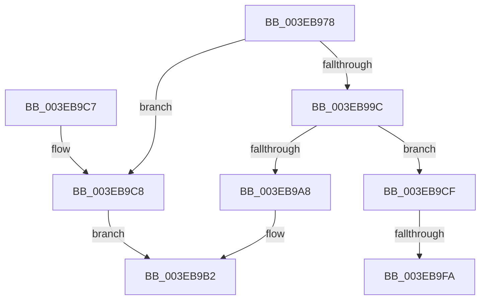

# EtwpFreeTraceBuffer

- RVA: `0x003EB978`–`0x003EBA01` (길이 `137` bytes)
- VA: `0x00000001403EB978`
- 실행 섹션: `.text`
- PDB 이름 있음: `예`; PDB Function 태그: `예`
- unwind 정보 RVA: `0x0005CBA8`
- 디코드: `36`개 명령, `137/137` bytes 표시
- 미해석 바이트: `0` (있으면 어셈블리에 `.byte`로 보존)

> 이 문서는 커널 이미지의 기계어와 PDB 기호를 분석해 생성했습니다. 4번과 5번은 함수 원형과 자료형을 바이너리 사용 방식에서 추정한 C 해석이며 원본 소스 복구 결과는 아닙니다.

## 1. Dependencies

- 직접 호출 지점: **3**; 고유 호출 대상: **3**
- 직접 호출자로 확인된 함수: **4**
- RIP 상대 이미지 참조: **0**

### Outgoing calls
- `0x003EB9AD` → [ExFreePoolWithTag](../../poolcode/B8/ExFreePoolWithTag_function_00B82870.md) (function, `0x00B82870`)
- `0x003EB9C8` → [EtwpFreePartitionMemory](EtwpFreePartitionMemory_function_003EBA08.md) (function, `0x003EBA08`)
- `0x003EB9E2` → [EtwpMdlInit](../../page/7B/EtwpMdlInit_function_007B7680.md) (function, `0x007B7680`)

### Direct callers
- [EtwpAdjustSiloTraceBuffers](EtwpAdjustSiloTraceBuffers_function_003EB720.md) at `0x003EB804`
- [EtwpCancelMemoryPreservation](../../page/7B/EtwpCancelMemoryPreservation_function_007BEC0C.md) at `0x007BEC4F`
- [EtwpPreserveLogger](../../page/7B/EtwpPreserveLogger_function_007BEF4C.md) at `0x007BF137`
- [EtwpFreeTraceBufferPool](../../page/9C/EtwpFreeTraceBufferPool_function_009C1A74.md) at `0x009C1AE7`
- [EtwpFreeTraceBufferPool](../../page/9C/EtwpFreeTraceBufferPool_function_009C1A74.md) at `0x009C1B0E`
- [EtwpFreeTraceBufferPool](../../page/9C/EtwpFreeTraceBufferPool_function_009C1A74.md) at `0x009C1BA2`
- [EtwpFreeTraceBufferPool](../../page/9C/EtwpFreeTraceBufferPool_function_009C1A74.md) at `0x009C1BE2`

### Static image references
- 디코드된 RIP-relative 메모리 참조가 없습니다.

## 2. Other-region calls and transfers

- 다른 실행 섹션으로 향하는 call: **2**
  - `0x003EB9AD` → [ExFreePoolWithTag](../../poolcode/B8/ExFreePoolWithTag_function_00B82870.md) (`.text` → `POOLCODE`)
  - `0x003EB9E2` → [EtwpMdlInit](../../page/7B/EtwpMdlInit_function_007B7680.md) (`.text` → `PAGE`)
- call이 아닌 외부 분기/꼬리 이동: **2**
  - `0x003EB9F4` → [sub_006EADCA + 0x20](../6E/Unknown_function_006EADCA.md) (`tail-transfer`)
  - `0x003EB9FC` → [sub_006EADCA](../6E/Unknown_function_006EADCA.md) (`tail-transfer`)

## 3. Assembly (complete function range)

```asm
003EB978  48 89 5C 24 08                  mov qword ptr [rsp + 8], rbx
003EB97D  48 89 6C 24 10                  mov qword ptr [rsp + 0x10], rbp
003EB982  48 89 74 24 18                  mov qword ptr [rsp + 0x18], rsi
003EB987  57                              push rdi
003EB988  48 83 EC 20                     sub rsp, 0x20
003EB98C  48 83 B9 40 06 00 00 00         cmp qword ptr [rcx + 0x640], 0
003EB994  48 8B DA                        mov rbx, rdx
003EB997  4C 8B C9                        mov r9, rcx
003EB99A  75 2C                           jne 0x1403eb9c8
003EB99C  F7 81 30 03 00 00 00 00 00 20   test dword ptr [rcx + 0x330], 0x20000000
003EB9A6  75 27                           jne 0x1403eb9cf
003EB9A8  33 D2                           xor edx, edx
003EB9AA  48 8B CB                        mov rcx, rbx
003EB9AD  E8 BE 6E 79 00                  call 0x140b82870
003EB9B2  48 8B 5C 24 30                  mov rbx, qword ptr [rsp + 0x30]
003EB9B7  48 8B 6C 24 38                  mov rbp, qword ptr [rsp + 0x38]
003EB9BC  48 8B 74 24 40                  mov rsi, qword ptr [rsp + 0x40]
003EB9C1  48 83 C4 20                     add rsp, 0x20
003EB9C5  5F                              pop rdi
003EB9C6  C3                              ret
003EB9C7  CC                              int3
003EB9C8  E8 3B 00 00 00                  call 0x1403eba08
003EB9CD  EB E3                           jmp 0x1403eb9b2
003EB9CF  8B 51 04                        mov edx, dword ptr [rcx + 4]
003EB9D2  4C 8B C3                        mov r8, rbx
003EB9D5  48 8B A9 48 06 00 00            mov rbp, qword ptr [rcx + 0x648]
003EB9DC  C1 EA 0C                        shr edx, 0xc
003EB9DF  48 8B CD                        mov rcx, rbp
003EB9E2  E8 99 BC 3C 00                  call 0x1407b7680
003EB9E7  41 8B 41 04                     mov eax, dword ptr [r9 + 4]
003EB9EB  48 8D 7D 30                     lea rdi, [rbp + 0x30]
003EB9EF  C1 E8 0C                        shr eax, 0xc
003EB9F2  85 C0                           test eax, eax
003EB9F4  0F 84 F0 F3 2F 00               je 0x1406eadea
003EB9FA  8B F0                           mov esi, eax
003EB9FC  E9 C9 F3 2F 00                  jmp 0x1406eadca
```

## 4. C-style interpretation (structured pseudocode)

```c
__int64 __fastcall EtwpFreeTraceBuffer(__int64 a1, __int64 a2)
{
    __int64 result;
    __int64 v_rsp;
    unsigned __int64 v_stack_p10;
    unsigned __int64 v_stack_p18;
    unsigned __int64 v_stack_p8;

    v_stack_p8 = v_rbx;
    v_stack_p10 = v_rbp;
    v_stack_p18 = v_rsi;
    v_rsp = (v_rsp) - (32);
    if ((*(unsigned __int64 *)(a1 + 1600)) != 0) goto loc_003EB9C8;
    if (((*(unsigned int *)(a1 + 816)) & (0x20000000ULL)) != 0) goto loc_003EB9CF;
    a2 = 0;
    result = ExFreePoolWithTag(0, a2, a3, a1);
loc_003EB9B2:
    v_rsp = (v_rsp) + (32);
    return result;
loc_003EB9C8:
    result = EtwpFreePartitionMemory(0, a2, a3, a1);
    goto loc_003EB9B2;
loc_003EB9CF:
    a2 = (unsigned int)(((unsigned int)(*(unsigned int *)(0 + 4))) >> (12));
    result = EtwpMdlInit(*(unsigned __int64 *)(0 + 1608), a2, v_stack_p8, a1);
    result = (unsigned int)(((unsigned int)(*(unsigned int *)(a1 + 4))) >> (12));
}
```

## 5. (Beta) C Style

```c
int64_t EtwpFreeTraceBuffer(void *Arg1, int64_t Arg2)
{
    uint8_t *arg1 = (uint8_t *)Arg1;

    int64_t result;
    int64_t local_rsp;
    uint64_t v_stack_p10;
    uint64_t v_stack_p18;
    uint64_t v_stack_p8;

    v_stack_p8 = local_rbx;
    v_stack_p10 = local_rbp;
    v_stack_p18 = local_rsi;
    local_rsp = (local_rsp) - (32);
    if ((*(uint64_t *)(arg1 + 0x640)) != 0) goto loc_003EB9C8;
    if (((*(uint32_t *)(arg1 + 0x330)) & (0x20000000ULL)) != 0) goto loc_003EB9CF;
    Arg2 = 0;
    result = ExFreePoolWithTag(0, Arg2, a3, Arg1);
loc_003EB9B2:
    local_rsp = (local_rsp) + (32);
    return result;
loc_003EB9C8:
    result = EtwpFreePartitionMemory(0, Arg2, a3, Arg1);
    goto loc_003EB9B2;
loc_003EB9CF:
    Arg2 = (uint32_t)(((uint32_t)(*(uint32_t *)(0 + 0x4))) >> (12));
    result = EtwpMdlInit(*(uint64_t *)(0 + 0x648), Arg2, v_stack_p8, Arg1);
    result = (uint32_t)(((uint32_t)(*(uint32_t *)(arg1 + 0x4))) >> (12));
}
```

### 관측된 메모리 오프셋

구조체 형식이 확인되지 않은 접근은 인자 기준의 오프셋으로만 기록했습니다.

| 기준 인자 | 오프셋 표현 | 폭 (bit) | 접근 |
|---|---:|---:|---|
| `Arg1` | `+ 0x4` | `32` | `R` |
| `Arg1` | `+ 0x330` | `32` | `R` |
| `Arg1` | `+ 0x640` | `64` | `R` |
| `Arg1` | `+ 0x648` | `64` | `R` |

## 6. Execution-region graph

[열기: 2D/3D 그래프와 함수 탐색 컨트롤 패널](../../../control-panel.html?section=text&rva=0x003EB978&view=graph)

- 2D 그래프는 위에서 아래로 흐르고, 3D 그래프는 빈 공간을 드래그해 회전합니다. Shift+드래그는 이동, 휠은 확대·축소, 함수 노드 선택은 대상 보고서 이동입니다.

### Static fallback


