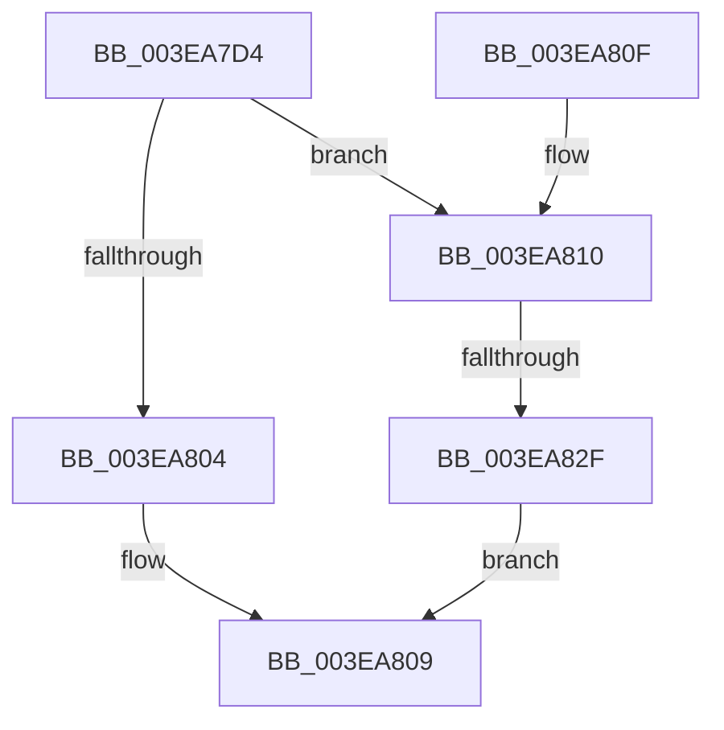

# EtwpGetDurationSince

- RVA: `0x003EA7D4`–`0x003EA833` (길이 `95` bytes)
- VA: `0x00000001403EA7D4`
- 실행 섹션: `.text`
- PDB 이름 있음: `예`; PDB Function 태그: `예`
- unwind 정보 RVA: `0x00095948`
- 디코드: `26`개 명령, `95/95` bytes 표시
- 미해석 바이트: `0` (있으면 어셈블리에 `.byte`로 보존)

> 이 문서는 커널 이미지의 기계어와 PDB 기호를 분석해 생성했습니다. 4번과 5번은 함수 원형과 자료형을 바이너리 사용 방식에서 추정한 C 해석이며 원본 소스 복구 결과는 아닙니다.

## 1. Dependencies

- 직접 호출 지점: **1**; 고유 호출 대상: **1**
- 직접 호출자로 확인된 함수: **2**
- RIP 상대 이미지 참조: **0**

### Outgoing calls
- `0x003EA7EC` → [KeQueryPerformanceCounter](../37/KeQueryPerformanceCounter_function_0037E7E0.md) (function, `0x0037E7E0`)

### Direct callers
- [EtwTraceMdlAllocationEvent](EtwTraceMdlAllocationEvent_function_003E95FC.md) at `0x003E965F`
- [EtwTraceContAllocationEvent](EtwTraceContAllocationEvent_function_003EA680.md) at `0x003EA6E8`

### Static image references
- 디코드된 RIP-relative 메모리 참조가 없습니다.

## 2. Other-region calls and transfers

- 다른 실행 섹션으로 향하는 call: **0**
- call이 아닌 외부 분기/꼬리 이동: **1**
  - `0x003EA829` → [sub_006EACEA](../6E/Unknown_function_006EACEA.md) (`tail-transfer`)

## 3. Assembly (complete function range)

```asm
003EA7D4  48 89 54 24 10                  mov qword ptr [rsp + 0x10], rdx
003EA7D9  53                              push rbx
003EA7DA  48 83 EC 20                     sub rsp, 0x20
003EA7DE  48 83 64 24 38 00               and qword ptr [rsp + 0x38], 0
003EA7E4  48 8B D9                        mov rbx, rcx
003EA7E7  48 8D 4C 24 38                  lea rcx, [rsp + 0x38]
003EA7EC  E8 EF 3F F9 FF                  call 0x14037e7e0
003EA7F1  4C 8B C0                        mov r8, rax
003EA7F4  B8 40 42 0F 00                  mov eax, 0xf4240
003EA7F9  4C 2B C3                        sub r8, rbx
003EA7FC  49 F7 E0                        mul r8
003EA7FF  48 85 D2                        test rdx, rdx
003EA802  75 0C                           jne 0x1403ea810
003EA804  48 F7 74 24 38                  div qword ptr [rsp + 0x38]
003EA809  48 83 C4 20                     add rsp, 0x20
003EA80D  5B                              pop rbx
003EA80E  C3                              ret
003EA80F  CC                              int3
003EA810  48 B8 DB 34 B6 D7 82 DE 1B 43   movabs rax, 0x431bde82d7b634db
003EA81A  48 F7 64 24 38                  mul qword ptr [rsp + 0x38]
003EA81F  48 8B CA                        mov rcx, rdx
003EA822  48 C1 E9 12                     shr rcx, 0x12
003EA826  48 85 C9                        test rcx, rcx
003EA829  0F 85 BB 04 30 00               jne 0x1406eacea
003EA82F  33 C0                           xor eax, eax
003EA831  EB D6                           jmp 0x1403ea809
```

## 4. C-style interpretation (structured pseudocode)

```c
__int64 __fastcall EtwpGetDurationSince(__int64 a1, __int64 a2)
{
    __int64 result;
    __int64 v_rsp;
    unsigned __int64 v_stack_p10;
    unsigned __int64 v_stack_p38;

    v_stack_p10 = a2;
    v_rsp = (v_rsp) - (32);
    result = KeQueryPerformanceCounter(v_stack_p10, a2, a3, a4);
    a3 = (result) - (a1);
    if (a2 != 0) goto loc_003EA810;
loc_003EA809:
    v_rsp = (v_rsp) + (32);
    return (unsigned int)(0xF4240ULL);
loc_003EA810:
    a1 = (a2) >> (18);
    result = 0;
    goto loc_003EA809;
}
```

## 5. (Beta) C Style

```c
int64_t EtwpGetDurationSince(int64_t Arg1, int64_t Arg2)
{
    int64_t result;
    int64_t local_rsp;
    uint64_t v_stack_p10;
    uint64_t v_stack_p38;

    v_stack_p10 = Arg2;
    local_rsp = (local_rsp) - (32);
    result = KeQueryPerformanceCounter(v_stack_p10, Arg2, a3, a4);
    a3 = (result) - (Arg1);
    if (Arg2 != 0) goto loc_003EA810;
loc_003EA809:
    local_rsp = (local_rsp) + (32);
    return (uint32_t)(0xF4240ULL);
loc_003EA810:
    Arg1 = (Arg2) >> (18);
    result = 0;
    goto loc_003EA809;
}
```

## 6. Execution-region graph

[열기: 2D/3D 그래프와 함수 탐색 컨트롤 패널](../../../control-panel.html?section=text&rva=0x003EA7D4&view=graph)

- 2D 그래프는 위에서 아래로 흐르고, 3D 그래프는 빈 공간을 드래그해 회전합니다. Shift+드래그는 이동, 휠은 확대·축소, 함수 노드 선택은 대상 보고서 이동입니다.

### Static fallback


