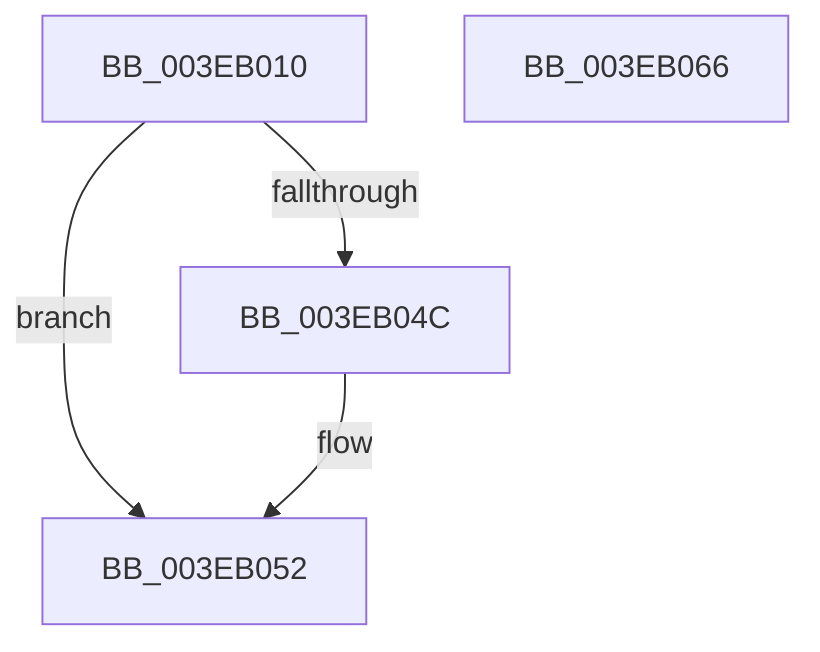

# EtwpInitializeBufferHeader

- RVA: `0x003EB010`–`0x003EB067` (길이 `87` bytes)
- VA: `0x00000001403EB010`
- 실행 섹션: `.text`
- PDB 이름 있음: `예`; PDB Function 태그: `아니요`
- unwind 정보 RVA: `0x0005CAAC`
- 디코드: `26`개 명령, `87/87` bytes 표시
- 미해석 바이트: `0` (있으면 어셈블리에 `.byte`로 보존)

> 이 문서는 커널 이미지의 기계어와 PDB 기호를 분석해 생성했습니다. 4번과 5번은 함수 원형과 자료형을 바이너리 사용 방식에서 추정한 C 해석이며 원본 소스 복구 결과는 아닙니다.

## 1. Dependencies

- 직접 호출 지점: **1**; 고유 호출 대상: **1**
- 직접 호출자로 확인된 함수: **6**
- RIP 상대 이미지 참조: **0**

### Outgoing calls
- `0x003EB029` → [memset](../6C/memset_function_006C6C40.md) (function, `0x006C6C40`)

### Direct callers
- [EtwpAllocateFreeBuffers](EtwpAllocateFreeBuffers_function_003EAEA4.md) at `0x003EAF7A`
- [EtwpPreserveLogger](../../page/7B/EtwpPreserveLogger_function_007BEF4C.md) at `0x007BF041`
- [EtwpRealtimeUpdateReferenceTime](../../page/7C/EtwpRealtimeUpdateReferenceTime_function_007C0CC0.md) at `0x007C0CE8`
- [EtwpRealtimeSendEmptyMarker](../../page/9B/EtwpRealtimeSendEmptyMarker_function_009BF4CC.md) at `0x009BF4ED`
- [EtwpUpdateFileHeader](../../page/9C/EtwpUpdateFileHeader_function_009C082C.md) at `0x009C08B9`
- [EtwpInitializeProviderInfoBuffer](../../page/AA/EtwpInitializeProviderInfoBuffer_function_00AACE3C.md) at `0x00AACE54`

### Static image references
- 디코드된 RIP-relative 메모리 참조가 없습니다.

## 2. Other-region calls and transfers

- 다른 실행 섹션으로 향하는 call: **0**
- 별도 외부 분기/꼬리 이동을 확인하지 못했습니다.

## 3. Assembly (complete function range)

```asm
003EB010  48 89 5C 24 08                  mov qword ptr [rsp + 8], rbx
003EB015  57                              push rdi
003EB016  48 83 EC 20                     sub rsp, 0x20
003EB01A  48 8B FA                        mov rdi, rdx
003EB01D  48 8B D9                        mov rbx, rcx
003EB020  33 D2                           xor edx, edx
003EB022  48 8B CF                        mov rcx, rdi
003EB025  44 8D 42 48                     lea r8d, [rdx + 0x48]
003EB029  E8 12 BC 2D 00                  call 0x1406c6c40
003EB02E  C7 47 08 48 00 00 00            mov dword ptr [rdi + 8], 0x48
003EB035  8B 47 08                        mov eax, dword ptr [rdi + 8]
003EB038  89 47 30                        mov dword ptr [rdi + 0x30], eax
003EB03B  8B 43 04                        mov eax, dword ptr [rbx + 4]
003EB03E  89 07                           mov dword ptr [rdi], eax
003EB040  0F B7 03                        movzx eax, word ptr [rbx]
003EB043  66 89 47 2A                     mov word ptr [rdi + 0x2a], ax
003EB047  66 85 C0                        test ax, ax
003EB04A  75 06                           jne 0x1403eb052
003EB04C  66 81 4F 2A FF FF               or word ptr [rdi + 0x2a], 0xffff
003EB052  48 8B 5C 24 30                  mov rbx, qword ptr [rsp + 0x30]
003EB057  B8 00 01 00 00                  mov eax, 0x100
003EB05C  66 09 47 34                     or word ptr [rdi + 0x34], ax
003EB060  48 83 C4 20                     add rsp, 0x20
003EB064  5F                              pop rdi
003EB065  C3                              ret
003EB066  CC                              int3
```

## 4. C-style interpretation (structured pseudocode)

```c
__int64 __fastcall EtwpInitializeBufferHeader(__int64 a1, __int64 a2)
{
    __int64 result;
    __int64 v_rsp;
    unsigned __int64 v_stack_p8;

    v_stack_p8 = v_rbx;
    v_rsp = (v_rsp) - (32);
    a2 = 0;
    result = memset(0, a2, a2 + 72, a4);
    *(unsigned int *)(a2 + 8) = 72;
    *(unsigned int *)(a2 + 48) = (unsigned int)((unsigned int)(*(unsigned int *)(a2 + 8)));
    *(unsigned int *)(a2) = (unsigned int)((unsigned int)(*(unsigned int *)(a1 + 4)));
    *(unsigned __int16 *)(a2 + 42) = (unsigned __int16)(*(unsigned __int16 *)(a1));
    if ((unsigned __int16)(*(unsigned __int16 *)(a1)) == 0) {
    }
    v_rsp = (v_rsp) + (32);
    return 256;
}
```

## 5. (Beta) C Style

```c
int64_t EtwpInitializeBufferHeader(void *Arg1, void *Arg2)
{
    uint8_t *arg1 = (uint8_t *)Arg1;
    uint8_t *arg2 = (uint8_t *)Arg2;

    int64_t result;
    int64_t local_rsp;
    uint64_t v_stack_p8;

    v_stack_p8 = local_rbx;
    local_rsp = (local_rsp) - (32);
    Arg2 = 0;
    result = memset(0, Arg2, Arg2 + 72, a4);
    *(uint32_t *)(arg2 + 0x8) = 72;
    *(uint32_t *)(arg2 + 0x30) = (uint32_t)((uint32_t)(*(uint32_t *)(arg2 + 0x8)));
    *(uint32_t *)(arg2) = (uint32_t)((uint32_t)(*(uint32_t *)(arg1 + 0x4)));
    *(uint16_t *)(arg2 + 0x2A) = (uint16_t)(*(uint16_t *)(arg1));
    if ((uint16_t)(*(uint16_t *)(arg1)) == 0) {
    }
    local_rsp = (local_rsp) + (32);
    return 256;
}
```

### 관측된 메모리 오프셋

구조체 형식이 확인되지 않은 접근은 인자 기준의 오프셋으로만 기록했습니다.

| 기준 인자 | 오프셋 표현 | 폭 (bit) | 접근 |
|---|---:|---:|---|
| `Arg1` | `+ 0x0` | `16` | `R` |
| `Arg1` | `+ 0x4` | `32` | `R` |
| `Arg2` | `+ 0x0` | `32` | `W` |
| `Arg2` | `+ 0x8` | `32` | `R` |
| `Arg2` | `+ 0x8` | `32` | `W` |
| `Arg2` | `+ 0x2A` | `16` | `R/W` |
| `Arg2` | `+ 0x2A` | `16` | `W` |
| `Arg2` | `+ 0x30` | `32` | `W` |
| `Arg2` | `+ 0x34` | `16` | `R/W` |

## 6. Execution-region graph

[열기: 2D/3D 그래프와 함수 탐색 컨트롤 패널](../../../control-panel.html?section=text&rva=0x003EB010&view=graph)

- 2D 그래프는 위에서 아래로 흐르고, 3D 그래프는 빈 공간을 드래그해 회전합니다. Shift+드래그는 이동, 휠은 확대·축소, 함수 노드 선택은 대상 보고서 이동입니다.

### Static fallback


