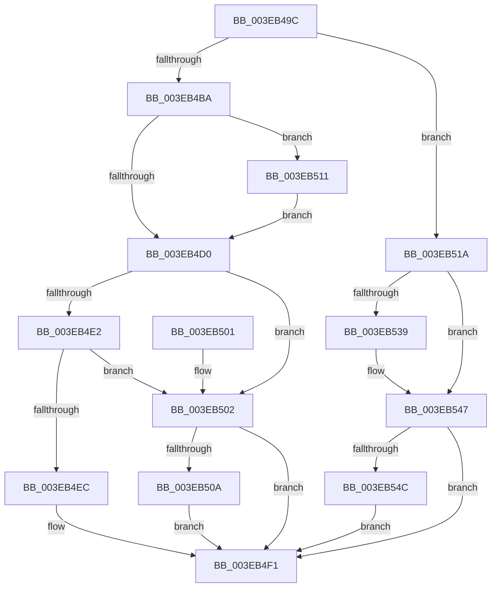

# EtwpLockBufferList

- RVA: `0x003EB49C`–`0x003EB552` (길이 `182` bytes)
- VA: `0x00000001403EB49C`
- 실행 섹션: `.text`
- PDB 이름 있음: `예`; PDB Function 태그: `아니요`
- unwind 정보 RVA: `0x00095A58`
- 디코드: `50`개 명령, `182/182` bytes 표시
- 미해석 바이트: `0` (있으면 어셈블리에 `.byte`로 보존)

> 이 문서는 커널 이미지의 기계어와 PDB 기호를 분석해 생성했습니다. 4번과 5번은 함수 원형과 자료형을 바이너리 사용 방식에서 추정한 C 해석이며 원본 소스 복구 결과는 아닙니다.

## 1. Dependencies

- 직접 호출 지점: **5**; 고유 호출 대상: **5**
- 직접 호출자로 확인된 함수: **7**
- RIP 상대 이미지 참조: **3**

### Outgoing calls
- `0x003EB4EC` → [KiAcquireSpinLockInstrumented](../20/KiAcquireSpinLockInstrumented_function_002084F0.md) (function, `0x002084F0`)
- `0x003EB50A` → [KxWaitForSpinLockAndAcquire](../20/KxWaitForSpinLockAndAcquire_function_002085C0.md) (function, `0x002085C0`)
- `0x003EB513` → [KiRaiseIrqlProcessIrqlFlags](../4F/KiRaiseIrqlProcessIrqlFlags_function_004F56FC.md) (function, `0x004F56FC`)
- `0x003EB529` → [KeAbPreAcquire](../21/KeAbPreAcquire_function_00210230.md) (function, `0x00210230`)
- `0x003EB542` → [ExfAcquirePushLockExclusiveEx](../20/ExfAcquirePushLockExclusiveEx_function_0020FC90.md) (function, `0x0020FC90`)

### Direct callers
- [EtwpReserveTraceBuffer](../2F/EtwpReserveTraceBuffer_function_002FC8C0.md) at `0x002FCD4C`
- [EtwpEnqueueOverflowBuffer](../2F/EtwpEnqueueOverflowBuffer_function_002FE644.md) at `0x002FE66D`
- [EtwpAllocateFreeBuffers](EtwpAllocateFreeBuffers_function_003EAEA4.md) at `0x003EAF8B`
- [EtwpDequeueFreeBuffer](EtwpDequeueFreeBuffer_function_003EB1F0.md) at `0x003EB220`
- [EtwpDequeueFreeBuffer](EtwpDequeueFreeBuffer_function_003EB1F0.md) at `0x003EB27E`
- [EtwpDequeueFreeBuffer](EtwpDequeueFreeBuffer_function_003EB1F0.md) at `0x003EB306`
- [EtwpAdjustSiloTraceBuffers](EtwpAdjustSiloTraceBuffers_function_003EB720.md) at `0x003EB7A8`
- [EtwpDequeueBufferPendingCompression](../65/EtwpDequeueBufferPendingCompression_function_006533E8.md) at `0x00653421`
- [EtwpReenableCompression](../65/EtwpReenableCompression_function_00653768.md) at `0x006537A4`

### Static image references
- `0x003EB4C7` → RVA `0x00FC6D20` (`ALMOSTRO`; read)
- `0x003EB4D0` → RVA `0x00FC6B06` (`ALMOSTRO`; read)
- `0x003EB4E2` → RVA `0x00F0DE58` (`.data`; read)

## 2. Other-region calls and transfers

- 다른 실행 섹션으로 향하는 call: **0**
- 별도 외부 분기/꼬리 이동을 확인하지 못했습니다.

## 3. Assembly (complete function range)

```asm
003EB49C  48 89 5C 24 08                  mov qword ptr [rsp + 8], rbx
003EB4A1  48 89 74 24 10                  mov qword ptr [rsp + 0x10], rsi
003EB4A6  57                              push rdi
003EB4A7  48 83 EC 20                     sub rsp, 0x20
003EB4AB  83 B9 2C 01 00 00 01            cmp dword ptr [rcx + 0x12c], 1
003EB4B2  48 8B F2                        mov rsi, rdx
003EB4B5  48 8B F9                        mov rdi, rcx
003EB4B8  74 60                           je 0x1403eb51a
003EB4BA  44 0F 20 C3                     mov rbx, cr8
003EB4BE  BA 0F 00 00 00                  mov edx, 0xf
003EB4C3  44 0F 22 C2                     mov cr8, rdx
003EB4C7  83 3D 52 B8 BD 00 00            cmp dword ptr [rip + 0xbdb852], 0
003EB4CE  75 41                           jne 0x1403eb511
003EB4D0  F6 05 2F B6 BD 00 21            test byte ptr [rip + 0xbdb62f], 0x21
003EB4D7  48 8D 8F B8 02 00 00            lea rcx, [rdi + 0x2b8]
003EB4DE  88 1E                           mov byte ptr [rsi], bl
003EB4E0  74 20                           je 0x1403eb502
003EB4E2  8B 05 70 29 B2 00               mov eax, dword ptr [rip + 0xb22970]
003EB4E8  85 C0                           test eax, eax
003EB4EA  75 16                           jne 0x1403eb502
003EB4EC  E8 FF CF E1 FF                  call 0x1402084f0
003EB4F1  48 8B 5C 24 30                  mov rbx, qword ptr [rsp + 0x30]
003EB4F6  48 8B 74 24 38                  mov rsi, qword ptr [rsp + 0x38]
003EB4FB  48 83 C4 20                     add rsp, 0x20
003EB4FF  5F                              pop rdi
003EB500  C3                              ret
003EB501  CC                              int3
003EB502  F0 48 0F BA 29 00               lock bts qword ptr [rcx], 0
003EB508  73 E7                           jae 0x1403eb4f1
003EB50A  E8 B1 D0 E1 FF                  call 0x1402085c0
003EB50F  EB E0                           jmp 0x1403eb4f1
003EB511  8A CB                           mov cl, bl
003EB513  E8 E4 A1 10 00                  call 0x1404f56fc
003EB518  EB B6                           jmp 0x1403eb4d0
003EB51A  48 81 C7 B8 02 00 00            add rdi, 0x2b8
003EB521  45 33 C0                        xor r8d, r8d
003EB524  48 8B CF                        mov rcx, rdi
003EB527  33 D2                           xor edx, edx
003EB529  E8 02 4D E2 FF                  call 0x140210230
003EB52E  F0 48 0F BA 2F 00               lock bts qword ptr [rdi], 0
003EB534  48 8B D8                        mov rbx, rax
003EB537  73 0E                           jae 0x1403eb547
003EB539  4C 8B C7                        mov r8, rdi
003EB53C  48 8B D0                        mov rdx, rax
003EB53F  48 8B CF                        mov rcx, rdi
003EB542  E8 49 47 E2 FF                  call 0x14020fc90
003EB547  48 85 DB                        test rbx, rbx
003EB54A  74 A5                           je 0x1403eb4f1
003EB54C  C6 43 0A 01                     mov byte ptr [rbx + 0xa], 1
003EB550  EB 9F                           jmp 0x1403eb4f1
```

## 4. C-style interpretation (structured pseudocode)

```c
__int64 __fastcall EtwpLockBufferList(__int64 a1, __int64 a2, int a3)
{
    __int64 result;
    __int64 v_rdi;
    __int64 v_rsp;
    unsigned __int64 v_stack_p10;
    unsigned __int64 v_stack_p8;

    v_stack_p8 = v_rbx;
    v_stack_p10 = v_rsi;
    v_rsp = (v_rsp) - (32);
    if ((*(unsigned int *)(a1 + 300)) == 1) goto loc_003EB51A;
    if ((*(unsigned int *)(v_rip + 12433490)) != 0) goto loc_003EB511;
loc_003EB4D0:
    *(unsigned __int8 *)(a2) = (unsigned __int8)(v_cr8);
    if (((*(unsigned __int8 *)(v_rip + 12432943)) & (33)) == 0) goto loc_003EB502;
    if ((unsigned int)((unsigned int)(*(unsigned int *)(v_rip + 11676016))) != 0) goto loc_003EB502;
    result = KiAcquireSpinLockInstrumented(a1 + 696, 15, a3, a4);
loc_003EB4F1:
    v_rsp = (v_rsp) + (32);
    return result;
loc_003EB502:
    if (condition_is_above_or_equal) goto loc_003EB4F1;
    result = KxWaitForSpinLockAndAcquire(a1 + 696, 15, a3, a4);
    goto loc_003EB4F1;
loc_003EB511:
    result = KiRaiseIrqlProcessIrqlFlags((unsigned __int8)(v_stack_p8), 15, a3, a4);
    goto loc_003EB4D0;
loc_003EB51A:
    v_rdi = (a1) + (696);
    a3 = 0;
    a2 = 0;
    result = KeAbPreAcquire(v_rdi, a2, a3, a4);
    if (!(condition_is_above_or_equal)) {
        a3 = v_rdi;
        a2 = result;
        a1 = v_rdi;
        result = ExfAcquirePushLockExclusiveEx(a1, a2, a3, a4);
    }
    if (result == 0) goto loc_003EB4F1;
    *(unsigned __int8 *)(result + 10) = 1;
    goto loc_003EB4F1;
}
```

## 5. (Beta) C Style

```c
int64_t EtwpLockBufferList(void *Arg1, void *Arg2, int32_t Arg3)
{
    uint8_t *arg1 = (uint8_t *)Arg1;
    uint8_t *arg2 = (uint8_t *)Arg2;

    int64_t result;
    int64_t local_rdi;
    int64_t local_rsp;
    uint64_t v_stack_p10;
    uint64_t v_stack_p8;

    v_stack_p8 = local_rbx;
    v_stack_p10 = local_rsi;
    local_rsp = (local_rsp) - (32);
    if ((*(uint32_t *)(arg1 + 0x12C)) == 1) goto loc_003EB51A;
    if ((*(uint32_t *)(v_rip + 0xBDB852)) != 0) goto loc_003EB511;
loc_003EB4D0:
    *(uint8_t *)(arg2) = (uint8_t)(v_cr8);
    if (((*(uint8_t *)(v_rip + 0xBDB62F)) & (33)) == 0) goto loc_003EB502;
    if ((uint32_t)((uint32_t)(*(uint32_t *)(v_rip + 0xB22970))) != 0) goto loc_003EB502;
    result = KiAcquireSpinLockInstrumented(Arg1 + 696, 15, Arg3, a4);
loc_003EB4F1:
    local_rsp = (local_rsp) + (32);
    return result;
loc_003EB502:
    if (condition_is_above_or_equal) goto loc_003EB4F1;
    result = KxWaitForSpinLockAndAcquire(Arg1 + 696, 15, Arg3, a4);
    goto loc_003EB4F1;
loc_003EB511:
    result = KiRaiseIrqlProcessIrqlFlags((uint8_t)(v_stack_p8), 15, Arg3, a4);
    goto loc_003EB4D0;
loc_003EB51A:
    local_rdi = (Arg1) + (696);
    Arg3 = 0;
    Arg2 = 0;
    result = KeAbPreAcquire(local_rdi, Arg2, Arg3, a4);
    if (!(condition_is_above_or_equal)) {
        Arg3 = local_rdi;
        Arg2 = result;
        Arg1 = local_rdi;
        result = ExfAcquirePushLockExclusiveEx(Arg1, Arg2, Arg3, a4);
    }
    if (result == 0) goto loc_003EB4F1;
    *(uint8_t *)(result + 0xA) = 1;
    goto loc_003EB4F1;
}
```

### 관측된 메모리 오프셋

구조체 형식이 확인되지 않은 접근은 인자 기준의 오프셋으로만 기록했습니다.

| 기준 인자 | 오프셋 표현 | 폭 (bit) | 접근 |
|---|---:|---:|---|
| `Arg1` | `+ 0x0` | `64` | `R/W` |
| `Arg1` | `+ 0x12C` | `32` | `R` |
| `Arg1` | `+ 0x2B8` | `64` | `R` |
| `Arg2` | `+ 0x0` | `8` | `W` |

## 6. Execution-region graph

[열기: 2D/3D 그래프와 함수 탐색 컨트롤 패널](../../../control-panel.html?section=text&rva=0x003EB49C&view=graph)

- 2D 그래프는 위에서 아래로 흐르고, 3D 그래프는 빈 공간을 드래그해 회전합니다. Shift+드래그는 이동, 휠은 확대·축소, 함수 노드 선택은 대상 보고서 이동입니다.

### Static fallback


