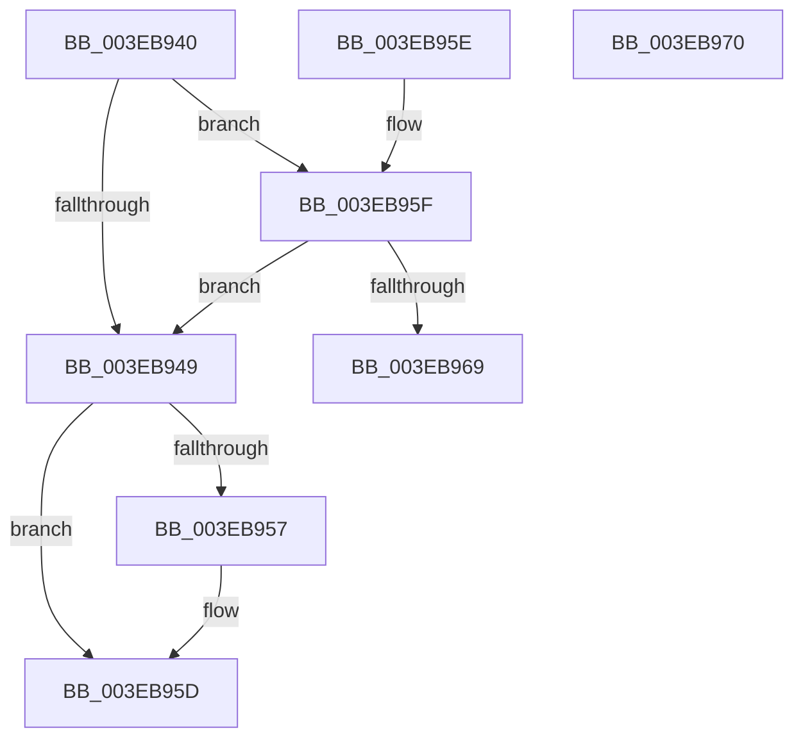

# EtwpQueryUsedProcessorCount

- RVA: `0x003EB940`–`0x003EB971` (길이 `49` bytes)
- VA: `0x00000001403EB940`
- 실행 섹션: `.text`
- PDB 이름 있음: `예`; PDB Function 태그: `아니요`
- unwind 정보 RVA: `0x000DB714`
- 디코드: `15`개 명령, `49/49` bytes 표시
- 미해석 바이트: `0` (있으면 어셈블리에 `.byte`로 보존)

> 이 문서는 커널 이미지의 기계어와 PDB 기호를 분석해 생성했습니다. 4번과 5번은 함수 원형과 자료형을 바이너리 사용 방식에서 추정한 C 해석이며 원본 소스 복구 결과는 아닙니다.

## 1. Dependencies

- 직접 호출 지점: **0**; 고유 호출 대상: **0**
- 직접 호출자로 확인된 함수: **18**
- RIP 상대 이미지 참조: **3**

### Outgoing calls
- 직접 디코드된 call 명령이 없습니다.

### Direct callers
- [EtwpBuffersFlushRequired](EtwpBuffersFlushRequired_function_003EB5AC.md) at `0x003EB5C4`
- [EtwpAdjustSiloTraceBuffers](EtwpAdjustSiloTraceBuffers_function_003EB720.md) at `0x003EB76B`
- [EtwpAddLastDroppedEvent](EtwpAddLastDroppedEvent_function_003EB8A4.md) at `0x003EB8C1`
- [EtwpAddLastDroppedEvent](EtwpAddLastDroppedEvent_function_003EB8A4.md) at `0x003EB916`
- [EtwpReenableCompression](../65/EtwpReenableCompression_function_00653768.md) at `0x006537B0`
- [EtwpUpdateContextRegisterTraceEvents](../../page/7B/EtwpUpdateContextRegisterTraceEvents_function_007B7B98.md) at `0x007B7BF4`
- [EtwpRealtimeSaveState](../../page/9B/EtwpRealtimeSaveState_function_009BCBD4.md) at `0x009BCC98`
- [EtwpBufferingModeFlush](../../page/9B/EtwpBufferingModeFlush_function_009BD8F4.md) at `0x009BD93A`
- [EtwpBufferingModeFlush](../../page/9B/EtwpBufferingModeFlush_function_009BD8F4.md) at `0x009BDA0B`
- [EtwpFlushActiveBuffers](../../page/9B/EtwpFlushActiveBuffers_function_009BDEF4.md) at `0x009BDFC5`
- [EtwpAdjustFreeBuffers](../../page/9B/EtwpAdjustFreeBuffers_function_009BE91C.md) at `0x009BE937`
- [EtwpUpdateFileHeader](../../page/9C/EtwpUpdateFileHeader_function_009C082C.md) at `0x009C0AA4`
- [EtwpAddLogHeader](../../page/9C/EtwpAddLogHeader_function_009C0BD0.md) at `0x009C0D2D`
- [EtwpFreeTraceBufferPool](../../page/9C/EtwpFreeTraceBufferPool_function_009C1A74.md) at `0x009C1B1B`
- [EtwpFinalizeHeader](../../page/9C/EtwpFinalizeHeader_function_009C1EF0.md) at `0x009C2028`
- [EtwpInitLoggerContext](../../page/A7/EtwpInitLoggerContext_function_00A7154C.md) at `0x00A7169D`
- [EtwpAllocateTraceBufferPool](../../page/A7/EtwpAllocateTraceBufferPool_function_00A74750.md) at `0x00A74762`
- [NtTraceControl](../../page/A9/NtTraceControl_function_00A9ED40.md) at `0x00A9F850`
- [EtwpUpdateTrace](../../page/AB/EtwpUpdateTrace_function_00ABCC7C.md) at `0x00ABD0BB`
- [EtwpRealtimeRestoreState](../../page/AC/EtwpRealtimeRestoreState_function_00AC6A74.md) at `0x00AC6B7B`

### Static image references
- `0x003EB957` → RVA `0x00FC6A80` (`ALMOSTRO`; read)
- `0x003EB95F` → RVA `0x00FC6A90` (`ALMOSTRO`; read)
- `0x003EB969` → RVA `0x00FC6BA0` (`ALMOSTRO`; read)

## 2. Other-region calls and transfers

- 다른 실행 섹션으로 향하는 call: **0**
- 별도 외부 분기/꼬리 이동을 확인하지 못했습니다.

## 3. Assembly (complete function range)

```asm
003EB940  F7 41 0C 00 00 04 00            test dword ptr [rcx + 0xc], 0x40000
003EB947  75 16                           jne 0x1403eb95f
003EB949  8B 41 0C                        mov eax, dword ptr [rcx + 0xc]
003EB94C  0F BA E0 1C                     bt eax, 0x1c
003EB950  B8 01 00 00 00                  mov eax, 1
003EB955  72 06                           jb 0x1403eb95d
003EB957  8B 05 23 B1 BD 00               mov eax, dword ptr [rip + 0xbdb123]
003EB95D  C3                              ret
003EB95E  CC                              int3
003EB95F  8B 05 2B B1 BD 00               mov eax, dword ptr [rip + 0xbdb12b]
003EB965  A8 02                           test al, 2
003EB967  74 E0                           je 0x1403eb949
003EB969  8B 05 31 B2 BD 00               mov eax, dword ptr [rip + 0xbdb231]
003EB96F  C3                              ret
003EB970  CC                              int3
```

## 4. C-style interpretation (structured pseudocode)

```c
__int64 __fastcall EtwpQueryUsedProcessorCount(__int64 a1)
{
    __int64 result;

    if (((*(unsigned int *)(a1 + 12)) & (0x40000ULL)) != 0) goto loc_003EB95F;
loc_003EB949:
    result = 1;
    if (!(condition_is_below)) {
        result = *(unsigned int *)(v_rip + 12431651);
    }
    return result;
loc_003EB95F:
    if ((((unsigned __int8)((unsigned int)(*(unsigned int *)(v_rip + 12431659)))) & (2)) == 0) goto loc_003EB949;
    return (unsigned int)(*(unsigned int *)(v_rip + 12431921));
}
```

## 5. (Beta) C Style

```c
int64_t EtwpQueryUsedProcessorCount(void *Arg1)
{
    uint8_t *arg1 = (uint8_t *)Arg1;

    int64_t result;

    if (((*(uint32_t *)(arg1 + 0xC)) & (0x40000ULL)) != 0) goto loc_003EB95F;
loc_003EB949:
    result = 1;
    if (!(condition_is_below)) {
        result = *(uint32_t *)(v_rip + 0xBDB123);
    }
    return result;
loc_003EB95F:
    if ((((uint8_t)((uint32_t)(*(uint32_t *)(v_rip + 0xBDB12B)))) & (2)) == 0) goto loc_003EB949;
    return (uint32_t)(*(uint32_t *)(v_rip + 0xBDB231));
}
```

### 관측된 메모리 오프셋

구조체 형식이 확인되지 않은 접근은 인자 기준의 오프셋으로만 기록했습니다.

| 기준 인자 | 오프셋 표현 | 폭 (bit) | 접근 |
|---|---:|---:|---|
| `Arg1` | `+ 0xC` | `32` | `R` |

## 6. Execution-region graph

[열기: 2D/3D 그래프와 함수 탐색 컨트롤 패널](../../../control-panel.html?section=text&rva=0x003EB940&view=graph)

- 2D 그래프는 위에서 아래로 흐르고, 3D 그래프는 빈 공간을 드래그해 회전합니다. Shift+드래그는 이동, 휠은 확대·축소, 함수 노드 선택은 대상 보고서 이동입니다.

### Static fallback


