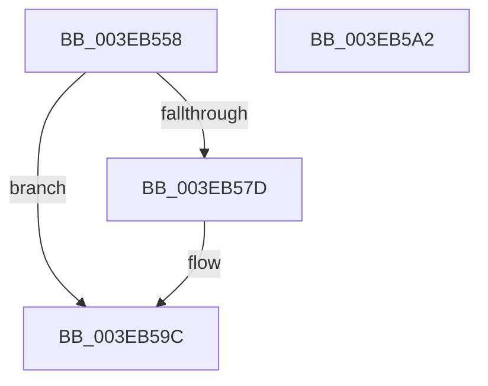

# EtwpResetBufferHeader

- RVA: `0x003EB558`–`0x003EB5A3` (길이 `75` bytes)
- VA: `0x00000001403EB558`
- 실행 섹션: `.text`
- PDB 이름 있음: `예`; PDB Function 태그: `아니요`
- unwind 정보 RVA: `0x0005CF00`
- 디코드: `22`개 명령, `75/75` bytes 표시
- 미해석 바이트: `0` (있으면 어셈블리에 `.byte`로 보존)

> 이 문서는 커널 이미지의 기계어와 PDB 기호를 분석해 생성했습니다. 4번과 5번은 함수 원형과 자료형을 바이너리 사용 방식에서 추정한 C 해석이며 원본 소스 복구 결과는 아닙니다.

## 1. Dependencies

- 직접 호출 지점: **1**; 고유 호출 대상: **1**
- 직접 호출자로 확인된 함수: **6**
- RIP 상대 이미지 참조: **0**

### Outgoing calls
- `0x003EB58E` → [memset](../6C/memset_function_006C6C40.md) (function, `0x006C6C40`)

### Direct callers
- [EtwpDequeueFreeBuffer](EtwpDequeueFreeBuffer_function_003EB1F0.md) at `0x003EB24F`
- [EtwpDequeueFreeBuffer](EtwpDequeueFreeBuffer_function_003EB1F0.md) at `0x003EB372`
- [EtwpPreserveLogger](../../page/7B/EtwpPreserveLogger_function_007BEF4C.md) at `0x007BF04E`
- [EtwpRealtimeUpdateReferenceTime](../../page/7C/EtwpRealtimeUpdateReferenceTime_function_007C0CC0.md) at `0x007C0D01`
- [EtwpRealtimeSendEmptyMarker](../../page/9B/EtwpRealtimeSendEmptyMarker_function_009BF4CC.md) at `0x009BF506`
- [EtwpUpdateFileHeader](../../page/9C/EtwpUpdateFileHeader_function_009C082C.md) at `0x009C08C6`
- [EtwpInitializeProviderInfoBuffer](../../page/AA/EtwpInitializeProviderInfoBuffer_function_00AACE3C.md) at `0x00AACE63`

### Static image references
- 디코드된 RIP-relative 메모리 참조가 없습니다.

## 2. Other-region calls and transfers

- 다른 실행 섹션으로 향하는 call: **0**
- 별도 외부 분기/꼬리 이동을 확인하지 못했습니다.

## 3. Assembly (complete function range)

```asm
003EB558  40 53                           push rbx
003EB55A  48 83 EC 20                     sub rsp, 0x20
003EB55E  83 61 04 00                     and dword ptr [rcx + 4], 0
003EB562  48 8B D9                        mov rbx, rcx
003EB565  48 83 61 20 00                  and qword ptr [rcx + 0x20], 0
003EB56A  66 0F BA 61 34 08               bt word ptr [rcx + 0x34], 8
003EB570  C7 41 08 48 00 00 00            mov dword ptr [rcx + 8], 0x48
003EB577  66 89 51 36                     mov word ptr [rcx + 0x36], dx
003EB57B  73 1F                           jae 0x1403eb59c
003EB57D  8B 41 08                        mov eax, dword ptr [rcx + 8]
003EB580  33 D2                           xor edx, edx
003EB582  44 8B 01                        mov r8d, dword ptr [rcx]
003EB585  8B 49 08                        mov ecx, dword ptr [rcx + 8]
003EB588  44 2B C0                        sub r8d, eax
003EB58B  48 03 CB                        add rcx, rbx
003EB58E  E8 AD B6 2D 00                  call 0x1406c6c40
003EB593  B8 FF FE 00 00                  mov eax, 0xfeff
003EB598  66 21 43 34                     and word ptr [rbx + 0x34], ax
003EB59C  48 83 C4 20                     add rsp, 0x20
003EB5A0  5B                              pop rbx
003EB5A1  C3                              ret
003EB5A2  CC                              int3
```

## 4. C-style interpretation (structured pseudocode)

```c
__int64 __fastcall EtwpResetBufferHeader(__int64 a1, int a2)
{
    __int64 result;
    __int64 v_rsp;

    v_rsp = (v_rsp) - (32);
    *(unsigned int *)(a1 + 8) = 72;
    *(unsigned __int16 *)(a1 + 54) = (unsigned __int16)(a2);
    if (!(condition_is_above_or_equal)) {
        result = *(unsigned int *)(a1 + 8);
        a2 = 0;
        a3 = *(unsigned int *)(a1);
        a1 = *(unsigned int *)(a1 + 8);
        a3 = (unsigned int)((a3) - ((unsigned int)(result)));
        a1 = (a1) + (a1);
        result = memset(a1, a2, a3, a4);
        result = 0xFEFFULL;
    }
    v_rsp = (v_rsp) + (32);
    return result;
}
```

## 5. (Beta) C Style

```c
int64_t EtwpResetBufferHeader(void *Arg1, int32_t Arg2)
{
    uint8_t *arg1 = (uint8_t *)Arg1;

    int64_t result;
    int64_t local_rsp;

    local_rsp = (local_rsp) - (32);
    *(uint32_t *)(arg1 + 0x8) = 72;
    *(uint16_t *)(arg1 + 0x36) = (uint16_t)(Arg2);
    if (!(condition_is_above_or_equal)) {
        result = *(uint32_t *)(arg1 + 0x8);
        Arg2 = 0;
        a3 = *(uint32_t *)(arg1);
        Arg1 = *(uint32_t *)(arg1 + 0x8);
        a3 = (uint32_t)((a3) - ((uint32_t)(result)));
        Arg1 = (Arg1) + (Arg1);
        result = memset(Arg1, Arg2, a3, a4);
        result = 0xFEFFULL;
    }
    local_rsp = (local_rsp) + (32);
    return result;
}
```

### 관측된 메모리 오프셋

구조체 형식이 확인되지 않은 접근은 인자 기준의 오프셋으로만 기록했습니다.

| 기준 인자 | 오프셋 표현 | 폭 (bit) | 접근 |
|---|---:|---:|---|
| `Arg1` | `+ 0x0` | `32` | `R` |
| `Arg1` | `+ 0x4` | `32` | `R/W` |
| `Arg1` | `+ 0x8` | `32` | `R` |
| `Arg1` | `+ 0x8` | `32` | `W` |
| `Arg1` | `+ 0x20` | `64` | `R/W` |
| `Arg1` | `+ 0x34` | `16` | `R` |
| `Arg1` | `+ 0x34` | `16` | `R/W` |
| `Arg1` | `+ 0x36` | `16` | `W` |

## 6. Execution-region graph

[열기: 2D/3D 그래프와 함수 탐색 컨트롤 패널](../../../control-panel.html?section=text&rva=0x003EB558&view=graph)

- 2D 그래프는 위에서 아래로 흐르고, 3D 그래프는 빈 공간을 드래그해 회전합니다. Shift+드래그는 이동, 휠은 확대·축소, 함수 노드 선택은 대상 보고서 이동입니다.

### Static fallback


