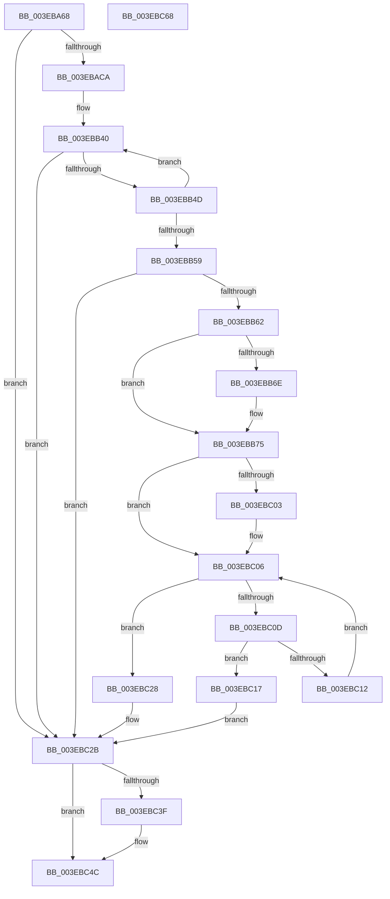

# EtwpUnregisterPartitionPages

- RVA: `0x003EBA68`–`0x003EBC69` (길이 `513` bytes)
- VA: `0x00000001403EBA68`
- 실행 섹션: `.text`
- PDB 이름 있음: `예`; PDB Function 태그: `아니요`
- unwind 정보 RVA: `0x00095AD0`
- 디코드: `139`개 명령, `513/513` bytes 표시
- 미해석 바이트: `0` (있으면 어셈블리에 `.byte`로 보존)

> 이 문서는 커널 이미지의 기계어와 PDB 기호를 분석해 생성했습니다. 4번과 5번은 함수 원형과 자료형을 바이너리 사용 방식에서 추정한 C 해석이며 원본 소스 복구 결과는 아닙니다.

## 1. Dependencies

- 직접 호출 지점: **3**; 고유 호출 대상: **3**
- 직접 호출자로 확인된 함수: **1**
- RIP 상대 이미지 참조: **4**

### Outgoing calls
- `0x003EBA96` → [ExAcquireSpinLockExclusive](../24/ExAcquireSpinLockExclusive_function_00248690.md) (function, `0x00248690`)
- `0x003EBC35` → [ExReleaseSpinLockExclusive](../2C/ExReleaseSpinLockExclusive_function_002C0EF0.md) (function, `0x002C0EF0`)
- `0x003EBC47` → [ExFreePoolWithTag](../../poolcode/B8/ExFreePoolWithTag_function_00B82870.md) (function, `0x00B82870`)

### Direct callers
- [EtwpFreePartitionMemory](EtwpFreePartitionMemory_function_003EBA08.md) at `0x003EBA24`

### Static image references
- `0x003EBA86` → RVA `0x00EFF130` (`.data`; read)
- `0x003EBA9B` → RVA `0x00EFF124` (`.data`; read)
- `0x003EBB35` → RVA `0x00EFF128` (`.data`; read)
- `0x003EBC1D` → RVA `0x00EFF120` (`.data`; read/write)

## 2. Other-region calls and transfers

- 다른 실행 섹션으로 향하는 call: **1**
  - `0x003EBC47` → [ExFreePoolWithTag](../../poolcode/B8/ExFreePoolWithTag_function_00B82870.md) (`.text` → `POOLCODE`)
- 별도 외부 분기/꼬리 이동을 확인하지 못했습니다.

## 3. Assembly (complete function range)

```asm
003EBA68  48 89 5C 24 08                  mov qword ptr [rsp + 8], rbx
003EBA6D  48 89 6C 24 18                  mov qword ptr [rsp + 0x18], rbp
003EBA72  48 89 74 24 20                  mov qword ptr [rsp + 0x20], rsi
003EBA77  57                              push rdi
003EBA78  41 56                           push r14
003EBA7A  41 57                           push r15
003EBA7C  48 83 EC 20                     sub rsp, 0x20
003EBA80  48 8B F1                        mov rsi, rcx
003EBA83  45 33 FF                        xor r15d, r15d
003EBA86  48 8D 0D A3 36 B1 00            lea rcx, [rip + 0xb136a3]
003EBA8D  41 8B EF                        mov ebp, r15d
003EBA90  41 8B FF                        mov edi, r15d
003EBA93  48 8B DA                        mov rbx, rdx
003EBA96  E8 F5 CB E5 FF                  call 0x140248690
003EBA9B  44 8B 15 82 36 B1 00            mov r10d, dword ptr [rip + 0xb13682]
003EBAA2  49 83 CB FF                     or r11, 0xffffffffffffffff
003EBAA6  41 8B CA                        mov ecx, r10d
003EBAA9  44 8A F0                        mov r14b, al
003EBAAC  83 E1 1F                        and ecx, 0x1f
003EBAAF  41 C1 EA 05                     shr r10d, 5
003EBAB3  49 D3 E3                        shl r11, cl
003EBAB6  4D 8B CB                        mov r9, r11
003EBAB9  4C 23 CB                        and r9, rbx
003EBABC  4C 89 4C 24 48                  mov qword ptr [rsp + 0x48], r9
003EBAC1  45 85 D2                        test r10d, r10d
003EBAC4  0F 84 61 01 00 00               je 0x1403ebc2b
003EBACA  41 0F B6 C1                     movzx eax, r9b
003EBACE  BB CB 5D B1 00                  mov ebx, 0xb15dcb
003EBAD3  48 03 C3                        add rax, rbx
003EBAD6  48 6B C8 25                     imul rcx, rax, 0x25
003EBADA  0F B6 44 24 49                  movzx eax, byte ptr [rsp + 0x49]
003EBADF  48 03 C8                        add rcx, rax
003EBAE2  0F B6 44 24 4A                  movzx eax, byte ptr [rsp + 0x4a]
003EBAE7  48 6B D1 25                     imul rdx, rcx, 0x25
003EBAEB  48 03 D0                        add rdx, rax
003EBAEE  0F B6 44 24 4B                  movzx eax, byte ptr [rsp + 0x4b]
003EBAF3  48 6B CA 25                     imul rcx, rdx, 0x25
003EBAF7  48 03 C8                        add rcx, rax
003EBAFA  0F B6 44 24 4C                  movzx eax, byte ptr [rsp + 0x4c]
003EBAFF  48 6B D1 25                     imul rdx, rcx, 0x25
003EBB03  48 03 D0                        add rdx, rax
003EBB06  0F B6 44 24 4D                  movzx eax, byte ptr [rsp + 0x4d]
003EBB0B  48 6B CA 25                     imul rcx, rdx, 0x25
003EBB0F  48 03 C8                        add rcx, rax
003EBB12  0F B6 44 24 4E                  movzx eax, byte ptr [rsp + 0x4e]
003EBB17  48 6B D1 25                     imul rdx, rcx, 0x25
003EBB1B  48 03 D0                        add rdx, rax
003EBB1E  0F B6 44 24 4F                  movzx eax, byte ptr [rsp + 0x4f]
003EBB23  4C 6B C2 25                     imul r8, rdx, 0x25
003EBB27  49 03 C0                        add rax, r8
003EBB2A  41 FF CA                        dec r10d
003EBB2D  8B C0                           mov eax, eax
003EBB2F  41 8B CA                        mov ecx, r10d
003EBB32  48 23 C8                        and rcx, rax
003EBB35  48 8B 05 EC 35 B1 00            mov rax, qword ptr [rip + 0xb135ec]
003EBB3C  4C 8D 04 C8                     lea r8, [rax + rcx*8]
003EBB40  4D 8B 00                        mov r8, qword ptr [r8]
003EBB43  41 F6 C0 01                     test r8b, 1
003EBB47  0F 85 DE 00 00 00               jne 0x1403ebc2b
003EBB4D  49 8B 40 08                     mov rax, qword ptr [r8 + 8]
003EBB51  49 23 C3                        and rax, r11
003EBB54  4C 3B C8                        cmp r9, rax
003EBB57  75 E7                           jne 0x1403ebb40
003EBB59  4D 85 C0                        test r8, r8
003EBB5C  0F 84 C9 00 00 00               je 0x1403ebc2b
003EBB62  49 8B 68 10                     mov rbp, qword ptr [r8 + 0x10]
003EBB66  49 8B F8                        mov rdi, r8
003EBB69  48 85 F6                        test rsi, rsi
003EBB6C  74 07                           je 0x1403ebb75
003EBB6E  49 8B 40 18                     mov rax, qword ptr [r8 + 0x18]
003EBB72  48 89 06                        mov qword ptr [rsi], rax
003EBB75  49 8B 40 08                     mov rax, qword ptr [r8 + 8]
003EBB79  49 23 C3                        and rax, r11
003EBB7C  48 89 44 24 48                  mov qword ptr [rsp + 0x48], rax
003EBB81  0F B6 C0                        movzx eax, al
003EBB84  48 03 C3                        add rax, rbx
003EBB87  48 6B C8 25                     imul rcx, rax, 0x25
003EBB8B  0F B6 44 24 49                  movzx eax, byte ptr [rsp + 0x49]
003EBB90  48 03 C8                        add rcx, rax
003EBB93  0F B6 44 24 4A                  movzx eax, byte ptr [rsp + 0x4a]
003EBB98  48 6B D1 25                     imul rdx, rcx, 0x25
003EBB9C  48 03 D0                        add rdx, rax
003EBB9F  0F B6 44 24 4B                  movzx eax, byte ptr [rsp + 0x4b]
003EBBA4  48 6B CA 25                     imul rcx, rdx, 0x25
003EBBA8  48 03 C8                        add rcx, rax
003EBBAB  0F B6 44 24 4C                  movzx eax, byte ptr [rsp + 0x4c]
003EBBB0  48 6B D1 25                     imul rdx, rcx, 0x25
003EBBB4  48 03 D0                        add rdx, rax
003EBBB7  0F B6 44 24 4D                  movzx eax, byte ptr [rsp + 0x4d]
003EBBBC  48 6B CA 25                     imul rcx, rdx, 0x25
003EBBC0  48 03 C8                        add rcx, rax
003EBBC3  0F B6 44 24 4E                  movzx eax, byte ptr [rsp + 0x4e]
003EBBC8  48 6B D1 25                     imul rdx, rcx, 0x25
003EBBCC  48 03 D0                        add rdx, rax
003EBBCF  0F B6 44 24 4F                  movzx eax, byte ptr [rsp + 0x4f]
003EBBD4  48 6B D2 25                     imul rdx, rdx, 0x25
003EBBD8  48 03 D0                        add rdx, rax
003EBBDB  41 8B C2                        mov eax, r10d
003EBBDE  8B D2                           mov edx, edx
003EBBE0  48 23 D0                        and rdx, rax
003EBBE3  48 8B 05 3E 35 B1 00            mov rax, qword ptr [rip + 0xb1353e]
003EBBEA  48 8D 0C D0                     lea rcx, [rax + rdx*8]
003EBBEE  49 8B 00                        mov rax, qword ptr [r8]
003EBBF1  48 BA 02 00 00 00 00 00 00 80   movabs rdx, 0x8000000000000002
003EBBFB  48 23 C2                        and rax, rdx
003EBBFE  48 3B C2                        cmp rax, rdx
003EBC01  75 03                           jne 0x1403ebc06
003EBC03  49 8B 07                        mov rax, qword ptr [r15]
003EBC06  48 8B 01                        mov rax, qword ptr [rcx]
003EBC09  A8 01                           test al, 1
003EBC0B  75 1B                           jne 0x1403ebc28
003EBC0D  49 3B C0                        cmp rax, r8
003EBC10  74 05                           je 0x1403ebc17
003EBC12  48 8B C8                        mov rcx, rax
003EBC15  EB EF                           jmp 0x1403ebc06
003EBC17  49 8B 00                        mov rax, qword ptr [r8]
003EBC1A  48 89 01                        mov qword ptr [rcx], rax
003EBC1D  FF 0D FD 34 B1 00               dec dword ptr [rip + 0xb134fd]
003EBC23  49 09 10                        or qword ptr [r8], rdx
003EBC26  EB 03                           jmp 0x1403ebc2b
003EBC28  49 8B 17                        mov rdx, qword ptr [r15]
003EBC2B  41 8A D6                        mov dl, r14b
003EBC2E  48 8D 0D FB 34 B1 00            lea rcx, [rip + 0xb134fb]
003EBC35  E8 B6 52 ED FF                  call 0x1402c0ef0
003EBC3A  48 85 FF                        test rdi, rdi
003EBC3D  74 0D                           je 0x1403ebc4c
003EBC3F  BA 45 74 77 4F                  mov edx, 0x4f777445
003EBC44  48 8B CF                        mov rcx, rdi
003EBC47  E8 24 6C 79 00                  call 0x140b82870
003EBC4C  48 8B 5C 24 40                  mov rbx, qword ptr [rsp + 0x40]
003EBC51  48 8B C5                        mov rax, rbp
003EBC54  48 8B 6C 24 50                  mov rbp, qword ptr [rsp + 0x50]
003EBC59  48 8B 74 24 58                  mov rsi, qword ptr [rsp + 0x58]
003EBC5E  48 83 C4 20                     add rsp, 0x20
003EBC62  41 5F                           pop r15
003EBC64  41 5E                           pop r14
003EBC66  5F                              pop rdi
003EBC67  C3                              ret
003EBC68  CC                              int3
```

## 4. C-style interpretation (structured pseudocode)

```c
__int64 __fastcall EtwpUnregisterPartitionPages(__int64 a1, __int64 a2)
{
    __int64 result;
    __int64 v_r10;
    __int64 v_r11;
    __int64 v_r15;
    __int64 v_rsp;
    unsigned __int64 v_stack_p10;
    unsigned __int8 v_stack_p11;
    unsigned __int8 v_stack_p12;
    unsigned __int8 v_stack_p13;
    unsigned __int8 v_stack_p14;
    unsigned __int8 v_stack_p15;
    unsigned __int8 v_stack_p16;
    unsigned __int8 v_stack_p17;
    unsigned __int64 v_stack_p18;
    unsigned __int64 v_stack_p20;
    unsigned __int64 v_stack_p8;

    v_stack_p8 = v_rbx;
    v_stack_p18 = v_rbp;
    v_stack_p20 = v_rsi;
    v_rsp = (v_rsp) - (32);
    v_r15 = 0;
    result = ExAcquireSpinLockExclusive(v_rip + 11613859, a2, a3, a4);
    v_r11 = (v_r11) | (-1);
    a1 = (unsigned int)(((unsigned int)((unsigned int)((unsigned int)(*(unsigned int *)(v_rip + 11613826))))) & (31));
    v_r10 = (unsigned int)(((unsigned int)(*(unsigned int *)(v_rip + 11613826))) >> (5));
    v_r11 = (v_r11) << ((unsigned __int8)(a1));
    a4 = (v_r11) & (a2);
    v_stack_p10 = a4;
    if ((unsigned int)(v_r10) == 0) goto loc_003EBC2B;
    result = ((unsigned __int8)(a4)) + ((unsigned int)(0xB15DCBULL));
    a1 = (a1) * (result);
    a1 = (a1) + (v_stack_p11);
    a2 = (a2) * (a1);
    a2 = (a2) + (v_stack_p12);
    a1 = (a1) * (a2);
    a1 = (a1) + (v_stack_p13);
    a2 = (a2) * (a1);
    a2 = (a2) + (v_stack_p14);
    a1 = (a1) * (a2);
    a1 = (a1) + (v_stack_p15);
    a2 = (a2) * (a1);
    a2 = (a2) + (v_stack_p16);
    a3 = (a3) * (a2);
    result = (v_stack_p17) + (a3);
    v_r10 = (unsigned int)((v_r10) - 1);
    a1 = ((unsigned int)((unsigned int)(v_r10))) & ((unsigned int)((unsigned int)(result)));
loc_003EBB40:
    if ((((unsigned __int8)(*(unsigned __int64 *)(*(unsigned __int64 *)(v_rip + 11613676) + a1 * 8))) & (1)) != 0) goto loc_003EBC2B;
    result = (*(unsigned __int64 *)(*(unsigned __int64 *)(*(unsigned __int64 *)(v_rip + 11613676) + a1 * 8) + 8)) & (v_r11);
    if (a4 != result) goto loc_003EBB40;
    if (*(unsigned __int64 *)(*(unsigned __int64 *)(v_rip + 11613676) + a1 * 8) == 0) goto loc_003EBC2B;
    if (a1 != 0) {
        result = *(unsigned __int64 *)(*(unsigned __int64 *)(*(unsigned __int64 *)(v_rip + 11613676) + a1 * 8) + 24);
        *(unsigned __int64 *)(a1) = result;
    }
    result = (*(unsigned __int64 *)(*(unsigned __int64 *)(*(unsigned __int64 *)(v_rip + 11613676) + a1 * 8) + 8)) & (v_r11);
    v_stack_p10 = result;
    result = ((unsigned __int8)(result)) + ((unsigned int)(0xB15DCBULL));
    a1 = (a1) * (result);
    a1 = (a1) + (v_stack_p11);
    a2 = (a2) * (a1);
    a2 = (a2) + (v_stack_p12);
    a1 = (a1) * (a2);
    a1 = (a1) + (v_stack_p13);
    a2 = (a2) * (a1);
    a2 = (a2) + (v_stack_p14);
    a1 = (a1) * (a2);
    a1 = (a1) + (v_stack_p15);
    a2 = (a2) * (a1);
    a2 = (a2) + (v_stack_p16);
    a2 = (a2) * (a2);
    a2 = (a2) + (v_stack_p17);
    a2 = ((unsigned int)((unsigned int)(a2))) & ((unsigned int)((unsigned int)(v_r10)));
    result = (*(unsigned __int64 *)(*(unsigned __int64 *)(*(unsigned __int64 *)(v_rip + 11613676) + a1 * 8))) & (a2);
    if (result == a2) {
        result = *(unsigned __int64 *)(v_r15);
    }
    if ((((unsigned __int8)(*(unsigned __int64 *)(*(unsigned __int64 *)(v_rip + 11613502) + a2 * 8))) & (1)) != 0) goto loc_003EBC28;
    if ((*(unsigned __int64 *)(*(unsigned __int64 *)(v_rip + 11613502) + a2 * 8)) == (*(unsigned __int64 *)(*(unsigned __int64 *)(v_rip + 11613676) + a1 * 8))) goto loc_003EBC17;
    goto loc_003EBC06;
loc_003EBC17:
    *(unsigned __int64 *)(*(unsigned __int64 *)(*(unsigned __int64 *)(v_rip + 11613502) + a2 * 8)) = *(unsigned __int64 *)(*(unsigned __int64 *)(*(unsigned __int64 *)(v_rip + 11613676) + a1 * 8));
    goto loc_003EBC2B;
loc_003EBC28:
loc_003EBC2B:
    result = ExReleaseSpinLockExclusive(v_rip + 11613435, (unsigned __int8)((unsigned __int8)(result)), *(unsigned __int64 *)(*(unsigned __int64 *)(v_rip + 11613676) + a1 * 8), a4);
    if (*(unsigned __int64 *)(*(unsigned __int64 *)(v_rip + 11613676) + a1 * 8) != 0) {
        a2 = 0x4F777445ULL;
        a1 = *(unsigned __int64 *)(*(unsigned __int64 *)(v_rip + 11613676) + a1 * 8);
        result = ExFreePoolWithTag(a1, a2, *(unsigned __int64 *)(*(unsigned __int64 *)(v_rip + 11613676) + a1 * 8), a4);
    }
    v_rsp = (v_rsp) + (32);
    return *(unsigned __int64 *)(*(unsigned __int64 *)(*(unsigned __int64 *)(v_rip + 11613676) + a1 * 8) + 16);
}
```

## 5. (Beta) C Style

```c
int64_t EtwpUnregisterPartitionPages(int64_t Arg1, int64_t Arg2)
{
    int64_t result;
    int64_t local_r10;
    int64_t local_r11;
    int64_t local_r15;
    int64_t local_rsp;
    uint64_t v_stack_p10;
    uint8_t v_stack_p11;
    uint8_t v_stack_p12;
    uint8_t v_stack_p13;
    uint8_t v_stack_p14;
    uint8_t v_stack_p15;
    uint8_t v_stack_p16;
    uint8_t v_stack_p17;
    uint64_t v_stack_p18;
    uint64_t v_stack_p20;
    uint64_t v_stack_p8;

    v_stack_p8 = local_rbx;
    v_stack_p18 = local_rbp;
    v_stack_p20 = local_rsi;
    local_rsp = (local_rsp) - (32);
    local_r15 = 0;
    result = ExAcquireSpinLockExclusive(v_rip + 11613859, Arg2, a3, a4);
    local_r11 = (local_r11) | (-1);
    Arg1 = (uint32_t)(((uint32_t)((uint32_t)((uint32_t)(*(uint32_t *)(v_rip + 0xB13682))))) & (31));
    local_r10 = (uint32_t)(((uint32_t)(*(uint32_t *)(v_rip + 0xB13682))) >> (5));
    local_r11 = (local_r11) << ((uint8_t)(Arg1));
    a4 = (local_r11) & (Arg2);
    v_stack_p10 = a4;
    if ((uint32_t)(local_r10) == 0) goto loc_003EBC2B;
    result = ((uint8_t)(a4)) + ((uint32_t)(0xB15DCBULL));
    Arg1 = (Arg1) * (result);
    Arg1 = (Arg1) + (v_stack_p11);
    Arg2 = (Arg2) * (Arg1);
    Arg2 = (Arg2) + (v_stack_p12);
    Arg1 = (Arg1) * (Arg2);
    Arg1 = (Arg1) + (v_stack_p13);
    Arg2 = (Arg2) * (Arg1);
    Arg2 = (Arg2) + (v_stack_p14);
    Arg1 = (Arg1) * (Arg2);
    Arg1 = (Arg1) + (v_stack_p15);
    Arg2 = (Arg2) * (Arg1);
    Arg2 = (Arg2) + (v_stack_p16);
    a3 = (a3) * (Arg2);
    result = (v_stack_p17) + (a3);
    local_r10 = (uint32_t)((local_r10) - 1);
    Arg1 = ((uint32_t)((uint32_t)(local_r10))) & ((uint32_t)((uint32_t)(result)));
loc_003EBB40:
    if ((((uint8_t)(*(uint64_t *)(*(uint64_t *)(v_rip + 0xB135EC) + Arg1 * 8))) & (1)) != 0) goto loc_003EBC2B;
    result = (*(uint64_t *)(*(uint64_t *)(*(uint64_t *)(v_rip + 0xB135EC) + Arg1 * 8) + 0x8)) & (local_r11);
    if (a4 != result) goto loc_003EBB40;
    if (*(uint64_t *)(*(uint64_t *)(v_rip + 0xB135EC) + Arg1 * 8) == 0) goto loc_003EBC2B;
    if (Arg1 != 0) {
        result = *(uint64_t *)(*(uint64_t *)(*(uint64_t *)(v_rip + 0xB135EC) + Arg1 * 8) + 0x18);
        *(uint64_t *)(Arg1) = result;
    }
    result = (*(uint64_t *)(*(uint64_t *)(*(uint64_t *)(v_rip + 0xB135EC) + Arg1 * 8) + 0x8)) & (local_r11);
    v_stack_p10 = result;
    result = ((uint8_t)(result)) + ((uint32_t)(0xB15DCBULL));
    Arg1 = (Arg1) * (result);
    Arg1 = (Arg1) + (v_stack_p11);
    Arg2 = (Arg2) * (Arg1);
    Arg2 = (Arg2) + (v_stack_p12);
    Arg1 = (Arg1) * (Arg2);
    Arg1 = (Arg1) + (v_stack_p13);
    Arg2 = (Arg2) * (Arg1);
    Arg2 = (Arg2) + (v_stack_p14);
    Arg1 = (Arg1) * (Arg2);
    Arg1 = (Arg1) + (v_stack_p15);
    Arg2 = (Arg2) * (Arg1);
    Arg2 = (Arg2) + (v_stack_p16);
    Arg2 = (Arg2) * (Arg2);
    Arg2 = (Arg2) + (v_stack_p17);
    Arg2 = ((uint32_t)((uint32_t)(Arg2))) & ((uint32_t)((uint32_t)(local_r10)));
    result = (*(uint64_t *)(*(uint64_t *)(*(uint64_t *)(v_rip + 0xB135EC) + Arg1 * 8))) & (Arg2);
    if (result == Arg2) {
        result = *(uint64_t *)(local_r15);
    }
    if ((((uint8_t)(*(uint64_t *)(*(uint64_t *)(v_rip + 0xB1353E) + Arg2 * 8))) & (1)) != 0) goto loc_003EBC28;
    if ((*(uint64_t *)(*(uint64_t *)(v_rip + 0xB1353E) + Arg2 * 8)) == (*(uint64_t *)(*(uint64_t *)(v_rip + 0xB135EC) + Arg1 * 8))) goto loc_003EBC17;
    goto loc_003EBC06;
loc_003EBC17:
    *(uint64_t *)(*(uint64_t *)(*(uint64_t *)(v_rip + 0xB1353E) + Arg2 * 8)) = *(uint64_t *)(*(uint64_t *)(*(uint64_t *)(v_rip + 0xB135EC) + Arg1 * 8));
    goto loc_003EBC2B;
loc_003EBC28:
loc_003EBC2B:
    result = ExReleaseSpinLockExclusive(v_rip + 11613435, (uint8_t)((uint8_t)(result)), *(uint64_t *)(*(uint64_t *)(v_rip + 0xB135EC) + Arg1 * 8), a4);
    if (*(uint64_t *)(*(uint64_t *)(v_rip + 0xB135EC) + Arg1 * 8) != 0) {
        Arg2 = 0x4F777445ULL;
        Arg1 = *(uint64_t *)(*(uint64_t *)(v_rip + 0xB135EC) + Arg1 * 8);
        result = ExFreePoolWithTag(Arg1, Arg2, *(uint64_t *)(*(uint64_t *)(v_rip + 0xB135EC) + Arg1 * 8), a4);
    }
    local_rsp = (local_rsp) + (32);
    return *(uint64_t *)(*(uint64_t *)(*(uint64_t *)(v_rip + 0xB135EC) + Arg1 * 8) + 0x10);
}
```

## 6. Execution-region graph

[열기: 2D/3D 그래프와 함수 탐색 컨트롤 패널](../../../control-panel.html?section=text&rva=0x003EBA68&view=graph)

- 2D 그래프는 위에서 아래로 흐르고, 3D 그래프는 빈 공간을 드래그해 회전합니다. Shift+드래그는 이동, 휠은 확대·축소, 함수 노드 선택은 대상 보고서 이동입니다.

### Static fallback


