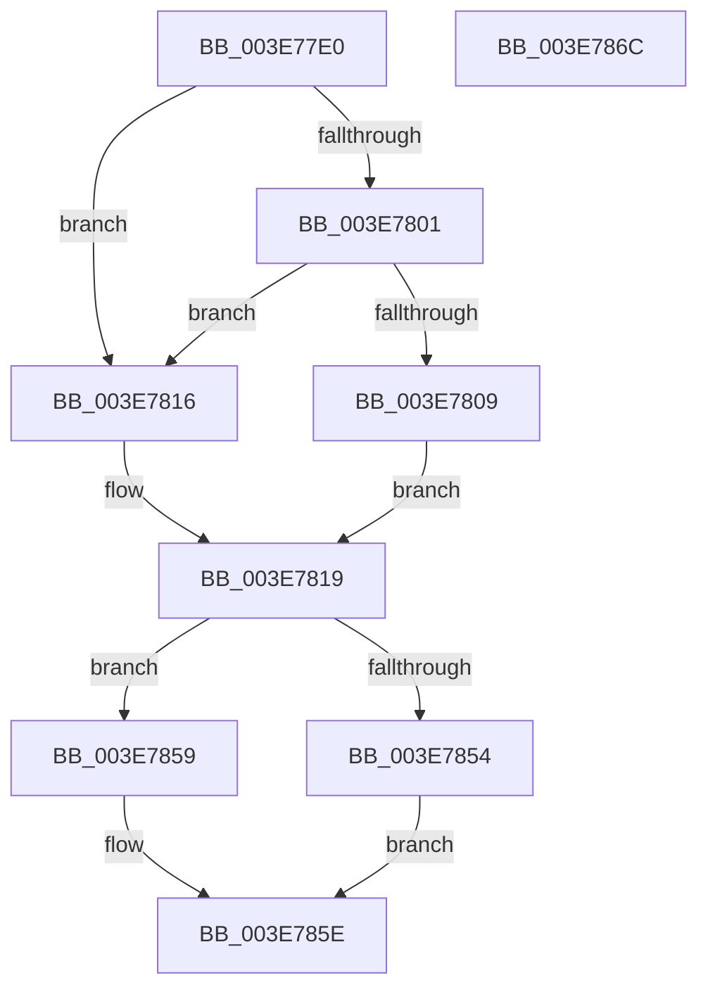

# HalAllocateCommonBufferDmarThinEx

- RVA: `0x003E77E0`–`0x003E786D` (길이 `141` bytes)
- VA: `0x00000001403E77E0`
- 실행 섹션: `.text`
- PDB 이름 있음: `예`; PDB Function 태그: `아니요`
- unwind 정보 RVA: `0x000956E8`
- 디코드: `39`개 명령, `141/141` bytes 표시
- 미해석 바이트: `0` (있으면 어셈블리에 `.byte`로 보존)

> 이 문서는 커널 이미지의 기계어와 PDB 기호를 분석해 생성했습니다. 4번과 5번은 함수 원형과 자료형을 바이너리 사용 방식에서 추정한 C 해석이며 원본 소스 복구 결과는 아닙니다.

## 1. Dependencies

- 직접 호출 지점: **1**; 고유 호출 대상: **1**
- 직접 호출자로 확인된 함수: **1**
- RIP 상대 이미지 참조: **0**

### Outgoing calls
- `0x003E784B` → [HalpAllocateCommonBufferDmarThin](HalpAllocateCommonBufferDmarThin_function_003E8FF0.md) (function, `0x003E8FF0`)

### Direct callers
- [HalAllocateCommonBufferDmarThin](HalAllocateCommonBufferDmarThin_function_003E77B0.md) at `0x003E77C9`

### Static image references
- 디코드된 RIP-relative 메모리 참조가 없습니다.

## 2. Other-region calls and transfers

- 다른 실행 섹션으로 향하는 call: **0**
- 별도 외부 분기/꼬리 이동을 확인하지 못했습니다.

## 3. Assembly (complete function range)

```asm
003E77E0  48 8B C4                        mov rax, rsp
003E77E3  48 89 58 10                     mov qword ptr [rax + 0x10], rbx
003E77E7  57                              push rdi
003E77E8  48 83 EC 60                     sub rsp, 0x60
003E77EC  33 DB                           xor ebx, ebx
003E77EE  49 8B F9                        mov rdi, r9
003E77F1  89 58 08                        mov dword ptr [rax + 8], ebx
003E77F4  48 89 58 E8                     mov qword ptr [rax - 0x18], rbx
003E77F8  38 9C 24 90 00 00 00            cmp byte ptr [rsp + 0x90], bl
003E77FF  74 15                           je 0x1403e7816
003E7801  38 99 BD 01 00 00               cmp byte ptr [rcx + 0x1bd], bl
003E7807  74 0D                           je 0x1403e7816
003E7809  C7 40 08 01 00 00 00            mov dword ptr [rax + 8], 1
003E7810  4C 8D 48 08                     lea r9, [rax + 8]
003E7814  EB 03                           jmp 0x1403e7819
003E7816  4C 8B CB                        mov r9, rbx
003E7819  48 8B 89 00 02 00 00            mov rcx, qword ptr [rcx + 0x200]
003E7820  48 8D 44 24 50                  lea rax, [rsp + 0x50]
003E7825  48 89 44 24 40                  mov qword ptr [rsp + 0x40], rax
003E782A  8B 84 24 98 00 00 00            mov eax, dword ptr [rsp + 0x98]
003E7831  48 89 7C 24 38                  mov qword ptr [rsp + 0x38], rdi
003E7836  89 44 24 30                     mov dword ptr [rsp + 0x30], eax
003E783A  4C 89 4C 24 28                  mov qword ptr [rsp + 0x28], r9
003E783F  45 8B C8                        mov r9d, r8d
003E7842  4C 8B C2                        mov r8, rdx
003E7845  89 5C 24 20                     mov dword ptr [rsp + 0x20], ebx
003E7849  33 D2                           xor edx, edx
003E784B  E8 A0 17 00 00                  call 0x1403e8ff0
003E7850  85 C0                           test eax, eax
003E7852  79 05                           jns 0x1403e7859
003E7854  48 89 1F                        mov qword ptr [rdi], rbx
003E7857  EB 05                           jmp 0x1403e785e
003E7859  48 8B 5C 24 50                  mov rbx, qword ptr [rsp + 0x50]
003E785E  48 8B C3                        mov rax, rbx
003E7861  48 8B 5C 24 78                  mov rbx, qword ptr [rsp + 0x78]
003E7866  48 83 C4 60                     add rsp, 0x60
003E786A  5F                              pop rdi
003E786B  C3                              ret
003E786C  CC                              int3
```

## 4. C-style interpretation (structured pseudocode)

```c
__int64 __fastcall HalAllocateCommonBufferDmarThinEx(__int64 a1, __int64 a2, int a3, __int64 a4, unsigned __int8 a5, unsigned int a6)
{
    __int64 result;
    __int64 v_rbx;
    __int64 v_rsp;
    unsigned __int64 v_stack_m18;
    unsigned __int64 v_stack_m28;
    unsigned __int64 v_stack_m30;
    unsigned int v_stack_m38;
    unsigned __int64 v_stack_m40;
    unsigned int v_stack_m48;
    unsigned __int64 v_stack_p10;

    *(unsigned __int64 *)(v_rsp + 16) = v_rbx;
    v_rsp = (v_rsp) - (96);
    v_rbx = 0;
    *(unsigned int *)(v_rsp + 8) = 0;
    *(unsigned __int64 *)(v_rsp - 24) = 0;
    if (a5 == 0) goto loc_003E7816;
    if ((*(unsigned __int8 *)(a1 + 445)) == 0) goto loc_003E7816;
    *(unsigned int *)(v_rsp + 8) = 1;
    goto loc_003E7819;
loc_003E7816:
loc_003E7819:
    v_stack_m28 = v_stack_m18;
    v_stack_m30 = a4;
    v_stack_m38 = (unsigned int)((unsigned int)(a6));
    v_stack_m40 = 0;
    v_stack_m48 = 0;
    a2 = 0;
    result = HalpAllocateCommonBufferDmarThin(*(unsigned __int64 *)(a1 + 512), a2, a2, (unsigned int)(a3));
    if (!sign_flag) goto loc_003E7859;
    *(unsigned __int64 *)(a4) = 0;
    goto loc_003E785E;
loc_003E7859:
loc_003E785E:
    v_rsp = (v_rsp) + (96);
    return v_stack_m18;
}
```

## 5. (Beta) C Style

```c
int64_t HalAllocateCommonBufferDmarThinEx(void *Arg1, int64_t Arg2, int32_t Arg3, void *Arg4, uint8_t Arg5, uint32_t Arg6)
{
    uint8_t *arg1 = (uint8_t *)Arg1;
    uint8_t *arg4 = (uint8_t *)Arg4;

    int64_t result;
    int64_t local_rbx;
    int64_t local_rsp;
    uint64_t v_stack_m18;
    uint64_t v_stack_m28;
    uint64_t v_stack_m30;
    uint32_t v_stack_m38;
    uint64_t v_stack_m40;
    uint32_t v_stack_m48;
    uint64_t v_stack_p10;

    *(uint64_t *)(local_rsp + 0x10) = local_rbx;
    local_rsp = (local_rsp) - (96);
    local_rbx = 0;
    *(uint32_t *)(local_rsp + 0x8) = 0;
    *(uint64_t *)(local_rsp - 0x18) = 0;
    if (Arg5 == 0) goto loc_003E7816;
    if ((*(uint8_t *)(arg1 + 0x1BD)) == 0) goto loc_003E7816;
    *(uint32_t *)(local_rsp + 0x8) = 1;
    goto loc_003E7819;
loc_003E7816:
loc_003E7819:
    v_stack_m28 = v_stack_m18;
    v_stack_m30 = Arg4;
    v_stack_m38 = (uint32_t)((uint32_t)(Arg6));
    v_stack_m40 = 0;
    v_stack_m48 = 0;
    Arg2 = 0;
    result = HalpAllocateCommonBufferDmarThin(*(uint64_t *)(arg1 + 0x200), Arg2, Arg2, (uint32_t)(Arg3));
    if (!sign_flag) goto loc_003E7859;
    *(uint64_t *)(arg4) = 0;
    goto loc_003E785E;
loc_003E7859:
loc_003E785E:
    local_rsp = (local_rsp) + (96);
    return v_stack_m18;
}
```

### 관측된 메모리 오프셋

구조체 형식이 확인되지 않은 접근은 인자 기준의 오프셋으로만 기록했습니다.

| 기준 인자 | 오프셋 표현 | 폭 (bit) | 접근 |
|---|---:|---:|---|
| `Arg1` | `+ 0x1BD` | `8` | `R` |
| `Arg1` | `+ 0x200` | `64` | `R` |
| `Arg4` | `+ 0x0` | `64` | `W` |

## 6. Execution-region graph

[열기: 2D/3D 그래프와 함수 탐색 컨트롤 패널](../../../control-panel.html?section=text&rva=0x003E77E0&view=graph)

- 2D 그래프는 위에서 아래로 흐르고, 3D 그래프는 빈 공간을 드래그해 회전합니다. Shift+드래그는 이동, 휠은 확대·축소, 함수 노드 선택은 대상 보고서 이동입니다.

### Static fallback


