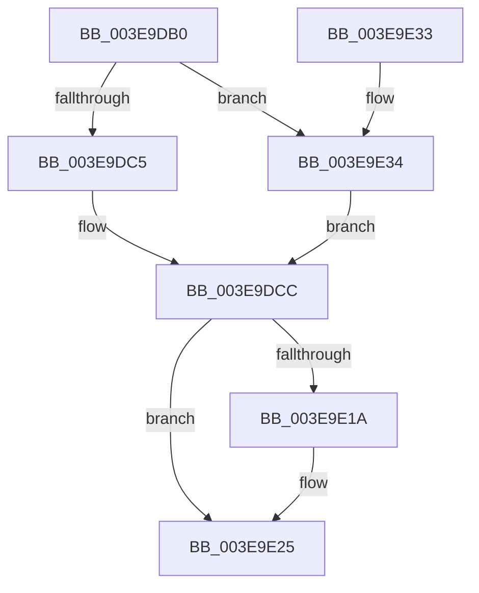

# HalAllocateCommonBufferExV2

- RVA: `0x003E9DB0`–`0x003E9E39` (길이 `137` bytes)
- VA: `0x00000001403E9DB0`
- 실행 섹션: `.text`
- PDB 이름 있음: `예`; PDB Function 태그: `아니요`
- unwind 정보 RVA: `0x00087858`
- 디코드: `39`개 명령, `137/137` bytes 표시
- 미해석 바이트: `0` (있으면 어셈블리에 `.byte`로 보존)

> 이 문서는 커널 이미지의 기계어와 PDB 기호를 분석해 생성했습니다. 4번과 5번은 함수 원형과 자료형을 바이너리 사용 방식에서 추정한 C 해석이며 원본 소스 복구 결과는 아닙니다.

## 1. Dependencies

- 직접 호출 지점: **2**; 고유 호출 대상: **2**
- 직접 호출자로 확인된 함수: **1**
- RIP 상대 이미지 참조: **0**

### Outgoing calls
- `0x003E9E0D` → [MmAllocateContiguousNodeMemory](MmAllocateContiguousNodeMemory_function_003E9E40.md) (function, `0x003E9E40`)
- `0x003E9E1D` → [MmGetPhysicalAddress](../23/MmGetPhysicalAddress_function_0023A500.md) (function, `0x0023A500`)

### Direct callers
- [HalAllocateCommonBufferV2](HalAllocateCommonBufferV2_function_003E9D80.md) at `0x003E9D99`

### Static image references
- 디코드된 RIP-relative 메모리 참조가 없습니다.

## 2. Other-region calls and transfers

- 다른 실행 섹션으로 향하는 call: **0**
- 별도 외부 분기/꼬리 이동을 확인하지 못했습니다.

## 3. Assembly (complete function range)

```asm
003E9DB0  48 89 5C 24 08                  mov qword ptr [rsp + 8], rbx
003E9DB5  57                              push rdi
003E9DB6  48 83 EC 30                     sub rsp, 0x30
003E9DBA  45 8B D0                        mov r10d, r8d
003E9DBD  49 8B F9                        mov rdi, r9
003E9DC0  48 85 D2                        test rdx, rdx
003E9DC3  75 6F                           jne 0x1403e9e34
003E9DC5  4C 8B 81 90 00 00 00            mov r8, qword ptr [rcx + 0x90]
003E9DCC  8A 81 BD 01 00 00               mov al, byte ptr [rcx + 0x1bd]
003E9DD2  F6 D8                           neg al
003E9DD4  8A 81 99 00 00 00               mov al, byte ptr [rcx + 0x99]
003E9DDA  49 8B CA                        mov rcx, r10
003E9DDD  1B D2                           sbb edx, edx
003E9DDF  81 E2 00 FE FF FF               and edx, 0xfffffe00
003E9DE5  81 C2 04 02 00 00               add edx, 0x204
003E9DEB  F6 D8                           neg al
003E9DED  B8 00 00 FF FF                  mov eax, 0xffff0000
003E9DF2  4D 1B C9                        sbb r9, r9
003E9DF5  4C 23 C8                        and r9, rax
003E9DF8  8B 44 24 68                     mov eax, dword ptr [rsp + 0x68]
003E9DFC  89 44 24 28                     mov dword ptr [rsp + 0x28], eax
003E9E00  49 81 C1 00 00 01 00            add r9, 0x10000
003E9E07  89 54 24 20                     mov dword ptr [rsp + 0x20], edx
003E9E0B  33 D2                           xor edx, edx
003E9E0D  E8 2E 00 00 00                  call 0x1403e9e40
003E9E12  48 8B D8                        mov rbx, rax
003E9E15  48 85 C0                        test rax, rax
003E9E18  74 0B                           je 0x1403e9e25
003E9E1A  48 8B C8                        mov rcx, rax
003E9E1D  E8 DE 06 E5 FF                  call 0x14023a500
003E9E22  48 89 07                        mov qword ptr [rdi], rax
003E9E25  48 8B C3                        mov rax, rbx
003E9E28  48 8B 5C 24 40                  mov rbx, qword ptr [rsp + 0x40]
003E9E2D  48 83 C4 30                     add rsp, 0x30
003E9E31  5F                              pop rdi
003E9E32  C3                              ret
003E9E33  CC                              int3
003E9E34  4C 8B 02                        mov r8, qword ptr [rdx]
003E9E37  EB 93                           jmp 0x1403e9dcc
```

## 4. C-style interpretation (structured pseudocode)

```c
__int64 __fastcall HalAllocateCommonBufferExV2(__int64 a1, __int64 a2, int a3, __int64 a4, __int64 a5, unsigned int a6)
{
    __int64 result;
    __int64 v_rsp;
    unsigned int v_stack_m10;
    unsigned int v_stack_m18;
    unsigned __int64 v_stack_p8;

    v_stack_p8 = v_rbx;
    v_rsp = (v_rsp) - (48);
    if (a2 != 0) goto loc_003E9E34;
loc_003E9DCC:
    result = (unsigned __int8)(-(*(unsigned __int8 *)(a1 + 445)));
    a2 = (unsigned int)((a2) & (0xFFFFFE00ULL));
    a2 = (unsigned int)((a2) + (516));
    result = (unsigned __int8)(-(*(unsigned __int8 *)(a1 + 153)));
    a4 = (a4) & ((unsigned int)(0xFFFF0000ULL));
    v_stack_m10 = (unsigned int)((unsigned int)(a6));
    a4 = (a4) + (0x10000ULL);
    v_stack_m18 = (unsigned int)(a2);
    a2 = 0;
    result = MmAllocateContiguousNodeMemory((unsigned int)(a3), a2, *(unsigned __int64 *)(a1 + 144), a4);
    if (result != 0) {
        a1 = result;
        result = MmGetPhysicalAddress(a1, a2, *(unsigned __int64 *)(a1 + 144), a4);
        *(unsigned __int64 *)(a4) = result;
    }
    v_rsp = (v_rsp) + (48);
    return result;
loc_003E9E34:
    goto loc_003E9DCC;
}
```

## 5. (Beta) C Style

```c
int64_t HalAllocateCommonBufferExV2(void *Arg1, int64_t Arg2, int32_t Arg3, void *Arg4, uint64_t Arg5, uint32_t Arg6)
{
    uint8_t *arg1 = (uint8_t *)Arg1;
    uint8_t *arg4 = (uint8_t *)Arg4;

    int64_t result;
    int64_t local_rsp;
    uint32_t v_stack_m10;
    uint32_t v_stack_m18;
    uint64_t v_stack_p8;

    v_stack_p8 = local_rbx;
    local_rsp = (local_rsp) - (48);
    if (Arg2 != 0) goto loc_003E9E34;
loc_003E9DCC:
    result = (uint8_t)(-(*(uint8_t *)(arg1 + 0x1BD)));
    Arg2 = (uint32_t)((Arg2) & (0xFFFFFE00ULL));
    Arg2 = (uint32_t)((Arg2) + (516));
    result = (uint8_t)(-(*(uint8_t *)(arg1 + 0x99)));
    Arg4 = (Arg4) & ((uint32_t)(0xFFFF0000ULL));
    v_stack_m10 = (uint32_t)((uint32_t)(Arg6));
    Arg4 = (Arg4) + (0x10000ULL);
    v_stack_m18 = (uint32_t)(Arg2);
    Arg2 = 0;
    result = MmAllocateContiguousNodeMemory((uint32_t)(Arg3), Arg2, *(uint64_t *)(arg1 + 0x90), Arg4);
    if (result != 0) {
        Arg1 = result;
        result = MmGetPhysicalAddress(Arg1, Arg2, *(uint64_t *)(arg1 + 0x90), Arg4);
        *(uint64_t *)(arg4) = result;
    }
    local_rsp = (local_rsp) + (48);
    return result;
loc_003E9E34:
    goto loc_003E9DCC;
}
```

### 관측된 메모리 오프셋

구조체 형식이 확인되지 않은 접근은 인자 기준의 오프셋으로만 기록했습니다.

| 기준 인자 | 오프셋 표현 | 폭 (bit) | 접근 |
|---|---:|---:|---|
| `Arg1` | `+ 0x90` | `64` | `R` |
| `Arg1` | `+ 0x99` | `8` | `R` |
| `Arg1` | `+ 0x1BD` | `8` | `R` |
| `Arg4` | `+ 0x0` | `64` | `W` |

## 6. Execution-region graph

[열기: 2D/3D 그래프와 함수 탐색 컨트롤 패널](../../../control-panel.html?section=text&rva=0x003E9DB0&view=graph)

- 2D 그래프는 위에서 아래로 흐르고, 3D 그래프는 빈 공간을 드래그해 회전합니다. Shift+드래그는 이동, 휠은 확대·축소, 함수 노드 선택은 대상 보고서 이동입니다.

### Static fallback


