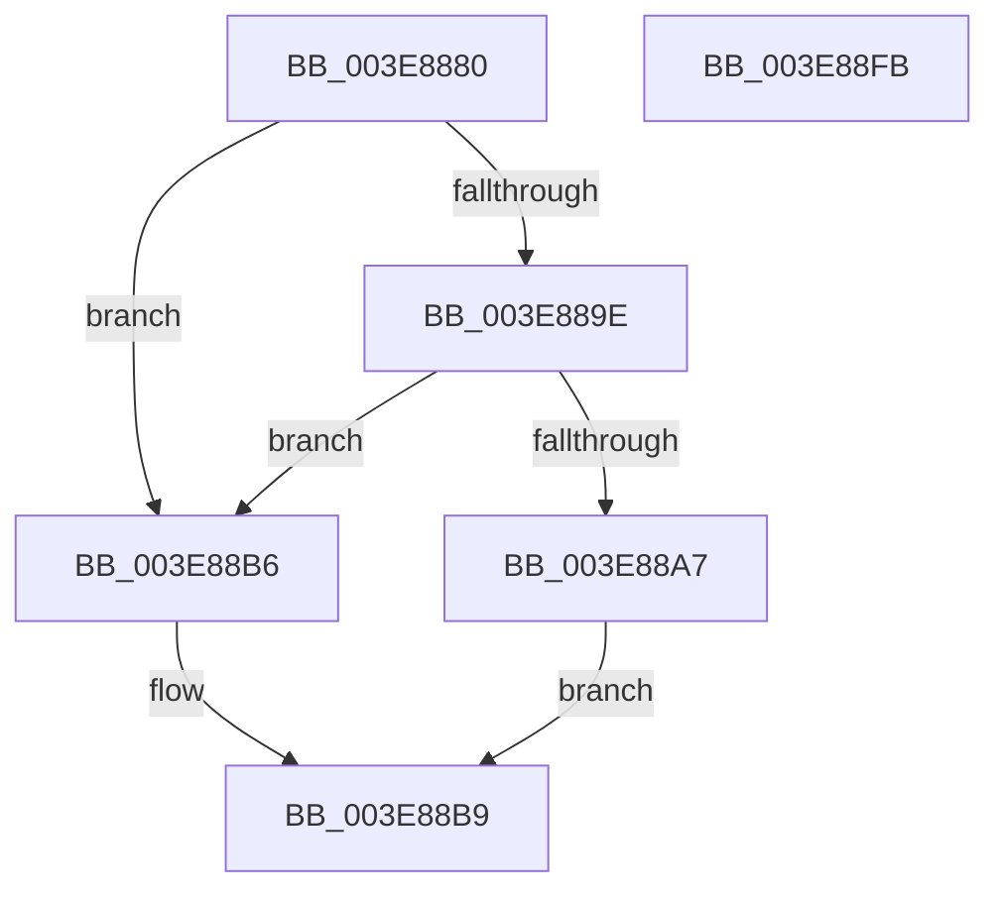

# HalAllocateCommonBufferExV3

- RVA: `0x003E8880`–`0x003E88FC` (길이 `124` bytes)
- VA: `0x00000001403E8880`
- 실행 섹션: `.text`
- PDB 이름 있음: `예`; PDB Function 태그: `아니요`
- unwind 정보 RVA: `0x0006E590`
- 디코드: `29`개 명령, `124/124` bytes 표시
- 미해석 바이트: `0` (있으면 어셈블리에 `.byte`로 보존)

> 이 문서는 커널 이미지의 기계어와 PDB 기호를 분석해 생성했습니다. 4번과 5번은 함수 원형과 자료형을 바이너리 사용 방식에서 추정한 C 해석이며 원본 소스 복구 결과는 아닙니다.

## 1. Dependencies

- 직접 호출 지점: **1**; 고유 호출 대상: **1**
- 직접 호출자로 확인된 함수: **1**
- RIP 상대 이미지 참조: **0**

### Outgoing calls
- `0x003E88EC` → [HalpAllocateDomainCommonBufferInternal](HalpAllocateDomainCommonBufferInternal_function_003E8B64.md) (function, `0x003E8B64`)

### Direct callers
- [HalAllocateCommonBufferV3](../55/HalAllocateCommonBufferV3_function_00550130.md) at `0x00550149`

### Static image references
- 디코드된 RIP-relative 메모리 참조가 없습니다.

## 2. Other-region calls and transfers

- 다른 실행 섹션으로 향하는 call: **0**
- 별도 외부 분기/꼬리 이동을 확인하지 못했습니다.

## 3. Assembly (complete function range)

```asm
003E8880  48 83 EC 68                     sub rsp, 0x68
003E8884  45 33 DB                        xor r11d, r11d
003E8887  49 8B C1                        mov rax, r9
003E888A  44 89 5C 24 70                  mov dword ptr [rsp + 0x70], r11d
003E888F  4C 89 5C 24 50                  mov qword ptr [rsp + 0x50], r11
003E8894  44 38 9C 24 90 00 00 00         cmp byte ptr [rsp + 0x90], r11b
003E889C  74 18                           je 0x1403e88b6
003E889E  44 38 99 BD 01 00 00            cmp byte ptr [rcx + 0x1bd], r11b
003E88A5  74 0F                           je 0x1403e88b6
003E88A7  C7 44 24 70 01 00 00 00         mov dword ptr [rsp + 0x70], 1
003E88AF  4C 8D 4C 24 70                  lea r9, [rsp + 0x70]
003E88B4  EB 03                           jmp 0x1403e88b9
003E88B6  4D 8B CB                        mov r9, r11
003E88B9  48 8B 89 00 02 00 00            mov rcx, qword ptr [rcx + 0x200]
003E88C0  4C 8D 54 24 50                  lea r10, [rsp + 0x50]
003E88C5  4C 89 54 24 40                  mov qword ptr [rsp + 0x40], r10
003E88CA  48 89 44 24 38                  mov qword ptr [rsp + 0x38], rax
003E88CF  8B 84 24 98 00 00 00            mov eax, dword ptr [rsp + 0x98]
003E88D6  89 44 24 30                     mov dword ptr [rsp + 0x30], eax
003E88DA  4C 89 4C 24 28                  mov qword ptr [rsp + 0x28], r9
003E88DF  45 8B C8                        mov r9d, r8d
003E88E2  4C 8B C2                        mov r8, rdx
003E88E5  44 89 5C 24 20                  mov dword ptr [rsp + 0x20], r11d
003E88EA  33 D2                           xor edx, edx
003E88EC  E8 73 02 00 00                  call 0x1403e8b64
003E88F1  48 8B 44 24 50                  mov rax, qword ptr [rsp + 0x50]
003E88F6  48 83 C4 68                     add rsp, 0x68
003E88FA  C3                              ret
003E88FB  CC                              int3
```

## 4. C-style interpretation (structured pseudocode)

```c
__int64 __fastcall HalAllocateCommonBufferExV3(__int64 a1, __int64 a2, int a3, __int64 a4, unsigned __int8 a5, unsigned int a6)
{
    __int64 result;
    __int64 v_r11;
    __int64 v_rsp;
    unsigned __int64 v_stack_m18;
    unsigned __int64 v_stack_m28;
    unsigned __int64 v_stack_m30;
    unsigned int v_stack_m38;
    unsigned __int64 v_stack_m40;
    unsigned int v_stack_m48;
    unsigned int v_stack_p8;

    v_rsp = (v_rsp) - (104);
    v_r11 = 0;
    v_stack_p8 = 0;
    v_stack_m18 = 0;
    if (a5 == 0) goto loc_003E88B6;
    if ((*(unsigned __int8 *)(a1 + 445)) == 0) goto loc_003E88B6;
    v_stack_p8 = 1;
    goto loc_003E88B9;
loc_003E88B6:
loc_003E88B9:
    v_stack_m28 = v_stack_m18;
    v_stack_m30 = a4;
    v_stack_m38 = (unsigned int)((unsigned int)(a6));
    v_stack_m40 = 0;
    v_stack_m48 = 0;
    a2 = 0;
    result = HalpAllocateDomainCommonBufferInternal(*(unsigned __int64 *)(a1 + 512), a2, a2, (unsigned int)(a3));
    v_rsp = (v_rsp) + (104);
    return v_stack_m18;
}
```

## 5. (Beta) C Style

```c
int64_t HalAllocateCommonBufferExV3(void *Arg1, int64_t Arg2, int32_t Arg3, int64_t Arg4, uint8_t Arg5, uint32_t Arg6)
{
    uint8_t *arg1 = (uint8_t *)Arg1;

    int64_t result;
    int64_t local_r11;
    int64_t local_rsp;
    uint64_t v_stack_m18;
    uint64_t v_stack_m28;
    uint64_t v_stack_m30;
    uint32_t v_stack_m38;
    uint64_t v_stack_m40;
    uint32_t v_stack_m48;
    uint32_t v_stack_p8;

    local_rsp = (local_rsp) - (104);
    local_r11 = 0;
    v_stack_p8 = 0;
    v_stack_m18 = 0;
    if (Arg5 == 0) goto loc_003E88B6;
    if ((*(uint8_t *)(arg1 + 0x1BD)) == 0) goto loc_003E88B6;
    v_stack_p8 = 1;
    goto loc_003E88B9;
loc_003E88B6:
loc_003E88B9:
    v_stack_m28 = v_stack_m18;
    v_stack_m30 = Arg4;
    v_stack_m38 = (uint32_t)((uint32_t)(Arg6));
    v_stack_m40 = 0;
    v_stack_m48 = 0;
    Arg2 = 0;
    result = HalpAllocateDomainCommonBufferInternal(*(uint64_t *)(arg1 + 0x200), Arg2, Arg2, (uint32_t)(Arg3));
    local_rsp = (local_rsp) + (104);
    return v_stack_m18;
}
```

### 관측된 메모리 오프셋

구조체 형식이 확인되지 않은 접근은 인자 기준의 오프셋으로만 기록했습니다.

| 기준 인자 | 오프셋 표현 | 폭 (bit) | 접근 |
|---|---:|---:|---|
| `Arg1` | `+ 0x1BD` | `8` | `R` |
| `Arg1` | `+ 0x200` | `64` | `R` |

## 6. Execution-region graph

[열기: 2D/3D 그래프와 함수 탐색 컨트롤 패널](../../../control-panel.html?section=text&rva=0x003E8880&view=graph)

- 2D 그래프는 위에서 아래로 흐르고, 3D 그래프는 빈 공간을 드래그해 회전합니다. Shift+드래그는 이동, 휠은 확대·축소, 함수 노드 선택은 대상 보고서 이동입니다.

### Static fallback


