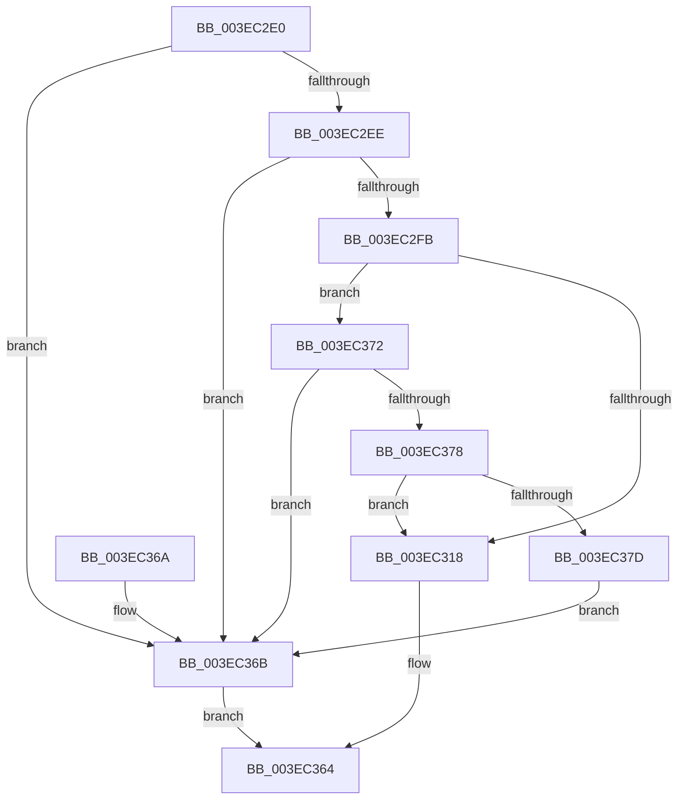

# HalBuildScatterGatherListDmaThinEx

- RVA: `0x003EC2E0`–`0x003EC37F` (길이 `159` bytes)
- VA: `0x00000001403EC2E0`
- 실행 섹션: `.text`
- PDB 이름 있음: `예`; PDB Function 태그: `아니요`
- unwind 정보 RVA: `0x00095B98`
- 디코드: `38`개 명령, `159/159` bytes 표시
- 미해석 바이트: `0` (있으면 어셈블리에 `.byte`로 보존)

> 이 문서는 커널 이미지의 기계어와 PDB 기호를 분석해 생성했습니다. 4번과 5번은 함수 원형과 자료형을 바이너리 사용 방식에서 추정한 C 해석이며 원본 소스 복구 결과는 아닙니다.

## 1. Dependencies

- 직접 호출 지점: **1**; 고유 호출 대상: **1**
- 직접 호출자로 확인된 함수: **0**
- RIP 상대 이미지 참조: **0**

### Outgoing calls
- `0x003EC35F` → [HalpBuildScatterGatherListDmaThin](HalpBuildScatterGatherListDmaThin_function_003EC390.md) (function, `0x003EC390`)

### Direct callers
- 이 함수 시작 RVA로 연결되는 직접 call은 확인되지 않았습니다. 간접 호출은 완전히 역산할 수 없습니다.

### Static image references
- 디코드된 RIP-relative 메모리 참조가 없습니다.

## 2. Other-region calls and transfers

- 다른 실행 섹션으로 향하는 call: **0**
- 별도 외부 분기/꼬리 이동을 확인하지 못했습니다.

## 3. Assembly (complete function range)

```asm
003EC2E0  40 53                           push rbx
003EC2E2  48 83 EC 70                     sub rsp, 0x70
003EC2E6  49 8B D9                        mov rbx, r9
003EC2E9  4D 85 C0                        test r8, r8
003EC2EC  74 7D                           je 0x1403ec36b
003EC2EE  4C 8B 94 24 D0 00 00 00         mov r10, qword ptr [rsp + 0xd0]
003EC2F6  4D 85 D2                        test r10, r10
003EC2F9  74 70                           je 0x1403ec36b
003EC2FB  4C 8B 8C 24 B8 00 00 00         mov r9, qword ptr [rsp + 0xb8]
003EC303  48 8B 84 24 F0 00 00 00         mov rax, qword ptr [rsp + 0xf0]
003EC30B  44 8B 9C 24 B0 00 00 00         mov r11d, dword ptr [rsp + 0xb0]
003EC313  4D 85 C9                        test r9, r9
003EC316  74 5A                           je 0x1403ec372
003EC318  48 89 44 24 60                  mov qword ptr [rsp + 0x60], rax
003EC31D  8B 84 24 D8 00 00 00            mov eax, dword ptr [rsp + 0xd8]
003EC324  89 44 24 58                     mov dword ptr [rsp + 0x58], eax
003EC328  48 8B 84 24 C0 00 00 00         mov rax, qword ptr [rsp + 0xc0]
003EC330  4C 89 54 24 50                  mov qword ptr [rsp + 0x50], r10
003EC335  48 89 44 24 40                  mov qword ptr [rsp + 0x40], rax
003EC33A  8B 84 24 A8 00 00 00            mov eax, dword ptr [rsp + 0xa8]
003EC341  4C 89 4C 24 38                  mov qword ptr [rsp + 0x38], r9
003EC346  4C 8B CB                        mov r9, rbx
003EC349  44 89 5C 24 30                  mov dword ptr [rsp + 0x30], r11d
003EC34E  89 44 24 28                     mov dword ptr [rsp + 0x28], eax
003EC352  48 8B 84 24 A0 00 00 00         mov rax, qword ptr [rsp + 0xa0]
003EC35A  48 89 44 24 20                  mov qword ptr [rsp + 0x20], rax
003EC35F  E8 2C 00 00 00                  call 0x1403ec390
003EC364  48 83 C4 70                     add rsp, 0x70
003EC368  5B                              pop rbx
003EC369  C3                              ret
003EC36A  CC                              int3
003EC36B  B8 0D 00 00 C0                  mov eax, 0xc000000d
003EC370  EB F2                           jmp 0x1403ec364
003EC372  41 F6 C3 01                     test r11b, 1
003EC376  74 F3                           je 0x1403ec36b
003EC378  48 85 C0                        test rax, rax
003EC37B  75 9B                           jne 0x1403ec318
003EC37D  EB EC                           jmp 0x1403ec36b
```

## 4. C-style interpretation (structured pseudocode)

```c
__int64 __fastcall HalBuildScatterGatherListDmaThinEx(__int64 a1, __int64 a2, __int64 a3, __int64 a4, __int64 a5, unsigned int a6, unsigned int a7, __int64 a8, __int64 a9, __int64 a10, __int64 a11, unsigned int a12, __int64 a13, __int64 a14, __int64 a15)
{
    __int64 result;
    __int64 v_rsp;
    unsigned __int64 v_stack_m18;
    unsigned int v_stack_m20;
    unsigned __int64 v_stack_m28;
    unsigned __int64 v_stack_m38;
    unsigned __int64 v_stack_m40;
    unsigned int v_stack_m48;
    unsigned int v_stack_m50;
    unsigned __int64 v_stack_m58;

    v_rsp = (v_rsp) - (112);
    if (a3 == 0) goto loc_003EC36B;
    if (a11 == 0) goto loc_003EC36B;
    if (a8 == 0) goto loc_003EC372;
loc_003EC318:
    v_stack_m18 = a15;
    v_stack_m20 = (unsigned int)((unsigned int)(a12));
    v_stack_m28 = a11;
    v_stack_m38 = a9;
    v_stack_m40 = a8;
    v_stack_m48 = (unsigned int)((unsigned int)(a7));
    v_stack_m50 = (unsigned int)((unsigned int)(a6));
    v_stack_m58 = a5;
    result = HalpBuildScatterGatherListDmaThin(a1, a2, a3, a4);
loc_003EC364:
    v_rsp = (v_rsp) + (112);
    return result;
loc_003EC36B:
    goto loc_003EC364;
loc_003EC372:
    if ((((unsigned __int8)((unsigned int)(a7))) & (1)) == 0) goto loc_003EC36B;
    if ((unsigned int)(0xC000000DULL) != 0) goto loc_003EC318;
    goto loc_003EC36B;
}
```

## 5. (Beta) C Style

```c
int64_t HalBuildScatterGatherListDmaThinEx(int64_t Arg1, int64_t Arg2, int64_t Arg3, int64_t Arg4, int64_t Arg5, uint32_t Arg6, uint32_t Arg7, int64_t Arg8, int64_t Arg9, uint64_t Arg10, int64_t Arg11, uint32_t Arg12, uint64_t Arg13, uint64_t Arg14, int64_t Arg15)
{
    int64_t result;
    int64_t local_rsp;
    uint64_t v_stack_m18;
    uint32_t v_stack_m20;
    uint64_t v_stack_m28;
    uint64_t v_stack_m38;
    uint64_t v_stack_m40;
    uint32_t v_stack_m48;
    uint32_t v_stack_m50;
    uint64_t v_stack_m58;

    local_rsp = (local_rsp) - (112);
    if (Arg3 == 0) goto loc_003EC36B;
    if (Arg11 == 0) goto loc_003EC36B;
    if (Arg8 == 0) goto loc_003EC372;
loc_003EC318:
    v_stack_m18 = Arg15;
    v_stack_m20 = (uint32_t)((uint32_t)(Arg12));
    v_stack_m28 = Arg11;
    v_stack_m38 = Arg9;
    v_stack_m40 = Arg8;
    v_stack_m48 = (uint32_t)((uint32_t)(Arg7));
    v_stack_m50 = (uint32_t)((uint32_t)(Arg6));
    v_stack_m58 = Arg5;
    result = HalpBuildScatterGatherListDmaThin(Arg1, Arg2, Arg3, Arg4);
loc_003EC364:
    local_rsp = (local_rsp) + (112);
    return result;
loc_003EC36B:
    goto loc_003EC364;
loc_003EC372:
    if ((((uint8_t)((uint32_t)(Arg7))) & (1)) == 0) goto loc_003EC36B;
    if ((uint32_t)(0xC000000DULL) != 0) goto loc_003EC318;
    goto loc_003EC36B;
}
```

## 6. Execution-region graph

[열기: 2D/3D 그래프와 함수 탐색 컨트롤 패널](../../../control-panel.html?section=text&rva=0x003EC2E0&view=graph)

- 2D 그래프는 위에서 아래로 흐르고, 3D 그래프는 빈 공간을 드래그해 회전합니다. Shift+드래그는 이동, 휠은 확대·축소, 함수 노드 선택은 대상 보고서 이동입니다.

### Static fallback


