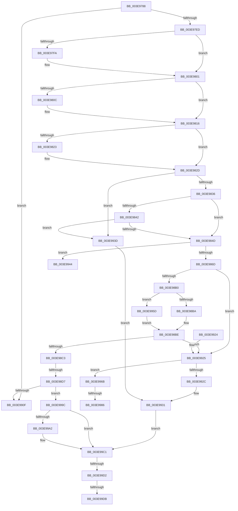

# HalpAllocateCommonBufferDmaThin

- RVA: `0x003E9788`–`0x003E99EC` (길이 `612` bytes)
- VA: `0x00000001403E9788`
- 실행 섹션: `.text`
- PDB 이름 있음: `예`; PDB Function 태그: `예`
- unwind 정보 RVA: `0x00095878`
- 디코드: `164`개 명령, `612/612` bytes 표시
- 미해석 바이트: `0` (있으면 어셈블리에 `.byte`로 보존)

> 이 문서는 커널 이미지의 기계어와 PDB 기호를 분석해 생성했습니다. 4번과 5번은 함수 원형과 자료형을 바이너리 사용 방식에서 추정한 C 해석이며 원본 소스 복구 결과는 아닙니다.

## 1. Dependencies

- 직접 호출 지점: **9**; 고유 호출 대상: **9**
- 직접 호출자로 확인된 함수: **3**
- RIP 상대 이미지 참조: **1**

### Outgoing calls
- `0x003E97DE` → [HalpDmaReferenceDomainObject](HalpDmaReferenceDomainObject_function_003E9B08.md) (function, `0x003E9B08`)
- `0x003E98A7` → [MmAllocateContiguousMemoryEx](MmAllocateContiguousMemoryEx_function_003E9B80.md) (function, `0x003E9B80`)
- `0x003E98C6` → [MmGetPhysicalAddress](../23/MmGetPhysicalAddress_function_0023A500.md) (function, `0x0023A500`)
- `0x003E98EF` → [HalpAllocateCommonBufferEntry](HalpAllocateCommonBufferEntry_function_003E99F4.md) (function, `0x003E99F4`)
- `0x003E9961` → [MmFreeContiguousMemory](../3F/MmFreeContiguousMemory_function_003F6F60.md) (function, `0x003F6F60`)
- `0x003E9991` → [MmAllocatePagesForMdlEx](MmAllocatePagesForMdlEx_function_003EA8C0.md) (function, `0x003EA8C0`)
- `0x003E99BC` → [guard_dispatch_icall](../6B/guard_dispatch_icall_function_006BAAD0.md) (function, `0x006BAAD0`)
- `0x003E99C4` → [HalpDmaDereferenceDomainObject](../3F/HalpDmaDereferenceDomainObject_function_003F69DC.md) (function, `0x003F69DC`)
- `0x003E99E1` → [MmUnmapLockedPages](../24/MmUnmapLockedPages_function_00246E60.md) (function, `0x00246E60`)

### Direct callers
- [HalAllocateCommonBufferDmaThinEx](HalAllocateCommonBufferDmaThinEx_function_003E96F0.md) at `0x003E9746`
- [HalAllocateCommonBufferWithBoundsDmaThin](../55/HalAllocateCommonBufferWithBoundsDmaThin_function_00552720.md) at `0x0055276F`
- [HalAllocateDomainCommonBufferDmaThin](../55/HalAllocateDomainCommonBufferDmaThin_function_005527A0.md) at `0x005527EA`

### Static image references
- `0x003E99A2` → RVA `0x00FC1778` (`.data`; read)

## 2. Other-region calls and transfers

- 다른 실행 섹션으로 향하는 call: **0**
- call이 아닌 외부 분기/꼬리 이동: **7**
  - `0x003E98D1` → [sub_006EABA2 + 0x73](../6E/Unknown_function_006EABA2.md) (`tail-transfer`)
  - `0x003E9958` → [sub_006EABA2](../6E/Unknown_function_006EABA2.md) (`tail-transfer`)
  - `0x003E9980` → [sub_006EABA2 + 0x25](../6E/Unknown_function_006EABA2.md) (`tail-transfer`)
  - `0x003E9997` → [sub_006EABA2 + 0x39](../6E/Unknown_function_006EABA2.md) (`tail-transfer`)
  - `0x003E99CC` → [sub_006EABA2 + 0xDD](../6E/Unknown_function_006EABA2.md) (`tail-transfer`)
  - `0x003E99D5` → [sub_006EABA2 + 0xCF](../6E/Unknown_function_006EABA2.md) (`tail-transfer`)
  - `0x003E99E7` → [sub_006EABA2 + 0xE6](../6E/Unknown_function_006EABA2.md) (`tail-transfer`)

## 3. Assembly (complete function range)

```asm
003E9788  4C 89 44 24 18                  mov qword ptr [rsp + 0x18], r8
003E978D  48 89 54 24 10                  mov qword ptr [rsp + 0x10], rdx
003E9792  55                              push rbp
003E9793  56                              push rsi
003E9794  57                              push rdi
003E9795  41 54                           push r12
003E9797  41 55                           push r13
003E9799  41 56                           push r14
003E979B  41 57                           push r15
003E979D  48 8D 6C 24 F9                  lea rbp, [rsp - 7]
003E97A2  48 81 EC 90 00 00 00            sub rsp, 0x90
003E97A9  33 C0                           xor eax, eax
003E97AB  C7 45 C7 05 00 00 00            mov dword ptr [rbp - 0x39], 5
003E97B2  48 21 45 CF                     and qword ptr [rbp - 0x31], rax
003E97B6  45 8D A1 FF 0F 00 00            lea r12d, [r9 + 0xfff]
003E97BD  0F 57 C0                        xorps xmm0, xmm0
003E97C0  89 45 F7                        mov dword ptr [rbp - 9], eax
003E97C3  45 33 FF                        xor r15d, r15d
003E97C6  88 45 5F                        mov byte ptr [rbp + 0x5f], al
003E97C9  0F 11 45 E7                     movups xmmword ptr [rbp - 0x19], xmm0
003E97CD  4C 89 7D D7                     mov qword ptr [rbp - 0x29], r15
003E97D1  41 81 E4 00 F0 FF FF            and r12d, 0xfffff000
003E97D8  4C 8B E9                        mov r13, rcx
003E97DB  45 33 F6                        xor r14d, r14d
003E97DE  E8 25 03 00 00                  call 0x1403e9b08
003E97E3  8B F0                           mov esi, eax
003E97E5  85 C0                           test eax, eax
003E97E7  0F 88 22 01 00 00               js 0x1403e990f
003E97ED  49 8B 45 38                     mov rax, qword ptr [r13 + 0x38]
003E97F1  45 8D 56 01                     lea r10d, [r14 + 1]
003E97F5  48 85 C0                        test rax, rax
003E97F8  74 07                           je 0x1403e9801
003E97FA  44 88 90 0C 02 00 00            mov byte ptr [rax + 0x20c], r10b
003E9801  48 8B 45 4F                     mov rax, qword ptr [rbp + 0x4f]
003E9805  33 FF                           xor edi, edi
003E9807  48 85 C0                        test rax, rax
003E980A  74 0A                           je 0x1403e9816
003E980C  48 8B 00                        mov rax, qword ptr [rax]
003E980F  48 85 C0                        test rax, rax
003E9812  48 0F 45 F8                     cmovne rdi, rax
003E9816  48 8B 45 57                     mov rax, qword ptr [rbp + 0x57]
003E981A  4D 8B 45 10                     mov r8, qword ptr [r13 + 0x10]
003E981E  48 85 C0                        test rax, rax
003E9821  74 0A                           je 0x1403e982d
003E9823  48 8B 00                        mov rax, qword ptr [rax]
003E9826  4C 3B C0                        cmp r8, rax
003E9829  4C 0F 47 C0                     cmova r8, rax
003E982D  49 3B F8                        cmp rdi, r8
003E9830  0F 87 07 01 00 00               ja 0x1403e993d
003E9836  48 8B 45 6F                     mov rax, qword ptr [rbp + 0x6f]
003E983A  41 8B F2                        mov esi, r10d
003E983D  48 85 C0                        test rax, rax
003E9840  74 0B                           je 0x1403e984d
003E9842  8B 30                           mov esi, dword ptr [rax]
003E9844  41 3B F2                        cmp esi, r10d
003E9847  0F 87 F0 00 00 00               ja 0x1403e993d
003E984D  4D 8B 4D 18                     mov r9, qword ptr [r13 + 0x18]
003E9851  8B C6                           mov eax, esi
003E9853  F7 D8                           neg eax
003E9855  1B D2                           sbb edx, edx
003E9857  81 E2 00 FE FF FF               and edx, 0xfffffe00
003E985D  81 C2 04 02 00 00               add edx, 0x204
003E9863  44 84 55 67                     test byte ptr [rbp + 0x67], r10b
003E9867  0F 85 D7 00 00 00               jne 0x1403e9944
003E986D  33 C0                           xor eax, eax
003E986F  4C 89 65 DF                     mov qword ptr [rbp - 0x21], r12
003E9873  41 83 7D 30 02                  cmp dword ptr [r13 + 0x30], 2
003E9878  48 8D 4D D7                     lea rcx, [rbp - 0x29]
003E987C  48 89 4C 24 48                  mov qword ptr [rsp + 0x48], rcx
003E9881  48 8D 4D DF                     lea rcx, [rbp - 0x21]
003E9885  0F 94 C0                        sete al
003E9888  89 44 24 40                     mov dword ptr [rsp + 0x40], eax
003E988C  8B 45 77                        mov eax, dword ptr [rbp + 0x77]
003E988F  C7 44 24 38 48 61 6C 44         mov dword ptr [rsp + 0x38], 0x446c6148
003E9897  4C 21 74 24 30                  and qword ptr [rsp + 0x30], r14
003E989C  89 54 24 28                     mov dword ptr [rsp + 0x28], edx
003E98A0  48 8B D7                        mov rdx, rdi
003E98A3  89 44 24 20                     mov dword ptr [rsp + 0x20], eax
003E98A7  E8 D4 02 00 00                  call 0x1403e9b80
003E98AC  85 C0                           test eax, eax
003E98AE  78 75                           js 0x1403e9925
003E98B0  4C 39 65 DF                     cmp qword ptr [rbp - 0x21], r12
003E98B4  0F 85 A3 00 00 00               jne 0x1403e995d
003E98BA  4C 8B 7D D7                     mov r15, qword ptr [rbp - 0x29]
003E98BE  4D 85 FF                        test r15, r15
003E98C1  74 62                           je 0x1403e9925
003E98C3  49 8B CF                        mov rcx, r15
003E98C6  E8 35 0C E5 FF                  call 0x14023a500
003E98CB  48 8B F8                        mov rdi, rax
003E98CE  4D 85 F6                        test r14, r14
003E98D1  0F 85 3E 13 30 00               jne 0x1406eac15
003E98D7  4C 8B 45 CF                     mov r8, qword ptr [rbp - 0x31]
003E98DB  48 83 64 24 28 00               and qword ptr [rsp + 0x28], 0
003E98E1  4D 8B CD                        mov r9, r13
003E98E4  49 8B D7                        mov rdx, r15
003E98E7  C6 44 24 20 01                  mov byte ptr [rsp + 0x20], 1
003E98EC  49 8B CE                        mov rcx, r14
003E98EF  E8 00 01 00 00                  call 0x1403e99f4
003E98F4  8B F0                           mov esi, eax
003E98F6  48 8B 45 7F                     mov rax, qword ptr [rbp + 0x7f]
003E98FA  48 89 38                        mov qword ptr [rax], rdi
003E98FD  48 8B BD 87 00 00 00            mov rdi, qword ptr [rbp + 0x87]
003E9904  4C 89 3F                        mov qword ptr [rdi], r15
003E9907  85 F6                           test esi, esi
003E9909  0F 88 8D 00 00 00               js 0x1403e999c
003E990F  8B C6                           mov eax, esi
003E9911  48 81 C4 90 00 00 00            add rsp, 0x90
003E9918  41 5F                           pop r15
003E991A  41 5E                           pop r14
003E991C  41 5D                           pop r13
003E991E  41 5C                           pop r12
003E9920  5F                              pop rdi
003E9921  5E                              pop rsi
003E9922  5D                              pop rbp
003E9923  C3                              ret
003E9924  CC                              int3
003E9925  41 83 7D 30 02                  cmp dword ptr [r13 + 0x30], 2
003E992A  74 3F                           je 0x1403e996b
003E992C  BE 9A 00 00 C0                  mov esi, 0xc000009a
003E9931  48 8B BD 87 00 00 00            mov rdi, qword ptr [rbp + 0x87]
003E9938  E9 84 00 00 00                  jmp 0x1403e99c1
003E993D  BE 0D 00 00 C0                  mov esi, 0xc000000d
003E9942  EB ED                           jmp 0x1403e9931
003E9944  41 81 C4 FF FF 1F 00            add r12d, 0x1fffff
003E994B  41 8B CA                        mov ecx, r10d
003E994E  41 81 E4 00 00 E0 FF            and r12d, 0xffe00000
003E9955  45 8B CC                        mov r9d, r12d
003E9958  E9 45 12 30 00                  jmp 0x1406eaba2
003E995D  48 8B 4D D7                     mov rcx, qword ptr [rbp - 0x29]
003E9961  E8 FA D5 00 00                  call 0x1403f6f60
003E9966  E9 53 FF FF FF                  jmp 0x1403e98be
003E996B  8B 45 77                        mov eax, dword ptr [rbp + 0x77]
003E996E  45 33 C0                        xor r8d, r8d
003E9971  8B 4D C7                        mov ecx, dword ptr [rbp - 0x39]
003E9974  4D 8B CC                        mov r9, r12
003E9977  49 8B 55 10                     mov rdx, qword ptr [r13 + 0x10]
003E997B  3D 00 00 00 80                  cmp eax, 0x80000000
003E9980  0F 85 41 12 30 00               jne 0x1406eabc7
003E9986  89 4C 24 28                     mov dword ptr [rsp + 0x28], ecx
003E998A  48 8B CF                        mov rcx, rdi
003E998D  89 74 24 20                     mov dword ptr [rsp + 0x20], esi
003E9991  E8 2A 0F 00 00                  call 0x1403ea8c0
003E9996  90                              nop
003E9997  E9 3F 12 30 00                  jmp 0x1406eabdb
003E999C  80 7D 5F 00                     cmp byte ptr [rbp + 0x5f], 0
003E99A0  74 1F                           je 0x1403e99c1
003E99A2  48 8B 05 CF 7D BD 00            mov rax, qword ptr [rip + 0xbd7dcf]
003E99A9  48 8B 55 CF                     mov rdx, qword ptr [rbp - 0x31]
003E99AD  49 8B 4D 28                     mov rcx, qword ptr [r13 + 0x28]
003E99B1  49 C1 EC 0C                     shr r12, 0xc
003E99B5  48 8B 40 40                     mov rax, qword ptr [rax + 0x40]
003E99B9  4D 8B C4                        mov r8, r12
003E99BC  E8 0F 11 2D 00                  call 0x1406baad0
003E99C1  49 8B CD                        mov rcx, r13
003E99C4  E8 13 D0 00 00                  call 0x1403f69dc
003E99C9  4D 85 FF                        test r15, r15
003E99CC  0F 84 AD 12 30 00               je 0x1406eac7f
003E99D2  4D 85 F6                        test r14, r14
003E99D5  0F 84 96 12 30 00               je 0x1406eac71
003E99DB  49 8B D6                        mov rdx, r14
003E99DE  49 8B CF                        mov rcx, r15
003E99E1  E8 7A D4 E5 FF                  call 0x140246e60
003E99E6  90                              nop
003E99E7  E9 9C 12 30 00                  jmp 0x1406eac88
```

## 4. C-style interpretation (structured pseudocode)

```c
__int64 __fastcall HalpAllocateCommonBufferDmaThin(__int64 a1, __int64 a2, __int64 a3, __int64 a4, __int64 a5, __int64 a6, unsigned int a7, __int64 a8, __int64 a9)
{
    __int64 result;
    __int64 v_r12;
    __int64 v_r14;
    __int64 v_r15;
    __int64 v_rdi;
    __int64 v_rsp;
    unsigned __int64 v_stack_m3F;
    unsigned int v_stack_m48;
    unsigned __int64 v_stack_m58;
    unsigned __int64 v_stack_m60;
    unsigned __int64 v_stack_m68;
    unsigned __int64 v_stack_m70;
    unsigned int v_stack_m78;
    unsigned __int64 v_stack_m80;
    unsigned int v_stack_m88;
    unsigned int v_stack_m90;
    unsigned __int64 v_stack_m98;
    unsigned int v_stack_mA0;
    unsigned int v_stack_mA8;
    unsigned __int64 v_stack_p10;
    unsigned __int64 v_stack_p18;
    unsigned __int8 v_stack_p20;
    unsigned __int8 v_stack_p28;

    v_stack_p18 = a3;
    v_stack_p10 = a2;
    v_rsp = (v_rsp) - (144);
    result = 0;
    v_stack_m78 = 5;
    v_stack_m48 = 0;
    v_r15 = 0;
    v_stack_p20 = 0;
    v_stack_m58 = v_xmm0;
    v_stack_m68 = 0;
    v_r12 = (unsigned int)((a4 + 4095) & (0xFFFFF000ULL));
    v_r14 = 0;
    result = HalpDmaReferenceDomainObject(a1, a2, a3, a4);
    if (sign_flag) goto loc_003E990F;
    if (*(unsigned __int64 *)(a1 + 56) != 0) {
        *(unsigned __int8 *)(*(unsigned __int64 *)(a1 + 56) + 524) = (unsigned __int8)(v_r14 + 1);
    }
    v_rdi = 0;
    result = v_stack_p10;
    if (v_stack_p10 != 0) {
        result = *(unsigned __int64 *)(v_stack_p10);
        if (result != 0) { v_rdi = result; }
    }
    result = v_stack_p18;
    if (v_stack_p18 != 0) {
        result = *(unsigned __int64 *)(v_stack_p18);
        a3 = *(unsigned __int64 *)(a1 + 16);
        if ((*(unsigned __int64 *)(a1 + 16)) > result) { a3 = result; }
    }
    if (v_rdi > a3) goto loc_003E993D;
    if (a6 == 0) goto loc_003E984D;
    if (((unsigned int)((unsigned int)(*(unsigned int *)(a6)))) > ((unsigned int)(v_r14 + 1))) goto loc_003E993D;
loc_003E984D:
    result = (unsigned int)(-((unsigned int)((unsigned int)((unsigned int)(*(unsigned int *)(a6))))));
    a2 = (unsigned int)((a2) & (0xFFFFFE00ULL));
    a2 = (unsigned int)((a2) + (516));
    if (((v_stack_p28) & ((unsigned __int8)(v_r14 + 1))) != 0) goto loc_003E9944;
    result = 0;
    v_stack_m60 = v_r12;
    v_stack_m80 = v_stack_m68;
    result = ((*(unsigned int *)(a1 + 48)) == 2) ? 1 : 0;
    v_stack_m88 = (unsigned int)(result);
    v_stack_m90 = 0x446C6148ULL;
    v_stack_mA0 = (unsigned int)(a2);
    v_stack_mA8 = (unsigned int)((unsigned int)(a7));
    result = MmAllocateContiguousMemoryEx(v_stack_m60, v_rdi, a3, *(unsigned __int64 *)(a1 + 24));
    if (sign_flag) goto loc_003E9925;
    if (v_stack_m60 != v_r12) goto loc_003E995D;
loc_003E98BE:
    if (v_stack_m68 == 0) goto loc_003E9925;
    result = MmGetPhysicalAddress(v_stack_m68, v_rdi, a3, *(unsigned __int64 *)(a1 + 24));
    v_stack_mA8 = 1;
    result = HalpAllocateCommonBufferEntry(0, v_stack_m68, v_stack_m70, a1);
    *(unsigned __int64 *)(a8) = result;
    *(unsigned __int64 *)(a9) = v_stack_m68;
    if (sign_flag) goto loc_003E999C;
loc_003E990F:
    v_rsp = (v_rsp) + (144);
    return (unsigned int)((unsigned int)((unsigned int)((unsigned int)(result))));
loc_003E9925:
    if ((*(unsigned int *)(a1 + 48)) == 2) goto loc_003E996B;
loc_003E9931:
    goto loc_003E99C1;
loc_003E993D:
    goto loc_003E9931;
loc_003E9944:
    v_r12 = (unsigned int)((v_r12) + (0x1FFFFFULL));
    v_r12 = (unsigned int)((v_r12) & (0xFFE00000ULL));
loc_003E995D:
    result = MmFreeContiguousMemory(v_stack_m68, v_stack_m68, v_stack_m70, (unsigned int)((unsigned int)(v_r12)));
    goto loc_003E98BE;
loc_003E996B:
    a3 = 0;
    v_stack_p28 = (unsigned int)((unsigned int)(v_stack_m78));
    v_stack_p20 = (unsigned int)((unsigned int)(0xC000000DULL));
    result = MmAllocatePagesForMdlEx(a9, *(unsigned __int64 *)(a1 + 16), a3, v_r12);
loc_003E999C:
    if (v_stack_p20 != 0) {
        result = *(unsigned __int64 *)(v_rip + 12418511);
        a2 = v_stack_m70;
        a1 = *(unsigned __int64 *)(a1 + 40);
        v_r12 = (v_r12) >> (12);
        result = *(unsigned __int64 *)(result + 64);
        a3 = v_r12;
        result = guard_dispatch_icall(a1, a2, a3, v_r12);
    }
    result = HalpDmaDereferenceDomainObject(a1, a2, a3, v_r12);
    result = MmUnmapLockedPages(v_stack_m68, 0, a3, v_r12);
}
```

## 5. (Beta) C Style

```c
int64_t HalpAllocateCommonBufferDmaThin(void *Arg1, int64_t Arg2, int64_t Arg3, void *Arg4, uint64_t Arg5, int64_t Arg6, uint32_t Arg7, void *Arg8, void *Arg9)
{
    uint8_t *arg1 = (uint8_t *)Arg1;
    uint8_t *arg4 = (uint8_t *)Arg4;
    uint8_t *arg8 = (uint8_t *)Arg8;
    uint8_t *arg9 = (uint8_t *)Arg9;

    int64_t result;
    int64_t local_r12;
    int64_t local_r14;
    int64_t local_r15;
    int64_t local_rdi;
    int64_t local_rsp;
    uint64_t v_stack_m3F;
    uint32_t v_stack_m48;
    uint64_t v_stack_m58;
    uint64_t v_stack_m60;
    uint64_t v_stack_m68;
    uint64_t v_stack_m70;
    uint32_t v_stack_m78;
    uint64_t v_stack_m80;
    uint32_t v_stack_m88;
    uint32_t v_stack_m90;
    uint64_t v_stack_m98;
    uint32_t v_stack_mA0;
    uint32_t v_stack_mA8;
    uint64_t v_stack_p10;
    uint64_t v_stack_p18;
    uint8_t v_stack_p20;
    uint8_t v_stack_p28;

    v_stack_p18 = Arg3;
    v_stack_p10 = Arg2;
    local_rsp = (local_rsp) - (144);
    result = 0;
    v_stack_m78 = 5;
    v_stack_m48 = 0;
    local_r15 = 0;
    v_stack_p20 = 0;
    v_stack_m58 = v_xmm0;
    v_stack_m68 = 0;
    local_r12 = (uint32_t)((Arg4 + 4095) & (0xFFFFF000ULL));
    local_r14 = 0;
    result = HalpDmaReferenceDomainObject(Arg1, Arg2, Arg3, Arg4);
    if (sign_flag) goto loc_003E990F;
    if (*(uint64_t *)(arg1 + 0x38) != 0) {
        *(uint8_t *)(*(uint64_t *)(arg1 + 0x38) + 0x20C) = (uint8_t)(local_r14 + 1);
    }
    local_rdi = 0;
    result = v_stack_p10;
    if (v_stack_p10 != 0) {
        result = *(uint64_t *)(v_stack_p10);
        if (result != 0) { local_rdi = result; }
    }
    result = v_stack_p18;
    if (v_stack_p18 != 0) {
        result = *(uint64_t *)(v_stack_p18);
        Arg3 = *(uint64_t *)(arg1 + 0x10);
        if ((*(uint64_t *)(arg1 + 0x10)) > result) { Arg3 = result; }
    }
    if (local_rdi > Arg3) goto loc_003E993D;
    if (Arg6 == 0) goto loc_003E984D;
    if (((uint32_t)((uint32_t)(*(uint32_t *)(Arg6)))) > ((uint32_t)(local_r14 + 1))) goto loc_003E993D;
loc_003E984D:
    result = (uint32_t)(-((uint32_t)((uint32_t)((uint32_t)(*(uint32_t *)(Arg6))))));
    Arg2 = (uint32_t)((Arg2) & (0xFFFFFE00ULL));
    Arg2 = (uint32_t)((Arg2) + (516));
    if (((v_stack_p28) & ((uint8_t)(local_r14 + 1))) != 0) goto loc_003E9944;
    result = 0;
    v_stack_m60 = local_r12;
    v_stack_m80 = v_stack_m68;
    result = ((*(uint32_t *)(arg1 + 0x30)) == 2) ? 1 : 0;
    v_stack_m88 = (uint32_t)(result);
    v_stack_m90 = 0x446C6148ULL;
    v_stack_mA0 = (uint32_t)(Arg2);
    v_stack_mA8 = (uint32_t)((uint32_t)(Arg7));
    result = MmAllocateContiguousMemoryEx(v_stack_m60, local_rdi, Arg3, *(uint64_t *)(arg1 + 0x18));
    if (sign_flag) goto loc_003E9925;
    if (v_stack_m60 != local_r12) goto loc_003E995D;
loc_003E98BE:
    if (v_stack_m68 == 0) goto loc_003E9925;
    result = MmGetPhysicalAddress(v_stack_m68, local_rdi, Arg3, *(uint64_t *)(arg1 + 0x18));
    v_stack_mA8 = 1;
    result = HalpAllocateCommonBufferEntry(0, v_stack_m68, v_stack_m70, Arg1);
    *(uint64_t *)(arg8) = result;
    *(uint64_t *)(arg9) = v_stack_m68;
    if (sign_flag) goto loc_003E999C;
loc_003E990F:
    local_rsp = (local_rsp) + (144);
    return (uint32_t)((uint32_t)((uint32_t)((uint32_t)(result))));
loc_003E9925:
    if ((*(uint32_t *)(arg1 + 0x30)) == 2) goto loc_003E996B;
loc_003E9931:
    goto loc_003E99C1;
loc_003E993D:
    goto loc_003E9931;
loc_003E9944:
    local_r12 = (uint32_t)((local_r12) + (0x1FFFFFULL));
    local_r12 = (uint32_t)((local_r12) & (0xFFE00000ULL));
loc_003E995D:
    result = MmFreeContiguousMemory(v_stack_m68, v_stack_m68, v_stack_m70, (uint32_t)((uint32_t)(local_r12)));
    goto loc_003E98BE;
loc_003E996B:
    Arg3 = 0;
    v_stack_p28 = (uint32_t)((uint32_t)(v_stack_m78));
    v_stack_p20 = (uint32_t)((uint32_t)(0xC000000DULL));
    result = MmAllocatePagesForMdlEx(Arg9, *(uint64_t *)(arg1 + 0x10), Arg3, local_r12);
loc_003E999C:
    if (v_stack_p20 != 0) {
        result = *(uint64_t *)(v_rip + 0xBD7DCF);
        Arg2 = v_stack_m70;
        Arg1 = *(uint64_t *)(arg1 + 0x28);
        local_r12 = (local_r12) >> (12);
        result = *(uint64_t *)(result + 0x40);
        Arg3 = local_r12;
        result = guard_dispatch_icall(Arg1, Arg2, Arg3, local_r12);
    }
    result = HalpDmaDereferenceDomainObject(Arg1, Arg2, Arg3, local_r12);
    result = MmUnmapLockedPages(v_stack_m68, 0, Arg3, local_r12);
}
```

### 관측된 메모리 오프셋

구조체 형식이 확인되지 않은 접근은 인자 기준의 오프셋으로만 기록했습니다.

| 기준 인자 | 오프셋 표현 | 폭 (bit) | 접근 |
|---|---:|---:|---|
| `Arg1` | `+ 0x10` | `64` | `R` |
| `Arg1` | `+ 0x18` | `64` | `R` |
| `Arg1` | `+ 0x28` | `64` | `R` |
| `Arg1` | `+ 0x30` | `32` | `R` |
| `Arg1` | `+ 0x38` | `64` | `R` |
| `Arg4` | `+ 0xFFF` | `32` | `R` |
| `Arg8` | `+ 0x0` | `64` | `W` |
| `Arg9` | `+ 0x0` | `64` | `W` |

## 6. Execution-region graph

[열기: 2D/3D 그래프와 함수 탐색 컨트롤 패널](../../../control-panel.html?section=text&rva=0x003E9788&view=graph)

- 2D 그래프는 위에서 아래로 흐르고, 3D 그래프는 빈 공간을 드래그해 회전합니다. Shift+드래그는 이동, 휠은 확대·축소, 함수 노드 선택은 대상 보고서 이동입니다.

### Static fallback


