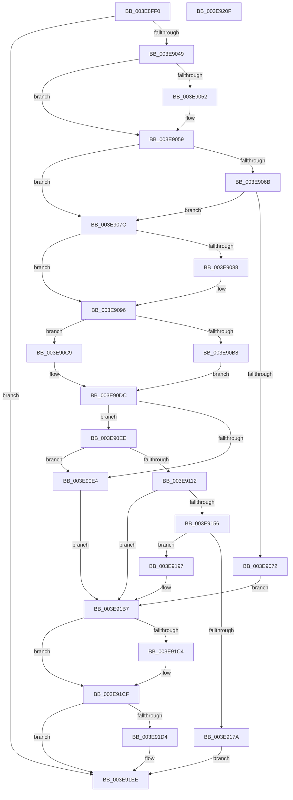

# HalpAllocateCommonBufferDmarThin

- RVA: `0x003E8FF0`–`0x003E9210` (길이 `544` bytes)
- VA: `0x00000001403E8FF0`
- 실행 섹션: `.text`
- PDB 이름 있음: `예`; PDB Function 태그: `아니요`
- unwind 정보 RVA: `0x000957E4`
- 디코드: `146`개 명령, `544/544` bytes 표시
- 미해석 바이트: `0` (있으면 어셈블리에 `.byte`로 보존)

> 이 문서는 커널 이미지의 기계어와 PDB 기호를 분석해 생성했습니다. 4번과 5번은 함수 원형과 자료형을 바이너리 사용 방식에서 추정한 C 해석이며 원본 소스 복구 결과는 아닙니다.

## 1. Dependencies

- 직접 호출 지점: **11**; 고유 호출 대상: **10**
- 직접 호출자로 확인된 함수: **3**
- RIP 상대 이미지 참조: **1**

### Outgoing calls
- `0x003E903A` → [HalpDmaReferenceDomainObject](HalpDmaReferenceDomainObject_function_003E9B08.md) (function, `0x003E9B08`)
- `0x003E90C2` → [MmAllocatePagesForMdlEx](MmAllocatePagesForMdlEx_function_003EA8C0.md) (function, `0x003EA8C0`)
- `0x003E90D7` → [MmAllocateNodePagesForMdlEx](MmAllocateNodePagesForMdlEx_function_003EA920.md) (function, `0x003EA920`)
- `0x003E9105` → [MmMapLockedPagesSpecifyCache](../31/MmMapLockedPagesSpecifyCache_function_00318800.md) (function, `0x00318800`)
- `0x003E914B` → [guard_dispatch_icall](../6B/guard_dispatch_icall_function_006BAAD0.md) (function, `0x006BAAD0`)
- `0x003E916F` → [HalpAllocateCommonBufferEntry](HalpAllocateCommonBufferEntry_function_003E99F4.md) (function, `0x003E99F4`)
- `0x003E91B2` → [guard_dispatch_icall](../6B/guard_dispatch_icall_function_006BAAD0.md) (function, `0x006BAAD0`)
- `0x003E91BA` → [HalpDmaDereferenceDomainObject](../3F/HalpDmaDereferenceDomainObject_function_003F69DC.md) (function, `0x003F69DC`)
- `0x003E91CA` → [MmUnmapLockedPages](../24/MmUnmapLockedPages_function_00246E60.md) (function, `0x00246E60`)
- `0x003E91DF` → [MiFreePagesFromMdl](../3F/MiFreePagesFromMdl_function_003F8300.md) (function, `0x003F8300`)
- `0x003E91E9` → [ExFreePoolWithTag](../../poolcode/B8/ExFreePoolWithTag_function_00B82870.md) (function, `0x00B82870`)

### Direct callers
- [HalAllocateCommonBufferDmarThinEx](HalAllocateCommonBufferDmarThinEx_function_003E77E0.md) at `0x003E784B`
- [HalAllocateCommonBufferWithBoundsDmarThin](../55/HalAllocateCommonBufferWithBoundsDmarThin_function_00552BF0.md) at `0x00552C3F`
- [HalAllocateDomainCommonBufferDmarThin](../55/HalAllocateDomainCommonBufferDmarThin_function_00552C70.md) at `0x00552CBA`

### Static image references
- `0x003E9112` → RVA `0x00FC1778` (`.data`; read)

## 2. Other-region calls and transfers

- 다른 실행 섹션으로 향하는 call: **1**
  - `0x003E91E9` → [ExFreePoolWithTag](../../poolcode/B8/ExFreePoolWithTag_function_00B82870.md) (`.text` → `POOLCODE`)
- 별도 외부 분기/꼬리 이동을 확인하지 못했습니다.

## 3. Assembly (complete function range)

```asm
003E8FF0  4C 8B DC                        mov r11, rsp
003E8FF3  49 89 6B 08                     mov qword ptr [r11 + 8], rbp
003E8FF7  49 89 73 10                     mov qword ptr [r11 + 0x10], rsi
003E8FFB  49 89 7B 18                     mov qword ptr [r11 + 0x18], rdi
003E8FFF  4D 89 63 20                     mov qword ptr [r11 + 0x20], r12
003E9003  41 55                           push r13
003E9005  41 56                           push r14
003E9007  41 57                           push r15
003E9009  48 83 EC 60                     sub rsp, 0x60
003E900D  33 C0                           xor eax, eax
003E900F  45 8D B1 FF 0F 00 00            lea r14d, [r9 + 0xfff]
003E9016  49 21 43 C8                     and qword ptr [r11 - 0x38], rax
003E901A  0F 57 C0                        xorps xmm0, xmm0
003E901D  0F 11 44 24 48                  movups xmmword ptr [rsp + 0x48], xmm0
003E9022  89 44 24 58                     mov dword ptr [rsp + 0x58], eax
003E9026  41 81 E6 00 F0 FF FF            and r14d, 0xfffff000
003E902D  4D 8B E0                        mov r12, r8
003E9030  4C 8B EA                        mov r13, rdx
003E9033  4C 8B F9                        mov r15, rcx
003E9036  33 ED                           xor ebp, ebp
003E9038  33 F6                           xor esi, esi
003E903A  E8 C9 0A 00 00                  call 0x1403e9b08
003E903F  8B F8                           mov edi, eax
003E9041  85 C0                           test eax, eax
003E9043  0F 88 A5 01 00 00               js 0x1403e91ee
003E9049  49 8B 47 38                     mov rax, qword ptr [r15 + 0x38]
003E904D  48 85 C0                        test rax, rax
003E9050  74 07                           je 0x1403e9059
003E9052  C6 80 0C 02 00 00 01            mov byte ptr [rax + 0x20c], 1
003E9059  48 8B 84 24 A8 00 00 00         mov rax, qword ptr [rsp + 0xa8]
003E9061  BF 01 00 00 00                  mov edi, 1
003E9066  48 85 C0                        test rax, rax
003E9069  74 11                           je 0x1403e907c
003E906B  8B 38                           mov edi, dword ptr [rax]
003E906D  83 FF 01                        cmp edi, 1
003E9070  76 0A                           jbe 0x1403e907c
003E9072  BF 0D 00 00 C0                  mov edi, 0xc000000d
003E9077  E9 3B 01 00 00                  jmp 0x1403e91b7
003E907C  8B 84 24 A0 00 00 00            mov eax, dword ptr [rsp + 0xa0]
003E9083  83 E0 01                        and eax, 1
003E9086  74 0E                           je 0x1403e9096
003E9088  41 81 C6 FF FF 1F 00            add r14d, 0x1fffff
003E908F  41 81 E6 00 00 E0 FF            and r14d, 0xffe00000
003E9096  49 8B 57 10                     mov rdx, qword ptr [r15 + 0x10]
003E909A  F7 D8                           neg eax
003E909C  8B 84 24 B0 00 00 00            mov eax, dword ptr [rsp + 0xb0]
003E90A3  4D 8B CE                        mov r9, r14
003E90A6  1B C9                           sbb ecx, ecx
003E90A8  45 33 C0                        xor r8d, r8d
003E90AB  83 E1 50                        and ecx, 0x50
003E90AE  83 C1 15                        add ecx, 0x15
003E90B1  3D 00 00 00 80                  cmp eax, 0x80000000
003E90B6  75 11                           jne 0x1403e90c9
003E90B8  89 4C 24 28                     mov dword ptr [rsp + 0x28], ecx
003E90BC  33 C9                           xor ecx, ecx
003E90BE  89 7C 24 20                     mov dword ptr [rsp + 0x20], edi
003E90C2  E8 F9 17 00 00                  call 0x1403ea8c0
003E90C7  EB 13                           jmp 0x1403e90dc
003E90C9  89 4C 24 30                     mov dword ptr [rsp + 0x30], ecx
003E90CD  33 C9                           xor ecx, ecx
003E90CF  89 44 24 28                     mov dword ptr [rsp + 0x28], eax
003E90D3  89 7C 24 20                     mov dword ptr [rsp + 0x20], edi
003E90D7  E8 44 18 00 00                  call 0x1403ea920
003E90DC  48 8B F0                        mov rsi, rax
003E90DF  48 85 C0                        test rax, rax
003E90E2  75 0A                           jne 0x1403e90ee
003E90E4  BF 9A 00 00 C0                  mov edi, 0xc000009a
003E90E9  E9 C9 00 00 00                  jmp 0x1403e91b7
003E90EE  C7 44 24 28 10 00 00 40         mov dword ptr [rsp + 0x28], 0x40000010
003E90F6  45 33 C9                        xor r9d, r9d
003E90F9  21 6C 24 20                     and dword ptr [rsp + 0x20], ebp
003E90FD  44 8B C7                        mov r8d, edi
003E9100  33 D2                           xor edx, edx
003E9102  48 8B CE                        mov rcx, rsi
003E9105  E8 F6 F6 F2 FF                  call 0x140318800
003E910A  48 8B E8                        mov rbp, rax
003E910D  48 85 C0                        test rax, rax
003E9110  74 D2                           je 0x1403e90e4
003E9112  48 8B 05 5F 86 BD 00            mov rax, qword ptr [rip + 0xbd865f]
003E9119  48 8D 4C 24 40                  lea rcx, [rsp + 0x40]
003E911E  83 64 24 48 00                  and dword ptr [rsp + 0x48], 0
003E9123  4C 8D 44 24 48                  lea r8, [rsp + 0x48]
003E9128  48 89 4C 24 30                  mov qword ptr [rsp + 0x30], rcx
003E912D  45 33 C9                        xor r9d, r9d
003E9130  49 8B 4F 28                     mov rcx, qword ptr [r15 + 0x28]
003E9134  48 89 74 24 50                  mov qword ptr [rsp + 0x50], rsi
003E9139  48 8B 40 38                     mov rax, qword ptr [rax + 0x38]
003E913D  41 8D 51 03                     lea edx, [r9 + 3]
003E9141  4C 89 64 24 28                  mov qword ptr [rsp + 0x28], r12
003E9146  4C 89 6C 24 20                  mov qword ptr [rsp + 0x20], r13
003E914B  E8 80 19 2D 00                  call 0x1406baad0
003E9150  8B F8                           mov edi, eax
003E9152  85 C0                           test eax, eax
003E9154  78 61                           js 0x1403e91b7
003E9156  48 83 64 24 28 00               and qword ptr [rsp + 0x28], 0
003E915C  4D 8B CF                        mov r9, r15
003E915F  4C 8B 44 24 40                  mov r8, qword ptr [rsp + 0x40]
003E9164  48 8B D5                        mov rdx, rbp
003E9167  48 8B CE                        mov rcx, rsi
003E916A  C6 44 24 20 01                  mov byte ptr [rsp + 0x20], 1
003E916F  E8 80 08 00 00                  call 0x1403e99f4
003E9174  8B F8                           mov edi, eax
003E9176  85 C0                           test eax, eax
003E9178  78 1D                           js 0x1403e9197
003E917A  48 8B 44 24 40                  mov rax, qword ptr [rsp + 0x40]
003E917F  48 8B 8C 24 B8 00 00 00         mov rcx, qword ptr [rsp + 0xb8]
003E9187  48 89 01                        mov qword ptr [rcx], rax
003E918A  48 8B 84 24 C0 00 00 00         mov rax, qword ptr [rsp + 0xc0]
003E9192  48 89 28                        mov qword ptr [rax], rbp
003E9195  EB 57                           jmp 0x1403e91ee
003E9197  48 8B 05 DA 85 BD 00            mov rax, qword ptr [rip + 0xbd85da]
003E919E  48 8B 54 24 40                  mov rdx, qword ptr [rsp + 0x40]
003E91A3  49 8B 4F 28                     mov rcx, qword ptr [r15 + 0x28]
003E91A7  49 C1 EE 0C                     shr r14, 0xc
003E91AB  48 8B 40 40                     mov rax, qword ptr [rax + 0x40]
003E91AF  4D 8B C6                        mov r8, r14
003E91B2  E8 19 19 2D 00                  call 0x1406baad0
003E91B7  49 8B CF                        mov rcx, r15
003E91BA  E8 1D D8 00 00                  call 0x1403f69dc
003E91BF  48 85 ED                        test rbp, rbp
003E91C2  74 0B                           je 0x1403e91cf
003E91C4  48 8B D6                        mov rdx, rsi
003E91C7  48 8B CD                        mov rcx, rbp
003E91CA  E8 91 DC E5 FF                  call 0x140246e60
003E91CF  48 85 F6                        test rsi, rsi
003E91D2  74 1A                           je 0x1403e91ee
003E91D4  45 33 C9                        xor r9d, r9d
003E91D7  45 33 C0                        xor r8d, r8d
003E91DA  33 D2                           xor edx, edx
003E91DC  48 8B CE                        mov rcx, rsi
003E91DF  E8 1C F1 00 00                  call 0x1403f8300
003E91E4  33 D2                           xor edx, edx
003E91E6  48 8B CE                        mov rcx, rsi
003E91E9  E8 82 96 79 00                  call 0x140b82870
003E91EE  4C 8D 5C 24 60                  lea r11, [rsp + 0x60]
003E91F3  8B C7                           mov eax, edi
003E91F5  49 8B 6B 20                     mov rbp, qword ptr [r11 + 0x20]
003E91F9  49 8B 73 28                     mov rsi, qword ptr [r11 + 0x28]
003E91FD  49 8B 7B 30                     mov rdi, qword ptr [r11 + 0x30]
003E9201  4D 8B 63 38                     mov r12, qword ptr [r11 + 0x38]
003E9205  49 8B E3                        mov rsp, r11
003E9208  41 5F                           pop r15
003E920A  41 5E                           pop r14
003E920C  41 5D                           pop r13
003E920E  C3                              ret
003E920F  CC                              int3
```

## 4. C-style interpretation (structured pseudocode)

```c
__int64 __fastcall HalpAllocateCommonBufferDmarThin(__int64 a1, __int64 a2, __int64 a3, __int64 a4, unsigned int a5, __int64 a6, unsigned int a7, __int64 a8, __int64 a9)
{
    __int64 result;
    __int64 v_r14;
    __int64 v_rbp;
    __int64 v_rsi;
    __int64 v_rsp;
    unsigned __int64 v_stack_m18;
    unsigned int v_stack_m20;
    unsigned __int64 v_stack_m28;
    unsigned __int64 v_stack_m30;
    unsigned __int64 v_stack_m38;
    unsigned int v_stack_m48;
    unsigned int v_stack_m50;
    unsigned int v_stack_m58;

    *(unsigned __int64 *)(v_rsp + 8) = v_rbp;
    *(unsigned __int64 *)(v_rsp + 16) = v_rsi;
    *(unsigned __int64 *)(v_rsp + 24) = v_rdi;
    *(unsigned __int64 *)(v_rsp + 32) = v_r12;
    v_rsp = (v_rsp) - (96);
    result = 0;
    v_stack_m30 = v_xmm0;
    v_stack_m20 = 0;
    v_r14 = (unsigned int)((a4 + 4095) & (0xFFFFF000ULL));
    v_rbp = 0;
    v_rsi = 0;
    result = HalpDmaReferenceDomainObject(a1, a2, a3, a4);
    if (sign_flag) goto loc_003E91EE;
    if (*(unsigned __int64 *)(a1 + 56) != 0) {
        *(unsigned __int8 *)(*(unsigned __int64 *)(a1 + 56) + 524) = 1;
    }
    if (a6 == 0) goto loc_003E907C;
    if (((unsigned int)((unsigned int)(*(unsigned int *)(a6)))) <= 1) goto loc_003E907C;
    goto loc_003E91B7;
loc_003E907C:
    result = (unsigned int)(((unsigned int)(a5)) & (1));
    if (!(condition_is_equal)) {
        v_r14 = (unsigned int)((v_r14) + (0x1FFFFFULL));
        v_r14 = (unsigned int)((v_r14) & (0xFFE00000ULL));
    }
    result = (unsigned int)(-(result));
    a3 = 0;
    a1 = (unsigned int)((a1) & (80));
    a1 = (unsigned int)((a1) + (21));
    if (((unsigned int)((unsigned int)(a7))) != 0x80000000ULL) goto loc_003E90C9;
    v_stack_m50 = (unsigned int)(a1);
    a1 = 0;
    v_stack_m58 = (unsigned int)((unsigned int)(0xC000000DULL));
    result = MmAllocatePagesForMdlEx(a1, *(unsigned __int64 *)(a1 + 16), a3, v_r14);
    goto loc_003E90DC;
loc_003E90C9:
    v_stack_m48 = 0;
    a1 = 0;
    v_stack_m50 = (unsigned int)(result);
    v_stack_m58 = (unsigned int)((unsigned int)(0xC000000DULL));
    result = MmAllocateNodePagesForMdlEx(a1, *(unsigned __int64 *)(a1 + 16), a3, v_r14);
loc_003E90DC:
    if (result != 0) goto loc_003E90EE;
loc_003E90E4:
    goto loc_003E91B7;
loc_003E90EE:
    v_stack_m50 = 0x40000010ULL;
    a4 = 0;
    a2 = 0;
    result = MmMapLockedPagesSpecifyCache(result, a2, (unsigned int)((unsigned int)((unsigned int)(0xC000009AULL))), a4);
    if (result == 0) goto loc_003E90E4;
    v_stack_m48 = v_stack_m38;
    a4 = 0;
    v_stack_m28 = result;
    v_stack_m50 = 0;
    v_stack_m58 = 0;
    result = guard_dispatch_icall(*(unsigned __int64 *)(a1 + 40), a4 + 3, v_stack_m30, a4);
    if (sign_flag) goto loc_003E91B7;
    v_stack_m58 = 1;
    result = HalpAllocateCommonBufferEntry(result, result, v_stack_m38, 0);
    if (sign_flag) goto loc_003E9197;
    *(unsigned __int64 *)(a8) = v_stack_m38;
    *(unsigned __int64 *)(a9) = result;
    goto loc_003E91EE;
loc_003E9197:
    v_r14 = (v_r14) >> (12);
    result = guard_dispatch_icall(*(unsigned __int64 *)(a1 + 40), v_stack_m38, v_r14, 0);
loc_003E91B7:
    result = HalpDmaDereferenceDomainObject(0, v_stack_m38, v_r14, 0);
    if (result != 0) {
        a2 = result;
        a1 = result;
        result = MmUnmapLockedPages(a1, a2, v_r14, 0);
    }
    if (result != 0) {
        a4 = 0;
        a3 = 0;
        a2 = 0;
        a1 = result;
        result = MiFreePagesFromMdl(a1, a2, a3, a4);
        a2 = 0;
        a1 = result;
        result = ExFreePoolWithTag(a1, a2, a3, a4);
    }
    return (unsigned int)((unsigned int)((unsigned int)((unsigned int)(result))));
}
```

## 5. (Beta) C Style

```c
int64_t HalpAllocateCommonBufferDmarThin(void *Arg1, int64_t Arg2, int64_t Arg3, void *Arg4, uint32_t Arg5, int64_t Arg6, uint32_t Arg7, void *Arg8, void *Arg9)
{
    uint8_t *arg1 = (uint8_t *)Arg1;
    uint8_t *arg4 = (uint8_t *)Arg4;
    uint8_t *arg8 = (uint8_t *)Arg8;
    uint8_t *arg9 = (uint8_t *)Arg9;

    int64_t result;
    int64_t local_r14;
    int64_t local_rbp;
    int64_t local_rsi;
    int64_t local_rsp;
    uint64_t v_stack_m18;
    uint32_t v_stack_m20;
    uint64_t v_stack_m28;
    uint64_t v_stack_m30;
    uint64_t v_stack_m38;
    uint32_t v_stack_m48;
    uint32_t v_stack_m50;
    uint32_t v_stack_m58;

    *(uint64_t *)(local_rsp + 0x8) = local_rbp;
    *(uint64_t *)(local_rsp + 0x10) = local_rsi;
    *(uint64_t *)(local_rsp + 0x18) = local_rdi;
    *(uint64_t *)(local_rsp + 0x20) = local_r12;
    local_rsp = (local_rsp) - (96);
    result = 0;
    v_stack_m30 = v_xmm0;
    v_stack_m20 = 0;
    local_r14 = (uint32_t)((Arg4 + 4095) & (0xFFFFF000ULL));
    local_rbp = 0;
    local_rsi = 0;
    result = HalpDmaReferenceDomainObject(Arg1, Arg2, Arg3, Arg4);
    if (sign_flag) goto loc_003E91EE;
    if (*(uint64_t *)(arg1 + 0x38) != 0) {
        *(uint8_t *)(*(uint64_t *)(arg1 + 0x38) + 0x20C) = 1;
    }
    if (Arg6 == 0) goto loc_003E907C;
    if (((uint32_t)((uint32_t)(*(uint32_t *)(Arg6)))) <= 1) goto loc_003E907C;
    goto loc_003E91B7;
loc_003E907C:
    result = (uint32_t)(((uint32_t)(Arg5)) & (1));
    if (!(condition_is_equal)) {
        local_r14 = (uint32_t)((local_r14) + (0x1FFFFFULL));
        local_r14 = (uint32_t)((local_r14) & (0xFFE00000ULL));
    }
    result = (uint32_t)(-(result));
    Arg3 = 0;
    Arg1 = (uint32_t)((Arg1) & (80));
    Arg1 = (uint32_t)((Arg1) + (21));
    if (((uint32_t)((uint32_t)(Arg7))) != 0x80000000ULL) goto loc_003E90C9;
    v_stack_m50 = (uint32_t)(Arg1);
    Arg1 = 0;
    v_stack_m58 = (uint32_t)((uint32_t)(0xC000000DULL));
    result = MmAllocatePagesForMdlEx(Arg1, *(uint64_t *)(arg1 + 0x10), Arg3, local_r14);
    goto loc_003E90DC;
loc_003E90C9:
    v_stack_m48 = 0;
    Arg1 = 0;
    v_stack_m50 = (uint32_t)(result);
    v_stack_m58 = (uint32_t)((uint32_t)(0xC000000DULL));
    result = MmAllocateNodePagesForMdlEx(Arg1, *(uint64_t *)(arg1 + 0x10), Arg3, local_r14);
loc_003E90DC:
    if (result != 0) goto loc_003E90EE;
loc_003E90E4:
    goto loc_003E91B7;
loc_003E90EE:
    v_stack_m50 = 0x40000010ULL;
    Arg4 = 0;
    Arg2 = 0;
    result = MmMapLockedPagesSpecifyCache(result, Arg2, (uint32_t)((uint32_t)((uint32_t)(0xC000009AULL))), Arg4);
    if (result == 0) goto loc_003E90E4;
    v_stack_m48 = v_stack_m38;
    Arg4 = 0;
    v_stack_m28 = result;
    v_stack_m50 = 0;
    v_stack_m58 = 0;
    result = guard_dispatch_icall(*(uint64_t *)(arg1 + 0x28), Arg4 + 3, v_stack_m30, Arg4);
    if (sign_flag) goto loc_003E91B7;
    v_stack_m58 = 1;
    result = HalpAllocateCommonBufferEntry(result, result, v_stack_m38, 0);
    if (sign_flag) goto loc_003E9197;
    *(uint64_t *)(arg8) = v_stack_m38;
    *(uint64_t *)(arg9) = result;
    goto loc_003E91EE;
loc_003E9197:
    local_r14 = (local_r14) >> (12);
    result = guard_dispatch_icall(*(uint64_t *)(arg1 + 0x28), v_stack_m38, local_r14, 0);
loc_003E91B7:
    result = HalpDmaDereferenceDomainObject(0, v_stack_m38, local_r14, 0);
    if (result != 0) {
        Arg2 = result;
        Arg1 = result;
        result = MmUnmapLockedPages(Arg1, Arg2, local_r14, 0);
    }
    if (result != 0) {
        Arg4 = 0;
        Arg3 = 0;
        Arg2 = 0;
        Arg1 = result;
        result = MiFreePagesFromMdl(Arg1, Arg2, Arg3, Arg4);
        Arg2 = 0;
        Arg1 = result;
        result = ExFreePoolWithTag(Arg1, Arg2, Arg3, Arg4);
    }
    return (uint32_t)((uint32_t)((uint32_t)((uint32_t)(result))));
}
```

### 관측된 메모리 오프셋

구조체 형식이 확인되지 않은 접근은 인자 기준의 오프셋으로만 기록했습니다.

| 기준 인자 | 오프셋 표현 | 폭 (bit) | 접근 |
|---|---:|---:|---|
| `Arg1` | `+ 0x10` | `64` | `R` |
| `Arg1` | `+ 0x28` | `64` | `R` |
| `Arg1` | `+ 0x38` | `64` | `R` |
| `Arg4` | `+ 0xFFF` | `32` | `R` |
| `Arg8` | `+ 0x0` | `64` | `W` |
| `Arg9` | `+ 0x0` | `64` | `W` |

## 6. Execution-region graph

[열기: 2D/3D 그래프와 함수 탐색 컨트롤 패널](../../../control-panel.html?section=text&rva=0x003E8FF0&view=graph)

- 2D 그래프는 위에서 아래로 흐르고, 3D 그래프는 빈 공간을 드래그해 회전합니다. Shift+드래그는 이동, 휠은 확대·축소, 함수 노드 선택은 대상 보고서 이동입니다.

### Static fallback


