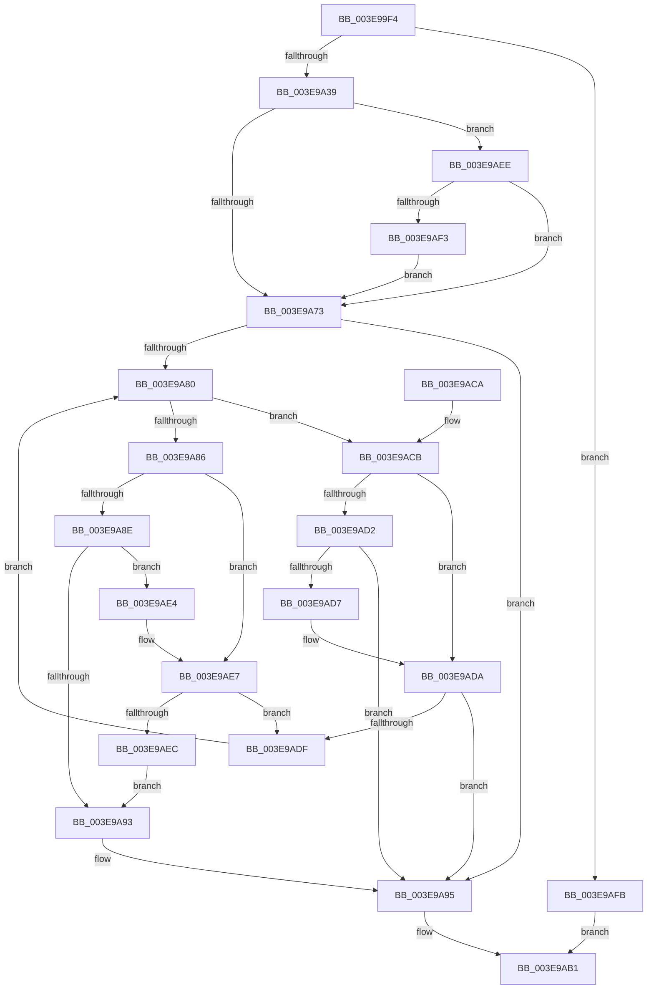

# HalpAllocateCommonBufferEntry

- RVA: `0x003E99F4`–`0x003E9B02` (길이 `270` bytes)
- VA: `0x00000001403E99F4`
- 실행 섹션: `.text`
- PDB 이름 있음: `예`; PDB Function 태그: `아니요`
- unwind 정보 RVA: `0x00093208`
- 디코드: `83`개 명령, `270/270` bytes 표시
- 미해석 바이트: `0` (있으면 어셈블리에 `.byte`로 보존)

> 이 문서는 커널 이미지의 기계어와 PDB 기호를 분석해 생성했습니다. 4번과 5번은 함수 원형과 자료형을 바이너리 사용 방식에서 추정한 C 해석이며 원본 소스 복구 결과는 아닙니다.

## 1. Dependencies

- 직접 호출 지점: **4**; 고유 호출 대상: **4**
- 직접 호출자로 확인된 함수: **6**
- RIP 상대 이미지 참조: **0**

### Outgoing calls
- `0x003E9A26` → [ExAllocatePool2](../../poolcode/B8/ExAllocatePool2_function_00B820F0.md) (function, `0x00B820F0`)
- `0x003E9A5D` → [KeAcquireSpinLockRaiseToDpc](../20/KeAcquireSpinLockRaiseToDpc_function_00208470.md) (function, `0x00208470`)
- `0x003E9A9E` → [RtlRbInsertNodeEx](../2E/RtlRbInsertNodeEx_function_002E4570.md) (function, `0x002E4570`)
- `0x003E9AAA` → [KeReleaseSpinLock](../39/KeReleaseSpinLock_function_00392BA0.md) (function, `0x00392BA0`)

### Direct callers
- [HalpAllocateDomainCommonBufferInternal](HalpAllocateDomainCommonBufferInternal_function_003E8B64.md) at `0x003E8F0D`
- [HalpAllocateCommonBufferDmarThin](HalpAllocateCommonBufferDmarThin_function_003E8FF0.md) at `0x003E916F`
- [HalpAllocateCommonBufferDmaThin](HalpAllocateCommonBufferDmaThin_function_003E9788.md) at `0x003E98EF`
- [HalCreateCommonBufferFromMdl](../55/HalCreateCommonBufferFromMdl_function_00551680.md) at `0x005519CC`
- [HalCreateCommonBufferFromMdlDmaThin](../55/HalCreateCommonBufferFromMdlDmaThin_function_00552800.md) at `0x00552ABA`
- [HalCreateCommonBufferFromMdlDmarThin](../55/HalCreateCommonBufferFromMdlDmarThin_function_00552DA0.md) at `0x00552F31`

### Static image references
- 디코드된 RIP-relative 메모리 참조가 없습니다.

## 2. Other-region calls and transfers

- 다른 실행 섹션으로 향하는 call: **1**
  - `0x003E9A26` → [ExAllocatePool2](../../poolcode/B8/ExAllocatePool2_function_00B820F0.md) (`.text` → `POOLCODE`)
- 별도 외부 분기/꼬리 이동을 확인하지 못했습니다.

## 3. Assembly (complete function range)

```asm
003E99F4  48 89 5C 24 08                  mov qword ptr [rsp + 8], rbx
003E99F9  48 89 6C 24 10                  mov qword ptr [rsp + 0x10], rbp
003E99FE  48 89 74 24 18                  mov qword ptr [rsp + 0x18], rsi
003E9A03  57                              push rdi
003E9A04  41 56                           push r14
003E9A06  41 57                           push r15
003E9A08  48 83 EC 20                     sub rsp, 0x20
003E9A0C  4C 8B F2                        mov r14, rdx
003E9A0F  49 8B F0                        mov rsi, r8
003E9A12  BA 48 00 00 00                  mov edx, 0x48
003E9A17  48 8B E9                        mov rbp, rcx
003E9A1A  41 B8 48 61 6C 44               mov r8d, 0x446c6148
003E9A20  4D 8B F9                        mov r15, r9
003E9A23  8D 4A FA                        lea ecx, [rdx - 6]
003E9A26  E8 C5 86 79 00                  call 0x140b820f0
003E9A2B  33 DB                           xor ebx, ebx
003E9A2D  48 8B F8                        mov rdi, rax
003E9A30  48 85 C0                        test rax, rax
003E9A33  0F 84 C2 00 00 00               je 0x1403e9afb
003E9A39  48 89 68 30                     mov qword ptr [rax + 0x30], rbp
003E9A3D  49 8D 4F 50                     lea rcx, [r15 + 0x50]
003E9A41  4C 89 70 18                     mov qword ptr [rax + 0x18], r14
003E9A45  48 89 70 28                     mov qword ptr [rax + 0x28], rsi
003E9A49  4C 89 78 38                     mov qword ptr [rax + 0x38], r15
003E9A4D  8A 44 24 60                     mov al, byte ptr [rsp + 0x60]
003E9A51  88 47 40                        mov byte ptr [rdi + 0x40], al
003E9A54  48 8B 44 24 68                  mov rax, qword ptr [rsp + 0x68]
003E9A59  48 89 47 20                     mov qword ptr [rdi + 0x20], rax
003E9A5D  E8 0E EA E1 FF                  call 0x140208470
003E9A62  4D 8D 57 40                     lea r10, [r15 + 0x40]
003E9A66  40 8A F0                        mov sil, al
003E9A69  41 F6 42 08 01                  test byte ptr [r10 + 8], 1
003E9A6E  49 8B 12                        mov rdx, qword ptr [r10]
003E9A71  75 7B                           jne 0x1403e9aee
003E9A73  41 0F B6 4A 08                  movzx ecx, byte ptr [r10 + 8]
003E9A78  83 E1 01                        and ecx, 1
003E9A7B  48 85 D2                        test rdx, rdx
003E9A7E  74 15                           je 0x1403e9a95
003E9A80  4C 39 72 18                     cmp qword ptr [rdx + 0x18], r14
003E9A84  77 45                           ja 0x1403e9acb
003E9A86  48 8B 42 08                     mov rax, qword ptr [rdx + 8]
003E9A8A  85 C9                           test ecx, ecx
003E9A8C  74 59                           je 0x1403e9ae7
003E9A8E  48 85 C0                        test rax, rax
003E9A91  75 51                           jne 0x1403e9ae4
003E9A93  B3 01                           mov bl, 1
003E9A95  4C 8B CF                        mov r9, rdi
003E9A98  44 8A C3                        mov r8b, bl
003E9A9B  49 8B CA                        mov rcx, r10
003E9A9E  E8 CD AA EF FF                  call 0x1402e4570
003E9AA3  49 8D 4F 50                     lea rcx, [r15 + 0x50]
003E9AA7  40 8A D6                        mov dl, sil
003E9AAA  E8 F1 90 FA FF                  call 0x140392ba0
003E9AAF  33 C0                           xor eax, eax
003E9AB1  48 8B 5C 24 40                  mov rbx, qword ptr [rsp + 0x40]
003E9AB6  48 8B 6C 24 48                  mov rbp, qword ptr [rsp + 0x48]
003E9ABB  48 8B 74 24 50                  mov rsi, qword ptr [rsp + 0x50]
003E9AC0  48 83 C4 20                     add rsp, 0x20
003E9AC4  41 5F                           pop r15
003E9AC6  41 5E                           pop r14
003E9AC8  5F                              pop rdi
003E9AC9  C3                              ret
003E9ACA  CC                              int3
003E9ACB  48 8B 02                        mov rax, qword ptr [rdx]
003E9ACE  85 C9                           test ecx, ecx
003E9AD0  74 08                           je 0x1403e9ada
003E9AD2  48 85 C0                        test rax, rax
003E9AD5  74 BE                           je 0x1403e9a95
003E9AD7  48 33 C2                        xor rax, rdx
003E9ADA  48 85 C0                        test rax, rax
003E9ADD  74 B6                           je 0x1403e9a95
003E9ADF  48 8B D0                        mov rdx, rax
003E9AE2  EB 9C                           jmp 0x1403e9a80
003E9AE4  48 33 C2                        xor rax, rdx
003E9AE7  48 85 C0                        test rax, rax
003E9AEA  75 F3                           jne 0x1403e9adf
003E9AEC  EB A5                           jmp 0x1403e9a93
003E9AEE  48 85 D2                        test rdx, rdx
003E9AF1  74 80                           je 0x1403e9a73
003E9AF3  49 33 D2                        xor rdx, r10
003E9AF6  E9 78 FF FF FF                  jmp 0x1403e9a73
003E9AFB  B8 9A 00 00 C0                  mov eax, 0xc000009a
003E9B00  EB AF                           jmp 0x1403e9ab1
```

## 4. C-style interpretation (structured pseudocode)

```c
__int64 __fastcall HalpAllocateCommonBufferEntry(__int64 a1, __int64 a2, __int64 a3, __int64 a4, unsigned __int8 a5, __int64 a6)
{
    __int64 result;
    __int64 v_rbx;
    __int64 v_rsp;
    unsigned __int64 v_stack_p10;
    unsigned __int64 v_stack_p18;
    unsigned __int64 v_stack_p8;

    v_stack_p8 = v_rbx;
    v_stack_p10 = v_rbp;
    v_stack_p18 = v_rsi;
    v_rsp = (v_rsp) - (32);
    result = ExAllocatePool2(72 - 6, 72, (unsigned int)(0x446C6148ULL), a4);
    v_rbx = 0;
    if (result == 0) goto loc_003E9AFB;
    *(unsigned __int64 *)(result + 48) = a1;
    *(unsigned __int64 *)(result + 24) = a2;
    *(unsigned __int64 *)(result + 40) = a3;
    *(unsigned __int64 *)(result + 56) = a4;
    *(unsigned __int8 *)(result + 64) = a5;
    *(unsigned __int64 *)(result + 32) = a6;
    result = KeAcquireSpinLockRaiseToDpc(a4 + 80, 72, (unsigned int)(0x446C6148ULL), a4);
    if (((*(unsigned __int8 *)(a4 + 64 + 8)) & (1)) != 0) goto loc_003E9AEE;
loc_003E9A73:
    a1 = (unsigned int)((*(unsigned __int8 *)(a4 + 64 + 8)) & (1));
    if (*(unsigned __int64 *)(a4 + 64) == 0) goto loc_003E9A95;
loc_003E9A80:
    if ((*(unsigned __int64 *)(*(unsigned __int64 *)(a4 + 64) + 24)) > a2) goto loc_003E9ACB;
    if ((unsigned int)(a1) == 0) goto loc_003E9AE7;
    if (*(unsigned __int64 *)(*(unsigned __int64 *)(a4 + 64) + 8) != 0) goto loc_003E9AE4;
loc_003E9A93:
loc_003E9A95:
    result = RtlRbInsertNodeEx(a4 + 64, *(unsigned __int64 *)(a4 + 64), 1, result);
    result = KeReleaseSpinLock(a4 + 80, (unsigned __int8)((unsigned __int8)(result)), 1, result);
    result = 0;
loc_003E9AB1:
    v_rsp = (v_rsp) + (32);
    return result;
loc_003E9ACB:
    if ((unsigned int)(a4 + 80) == 0) goto loc_003E9ADA;
    if (*(unsigned __int64 *)((unsigned __int8)((unsigned __int8)(result))) == 0) goto loc_003E9A95;
    result = (*(unsigned __int64 *)((unsigned __int8)((unsigned __int8)(result)))) ^ ((unsigned __int8)((unsigned __int8)(result)));
loc_003E9ADA:
    if (result == 0) goto loc_003E9A95;
loc_003E9ADF:
    goto loc_003E9A80;
loc_003E9AE4:
    result = (result) ^ (result);
loc_003E9AE7:
    if (result != 0) goto loc_003E9ADF;
    goto loc_003E9A93;
loc_003E9AEE:
    if (result == 0) goto loc_003E9A73;
    a2 = (result) ^ (a4 + 64);
    goto loc_003E9A73;
loc_003E9AFB:
    goto loc_003E9AB1;
}
```

## 5. (Beta) C Style

```c
int64_t HalpAllocateCommonBufferEntry(int64_t Arg1, int64_t Arg2, int64_t Arg3, void *Arg4, uint8_t Arg5, int64_t Arg6)
{
    uint8_t *arg4 = (uint8_t *)Arg4;

    int64_t result;
    int64_t local_rbx;
    int64_t local_rsp;
    uint64_t v_stack_p10;
    uint64_t v_stack_p18;
    uint64_t v_stack_p8;

    v_stack_p8 = local_rbx;
    v_stack_p10 = local_rbp;
    v_stack_p18 = local_rsi;
    local_rsp = (local_rsp) - (32);
    result = ExAllocatePool2(72 - 6, 72, (uint32_t)(0x446C6148ULL), Arg4);
    local_rbx = 0;
    if (result == 0) goto loc_003E9AFB;
    *(uint64_t *)(result + 0x30) = Arg1;
    *(uint64_t *)(result + 0x18) = Arg2;
    *(uint64_t *)(result + 0x28) = Arg3;
    *(void **)(result + 0x38) = Arg4;
    *(uint8_t *)(result + 0x40) = Arg5;
    *(uint64_t *)(result + 0x20) = Arg6;
    result = KeAcquireSpinLockRaiseToDpc(Arg4 + 80, 72, (uint32_t)(0x446C6148ULL), Arg4);
    if (((*(uint8_t *)(arg4 + 0x40 + 0x8)) & (1)) != 0) goto loc_003E9AEE;
loc_003E9A73:
    Arg1 = (uint32_t)((*(uint8_t *)(arg4 + 0x40 + 0x8)) & (1));
    if (*(uint64_t *)(arg4 + 0x40) == 0) goto loc_003E9A95;
loc_003E9A80:
    if ((*(uint64_t *)(*(uint64_t *)(arg4 + 0x40) + 0x18)) > Arg2) goto loc_003E9ACB;
    if ((uint32_t)(Arg1) == 0) goto loc_003E9AE7;
    if (*(uint64_t *)(*(uint64_t *)(arg4 + 0x40) + 0x8) != 0) goto loc_003E9AE4;
loc_003E9A93:
loc_003E9A95:
    result = RtlRbInsertNodeEx(Arg4 + 64, *(uint64_t *)(arg4 + 0x40), 1, result);
    result = KeReleaseSpinLock(Arg4 + 80, (uint8_t)((uint8_t)(result)), 1, result);
    result = 0;
loc_003E9AB1:
    local_rsp = (local_rsp) + (32);
    return result;
loc_003E9ACB:
    if ((uint32_t)(Arg4 + 80) == 0) goto loc_003E9ADA;
    if (*(uint64_t *)((uint8_t)((uint8_t)(result))) == 0) goto loc_003E9A95;
    result = (*(uint64_t *)((uint8_t)((uint8_t)(result)))) ^ ((uint8_t)((uint8_t)(result)));
loc_003E9ADA:
    if (result == 0) goto loc_003E9A95;
loc_003E9ADF:
    goto loc_003E9A80;
loc_003E9AE4:
    result = (result) ^ (result);
loc_003E9AE7:
    if (result != 0) goto loc_003E9ADF;
    goto loc_003E9A93;
loc_003E9AEE:
    if (result == 0) goto loc_003E9A73;
    Arg2 = (result) ^ (Arg4 + 64);
    goto loc_003E9A73;
loc_003E9AFB:
    goto loc_003E9AB1;
}
```

### 관측된 메모리 오프셋

구조체 형식이 확인되지 않은 접근은 인자 기준의 오프셋으로만 기록했습니다.

| 기준 인자 | 오프셋 표현 | 폭 (bit) | 접근 |
|---|---:|---:|---|
| `Arg4` | `+ 0x0` | `64` | `R` |
| `Arg4` | `+ 0x8` | `8` | `R` |
| `Arg4` | `+ 0x40` | `64` | `R` |
| `Arg4` | `+ 0x50` | `64` | `R` |

## 6. Execution-region graph

[열기: 2D/3D 그래프와 함수 탐색 컨트롤 패널](../../../control-panel.html?section=text&rva=0x003E99F4&view=graph)

- 2D 그래프는 위에서 아래로 흐르고, 3D 그래프는 빈 공간을 드래그해 회전합니다. Shift+드래그는 이동, 휠은 확대·축소, 함수 노드 선택은 대상 보고서 이동입니다.

### Static fallback


