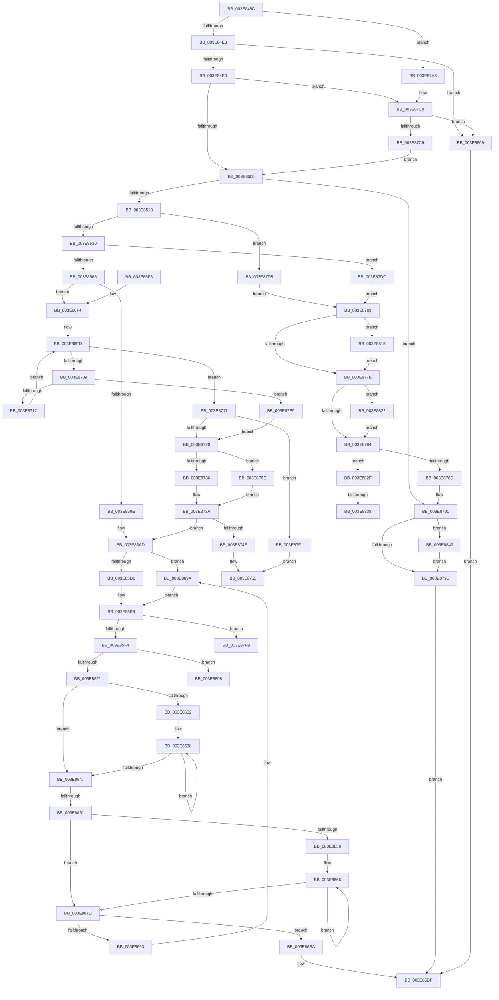

# HalpAllocateCommonBufferVectorInternal

- RVA: `0x003E848C`–`0x003E8873` (길이 `999` bytes)
- VA: `0x00000001403E848C`
- 실행 섹션: `.text`
- PDB 이름 있음: `예`; PDB Function 태그: `예`
- unwind 정보 RVA: `0x00095778`
- 디코드: `265`개 명령, `999/999` bytes 표시
- 미해석 바이트: `0` (있으면 어셈블리에 `.byte`로 보존)

> 이 문서는 커널 이미지의 기계어와 PDB 기호를 분석해 생성했습니다. 4번과 5번은 함수 원형과 자료형을 바이너리 사용 방식에서 추정한 C 해석이며 원본 소스 복구 결과는 아닙니다.

## 1. Dependencies

- 직접 호출 지점: **16**; 고유 호출 대상: **13**
- 직접 호출자로 확인된 함수: **1**
- RIP 상대 이미지 참조: **1**

### Outgoing calls
- `0x003E8509` → [HalpDmaReferenceDomainObject](HalpDmaReferenceDomainObject_function_003E9B08.md) (function, `0x003E9B08`)
- `0x003E851F` → [HalpMmAllocCtxAlloc](HalpMmAllocCtxAlloc_function_003E10B8.md) (function, `0x003E10B8`)
- `0x003E8538` → [memset](../6C/memset_function_006C6C40.md) (function, `0x006C6C40`)
- `0x003E8553` → [HalpMmAllocCtxAlloc](HalpMmAllocCtxAlloc_function_003E10B8.md) (function, `0x003E10B8`)
- `0x003E8570` → [memset](../6C/memset_function_006C6C40.md) (function, `0x006C6C40`)
- `0x003E85E3` → [MmAllocatePagesForMdlEx](MmAllocatePagesForMdlEx_function_003EA8C0.md) (function, `0x003EA8C0`)
- `0x003E860C` → [MmMapLockedPagesSpecifyCache](../31/MmMapLockedPagesSpecifyCache_function_00318800.md) (function, `0x00318800`)
- `0x003E8681` → [KeAcquireSpinLockRaiseToDpc](../20/KeAcquireSpinLockRaiseToDpc_function_00208470.md) (function, `0x00208470`)
- `0x003E86B0` → [MmAllocateNodePagesForMdlEx](MmAllocateNodePagesForMdlEx_function_003EA920.md) (function, `0x003EA920`)
- `0x003E86CE` → [KeReleaseSpinLock](../39/KeReleaseSpinLock_function_00392BA0.md) (function, `0x00392BA0`)
- `0x003E876D` → [HalpDmaDereferenceDomainObject](../3F/HalpDmaDereferenceDomainObject_function_003F69DC.md) (function, `0x003F69DC`)
- `0x003E87BA` → [KeBugCheckEx](../4F/KeBugCheckEx_function_004FD660.md) (function, `0x004FD660`)
- `0x003E8818` → [HalpMmAllocCtxFree](HalpMmAllocCtxFree_function_003E1904.md) (function, `0x003E1904`)
- `0x003E8825` → [HalpMmAllocCtxFree](HalpMmAllocCtxFree_function_003E1904.md) (function, `0x003E1904`)
- `0x003E883E` → [MmUnmapLockedPages](../24/MmUnmapLockedPages_function_00246E60.md) (function, `0x00246E60`)
- `0x003E885F` → [guard_dispatch_icall](../6B/guard_dispatch_icall_function_006BAAD0.md) (function, `0x006BAAD0`)

### Direct callers
- [HalAllocateCommonBufferVector](../55/HalAllocateCommonBufferVector_function_00550160.md) at `0x005501C7`
- [HalAllocateCommonBufferVector](../55/HalAllocateCommonBufferVector_function_00550160.md) at `0x00550210`

### Static image references
- `0x003E8849` → RVA `0x00FC1778` (`.data`; read)

## 2. Other-region calls and transfers

- 다른 실행 섹션으로 향하는 call: **0**
- call이 아닌 외부 분기/꼬리 이동: **6**
  - `0x003E864B` → [sub_006EAAF4](../6E/Unknown_function_006EAAF4.md) (`tail-transfer`)
  - `0x003E8759` → [sub_006EAAF4 + 0x4C](../6E/Unknown_function_006EAAF4.md) (`tail-transfer`)
  - `0x003E8803` → [sub_006EAAF4 + 0x48](../6E/Unknown_function_006EAAF4.md) (`tail-transfer`)
  - `0x003E8810` → [sub_006EAAF4 + 0x48](../6E/Unknown_function_006EAAF4.md) (`tail-transfer`)
  - `0x003E8832` → [sub_006EAAF4 + 0x55](../6E/Unknown_function_006EAAF4.md) (`tail-transfer`)
  - `0x003E8844` → [sub_006EAAF4 + 0x55](../6E/Unknown_function_006EAAF4.md) (`tail-transfer`)

## 3. Assembly (complete function range)

```asm
003E848C  48 8B C4                        mov rax, rsp
003E848F  44 89 48 20                     mov dword ptr [rax + 0x20], r9d
003E8493  4C 89 40 18                     mov qword ptr [rax + 0x18], r8
003E8497  48 89 50 10                     mov qword ptr [rax + 0x10], rdx
003E849B  48 89 48 08                     mov qword ptr [rax + 8], rcx
003E849F  55                              push rbp
003E84A0  53                              push rbx
003E84A1  56                              push rsi
003E84A2  57                              push rdi
003E84A3  41 54                           push r12
003E84A5  41 55                           push r13
003E84A7  41 56                           push r14
003E84A9  41 57                           push r15
003E84AB  48 8D 68 B9                     lea rbp, [rax - 0x47]
003E84AF  48 81 EC 98 00 00 00            sub rsp, 0x98
003E84B6  33 C0                           xor eax, eax
003E84B8  0F 57 C0                        xorps xmm0, xmm0
003E84BB  33 DB                           xor ebx, ebx
003E84BD  89 45 EF                        mov dword ptr [rbp - 0x11], eax
003E84C0  44 8B E3                        mov r12d, ebx
003E84C3  48 89 5D C7                     mov qword ptr [rbp - 0x39], rbx
003E84C7  44 8B EB                        mov r13d, ebx
003E84CA  44 8B F3                        mov r14d, ebx
003E84CD  44 8B FB                        mov r15d, ebx
003E84D0  0F 11 45 DF                     movups xmmword ptr [rbp - 0x21], xmm0
003E84D4  44 0F 20 C0                     mov rax, cr8
003E84D8  3C 02                           cmp al, 2
003E84DA  0F 87 C5 02 00 00               ja 0x1403e87a5
003E84E0  39 5D 77                        cmp dword ptr [rbp + 0x77], ebx
003E84E3  0F 85 80 03 00 00               jne 0x1403e8869
003E84E9  48 8B B1 00 02 00 00            mov rsi, qword ptr [rcx + 0x200]
003E84F0  48 89 75 BF                     mov qword ptr [rbp - 0x41], rsi
003E84F4  8B 46 30                        mov eax, dword ptr [rsi + 0x30]
003E84F7  89 45 AF                        mov dword ptr [rbp - 0x51], eax
003E84FA  38 9D 8F 00 00 00               cmp byte ptr [rbp + 0x8f], bl
003E8500  0F 84 BA 02 00 00               je 0x1403e87c0
003E8506  48 8B CE                        mov rcx, rsi
003E8509  E8 FA 15 00 00                  call 0x1403e9b08
003E850E  8B F8                           mov edi, eax
003E8510  85 C0                           test eax, eax
003E8512  0F 88 79 02 00 00               js 0x1403e8791
003E8518  BF 50 00 00 00                  mov edi, 0x50
003E851D  8B D7                           mov edx, edi
003E851F  E8 94 8B FF FF                  call 0x1403e10b8
003E8524  48 8B F0                        mov rsi, rax
003E8527  48 85 C0                        test rax, rax
003E852A  0F 84 A5 02 00 00               je 0x1403e87d5
003E8530  44 8B C7                        mov r8d, edi
003E8533  33 D2                           xor edx, edx
003E8535  48 8B C8                        mov rcx, rax
003E8538  E8 03 E7 2D 00                  call 0x1406c6c40
003E853D  44 8B 7D 7F                     mov r15d, dword ptr [rbp + 0x7f]
003E8541  48 8B 7D BF                     mov rdi, qword ptr [rbp - 0x41]
003E8545  45 8B E7                        mov r12d, r15d
003E8548  49 C1 E4 04                     shl r12, 4
003E854C  49 8B D4                        mov rdx, r12
003E854F  48 89 7E 20                     mov qword ptr [rsi + 0x20], rdi
003E8553  E8 60 8B FF FF                  call 0x1403e10b8
003E8558  48 89 45 B7                     mov qword ptr [rbp - 0x49], rax
003E855C  4C 8B F0                        mov r14, rax
003E855F  48 85 C0                        test rax, rax
003E8562  0F 84 74 02 00 00               je 0x1403e87dc
003E8568  4D 8B C4                        mov r8, r12
003E856B  33 D2                           xor edx, edx
003E856D  48 8B C8                        mov rcx, rax
003E8570  E8 CB E6 2D 00                  call 0x1406c6c40
003E8575  4C 89 76 40                     mov qword ptr [rsi + 0x40], r14
003E8579  41 BC 01 00 00 00               mov r12d, 1
003E857F  4C 8B B5 87 00 00 00            mov r14, qword ptr [rbp + 0x87]
003E8586  49 81 C6 FF 0F 00 00            add r14, 0xfff
003E858D  49 81 E6 00 F0 FF FF            and r14, 0xfffffffffffff000
003E8594  83 7D AF 03                     cmp dword ptr [rbp - 0x51], 3
003E8598  0F 85 56 01 00 00               jne 0x1403e86f4
003E859E  45 8D 4C 24 13                  lea r9d, [r12 + 0x13]
003E85A3  4C 8B C3                        mov r8, rbx
003E85A6  4C 8B D3                        mov r10, rbx
003E85A9  48 83 CA FF                     or rdx, 0xffffffffffffffff
003E85AD  8B 45 7F                        mov eax, dword ptr [rbp + 0x7f]
003E85B0  8B 4D 6F                        mov ecx, dword ptr [rbp + 0x6f]
003E85B3  89 46 18                        mov dword ptr [rsi + 0x18], eax
003E85B6  49 8B C7                        mov rax, r15
003E85B9  49 0F AF C6                     imul rax, r14
003E85BD  4C 89 76 10                     mov qword ptr [rsi + 0x10], r14
003E85C1  48 89 45 CF                     mov qword ptr [rbp - 0x31], rax
003E85C5  81 F9 00 00 00 80               cmp ecx, 0x80000000
003E85CB  0F 85 C9 00 00 00               jne 0x1403e869a
003E85D1  8B 4D 67                        mov ecx, dword ptr [rbp + 0x67]
003E85D4  44 89 4C 24 28                  mov dword ptr [rsp + 0x28], r9d
003E85D9  4C 8B C8                        mov r9, rax
003E85DC  89 4C 24 20                     mov dword ptr [rsp + 0x20], ecx
003E85E0  49 8B CA                        mov rcx, r10
003E85E3  E8 D8 22 00 00                  call 0x1403ea8c0
003E85E8  4C 8B E8                        mov r13, rax
003E85EB  48 85 C0                        test rax, rax
003E85EE  0F 84 07 02 00 00               je 0x1403e87fb
003E85F4  44 8B 45 67                     mov r8d, dword ptr [rbp + 0x67]
003E85F8  45 33 C9                        xor r9d, r9d
003E85FB  C7 44 24 28 10 00 00 40         mov dword ptr [rsp + 0x28], 0x40000010
003E8603  33 D2                           xor edx, edx
003E8605  48 8B C8                        mov rcx, rax
003E8608  89 5C 24 20                     mov dword ptr [rsp + 0x20], ebx
003E860C  E8 EF 01 F3 FF                  call 0x140318800
003E8611  48 89 45 D7                     mov qword ptr [rbp - 0x29], rax
003E8615  48 8B D0                        mov rdx, rax
003E8618  48 85 C0                        test rax, rax
003E861B  0F 84 E7 01 00 00               je 0x1403e8808
003E8621  48 89 46 30                     mov qword ptr [rsi + 0x30], rax
003E8625  48 8B 45 B7                     mov rax, qword ptr [rbp - 0x49]
003E8629  4C 89 6E 28                     mov qword ptr [rsi + 0x28], r13
003E862D  4D 85 FF                        test r15, r15
003E8630  74 15                           je 0x1403e8647
003E8632  48 8B C8                        mov rcx, rax
003E8635  4D 8B C7                        mov r8, r15
003E8638  48 89 11                        mov qword ptr [rcx], rdx
003E863B  49 03 D6                        add rdx, r14
003E863E  48 8D 49 10                     lea rcx, [rcx + 0x10]
003E8642  4D 2B C4                        sub r8, r12
003E8645  75 F1                           jne 0x1403e8638
003E8647  83 7D AF 03                     cmp dword ptr [rbp - 0x51], 3
003E864B  0F 84 A3 24 30 00               je 0x1406eaaf4
003E8651  4D 85 FF                        test r15, r15
003E8654  74 27                           je 0x1403e867d
003E8656  49 C1 EE 0C                     shr r14, 0xc
003E865A  48 8D 48 08                     lea rcx, [rax + 8]
003E865E  49 C1 E6 03                     shl r14, 3
003E8662  49 83 C5 30                     add r13, 0x30
003E8666  49 8B 45 00                     mov rax, qword ptr [r13]
003E866A  4D 03 EE                        add r13, r14
003E866D  48 C1 E0 0C                     shl rax, 0xc
003E8671  48 89 01                        mov qword ptr [rcx], rax
003E8674  48 8D 49 10                     lea rcx, [rcx + 0x10]
003E8678  4D 2B FC                        sub r15, r12
003E867B  75 E9                           jne 0x1403e8666
003E867D  48 8D 4F 68                     lea rcx, [rdi + 0x68]
003E8681  E8 EA FD E1 FF                  call 0x140208470
003E8686  48 8D 57 58                     lea rdx, [rdi + 0x58]
003E868A  4C 8B 02                        mov r8, qword ptr [rdx]
003E868D  49 39 50 08                     cmp qword ptr [r8 + 8], rdx
003E8691  74 27                           je 0x1403e86ba
003E8693  B9 03 00 00 00                  mov ecx, 3
003E8698  CD 29                           int 0x29
003E869A  44 89 4C 24 30                  mov dword ptr [rsp + 0x30], r9d
003E869F  4C 8B C8                        mov r9, rax
003E86A2  89 4C 24 28                     mov dword ptr [rsp + 0x28], ecx
003E86A6  8B 4D 67                        mov ecx, dword ptr [rbp + 0x67]
003E86A9  89 4C 24 20                     mov dword ptr [rsp + 0x20], ecx
003E86AD  49 8B CA                        mov rcx, r10
003E86B0  E8 6B 22 00 00                  call 0x1403ea920
003E86B5  E9 2E FF FF FF                  jmp 0x1403e85e8
003E86BA  48 89 56 08                     mov qword ptr [rsi + 8], rdx
003E86BE  48 8D 4F 68                     lea rcx, [rdi + 0x68]
003E86C2  4C 89 06                        mov qword ptr [rsi], r8
003E86C5  49 89 70 08                     mov qword ptr [r8 + 8], rsi
003E86C9  48 89 32                        mov qword ptr [rdx], rsi
003E86CC  8A D0                           mov dl, al
003E86CE  E8 CD A4 FA FF                  call 0x140392ba0
003E86D3  48 8B 85 97 00 00 00            mov rax, qword ptr [rbp + 0x97]
003E86DA  48 89 30                        mov qword ptr [rax], rsi
003E86DD  33 C0                           xor eax, eax
003E86DF  48 81 C4 98 00 00 00            add rsp, 0x98
003E86E6  41 5F                           pop r15
003E86E8  41 5E                           pop r14
003E86EA  41 5D                           pop r13
003E86EC  41 5C                           pop r12
003E86EE  5F                              pop rdi
003E86EF  5E                              pop rsi
003E86F0  5B                              pop rbx
003E86F1  5D                              pop rbp
003E86F2  C3                              ret
003E86F3  CC                              int3
003E86F4  41 B9 24 00 00 00               mov r9d, 0x24
003E86FA  48 8B CB                        mov rcx, rbx
003E86FD  49 8B C4                        mov rax, r12
003E8700  48 D3 E0                        shl rax, cl
003E8703  48 83 F9 40                     cmp rcx, 0x40
003E8707  73 0E                           jae 0x1403e8717
003E8709  49 3B C6                        cmp rax, r14
003E870C  0F 83 D7 00 00 00               jae 0x1403e87e9
003E8712  49 03 CC                        add rcx, r12
003E8715  EB E6                           jmp 0x1403e86fd
003E8717  49 3B C6                        cmp rax, r14
003E871A  0F 85 D1 00 00 00               jne 0x1403e87f1
003E8720  48 8B 4D 4F                     mov rcx, qword ptr [rbp + 0x4f]
003E8724  4D 8B C6                        mov r8, r14
003E8727  4C 8B 55 57                     mov r10, qword ptr [rbp + 0x57]
003E872B  8B 89 C0 01 00 00               mov ecx, dword ptr [rcx + 0x1c0]
003E8731  83 F9 40                        cmp ecx, 0x40
003E8734  72 28                           jb 0x1403e875e
003E8736  48 83 C8 FF                     or rax, 0xffffffffffffffff
003E873A  48 8B 55 5F                     mov rdx, qword ptr [rbp + 0x5f]
003E873E  48 3B D0                        cmp rdx, rax
003E8741  48 0F 43 D0                     cmovae rdx, rax
003E8745  4C 3B D2                        cmp r10, rdx
003E8748  0F 82 5F FE FF FF               jb 0x1403e85ad
003E874E  BF F0 00 00 C0                  mov edi, 0xc00000f0
003E8753  4C 8B FB                        mov r15, rbx
003E8756  4C 8B E3                        mov r12, rbx
003E8759  E9 E2 23 30 00                  jmp 0x1406eab40
003E875E  49 8B C4                        mov rax, r12
003E8761  48 D3 E0                        shl rax, cl
003E8764  49 2B C4                        sub rax, r12
003E8767  EB D1                           jmp 0x1403e873a
003E8769  48 8B 4D BF                     mov rcx, qword ptr [rbp - 0x41]
003E876D  E8 6A E2 00 00                  call 0x1403f69dc
003E8772  48 85 F6                        test rsi, rsi
003E8775  0F 85 9A 00 00 00               jne 0x1403e8815
003E877B  4D 85 F6                        test r14, r14
003E877E  0F 85 9E 00 00 00               jne 0x1403e8822
003E8784  4D 85 ED                        test r13, r13
003E8787  0F 85 A2 00 00 00               jne 0x1403e882f
003E878D  48 8B 75 BF                     mov rsi, qword ptr [rbp - 0x41]
003E8791  48 8B 55 C7                     mov rdx, qword ptr [rbp - 0x39]
003E8795  48 85 D2                        test rdx, rdx
003E8798  0F 85 AB 00 00 00               jne 0x1403e8849
003E879E  8B C7                           mov eax, edi
003E87A0  E9 3A FF FF FF                  jmp 0x1403e86df
003E87A5  45 33 C9                        xor r9d, r9d
003E87A8  44 0F B6 C0                     movzx r8d, al
003E87AC  B9 DC 01 00 00                  mov ecx, 0x1dc
003E87B1  48 89 5C 24 20                  mov qword ptr [rsp + 0x20], rbx
003E87B6  41 8D 51 01                     lea edx, [r9 + 1]
003E87BA  E8 A1 4E 11 00                  call 0x1404fd660
003E87BF  CC                              int3
003E87C0  83 F8 02                        cmp eax, 2
003E87C3  0F 85 A0 00 00 00               jne 0x1403e8869
003E87C9  C7 45 AF 03 00 00 00            mov dword ptr [rbp - 0x51], 3
003E87D0  E9 31 FD FF FF                  jmp 0x1403e8506
003E87D5  BF 9A 00 00 C0                  mov edi, 0xc000009a
003E87DA  EB 8D                           jmp 0x1403e8769
003E87DC  BF 9A 00 00 C0                  mov edi, 0xc000009a
003E87E1  4C 8B FB                        mov r15, rbx
003E87E4  4C 8B E3                        mov r12, rbx
003E87E7  EB 80                           jmp 0x1403e8769
003E87E9  4C 8B F0                        mov r14, rax
003E87EC  E9 2F FF FF FF                  jmp 0x1403e8720
003E87F1  BF F7 00 00 C0                  mov edi, 0xc00000f7
003E87F6  E9 58 FF FF FF                  jmp 0x1403e8753
003E87FB  BF 9A 00 00 C0                  mov edi, 0xc000009a
003E8800  4C 8B E3                        mov r12, rbx
003E8803  E9 34 23 30 00                  jmp 0x1406eab3c
003E8808  BF 9A 00 00 C0                  mov edi, 0xc000009a
003E880D  4C 8B E0                        mov r12, rax
003E8810  E9 27 23 30 00                  jmp 0x1406eab3c
003E8815  48 8B D6                        mov rdx, rsi
003E8818  E8 E7 90 FF FF                  call 0x1403e1904
003E881D  E9 59 FF FF FF                  jmp 0x1403e877b
003E8822  49 8B D6                        mov rdx, r14
003E8825  E8 DA 90 FF FF                  call 0x1403e1904
003E882A  E9 55 FF FF FF                  jmp 0x1403e8784
003E882F  4D 85 E4                        test r12, r12
003E8832  0F 84 11 23 30 00               je 0x1406eab49
003E8838  49 8B D5                        mov rdx, r13
003E883B  49 8B CC                        mov rcx, r12
003E883E  E8 1D E6 E5 FF                  call 0x140246e60
003E8843  90                              nop
003E8844  E9 00 23 30 00                  jmp 0x1406eab49
003E8849  48 8B 05 28 8F BD 00            mov rax, qword ptr [rip + 0xbd8f28]
003E8850  48 8B 4E 28                     mov rcx, qword ptr [rsi + 0x28]
003E8854  49 C1 EF 0C                     shr r15, 0xc
003E8858  4D 8B C7                        mov r8, r15
003E885B  48 8B 40 40                     mov rax, qword ptr [rax + 0x40]
003E885F  E8 6C 22 2D 00                  call 0x1406baad0
003E8864  E9 35 FF FF FF                  jmp 0x1403e879e
003E8869  B8 0D 00 00 C0                  mov eax, 0xc000000d
003E886E  E9 6C FE FF FF                  jmp 0x1403e86df
```

## 4. C-style interpretation (structured pseudocode)

```c
__int64 __fastcall HalpAllocateCommonBufferVectorInternal(__int64 a1, __int64 a2, __int64 a3, int a4)
{
    __int64 result;
    __int64 v_r12;
    __int64 v_r13;
    __int64 v_r14;
    __int64 v_r15;
    __int64 v_rbx;
    __int64 v_rsp;
    unsigned int v_stack_mA8;
    unsigned int v_stack_mB0;
    unsigned int v_stack_mB8;
    unsigned __int64 v_stack_p20;

    *(unsigned int *)(v_rsp + 32) = a4;
    *(unsigned __int64 *)(v_rsp + 24) = a3;
    *(unsigned __int64 *)(v_rsp + 16) = a2;
    *(unsigned __int64 *)(v_rsp + 8) = a1;
    v_rsp = (v_rsp) - (152);
    result = 0;
    v_rbx = 0;
    *(unsigned int *)(v_rsp - 71 - 17) = 0;
    *(unsigned __int64 *)(v_rsp - 71 - 57) = 0;
    *(unsigned __int64 *)(v_rsp - 71 - 33) = v_xmm0;
    if (((unsigned __int8)(v_cr8)) > 2) goto loc_003E87A5;
    if ((*(unsigned int *)(v_rsp - 71 + 119)) != 0) goto loc_003E8869;
    *(unsigned __int64 *)(v_rsp - 71 - 65) = *(unsigned __int64 *)(a1 + 512);
    *(unsigned int *)(v_rsp - 71 - 81) = (unsigned int)((unsigned int)(*(unsigned int *)(*(unsigned __int64 *)(a1 + 512) + 48)));
    if ((*(unsigned __int8 *)(v_rsp - 71 + 143)) == 0) goto loc_003E87C0;
loc_003E8506:
    result = HalpDmaReferenceDomainObject(*(unsigned __int64 *)(a1 + 512), a2, a3, a4);
    if (sign_flag) goto loc_003E8791;
    result = HalpMmAllocCtxAlloc(*(unsigned __int64 *)(a1 + 512), 80, a3, a4);
    if (result == 0) goto loc_003E87D5;
    a2 = 0;
    result = memset(result, a2, 80, a4);
    v_r12 = ((unsigned int)((unsigned int)((unsigned int)(*(unsigned int *)(v_rsp - 71 + 127))))) << (4);
    *(unsigned __int64 *)(result + 32) = *(unsigned __int64 *)(v_rsp - 71 - 65);
    result = HalpMmAllocCtxAlloc(result, v_r12, 80, a4);
    *(unsigned __int64 *)(v_rsp - 71 - 73) = result;
    if (result == 0) goto loc_003E87DC;
    a2 = 0;
    result = memset(result, a2, v_r12, a4);
    *(unsigned __int64 *)(result + 64) = result;
    v_r14 = (*(unsigned __int64 *)(v_rsp - 71 + 135)) + (0xFFFULL);
    v_r14 = (v_r14) & (0xFFFFFFFFFFFFF000ULL);
    if ((*(unsigned int *)(v_rsp - 71 - 81)) != 3) goto loc_003E86F4;
    a2 = (a2) | (-1);
loc_003E85AD:
    *(unsigned int *)(result + 24) = (unsigned int)((unsigned int)(*(unsigned int *)(v_rsp - 71 + 127)));
    result = ((unsigned int)(*(unsigned int *)(v_rsp - 71 + 127))) * (v_r14);
    *(unsigned __int64 *)(result + 16) = v_r14;
    *(unsigned __int64 *)(v_rsp - 71 - 49) = result;
    if (((unsigned int)((unsigned int)(*(unsigned int *)(v_rsp - 71 + 111)))) != 0x80000000ULL) goto loc_003E869A;
    v_stack_mB0 = (unsigned int)(1 + 19);
    v_stack_mB8 = (unsigned int)((unsigned int)(*(unsigned int *)(v_rsp - 71 + 103)));
    result = MmAllocatePagesForMdlEx(0, a2, 0, result);
loc_003E85E8:
    if (result == 0) goto loc_003E87FB;
    a4 = 0;
    v_stack_mB0 = 0x40000010ULL;
    a2 = 0;
    v_stack_mB8 = 0;
    result = MmMapLockedPagesSpecifyCache(result, a2, (unsigned int)(*(unsigned int *)(v_rsp - 71 + 103)), a4);
    *(unsigned __int64 *)(v_rsp - 71 - 41) = result;
    if (result == 0) goto loc_003E8808;
    *(unsigned __int64 *)(result + 48) = result;
    *(unsigned __int64 *)(result + 40) = result;
    if ((unsigned int)(*(unsigned int *)(v_rsp - 71 + 127)) == 0) goto loc_003E8647;
loc_003E8638:
    *(unsigned __int64 *)(*(unsigned __int64 *)(v_rsp - 71 - 73)) = result;
    a2 = (result) + (v_r14);
    a3 = ((unsigned int)(*(unsigned int *)(v_rsp - 71 + 127))) - (1);
    if (condition_is_not_equal) goto loc_003E8638;
loc_003E8647:
    if ((unsigned int)(*(unsigned int *)(v_rsp - 71 + 127)) == 0) goto loc_003E867D;
    v_r14 = (v_r14) >> (12);
    v_r14 = (v_r14) << (3);
    v_r13 = (result) + (48);
loc_003E8666:
    v_r13 = (v_r13) + (v_r14);
    result = (*(unsigned __int64 *)(v_r13)) << (12);
    *(unsigned __int64 *)(*(unsigned __int64 *)(v_rsp - 71 - 73) + 8) = result;
    v_r15 = ((unsigned int)(*(unsigned int *)(v_rsp - 71 + 127))) - (1);
    if (condition_is_not_equal) goto loc_003E8666;
loc_003E867D:
    result = KeAcquireSpinLockRaiseToDpc(*(unsigned __int64 *)(v_rsp - 71 - 65) + 104, a2, a3, a4);
    if ((*(unsigned __int64 *)(*(unsigned __int64 *)(*(unsigned __int64 *)(v_rsp - 71 - 65) + 88) + 8)) == (*(unsigned __int64 *)(v_rsp - 71 - 65) + 88)) goto loc_003E86BA;
loc_003E869A:
    v_stack_mA8 = 0;
    v_stack_mB0 = 3;
    v_stack_mB8 = (unsigned int)((unsigned int)(*(unsigned int *)(v_rsp - 71 + 103)));
    result = MmAllocateNodePagesForMdlEx(0, *(unsigned __int64 *)(v_rsp - 71 - 65) + 88, *(unsigned __int64 *)(*(unsigned __int64 *)(v_rsp - 71 - 65) + 88), result);
    goto loc_003E85E8;
loc_003E86BA:
    *(unsigned __int64 *)(result + 8) = *(unsigned __int64 *)(v_rsp - 71 - 65) + 88;
    *(unsigned __int64 *)(result) = *(unsigned __int64 *)(*(unsigned __int64 *)(v_rsp - 71 - 65) + 88);
    *(unsigned __int64 *)(*(unsigned __int64 *)(*(unsigned __int64 *)(v_rsp - 71 - 65) + 88) + 8) = result;
    *(unsigned __int64 *)(*(unsigned __int64 *)(v_rsp - 71 - 65) + 88) = result;
    result = KeReleaseSpinLock(*(unsigned __int64 *)(v_rsp - 71 - 65) + 104, (unsigned __int8)(result), *(unsigned __int64 *)(*(unsigned __int64 *)(v_rsp - 71 - 65) + 88), result);
    *(unsigned __int64 *)(*(unsigned __int64 *)(v_rsp - 71 + 151)) = result;
    result = 0;
loc_003E86DF:
    v_rsp = (v_rsp) + (152);
    return result;
loc_003E86F4:
loc_003E86FD:
    result = (1) << (0);
    if (0 >= 64) goto loc_003E8717;
    if (result >= v_r14) goto loc_003E87E9;
    a1 = (0) + (1);
    goto loc_003E86FD;
loc_003E8717:
    if (result != v_r14) goto loc_003E87F1;
loc_003E8720:
    if (((unsigned int)((unsigned int)(*(unsigned int *)(*(unsigned __int64 *)(v_rsp - 71 + 79) + 448)))) < 64) goto loc_003E875E;
    result = (result) | (-1);
loc_003E873A:
    a2 = *(unsigned __int64 *)(v_rsp - 71 + 95);
    if ((*(unsigned __int64 *)(v_rsp - 71 + 95)) >= result) { a2 = result; }
    if ((*(unsigned __int64 *)(v_rsp - 71 + 87)) < a2) goto loc_003E85AD;
loc_003E8753:
loc_003E875E:
    result = (0) << ((unsigned __int8)((unsigned int)(*(unsigned int *)(*(unsigned __int64 *)(v_rsp - 71 + 79) + 448))));
    result = (result) - (0);
    goto loc_003E873A;
loc_003E8769:
    result = HalpDmaDereferenceDomainObject(*(unsigned __int64 *)(v_rsp - 71 - 65), a2, v_r14, 36);
    if (result != 0) goto loc_003E8815;
loc_003E877B:
    if (v_r14 != 0) goto loc_003E8822;
loc_003E8784:
    if (v_r13 != 0) goto loc_003E882F;
loc_003E8791:
    if (*(unsigned __int64 *)(v_rsp - 71 - 57) != 0) goto loc_003E8849;
loc_003E879E:
    goto loc_003E86DF;
loc_003E87A5:
    a4 = 0;
    v_stack_p20 = 0;
    result = KeBugCheckEx(476, a4 + 1, (unsigned __int8)((unsigned int)((unsigned int)((unsigned int)(0xC00000F0ULL)))), a4);
loc_003E87C0:
    if (((unsigned int)(result)) != 2) goto loc_003E8869;
    *(unsigned int *)(v_rsp - 71 - 81) = 3;
    goto loc_003E8506;
loc_003E87D5:
    goto loc_003E8769;
loc_003E87DC:
    goto loc_003E8769;
loc_003E87E9:
    goto loc_003E8720;
loc_003E87F1:
    goto loc_003E8753;
loc_003E87FB:
loc_003E8808:
loc_003E8815:
    result = HalpMmAllocCtxFree(476, *(unsigned __int64 *)(v_rsp - 71 - 65), (unsigned __int8)((unsigned int)((unsigned int)((unsigned int)(0xC00000F0ULL)))), a4);
    goto loc_003E877B;
loc_003E8822:
    result = HalpMmAllocCtxFree(476, result, (unsigned __int8)((unsigned int)((unsigned int)((unsigned int)(0xC00000F0ULL)))), a4);
    goto loc_003E8784;
loc_003E882F:
    result = MmUnmapLockedPages(result, v_r13, (unsigned __int8)((unsigned int)((unsigned int)((unsigned int)(0xC00000F0ULL)))), a4);
loc_003E8849:
    v_r15 = (0) >> (12);
    result = guard_dispatch_icall(*(unsigned __int64 *)(*(unsigned __int64 *)(v_rsp - 71 - 65) + 40), v_r13, v_r15, a4);
    goto loc_003E879E;
loc_003E8869:
    goto loc_003E86DF;
}
```

## 5. (Beta) C Style

```c
int64_t HalpAllocateCommonBufferVectorInternal(void *Arg1, int64_t Arg2, int64_t Arg3, int32_t Arg4)
{
    uint8_t *arg1 = (uint8_t *)Arg1;

    int64_t result;
    int64_t local_r12;
    int64_t local_r13;
    int64_t local_r14;
    int64_t local_r15;
    int64_t local_rbx;
    int64_t local_rsp;
    uint32_t v_stack_mA8;
    uint32_t v_stack_mB0;
    uint32_t v_stack_mB8;
    uint64_t v_stack_p20;

    *(uint32_t *)(local_rsp + 0x20) = Arg4;
    *(uint64_t *)(local_rsp + 0x18) = Arg3;
    *(uint64_t *)(local_rsp + 0x10) = Arg2;
    *(void **)(local_rsp + 0x8) = Arg1;
    local_rsp = (local_rsp) - (152);
    result = 0;
    local_rbx = 0;
    *(uint32_t *)(local_rsp - 0x47 - 0x11) = 0;
    *(uint64_t *)(local_rsp - 0x47 - 0x39) = 0;
    *(uint64_t *)(local_rsp - 0x47 - 0x21) = v_xmm0;
    if (((uint8_t)(v_cr8)) > 2) goto loc_003E87A5;
    if ((*(uint32_t *)(local_rsp - 0x47 + 0x77)) != 0) goto loc_003E8869;
    *(uint64_t *)(local_rsp - 0x47 - 0x41) = *(uint64_t *)(arg1 + 0x200);
    *(uint32_t *)(local_rsp - 0x47 - 0x51) = (uint32_t)((uint32_t)(*(uint32_t *)(*(uint64_t *)(arg1 + 0x200) + 0x30)));
    if ((*(uint8_t *)(local_rsp - 0x47 + 0x8F)) == 0) goto loc_003E87C0;
loc_003E8506:
    result = HalpDmaReferenceDomainObject(*(uint64_t *)(arg1 + 0x200), Arg2, Arg3, Arg4);
    if (sign_flag) goto loc_003E8791;
    result = HalpMmAllocCtxAlloc(*(uint64_t *)(arg1 + 0x200), 80, Arg3, Arg4);
    if (result == 0) goto loc_003E87D5;
    Arg2 = 0;
    result = memset(result, Arg2, 80, Arg4);
    local_r12 = ((uint32_t)((uint32_t)((uint32_t)(*(uint32_t *)(local_rsp - 0x47 + 0x7F))))) << (4);
    *(uint64_t *)(result + 0x20) = *(uint64_t *)(local_rsp - 0x47 - 0x41);
    result = HalpMmAllocCtxAlloc(result, local_r12, 80, Arg4);
    *(uint64_t *)(local_rsp - 0x47 - 0x49) = result;
    if (result == 0) goto loc_003E87DC;
    Arg2 = 0;
    result = memset(result, Arg2, local_r12, Arg4);
    *(uint64_t *)(result + 0x40) = result;
    local_r14 = (*(uint64_t *)(local_rsp - 0x47 + 0x87)) + (0xFFFULL);
    local_r14 = (local_r14) & (0xFFFFFFFFFFFFF000ULL);
    if ((*(uint32_t *)(local_rsp - 0x47 - 0x51)) != 3) goto loc_003E86F4;
    Arg2 = (Arg2) | (-1);
loc_003E85AD:
    *(uint32_t *)(result + 0x18) = (uint32_t)((uint32_t)(*(uint32_t *)(local_rsp - 0x47 + 0x7F)));
    result = ((uint32_t)(*(uint32_t *)(local_rsp - 0x47 + 0x7F))) * (local_r14);
    *(uint64_t *)(result + 0x10) = local_r14;
    *(uint64_t *)(local_rsp - 0x47 - 0x31) = result;
    if (((uint32_t)((uint32_t)(*(uint32_t *)(local_rsp - 0x47 + 0x6F)))) != 0x80000000ULL) goto loc_003E869A;
    v_stack_mB0 = (uint32_t)(1 + 19);
    v_stack_mB8 = (uint32_t)((uint32_t)(*(uint32_t *)(local_rsp - 0x47 + 0x67)));
    result = MmAllocatePagesForMdlEx(0, Arg2, 0, result);
loc_003E85E8:
    if (result == 0) goto loc_003E87FB;
    Arg4 = 0;
    v_stack_mB0 = 0x40000010ULL;
    Arg2 = 0;
    v_stack_mB8 = 0;
    result = MmMapLockedPagesSpecifyCache(result, Arg2, (uint32_t)(*(uint32_t *)(local_rsp - 0x47 + 0x67)), Arg4);
    *(uint64_t *)(local_rsp - 0x47 - 0x29) = result;
    if (result == 0) goto loc_003E8808;
    *(uint64_t *)(result + 0x30) = result;
    *(uint64_t *)(result + 0x28) = result;
    if ((uint32_t)(*(uint32_t *)(local_rsp - 0x47 + 0x7F)) == 0) goto loc_003E8647;
loc_003E8638:
    *(uint64_t *)(*(uint64_t *)(local_rsp - 0x47 - 0x49)) = result;
    Arg2 = (result) + (local_r14);
    Arg3 = ((uint32_t)(*(uint32_t *)(local_rsp - 0x47 + 0x7F))) - (1);
    if (condition_is_not_equal) goto loc_003E8638;
loc_003E8647:
    if ((uint32_t)(*(uint32_t *)(local_rsp - 0x47 + 0x7F)) == 0) goto loc_003E867D;
    local_r14 = (local_r14) >> (12);
    local_r14 = (local_r14) << (3);
    local_r13 = (result) + (48);
loc_003E8666:
    local_r13 = (local_r13) + (local_r14);
    result = (*(uint64_t *)(local_r13)) << (12);
    *(uint64_t *)(*(uint64_t *)(local_rsp - 0x47 - 0x49) + 0x8) = result;
    local_r15 = ((uint32_t)(*(uint32_t *)(local_rsp - 0x47 + 0x7F))) - (1);
    if (condition_is_not_equal) goto loc_003E8666;
loc_003E867D:
    result = KeAcquireSpinLockRaiseToDpc(*(uint64_t *)(local_rsp - 0x47 - 0x41) + 104, Arg2, Arg3, Arg4);
    if ((*(uint64_t *)(*(uint64_t *)(*(uint64_t *)(local_rsp - 0x47 - 0x41) + 0x58) + 0x8)) == (*(uint64_t *)(local_rsp - 0x47 - 0x41) + 88)) goto loc_003E86BA;
loc_003E869A:
    v_stack_mA8 = 0;
    v_stack_mB0 = 3;
    v_stack_mB8 = (uint32_t)((uint32_t)(*(uint32_t *)(local_rsp - 0x47 + 0x67)));
    result = MmAllocateNodePagesForMdlEx(0, *(uint64_t *)(local_rsp - 0x47 - 0x41) + 88, *(uint64_t *)(*(uint64_t *)(local_rsp - 0x47 - 0x41) + 0x58), result);
    goto loc_003E85E8;
loc_003E86BA:
    *(uint64_t *)(result + 0x8) = *(uint64_t *)(local_rsp - 0x47 - 0x41) + 88;
    *(uint64_t *)(result) = *(uint64_t *)(*(uint64_t *)(local_rsp - 0x47 - 0x41) + 0x58);
    *(uint64_t *)(*(uint64_t *)(*(uint64_t *)(local_rsp - 0x47 - 0x41) + 0x58) + 0x8) = result;
    *(uint64_t *)(*(uint64_t *)(local_rsp - 0x47 - 0x41) + 0x58) = result;
    result = KeReleaseSpinLock(*(uint64_t *)(local_rsp - 0x47 - 0x41) + 104, (uint8_t)(result), *(uint64_t *)(*(uint64_t *)(local_rsp - 0x47 - 0x41) + 0x58), result);
    *(uint64_t *)(*(uint64_t *)(local_rsp - 0x47 + 0x97)) = result;
    result = 0;
loc_003E86DF:
    local_rsp = (local_rsp) + (152);
    return result;
loc_003E86F4:
loc_003E86FD:
    result = (1) << (0);
    if (0 >= 64) goto loc_003E8717;
    if (result >= local_r14) goto loc_003E87E9;
    Arg1 = (0) + (1);
    goto loc_003E86FD;
loc_003E8717:
    if (result != local_r14) goto loc_003E87F1;
loc_003E8720:
    if (((uint32_t)((uint32_t)(*(uint32_t *)(*(uint64_t *)(local_rsp - 0x47 + 0x4F) + 0x1C0)))) < 64) goto loc_003E875E;
    result = (result) | (-1);
loc_003E873A:
    Arg2 = *(uint64_t *)(local_rsp - 0x47 + 0x5F);
    if ((*(uint64_t *)(local_rsp - 0x47 + 0x5F)) >= result) { Arg2 = result; }
    if ((*(uint64_t *)(local_rsp - 0x47 + 0x57)) < Arg2) goto loc_003E85AD;
loc_003E8753:
loc_003E875E:
    result = (0) << ((uint8_t)((uint32_t)(*(uint32_t *)(*(uint64_t *)(local_rsp - 0x47 + 0x4F) + 0x1C0))));
    result = (result) - (0);
    goto loc_003E873A;
loc_003E8769:
    result = HalpDmaDereferenceDomainObject(*(uint64_t *)(local_rsp - 0x47 - 0x41), Arg2, local_r14, 36);
    if (result != 0) goto loc_003E8815;
loc_003E877B:
    if (local_r14 != 0) goto loc_003E8822;
loc_003E8784:
    if (local_r13 != 0) goto loc_003E882F;
loc_003E8791:
    if (*(uint64_t *)(local_rsp - 0x47 - 0x39) != 0) goto loc_003E8849;
loc_003E879E:
    goto loc_003E86DF;
loc_003E87A5:
    Arg4 = 0;
    v_stack_p20 = 0;
    result = KeBugCheckEx(476, Arg4 + 1, (uint8_t)((uint32_t)((uint32_t)((uint32_t)(0xC00000F0ULL)))), Arg4);
loc_003E87C0:
    if (((uint32_t)(result)) != 2) goto loc_003E8869;
    *(uint32_t *)(local_rsp - 0x47 - 0x51) = 3;
    goto loc_003E8506;
loc_003E87D5:
    goto loc_003E8769;
loc_003E87DC:
    goto loc_003E8769;
loc_003E87E9:
    goto loc_003E8720;
loc_003E87F1:
    goto loc_003E8753;
loc_003E87FB:
loc_003E8808:
loc_003E8815:
    result = HalpMmAllocCtxFree(476, *(uint64_t *)(local_rsp - 0x47 - 0x41), (uint8_t)((uint32_t)((uint32_t)((uint32_t)(0xC00000F0ULL)))), Arg4);
    goto loc_003E877B;
loc_003E8822:
    result = HalpMmAllocCtxFree(476, result, (uint8_t)((uint32_t)((uint32_t)((uint32_t)(0xC00000F0ULL)))), Arg4);
    goto loc_003E8784;
loc_003E882F:
    result = MmUnmapLockedPages(result, local_r13, (uint8_t)((uint32_t)((uint32_t)((uint32_t)(0xC00000F0ULL)))), Arg4);
loc_003E8849:
    local_r15 = (0) >> (12);
    result = guard_dispatch_icall(*(uint64_t *)(*(uint64_t *)(local_rsp - 0x47 - 0x41) + 0x28), local_r13, local_r15, Arg4);
    goto loc_003E879E;
loc_003E8869:
    goto loc_003E86DF;
}
```

### 관측된 메모리 오프셋

구조체 형식이 확인되지 않은 접근은 인자 기준의 오프셋으로만 기록했습니다.

| 기준 인자 | 오프셋 표현 | 폭 (bit) | 접근 |
|---|---:|---:|---|
| `Arg1` | `+ 0x200` | `64` | `R` |

## 6. Execution-region graph

[열기: 2D/3D 그래프와 함수 탐색 컨트롤 패널](../../../control-panel.html?section=text&rva=0x003E848C&view=graph)

- 2D 그래프는 위에서 아래로 흐르고, 3D 그래프는 빈 공간을 드래그해 회전합니다. Shift+드래그는 이동, 휠은 확대·축소, 함수 노드 선택은 대상 보고서 이동입니다.

### Static fallback


